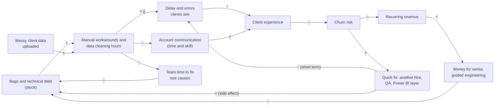
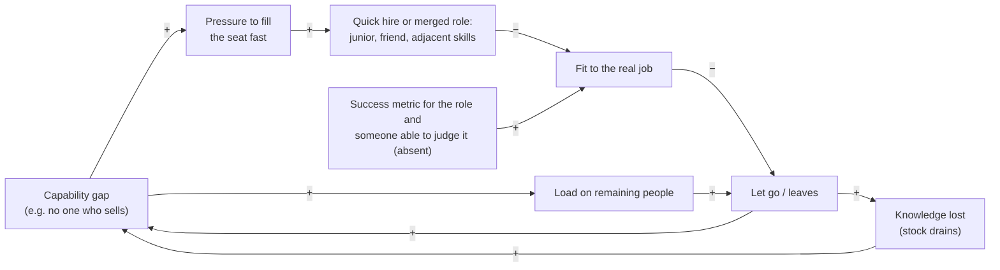
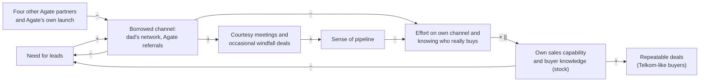
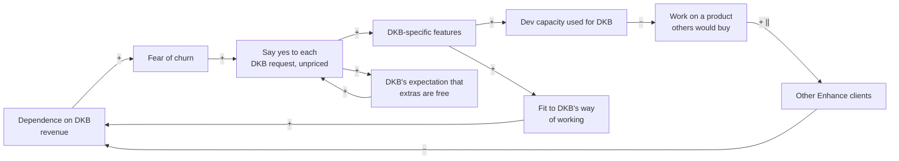
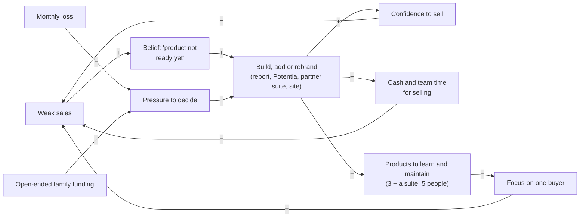
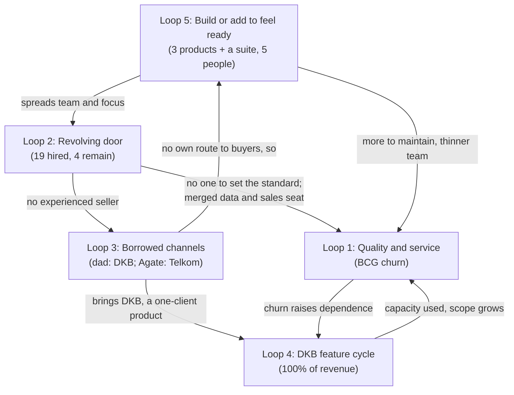

# Step 1: Systems Thinking: why things kept happening

As of 2026-10-28. **Revised 2026-10-28 with the founder's answers** to the Steps 1–5 questions (`inputs/deus-fact-sheet.md`, sections "Corrections to the recap and earlier steps" and "Founder answers"). The answers are the founder's account, not buyers' words: the Step 6c interviews have not run, so this report stays provisional. Sources: `inputs/DEUS_Company_History_Recap.pdf` (cited as "Recap, Phase N"), `inputs/deus-fact-sheet.md` (cited as "Fact sheet"; "Founder answers" = its last section), `inputs/DEUS_Pitch.pdf`, `inputs/Agate_Next_Chapter_GBA_deck.pdf`. Method: causal loop diagrams, stocks and flows, system archetypes and Meadows' leverage points (`systems-thinking` skill).

## The answer in one paragraph

DEUS's problems were not eleven phases of separate bad luck. Five feedback loops produced them, and four are still running. Each time a problem appeared, the company applied a fix that relieved the pressure (another hire, a Power BI layer, another wave of the dad's network, another product or game suite, another free feature for DKB) instead of the harder fix underneath (an engineering and service standard, a sales role with a seller in it, its own route to a repeatable buyer type, a product scope not set by one client). The pattern is "shifting the burden": the quick fixes worked well enough to remove the urgency of the real fix. The founder's answers sharpen one point: **both repeat buyers came through someone else's channel** (DKB through the dad, Telkom's Assessment Center through Agate; how BCG first reached DEUS is NO DATA), and DEUS's own outreach has not closed a deal yet. The single highest-leverage change is still one rule: **nothing new gets built, added or rebranded until a named buyer type has paid for what already exists, more than once.** Telkom's Assessment Center is the only evidence of what that buyer looks like, and Agate is the only evidence of how to reach one.

## What this revision changed

| Point | First pass said | Now (founder answers) | Effect on the loops |
|---|---|---|---|
| Phase 11 games | DEUS "acquired more games from Agate"; cost NO DATA | Not bought. DEUS is one of **five** sales partners for Agate's Next Chapter; no purchase cost (Fact sheet, Correction 1) | Loop 5 cost no cash this time, but the pattern (add product to feel ready) held. A new risk: four other partners sell the same suite |
| Telkom | A buyer "looking for gamification vendors"; lead source unknown | Telkom's **Assessment Center** asked Agate; Agate brought DEUS in. Stopped after two years because Telkom's MT intake strategy changed; Telkom could not refer DEUS to similar groups (Fact sheet, Corrections 2–3) | Loop 3: the second borrowed channel. The Telkom profile is still the best buyer evidence, but DEUS has never reached such a buyer on its own |
| BCG churn | Data problems and bugs; BCG's own words NO DATA | Bugs, DEUS "weren't able to deliver", and poor communication once Wulan held the account; BCG won't come back (Correction 4) | Loop 1 confirmed, with a service link added |
| DKB features | Whether DKB still adds features NO DATA | DKB still adds features (own KPI groupings, a year-end summary), pays no extra, and has never accepted a written scope with a price per change. DKB is "quite satisfied"; Power BI is no longer used (Fact sheet, DKB row) | Loop 4 confirmed and still running; the "price each change" lever is known to be resisted |
| Funding | How the monthly gap is covered NO DATA | The dad is the main funder and shareholder and says he will keep supporting; no written limit. The founder has the final say (Correction 5) | Loop 5: open-ended support is a buffer that hides the cash signal |
| Team exits | Reasons NO DATA | Five reasons given; no success metrics were set for four of the hires; Ko Will is the key person for Enhance (Fact sheet, Team) | Loop 2 confirmed for role design; not every exit belongs to the loop |

## How to read the diagrams

- An arrow marked **+** means "more of A leads to more of B". An arrow marked **−** means "more of A leads to less of B".
- **R** = reinforcing loop (it snowballs, good or bad). **B** = balancing loop (it pulls back toward a level).
- **||** on an arrow marks a long delay.
- Each loop separates facts (with citations), interpretation (why it happened) and what would have broken it.

---

## Loop 1: Quality and service → client experience → churn

### Facts

- Discover's first client, Boga Group, met "many bugs", a long process and simple reports, and "did not seem fully satisfied" (Recap, Phase 2).
- Enhance's first developer, Ghifari, "worked with no guidance" because "we did not know how to develop systems at all"; his version was "very unprofessional and still very buggy" (Recap, Phase 3).
- Enhance took "a very long time" with "many changes" and "many bugs"; DEUS hired Yuli as QA "because there were so many bugs" (Recap, Phase 4).
- Enhance "continued to have many bugs"; "messy client data that had to be uploaded" caused problems; Sahid (hired for psychometrics) did data work "until he was overloaded"; Fitri was added for data and stayed three months (Recap, Phases 6, 7).
- Wulan "was not able to handle data well, so cleaning data took a long time, and Enhance remained buggy. BCG ... churned" (Recap, Phase 8). BCG paid Rp40 juta per month, about Rp480 juta in total, more per month than DKB's Rp35 juta (Fact sheet).
- **The founder's account of why BCG left:** a lot of bugs, DEUS "weren't able to deliver", and BCG felt abandoned on communication once Wulan handled the account. BCG does not want to come back. Wulan left for poor performance, "one of the reasons BCG failed" (Fact sheet, Correction 4; Founder answers).
- Fearing DKB would churn too, DEUS put Power BI on top of Enhance "as a temporary solution" (Recap, Phase 9). Power BI is no longer in use (Founder answers).
- Ko Will's rebuilt Enhance "was much better, even under a clear audit" (Recap, Phase 10). DKB, with about 300–400 users, is now "quite satisfied" (Founder answers).

### Causal loop diagram

- **R1 (quality death spiral):** bugs → workarounds → slow, error-prone delivery → worse client experience → churn → less revenue → less money for guided engineering → more bugs.
- **R1b (no time to fix):** workarounds eat the time that would remove the bugs, so the bug stock grows on its own.
- **Service link (new in this revision):** the same overloaded person who cleaned data also held the client relationship (Wulan, "sales and data", Recap, Phase 7). When the data work swamped her, communication with BCG dropped, and the founder names that as a cause of the churn (Founder answers).
- **B1 (the quick fix):** churn risk → a patch (Yuli for QA, Fitri and Wulan for data, Power BI for display) → visible problems ease for a while. The patch also adds a layer to maintain, which is the side effect.

### Stocks and flows

| Stock | Inflow | Outflow | Delay |
|---|---|---|---|
| Bugs and technical debt in Enhance | Features built with no engineering guidance (Recap, Phase 3); changes requested mid-build (Recap, Phase 4) | Fixing, and in the end a full rebuild (Recap, Phase 10) | Three to four years before a clean version existed (Recap, Phase 10) |
| Uncleaned client data | Each client upload of "messy" data (Recap, Phase 6) | Data person's hours | No intake standard is recorded, so the inflow never shrank |
| Client goodwill | Working, on-time results; being kept informed | Each bug, delay, wrong report or unanswered message | Churn shows only when goodwill runs out (BCG, Recap, Phase 8; Founder answers) |

### Archetype: Shifting the burden (with a Fixes that fail side effect)

The fundamental fix was a way of building software (a senior technical lead, specification before build, testing), a standard for how client data comes in, and an account owner whose time is protected from data work. The symptomatic fix was to add a person or a layer each time a symptom hurt: QA for bugs (Phase 4), a data person for data (Phases 6, 7), Power BI for display (Phase 9). Each fix helped for a while, so the fundamental fix kept being postponed until the dad asked for a full rebuild (Phase 10).

**Interpretation:** the root cause was not the individual hires; it was that nobody at DEUS could set or check engineering quality in Phases 3–9 ("we did not know how to develop systems at all", Phase 3). BCG's churn reason, as the founder tells it, is a quality-and-service failure, not a lack of need (Correction 4). That matters: it means BCG is evidence that a group like BCG would pay for Enhance at Rp40 juta a month, and evidence that DEUS lost it on delivery. ASSUMPTION: the rebuild succeeded partly because Ko Will brought the standard himself, not because the company had learned to set one.

### Leverage points (Meadows level in brackets)

1. **[Rules, level 5] Data intake rule:** no client data enters the system unless it meets a written template, and cleaning is quoted and paid for as a service. This shuts the inflow of the data stock instead of adding people to drain it.
2. **[Rules, level 5] One account owner per client whose job is not data cleaning,** with a set rhythm of contact (for example a weekly update). BCG left partly over silence (Founder answers).
3. **[Information flows, level 6] Make quality visible:** a weekly count of open bugs and data-cleaning hours per client, seen by the founder. In Phases 3–8 the first hard signal of quality was BCG leaving.
4. **[Self-organization, level 4] Hire or rent the judgement first:** before any technical hire, one senior person (an advisor is enough) who can set the standard and review the work.

### Still active today?

**Weakened, not gone.** The bug stock was largely cleared by Ko Will's rebuild (Recap, Phase 10), Power BI is gone and DKB is satisfied (Founder answers). But: (a) no data person is on today's team of five (Recap, Phase 11), so the next client with messy data reopens the loop; (b) all engineering sits with Ko Will, and the founder says that if he left, keeping Enhance running would be "very hard" (Founder answers), so the knowledge stock has one holder; (c) the service link has no owner either: who would look after a second Enhance client is NO DATA.

---

## Loop 2: Hiring, turnover and the role that was never filled

### Facts

- 19 people besides the founder have worked at DEUS; 4 remain (Recap, Reference: people). 15 have left (derived).
- **Sales and account roles** were held by seven people: Rosi (junior, "without strong product knowledge"), Bu Vera ("without a sales background", hired as account manager), Fizka (business development, "overlapped with Bu Vera"), Bu Retno (account manager), Audrey (marketing and sales), Wulan (sales and data), Yessica ("not strong in sales and struggled to bring in new clients") (Recap, Phases 1, 3, 4, 7, 8). Only Audrey remains; she runs the F&B outreach today (Founder answers). No hire is recorded as an experienced B2B seller.
- **Data and psychometrics** were held by five people in a chain: Sahid → Fitri (three months) → Wulan → Rizkie ("did not have a good work ethic") → Bu Sovie (Recap, Phases 1, 6, 7, 8, 9).
- **Engineering** passed through Ghifari → Andar (+ Kayyis, a friend of Andar's) → Ko Will and David; Ghifari, Andar and Kayyis were let go or not extended (Recap, Phases 3, 4, 8, 9, 10).
- **Why some left (founder's account):** Bu Vera resigned; Fizka left because his father had health problems; Bu Retno was replaced by Yess; Fitri left because DEUS wanted one person to do both data and sales; Wulan for poor performance (Founder answers).
- **No success metrics** were set for Bu Vera, Fizka, Bu Retno or Yess (Founder answers).
- DEUS rarely uses Discover or Enhance on its own candidates or team (Founder answers).
- Average tenure of departed staff: NO DATA (Fact sheet).

### Causal loop diagram

- **R2 (revolving door):** gap → fast hire, or two jobs merged into one seat → poor fit → exit → knowledge loss → the gap reopens, often bigger.
- **R2b (overload):** each exit loads the people who remain (Sahid "overloaded", Phase 6), which raises the chance they leave too.
- The variable missing from the history is **SPEC**: a written definition of what success in the role is, and someone able to judge it. The founder confirms it was absent for four hires (Founder answers).

### Stocks and flows

| Stock | Inflow | Outflow | Delay |
|---|---|---|---|
| Team know-how (product, client, code, data) | Hires × time to learn | 15 departures (derived) | Every new hire restarts the learning curve; tenure NO DATA |
| Headcount | 19 hires over 11 phases | 15 exits | Five exits in one phase (Phase 10) |

### Archetype: Fixes that fail (sales seat) and Shifting the burden (data and tech seats)

- **Sales seat, Fixes that fail.** The problem was that DEUS could not sell ("Apart from Telkom, we struggled very hard to sell anything", Recap, Phase 7). The fix each time was to hire for the seat, but the person hired was an account manager or a junior, not a seller (Bu Vera, Bu Retno, Yessica; Rosi). The same gap reappeared after each one.
- **Data and tech seats, Shifting the burden.** Each replacement fixed the symptom (an empty chair) while the fundamental fix (a role defined by someone who understands the work, and a way to check it) was never built.

**Interpretation, stated plainly:** the founder's reasons let us separate the loop from bad luck. **Not the loop:** Fizka (family health) and Bu Vera (resigned; her reason is not given). **The loop:** Fitri left because two jobs were merged into one seat (a role design decision); Wulan held that merged seat, failed at it, and the founder links her to the BCG loss; Bu Retno was replaced rather than given a target to hit; and none of the four named hires had a success metric to be judged against (Founder answers). So the evidence still points more to **role design and management** than to hiring luck. One small, telling fact: an assessment company that rarely assesses its own candidates (Founder answers) skipped the cheapest check it had on its own hires. Step 6a (McKinsey 7S) tests this further.

### Leverage points

1. **[Goal and rules, levels 3/5] Define the job before the hire:** a one-page role card with the outcome expected at 90 days (for example "3 paid pilots from new logos"), the person who will judge it, and what happens if it is missed. This would have stopped the account-manager-for-sales pattern and the merged data-and-sales seat.
2. **[Information flows, level 6] A 90-day check in writing** for every hire, so a poor fit is seen in months, not phases.
3. **[Buffers, level 11] Document what each person knows,** starting with Ko Will (code, deployment, the Enhance server, DKB's custom rules), so an exit doesn't drain the stock to zero.
4. **[Information flows, level 6] Use Discover on DEUS's own candidates.** It costs nothing and tests the product on a buyer DEUS controls.

### Still active today?

**Yes, as a risk.** The team is five, each in a single seat: founder, Ko Will (tech), Thania (product), Audrey (marketing and sales), Bu Sovie (psychometrics) (Recap, Phase 11). Every seat is a single point of failure, and Ko Will's is the one the founder names (Founder answers). Selling today is Audrey (F&B outreach) and the founder (current focus: mainly selling Discover) (Founder answers); neither is recorded as an experienced B2B seller. How much of the founder's week goes to selling is NO DATA.

---

## Loop 3: Borrowed channels (the dad's network, then Agate)

### Facts

- "All through my dad's connections"; "most leads he brought were retail companies and his friends"; "we converted almost none of them" (Recap, Phase 5). The dad, Christian Kurnia, was a long-time director at Matahari Department Store (Recap, Phase 5).
- The network produced DKB (Recap, Phase 3) and "about 100" meetings in total, with "almost no others" converting (Fact sheet, founder's estimate). That is roughly one deal per hundred meetings (derived, rough). Offered Enhance at Rp30 juta a month, the dad's connections "almost all" say they have no budget or will hold until later (Founder answers).
- Further waves of the network failed for Potentia, Discover and Enhance (Recap, Phase 9), and again in Phase 11: "nothing; no assessment sales and no Enhance sales" (Recap, Phase 11).
- Recognition (Startup Studio Indonesia, InnovFest Singapore) and partner MoMs produced no sales (Recap, Phases 2, 5).
- **Telkom came through Agate.** Telkom's Assessment Center, the unit that tests all Telkom recruits, contacted Agate for a gamified assessment, and Agate brought DEUS in (Fact sheet, Correction 2). The recap's "specifically looking for gamification vendors" (Recap, Phase 7) describes the buyer; the founder's answer adds that the route to DEUS was Agate. Telkom's second deal was Rp380 juta for 1,000 candidates (Fact sheet), about 11 months of today's DKB revenue (derived).
- **Why Telkom stopped:** no third year because Telkom's strategy for its MT intake changed. Telkom could not introduce DEUS to similar groups (Fact sheet, Correction 3).
- Cold outreach started only in Phase 11 ("for the first time, we stopped relying on my dad's connections"): F&B 100+ contacts, "a good number" of replies, almost 10 meetings, 0 deals; finance about 100 contacts, most don't reply; Apollo for Enhance "hundreds" of contacts, 0 meetings (Recap, Phase 11; Fact sheet, Funnel). DEUS has tried cold outreach to organisations like Telkom but "can't make them respond" (Founder answers).
- **Why deals don't close, founder's account:** most often the company is curious about Discover but already has its own assessment; also "we'll discuss internally" then silence, "we don't need it now", the game experience (long, small text), and personal preference (Fact sheet, "Why deals don't close").
- Agate sells Next Chapter only through partners, DEUS and four others (Correction 1). Agate's own deck shows a price list and "Book Your Live Demo" (Agate deck, Pricing Structure), and Agate launched the suite publicly with free pilots (Step 4, W8). How leads are shared between Agate and its five partners is unknown (Fact sheet, gap 2).

### Causal loop diagram

- **B3a (symptomatic fix):** need leads → use a channel someone else owns → meetings, and sometimes a deal → pressure eases.
- **B3b (fundamental fix, slow):** build your own channel and learn who buys → capability → leads that convert. This loop has a long delay, so it always lost to B3a.
- **R3 (side effect):** heavy use of borrowed channels → courtesy meetings and the occasional windfall → a feeling of pipeline → less effort on the own channel → capability stays near zero → more need for borrowed channels.
- **Outside pressure (new):** Agate's referrals are shared with four other partners and sit next to Agate's own public launch (Correction 1; Step 4, W8). DEUS does not control how many Telkom-like leads reach it.

### Archetype: Shifting the burden

The dad's network is the textbook symptomatic solution: fast, free and friendly, and it removed the urgency to answer "who buys this, and why?". Its side effect is specific: it sent DEUS to **retail companies run by the dad's friends**, a segment chosen by who the dad knows, not by who needs game-based assessment. Recognition programmes (Phase 5) played the same role on the confidence side.

**The Telkom correction changes the reading of Loop 3 in two ways.**

1. **The burden shifted to a second outsider.** The first pass treated Telkom as proof that DEUS could win a buyer outside the family network. It was outside the family network, but it was still not DEUS's own channel: Agate found the buyer and brought DEUS in (Correction 2). DEUS's own outreach, across F&B, finance and Apollo, has produced zero deals (Fact sheet, Funnel). So both repeat buyers came through a relationship someone else owned (how BCG, the largest by total, arrived is NO DATA; Recap, Phase 3).
2. **The buyer profile survives; the route to it does not.** The Telkom Assessment Center still had what the network leads lacked: a need it was already shopping for, high candidate volume (1,000+ MT candidates, 30+ provinces; DEUS_Pitch.pdf, Telkom slide) and a recruitment use case. It also adds one new feature: a **central assessment unit** that tests recruits for the whole group. It ended for a reason inside Telkom (a change in MT intake strategy), not, on the founder's account, because of DEUS (Correction 3). What the evidence does not show is a way for DEUS to reach the next such buyer by itself: Telkom could not refer peers, and cold outreach to similar organisations gets no response (Founder answers).

**Interpretation:** the most frequent loss reason, "we already have our own assessment" (Fact sheet), says DEUS is mostly meeting companies with no open need. Telkom's Assessment Center was the opposite: it had an open need and was asking around. ASSUMPTION: the buyers worth chasing are the ones already running a vendor search, and today Agate hears about those searches before DEUS does.

**Said plainly, with respect:** the dad's network gave DEUS its only current revenue (DKB), and Agate gave it its largest deal. Both matter. But neither is a channel DEUS owns, and nine phases of network waves at roughly one deal per hundred meetings, with nothing in Phase 11, is not a reason to keep using the network as the main channel (Recap, Phase 11; Fact sheet). Sunk effort is not evidence.

### Leverage points

1. **[Goal, level 3] Change what counts as a lead:** a lead is an organisation that already has the problem and an open need (volume hiring, an assessment budget, an active vendor search), not an organisation whose leader knows the family. This turns the network into a source of introductions to qualified buyers only.
2. **[Rules, level 5] Put the Agate channel in writing:** partner terms, how leads are allocated among the five partners, and what DEUS must do to be the partner Agate brings in. Today none of this is known (Fact sheet, gap 2). A channel DEUS cannot measure is a channel it cannot manage.
3. **[Information flows, level 6] Log every channel's funnel** (contacts → replies → meetings → proposals → deals) every week, with the loss reason in the buyer's words. Today most of those cells are "?" (Fact sheet, Funnel by channel).
4. **[Reinforcing loop, level 7] Build the Telkom loop on purpose:** case study → central assessment units and MT programmes at other large groups → second reference → easier third. ASSUMPTION: the first route in is a warm one (Agate, or a network introduction to a qualified buyer), because cold outreach to these organisations has not worked.

### Still active today?

**Yes, in a new form.** Phase 11's cold outreach is the first real attempt at the fundamental fix, and that is a genuine change. But it has not closed a deal, the network is still being worked in new waves (Recap, Phase 11), and the one route that has produced a Telkom-like buyer is Agate's, shared with four other partners. Telkom is not coming back for a third year (Correction 3).

---

## Loop 4: The Enhance feature-request cycle with DKB

### Facts

- DKB came through the dad's relationship with "very complex" KPI and appraisal needs; DEUS "decided to take it on and build it as our second product" (Recap, Phase 3).
- BCG signed "while Enhance was still in development" (Recap, Phase 3).
- "Many changes came in while it was being built" (Recap, Phase 4).
- DEUS was "afraid DKB would churn too" after BCG left (Recap, Phase 9).
- "Three to four years in, and Enhance was still not fully done because DKB kept adding more and more features" (Recap, Phase 10).
- Feature work ran in a fixed sequence: wait for the PRD, wait for UI/UX made "from scratch in Figma", then build (Recap, Phase 10).
- **DKB still adds features** (its own KPI groupings, a year-end summary) and **pays no extra**: it sees the Rp35 juta a month as covering them, and it has never accepted a written scope with a price per change (Founder answers). DKB is "quite satisfied" now and has about 300–400 users (Founder answers).
- DKB pays Rp35 juta per month and is the only income today, about 56–67% of the estimated monthly burn of Rp52–62 juta (Fact sheet; percentages derived). The Enhance server costs about Rp4 juta a month (Founder answers), so DKB's fee is about Rp31 juta after the server (derived), before any share of Ko Will's or Thania's time (NO DATA).
- New clients are quoted Rp30 juta a month (Fact sheet, Pricing). The dad's connections almost all say no budget or "hold till later"; Apollo produced zero meetings from hundreds of contacts (Founder answers; Recap, Phase 11). The founder "would like to sell Enhance more but can't" (Founder answers).

### Causal loop diagram

- **R4 (success to the successful):** DKB is the paying client → it gets the development capacity → Enhance fits DKB better and the market less → no other clients → DKB's share of revenue rises → fear of losing DKB rises → DEUS says yes even more.
- **R4b (expectation, new in this revision):** every free feature confirms that extras are included, which makes the next request free too. This is why DKB now refuses a priced scope (Founder answers): the price was set by years of saying yes.
- The sequential PRD → design-from-scratch → build process (Phase 10) is a **delay** that makes each request expensive, so capacity runs out faster.

### Archetype: Success to the successful (DKB vs the rest of the market), with Shifting the burden

Two "customers" compete for one development team: DKB and the wider market. DKB wins every round because it pays now, so the market gets nothing, which keeps DKB the only one paying. The Shifting the burden part: saying yes to DKB solves "how do we keep revenue" in the short term while blocking the fundamental fix, which is a product with a defined scope and a price that more than one company would pay.

**Interpretation:** the evidence now leans clearly toward "Enhance is a service contract for DKB, not yet a product": built from one client's complex needs (Phase 3), shaped by that client's additions for years (Phase 10), still taking unpriced requests today, and zero meetings when offered to the market (Phase 11; Founder answers). That is not a failure in itself. A satisfied client paying Rp35 juta a month is real. The loop becomes dangerous only when DEUS treats the DKB work as product development for a market that is not buying, because then every free feature is counted as progress.

The founder asked whether running Enhance as a DKB service contract is still fine as a business model (Founder answers). Seen from the loops: **yes, as a way to break R4, on two conditions.** Calling it a service contract removes the conflict between DKB and "the market", so the capacity question becomes simple: what does Rp35 juta buy each month? But (a) that answer has to be written, or R4b keeps growing the free scope; and (b) the contract rests on one client and one engineer (Ko Will), so it is a cash line to protect, not a base to build on. The full answer is for Steps 2 and 8.

### Leverage points

1. **[Goal, level 3] Decide what Enhance is for.** If it is a service contract for DKB, run it as one, with no expectation of selling it to others and no product spending beyond what DKB's fee covers. If it is a product, it needs a second paying client before more features.
2. **[Rules, level 5] Fix what the fee includes, not the price of each change.** DKB has refused a price per change (Founder answers), so the first-pass lever ("a written change-request price") is known to meet resistance. A softer rule may land: a set amount of development time each month is included in the Rp35 juta, and requests beyond it wait for the next month. ASSUMPTION: DKB would accept a capacity limit more easily than a price list, because it changes no money.
3. **[Information flows, level 6] Track the share of dev time that goes to DKB-only work.** NO DATA today. Without it, nobody can say whether Rp35 juta covers the work.
4. **[Delays, level 9] Shorten the feature pipeline:** a shared component library so UI isn't drawn "from scratch" each time (Recap, Phase 10).

### Still active today?

**Yes, at its strongest.** DKB is 100% of current revenue (Fact sheet), still adds features, and pays nothing extra for them (Founder answers). The dependence is total, which is exactly when R4 is most dangerous: if DKB leaves, revenue goes to zero; if Ko Will leaves, DEUS may not be able to keep serving DKB (Founder answers).

---

## Loop 5 (cross-cutting): Build or add to feel ready to sell

The playbook asked for the four loops above. The recap shows a fifth one that sits underneath all of them, so it is included here.

### Facts

- Discover was built "straight" from "an idea we thought was genuinely cool", with no psychometric validation and little market validation, for almost Rp1 billion (Recap, Phase 1). DEUS's own personality game still has no validation (Fact sheet, Validation).
- After a weak first client, DEUS spent about a year turning the Discover report into a digital report (Recap, Phase 6) and paid Agate extra to shorten the game (Recap, Phase 4; amount NO DATA).
- Enhance was taken on as a second product off one client (Recap, Phase 3). Potentia was acquired, free, while sales of the first two were weak; DEUS then expanded its report (Founder answers), and it was "extremely hard to sell" (Recap, Phase 9).
- **Phase 11, corrected:** DEUS did not buy new games. It became one of **five** sales partners for Agate's Next Chapter suite (cognitive, neuroscience, simulation), with no purchase cost (Fact sheet, Correction 1). The cognitive module has a validation; neuroscience and simulation are "not fully" validated (Fact sheet, Validation). The suite "made us more confident in selling" and "we have recently felt more ready to sell" (Recap, Phase 11). A rebrand of website, presentations and company profile followed (Recap, Phase 11).
- Lost-deal reasons, founder's account: most often "we already have our own assessment"; also the game experience (a bit long, small text), "we'll discuss internally" then silence, "we don't need it now", personal preference (Fact sheet).
- Three products plus a partner suite for a team of five (Recap, Phase 11; Correction 1). Neither Discover nor Potentia has a recorded paying client today; the only current income is DKB on Enhance (Fact sheet).
- Funding: the dad is the main funder and shareholder and says he is fine continuing to support DEUS; there is no written limit, and the bank balance is not known (Fact sheet, Correction 5; Money).

### Causal loop diagram

- **B5 (the fix):** weak sales → build or add something → confidence → a short-lived sense that sales will now come.
- **R5 (the side effect):** each addition costs team time (and, until Phase 11, money) and adds a product to learn and maintain → less focus on any one buyer → sales stay weak → the next addition.
- **The missing brake:** a monthly loss should create pressure to decide what to stop. Open-ended family funding (Correction 5) cancels that pressure, so the brake never engages.

### Archetype: Fixes that fail

The fix (more or better product) treats a sales problem as a product problem. The founder's answers now give lost-deal reasons, and they mostly confirm this. The most common reason, "we already have our own assessment", is about need and switching, which no added game fixes. One reason is about the product: the existing game is long and its text is small. That is a usability fix to the game buyers already see, not a reason to add modules. And Telkom's Assessment Center bought the single-personality-game version (Recap, Phase 7), before the Phase 11 suite existed.

**What the correction changes, fairly stated:** the Phase 11 move was cheaper and more sensible than the first pass assumed. It cost no purchase price, and it gave DEUS the only validated module it can sell (cognitive; Fact sheet, Validation). The part of the loop that still holds is the belief behind it ("now we are ready to sell") and the added scope. It also brings a new problem the first pass did not see: **the suite is not DEUS's.** Four other partners sell the same product, and Agate launched it publicly with a price list and free pilots (Correction 1; Agate deck; Step 4, W8). So the suite cannot be what makes a buyer choose DEUS; DEUS's own service, relationships and focus have to.

**Interpretation:** the mental model behind this loop is "if we build it well enough, it will sell". Every phase where sales stalled was followed by an addition. ASSUMPTION: building and adding feel like progress and are under DEUS's control, while selling depends on strangers saying no.

**On the family funding (rule 3 applies):** the dad's willingness to keep funding is a fact (Correction 5). It is not evidence that any product works, and money already spent is not a reason to spend more. Whether a written limit is still needed is this analysis's call, and the answer is **yes**, for a reason that has nothing to do with doubting the dad: in this system the cash gap is the only signal that forces a choice. A written annual amount and a review date (for example: this much for 12 months, reviewed against named sales results) give the founder that signal while keeping the support. Without it, Loop 5 has no brake.

### Leverage points

1. **[Paradigm, level 2] Replace "build, then sell" with "sell, then build":** nothing new is built, added or rebranded until a buyer has paid for what exists, or has signed for the thing to be built. This is the highest leverage in the whole system, because it cuts the inflow to Loops 1, 4 and 5 at once.
2. **[Goal, level 3] One product, one buyer type, for a fixed period.** Three products plus a partner suite for five people spreads every scarce stock. Which one is for Step 4.
3. **[Information flows, level 6] Know the cash, and write the funding down.** Cash in bank and total invested are both NO DATA (Fact sheet). A written funding amount and review date restore the balancing loop that should force a decision.
4. **[Parameters, level 12] Fix what buyers actually named:** a shorter game with larger text, before any new module. Low leverage, but it answers the one product reason on record.

### Still active today?

**Yes.** Phase 11 is the loop running again (a partner suite, then a rebrand), now in a cheaper form, while monthly revenue (Rp35 juta) is below the estimated burn (Rp52–62 juta), a gap of about Rp17–27 juta per month, or about Rp21–31 juta if the Rp4 juta server is on top (Fact sheet). The dad covers the gap with no written limit (Correction 5), so nothing in the system forces the next decision.

---

## How the loops connect

The common root: **DEUS never built its own way to reach the buyer who needs it before deciding what to build.** Loop 3 (borrowed channels, no own route) feeds Loop 5 (add product to feel ready) and Loop 4 (build for the one buyer you have). Those create the scope and quality load in Loop 1 and the hiring churn in Loop 2. Loop 2 in turn leaves no experienced seller, which keeps Loop 3 running. The founder's answers did not break any link in this picture; they moved Telkom from "proof DEUS can sell on its own" to "proof of the right buyer, reached through a partner".

## Leverage points, ranked

| Rank | Change | Meadows level | Loops it breaks | Easy to start? |
|---|---|---|---|---|
| 1 | "Sell, then build": nothing new built, added or rebranded until a buyer has paid or signed for it | 2 Paradigm | 5, 4, 1 | Yes: a decision, no cost |
| 2 | Pick one buyer type from the evidence (Telkom's Assessment Center: a central assessment unit, volume hiring, an open vendor search) and one product for a fixed period | 3 Goal | 3, 5 | Yes, after Steps 3–5 |
| 3 | Put the Agate partnership in writing (terms, lead allocation) and log every channel's funnel weekly | 5 Rules, 6 Information | 3 | Needs a talk with Agate; the log is a spreadsheet |
| 4 | Enhance as a written service contract: what Rp35 juta includes each month (a set amount of dev time), the rest waits | 3 Goal, 5 Rules | 4, 1 | Needs a talk with DKB |
| 5 | A written family funding amount and review date; know the cash | 6 Information | 5 | Yes: one conversation with the dad |
| 6 | A role card with a 90-day outcome before any hire; document what Ko Will knows | 5 Rules, 11 Buffers | 2, 1 | Yes, before the next hire |
| 7 | Client data intake template; cleaning quoted as paid work; an account owner who is not the data cleaner | 5 Rules | 1 | Yes |

### Unintended consequences to watch

- **"Sell, then build"** can make the team pitch things that don't exist yet. Guard: only sell what can be delivered within an agreed date, and get it in writing.
- **Changing DKB's terms** could trigger the churn DEUS fears, and DKB has already refused a priced scope (Founder answers). Guard: frame it as how the team plans its month (an included amount of time), not a price rise, and raise it when the relationship is good, as it is now.
- **Asking Agate for written terms** could cool a partner that owes DEUS nothing. Guard: ask for clarity on how leads are shared, not for exclusivity.
- **A written funding limit** could feel like distrust within the family. Guard: present it as the founder's own tool for deciding, with the amount set by the dad.
- **Narrowing to one buyer type** means saying no to network leads that look easy. Guard: a referral that matches the buyer profile is still welcome.
- **Logging the funnel** can show that a favourite channel doesn't work. That's the point, but the founder and the dad should agree up front that the numbers decide.

---

## Key findings

1. **Five loops, not eleven separate setbacks.** Quality and service → churn (Loop 1), the revolving door (Loop 2), borrowed channels (Loop 3), the DKB feature cycle (Loop 4) and "build or add to feel ready" (Loop 5) explain most of the history (Recap, Phases 1–11). The founder's answers confirmed Loops 1, 2 and 4 and changed the reading of Loops 3 and 5; none was removed.
2. **Both repeat buyers came through someone else's channel.** DKB through the dad, Telkom's Assessment Center through Agate (Recap, Phase 3; Fact sheet, Correction 2); how BCG arrived is NO DATA. DEUS's own outreach has produced no deal (Fact sheet, Funnel). Telkom is still the best evidence of the right buyer, but not of a route DEUS owns, and Agate shares that route with four other partners (Correction 1).
3. **Loop 5 ran again in Phase 11 in a cheaper form.** The suite was a partnership, not a purchase, and it brought the only validated module (Correction 1; Fact sheet, Validation). But the belief behind it ("now we are ready") does not match the loss reasons buyers give, mostly "we already have an assessment" (Fact sheet), and open-ended family funding means no cash signal forces the next choice (Correction 5).
4. **Loop 4 is at its strongest.** DKB is 100% of revenue, still adds features and pays nothing extra, and has refused a priced scope (Founder answers). Running Enhance openly as a DKB service contract would break the loop, if what the fee includes is written down; the contract rests on one client and one engineer, Ko Will.
5. **The highest-leverage change is still a rule, not a hire or a product:** sell before building, aimed at the one buyer type the evidence supports (a central assessment unit with volume hiring and an open vendor search), with the Agate channel and the family funding both put in writing so they can be managed.

## Data gaps

- Cash in bank today, total invested to date, and a written funding amount (Fact sheet: NO DATA; the dad will keep supporting, with no written limit).
- Agate's Next Chapter partner terms: revenue share, prices, exclusivity, and how leads are shared among the five partners (Fact sheet, gap 2).
- Cost of shortening the game (Recap, Phase 4; NO DATA).
- Telkom's first deal value (Fact sheet, gap 5).
- Dates of the phases and the founding year; tenure of each departed person (NO DATA).
- The share of dev time spent on DKB-only work, and Ko Will's and Thania's cost attributable to Enhance (NO DATA).
- What DKB's contract says: start date, notice period, what the Rp35 juta covers (Fact sheet, gap 4).
- Full funnel by channel: proposals and deal counts are "?" for most channels; loss reasons in buyers' own words (Fact sheet; interviews not run).
- How much of the founder's week goes to selling (NO DATA).

## Questions for the founder

**Answered on 2026-10-28** (Founder answers):
- *How did Telkom reach DEUS, and why did it pick DEUS?* Telkom's Assessment Center asked Agate, and Agate brought DEUS in. Telkom could not refer similar groups, and cold outreach to them gets no response. Still open: why Agate picked DEUS among its partners.
- *Does DKB pay for the features it asks for?* No; it sees the Rp35 juta as covering them and has never accepted a priced scope. Still open: who decides what gets built in Enhance today.
- *Who has the final say on product and hiring?* The founder; the dad is the main funder and shareholder.
- *How long can DEUS run at a loss, and who covers it?* The dad covers it and says he will keep supporting; no number or limit.
- *Had any buyer said the old product was why they didn't buy?* Partly: the game's experience (long, small text) is one reason given; the most common is "we already have an assessment".

**Still open:**
1. When DEUS took on the Agate suite and rebranded, what made the team feel breadth was missing, given that the loss reasons point to incumbency and the existing game's usability?
2. What are the Next Chapter partner terms, and how does Agate decide which of its five partners gets a lead like Telkom's?
3. Would the dad agree to write down an amount for the next 12 months and a date to review it against named sales results?
4. If Ko Will left next month, who would keep Enhance running for DKB? What would it take to write down what he knows?
5. What does DKB's contract say the Rp35 juta covers, and would DKB accept a set amount of development time each month instead of a price per change?
6. For the next hire, what is the one result the person must deliver in their first 90 days, and who will judge it?

Full sources: `inputs/DEUS_Company_History_Recap.pdf`, `inputs/deus-fact-sheet.md` (Corrections, Founder answers), `inputs/DEUS_Pitch.pdf` (Telkom slide), `inputs/Agate_Next_Chapter_GBA_deck.pdf` (Pricing Structure), `outputs/04-bcg-matrix.md` (W8).
