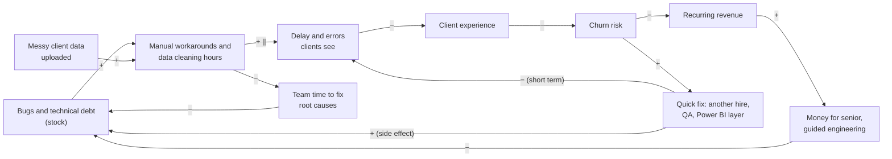
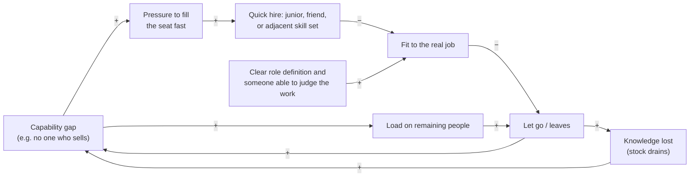
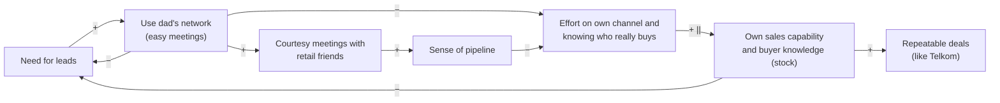
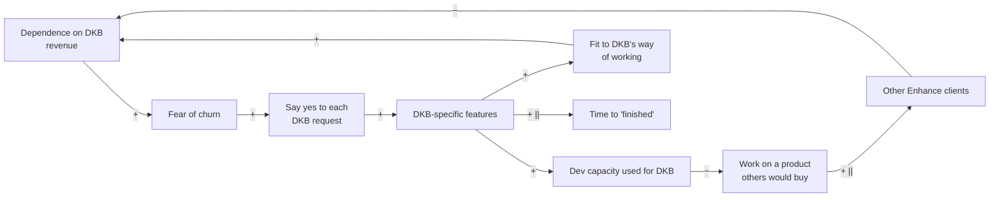
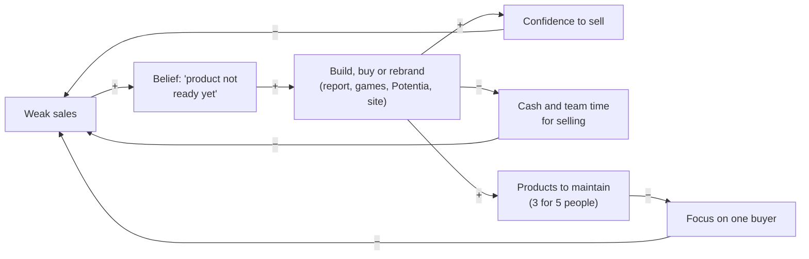
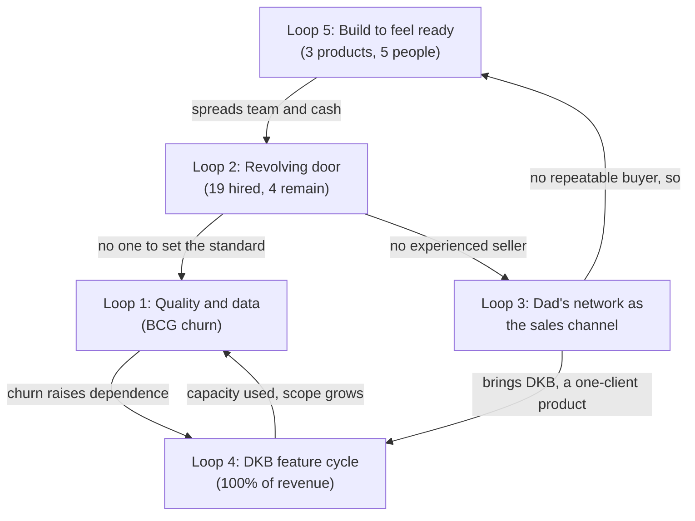

# Step 1: Systems Thinking: why things kept happening

As of 2026-10-28. First pass, no interviews yet. Sources: `inputs/DEUS_Company_History_Recap.pdf` (cited as "Recap, Phase N"), `inputs/deus-fact-sheet.md` (cited as "Fact sheet"), `inputs/DEUS_Pitch.pdf`. Method: causal loop diagrams, stocks and flows, system archetypes and Meadows' leverage points (`systems-thinking` skill).

## The answer in one paragraph

DEUS's problems were not eleven phases of separate bad luck. Five feedback loops produced them, and four are still running. Each time a problem appeared, the company applied a fix that relieved the pressure (another hire, a Power BI layer, another wave of the dad's network, another product or game, another feature for DKB) instead of the harder fix underneath (an engineering and data standard, a sales role with a sales person in it, a repeatable buyer type, a product scope that is not set by one client). The pattern is "shifting the burden": the quick fixes worked well enough to remove the urgency of the real fix, and in several cases made the real fix harder. The single highest-leverage change is to make one rule the company lives by: **nothing new gets built, bought or rebranded until a named buyer type has paid for what already exists, more than once.** Telkom is the only evidence of what that buyer looks like.

## How to read the diagrams

- An arrow marked **+** means "more of A leads to more of B". An arrow marked **−** means "more of A leads to less of B".
- **R** = reinforcing loop (it snowballs, good or bad). **B** = balancing loop (it pulls back toward a level).
- **||** on an arrow marks a long delay.
- Each loop separates facts (with recap citations), interpretation (why it happened) and what would have broken it.

---

## Loop 1: Quality → data cleaning → client experience → churn

### Facts

- Discover's first client, Boga Group, met "many bugs", a long process and simple reports, and "did not seem fully satisfied" (Recap, Phase 2).
- Enhance's first developer, Ghifari, "worked with no guidance" because "we did not know how to develop systems at all"; his version was "very unprofessional and still very buggy" (Recap, Phase 3).
- Enhance took "a very long time" with "many changes" and "many bugs"; DEUS hired Yuli as QA "because there were so many bugs" (Recap, Phase 4).
- Enhance "continued to have many bugs"; "messy client data that had to be uploaded" caused problems; Sahid (hired for psychometrics) did data work "until he was overloaded"; Fitri was added for data and stayed three months (Recap, Phases 6, 7).
- Wulan "was not able to handle data well, so cleaning data took a long time, and Enhance remained buggy. BCG ... churned" (Recap, Phase 8). BCG paid Rp40 juta per month, about Rp480 juta in total, more per month than DKB's Rp35 juta (Fact sheet).
- Fearing DKB would churn too, DEUS put Power BI on top of Enhance "as a temporary solution" because Enhance "could not display things properly on the web" (Recap, Phase 9).
- Ko Will's rebuilt Enhance "was much better, even under a clear audit" (Recap, Phase 10).

### Causal loop diagram

- **R1 (quality death spiral):** bugs → workarounds → slow, error-prone delivery → worse client experience → churn → less revenue → less money for guided engineering → more bugs.
- **R1b (no time to fix):** workarounds eat the time that would remove the bugs, so the bug stock grows on its own.
- **B1 (the quick fix):** churn risk → a patch (Yuli for QA, Fitri and Wulan for data, Power BI for display) → visible problems ease for a while. The patch also adds a layer to maintain (Power BI next to Enhance; Recap, Phase 9), which is the side effect.

### Stocks and flows

| Stock | Inflow | Outflow | Delay |
|---|---|---|---|
| Bugs and technical debt in Enhance | Features built with no engineering guidance (Recap, Phase 3); changes requested mid-build (Recap, Phase 4) | Fixing, and in the end a full rebuild (Recap, Phase 10) | Three to four years before a clean version existed (Recap, Phase 10) |
| Uncleaned client data | Each client upload of "messy" data (Recap, Phase 6) | Data person's hours | No intake standard is recorded, so the inflow never shrank |
| Client goodwill | Working, on-time results | Each bug, delay or wrong report | Churn shows only when goodwill runs out (BCG, Recap, Phase 8) |

### Archetype: Shifting the burden (with a Fixes that fail side effect)

The fundamental fix was a way of building software (senior technical lead, specification before build, testing) and a standard for how client data comes in. The symptomatic fix was to add a person or a layer each time a symptom hurt: QA for bugs (Phase 4), a data person for data (Phases 6, 7), Power BI for display (Phase 9). Each fix helped for a while, so the fundamental fix kept being postponed until the dad asked for a full rebuild (Phase 10).

**Interpretation:** the root cause was not the individual hires; it was that nobody at DEUS could set or check engineering quality in Phases 3–9 ("we did not know how to develop systems at all", Phase 3). Every tech and data hire was judged by people who could not judge that work. ASSUMPTION: the rebuild succeeded partly because Ko Will brought the standard himself, not because the company had learned to set one.

### Leverage points (Meadows level in brackets)

1. **[Rules, level 5] Data intake rule:** no client data enters the system unless it meets a written template, and cleaning is quoted and paid for as a service. This shuts the inflow of the data stock instead of adding people to drain it.
2. **[Information flows, level 6] Make quality visible:** a weekly count of open bugs and data-cleaning hours per client, seen by the founder. In Phases 3–8 the first hard signal of quality was BCG leaving.
3. **[Self-organization, level 4] Hire or rent the judgement first:** before any technical hire, have one senior person (an advisor is enough) who can set the standard and review the work. This was missing from Phase 3 to Phase 9.

### Still active today?

**Weakened, not gone.** The bug stock was largely cleared by Ko Will's rebuild (Recap, Phase 10). But: (a) no data person is on today's team of five (Recap, Phase 11), so the next client with messy data reopens the loop; (b) all engineering now sits with one person, Ko Will, so if he leaves, the stock of knowledge goes to zero (see Loop 2); (c) whether Power BI is still in use for DKB is NO DATA.

---

## Loop 2: Hiring, turnover and the role that was never filled

### Facts

- 19 people besides the founder have worked at DEUS; 4 remain (Recap, Reference: people). 15 have left (derived).
- **Sales and account roles** were held by seven people: Rosi (junior, "without strong product knowledge"), Bu Vera ("without a sales background", hired as account manager), Fizka (business development, "overlapped with Bu Vera"), Bu Retno (account manager), Audrey (marketing and sales), Wulan (sales and data), Yessica ("not strong in sales and struggled to bring in new clients") (Recap, Phases 1, 3, 4, 7, 8). Only Audrey remains. No hire is recorded as an experienced B2B seller.
- **Data and psychometrics** were held by five people in a chain: Sahid → Fitri (three months) → Wulan → Rizkie ("did not have a good work ethic") → Bu Sovie (Recap, Phases 1, 6, 7, 8, 9).
- **Engineering** passed through Ghifari → Andar (+ Kayyis, a friend of Andar's) → Ko Will and David; Ghifari, Andar and Kayyis were let go or not extended (Recap, Phases 3, 4, 8, 9, 10).
- At least five people were let go or not extended: Rosi, Ghifari, Andar, Yessica, Kayyis (Recap, Phases 3, 8, 9, 10). Five left in Phase 10 alone (Recap, Phase 10).
- Hiring channels recorded: fresh graduates (Phase 1), a friend of an existing hire (Kayyis, Phase 9), people the dad directed (Ko Will and David's rebuild, Phase 10).
- Average tenure of departed staff: NO DATA (Fact sheet).

### Causal loop diagram

- **R2 (revolving door):** gap → fast hire into a poorly defined role → poor fit → exit → knowledge loss → the gap reopens, often bigger.
- **R2b (overload):** each exit loads the people who remain (Sahid "overloaded", Phase 6), which raises the chance they leave too.
- The variable that is missing from the history is **SPEC**: a written definition of what success in the role is, and someone able to judge it. It appears as an outside force, not part of any loop, because the recap never shows it being built.

### Stocks and flows

| Stock | Inflow | Outflow | Delay |
|---|---|---|---|
| Team know-how (product, client, code, data) | Hires × time to learn | 15 departures (derived) | Every new hire restarts the learning curve; tenure NO DATA |
| Headcount | 19 hires over 11 phases | 15 exits | Five exits in one phase (Phase 10) |

### Archetype: Fixes that fail (sales seat) and Shifting the burden (data and tech seats)

- **Sales seat, Fixes that fail.** The problem was that DEUS could not sell ("Apart from Telkom, we struggled very hard to sell anything", Recap, Phase 7). The fix each time was to hire for the seat, but the person hired was an account manager or a junior, not a seller (Bu Vera, Bu Retno, Yessica; Rosi). The same gap reappeared after each one, and the company never tried the hire the problem called for.
- **Data and tech seats, Shifting the burden.** Each replacement fixed the symptom (an empty chair) while the fundamental fix (a role defined by someone who understands the work, and a way to check it) was never built. That is why replacements tended to show the same gaps as the people they replaced (interpretation from the departures listed in Recap, Reference: people).

**Interpretation, stated plainly:** the evidence points more to **role design and management** than to bad luck in hiring. Three signals: (1) the seat meant to fix sales was filled four times (Rosi, junior; Bu Vera, no sales background; Bu Retno, account manager; Yessica, account management, not strong in sales), and none is recorded as an experienced seller; (2) roles overlapped (Fizka and Bu Vera, Phase 4; "sales and data" in one person, Wulan, Phase 7); (3) a psychometrics hire ended up doing data work until overloaded (Phase 6), which is a role allocation decision, not a hiring one. Step 6a (McKinsey 7S) should test this further.

### Leverage points

1. **[Goal and rules, levels 3/5] Define the job before the hire:** a one-page role card with the outcome expected at 90 days (e.g. "3 paid pilots from new logos"), the person who will judge it, and what happens if it is missed. This would have stopped the account-manager-for-sales pattern.
2. **[Information flows, level 6] A 90-day check in writing** for every hire, so a poor fit is seen in months, not phases.
3. **[Buffers, level 11] Document what each person knows** (code, client data rules, psychometric norms), so an exit doesn't drain the stock to zero.

### Still active today?

**Yes, as a risk.** The team is five, each in a single seat: founder, Ko Will (tech), Thania (product), Audrey (marketing and sales), Bu Sovie (psychometrics) (Recap, Phase 11). Every seat is a single point of failure. The seller seat that went unfilled from Phase 1 is still unfilled by an experienced seller: who leads selling today, and how much of it the founder does, is NO DATA.

---

## Loop 3: Lead source dependence (the dad's network)

### Facts

- "All through my dad's connections"; "most leads he brought were retail companies and his friends"; "we converted almost none of them" (Recap, Phase 5). The dad, Christian Kurnia, was a long-time director at Matahari Department Store (Recap, Phase 5).
- The network produced DKB (Recap, Phase 3) and "about 100" meetings in total, with "almost no others" converting (Fact sheet, founder's estimate). That is roughly one deal per hundred meetings (derived, rough).
- Further waves of the network failed for Potentia, Discover and Enhance (Recap, Phase 9), and again in Phase 11: "nothing; no assessment sales and no Enhance sales" (Recap, Phase 11).
- Recognition (Startup Studio Indonesia, InnovFest Singapore) and partner MoMs produced no sales (Recap, Phases 2, 5).
- The one large Discover win, Telkom, came from a buyer that "was specifically looking for gamification vendors" (Recap, Phase 7), not from the dad's network (no source for the Telkom lead is recorded beyond this). Telkom's second deal was Rp380 juta for 1,000 candidates (Fact sheet), about 11 months of today's DKB revenue (derived).
- Cold outreach started only in Phase 11 ("for the first time, we stopped relying on my dad's connections"): F&B 100+ contacts, "a good number" of replies, almost 10 meetings, 0 deals; finance about 100 contacts, "not many" replies; Apollo for Enhance "hundreds" of contacts, 0 meetings (Recap, Phase 11; Fact sheet).

### Causal loop diagram

- **B3a (symptomatic fix):** need leads → call the network → meetings appear → pressure eases.
- **B3b (fundamental fix, slow):** build your own channel and learn who buys → capability → leads that convert. This loop has a long delay, so it always lost to B3a.
- **R3 (side effect):** heavy use of the network → courtesy meetings → a feeling of pipeline → less effort on the own channel → capability stays near zero → more need for the network.

### Archetype: Shifting the burden

The network is the textbook symptomatic solution: fast, free and friendly, and it removed the urgency to answer "who buys this, and why?". The side effect is specific: it sent DEUS to **retail companies run by the dad's friends**, a segment chosen by who the dad knows, not by who needs game-based assessment. Recognition programmes (Phase 5) played the same role on the confidence side: they felt like validation without being buyer validation.

**Interpretation:** the one buyer who did buy repeatedly (Telkom) had three features the network leads did not: an existing need it was already shopping for (gamification vendors), high candidate volume (1,000+ MT candidates, 30+ provinces; DEUS_Pitch.pdf, Telkom slide), and a recruitment use case. The F&B and finance cold outreach in Phase 11 picked industries, but the recap gives no evidence that these industries share Telkom's features. ASSUMPTION: the industry targets were chosen for reachability, not because they match the Telkom pattern. Step 3 (ICP) should test this.

**Said plainly, with respect:** the dad's network gave DEUS its only current revenue (DKB) and that matters. But measured as a sales channel, it has run for nine phases at roughly one deal per hundred meetings, and new waves in Phase 11 still produced nothing (Recap, Phase 11; Fact sheet). Sunk effort is not a reason to keep using it as the main channel.

### Leverage points

1. **[Goal, level 3] Change what counts as a lead:** a lead is an organisation that already has the problem and budget (volume hiring, an assessment budget, an active vendor search), not an organisation whose leader knows the family. This turns the network into a source of introductions to qualified buyers only.
2. **[Information flows, level 6] Log every channel's funnel** (contacts → replies → meetings → proposals → deals) every week. Today most of those cells are "?" (Fact sheet, Funnel by channel), so no channel can be judged.
3. **[Reinforcing loop, level 7] Build the Telkom loop on purpose:** case study → buyers with the same profile (SOEs and large groups with MT or mass-hiring programmes) → second reference → easier third. The recap shows no attempt to replicate Telkom.

### Still active today?

**Partly broken, still running.** Phase 11's cold outreach is the first real attempt at the fundamental fix, which is a genuine change. But the network is still being worked in new waves (Recap, Phase 11), and the cold outreach targets were not chosen from the Telkom evidence. Whether Telkom will run a third year is NO DATA (Fact sheet).

---

## Loop 4: The Enhance feature-request cycle with DKB

### Facts

- DKB came through the dad's relationship with "very complex" KPI and appraisal needs; DEUS "decided to take it on and build it as our second product" (Recap, Phase 3).
- BCG signed "while Enhance was still in development" (Recap, Phase 3).
- "Many changes came in while it was being built" (Recap, Phase 4).
- DEUS was "afraid DKB would churn too" after BCG left (Recap, Phase 9).
- "Three to four years in, and Enhance was still not fully done because DKB kept adding more and more features" (Recap, Phase 10).
- Feature work ran in a fixed sequence: wait for the PRD, wait for UI/UX made "from scratch in Figma", then build (Recap, Phase 10).
- Enhance cold outreach via Apollo: "zero meetings from hundreds of contacts" (Recap, Phase 11).
- DKB pays Rp35 juta per month and is the only income today, about 56–67% of the estimated monthly burn of Rp52–62 juta (Fact sheet; percentages derived).
- Enhance pricing is not published (Fact sheet).

### Causal loop diagram

- **R4 (success to the successful):** DKB is the paying client → it gets the development capacity → Enhance fits DKB better and the market less → no other clients → DKB's share of revenue rises → fear of losing DKB rises → DEUS says yes even more.
- The sequential PRD → design-from-scratch → build process (Phase 10) is a **delay** that makes each request expensive, so capacity runs out faster.

### Archetype: Success to the successful (DKB vs the rest of the market), with Shifting the burden

Two "customers" compete for one development team: DKB and the wider market. DKB wins every round because it pays now, so the market gets nothing, which keeps DKB the only one paying. The Shifting the burden part: saying yes to DKB solves "how do we keep revenue" in the short term while blocking the fundamental fix, which is a product with a defined scope and a price that more than one company would pay for.

**Interpretation:** the recap supports the playbook's question "is Enhance a product, or a custom system for DKB?" leaning toward the second, at least until Phase 10. Evidence: built from one client's complex needs (Phase 3), shaped by that client's additions for years (Phase 10), and zero meetings when offered to the market (Phase 11). Whether Ko Will's rebuild is a general product or a cleaner DKB system is NO DATA. Step 5 (PMF) and Step 4 (BCG) should answer this.

### Leverage points

1. **[Rules, level 5] Separate the product from the client work:** a fixed core that every client gets, and paid custom work for anything else, with a written change-request price. DKB would still get features, but they would pay for them and they would not set the roadmap.
2. **[Information flows, level 6] Track the share of dev time that goes to DKB-only work.** NO DATA today.
3. **[Delays, level 9] Shorten the feature pipeline:** a shared component library so UI isn't drawn "from scratch" each time (Recap, Phase 10).
4. **[Goal, level 3] Decide what Enhance is for.** If it is a revenue line from one client (a service contract), run it as one, with no expectation of selling it to others. If it is a product, it needs a second paying client before more features.

### Still active today?

**Yes, at its strongest.** DKB is 100% of current revenue (Fact sheet). Whether DKB still adds features, and how much dev time goes to it, is NO DATA. The dependence is now total, which is exactly when R4 is most dangerous: if DKB leaves, revenue goes to zero.

---

## Loop 5 (cross-cutting): Build to feel ready to sell

The playbook asked for the four loops above. The recap shows a fifth one that sits underneath all of them, so it is included here.

### Facts

- Discover was built "straight" from "an idea we thought was genuinely cool", with no psychometric validation and little market validation, for almost Rp1 billion (Recap, Phase 1).
- After a weak first client, DEUS spent about a year turning the Discover report into a digital report (Recap, Phase 6) and paid Agate extra to shorten the game (Recap, Phase 4; amount NO DATA).
- Enhance was taken on as a second product off one client (Recap, Phase 3). Potentia was acquired while sales of the first two were weak, and was "extremely hard to sell" (Recap, Phase 9).
- Phase 11 added cognitive, neuroscience and simulation games from Agate, which "made us more confident in selling" and "we have recently felt more ready to sell" (Recap, Phase 11). Cost of the new games: NO DATA (Fact sheet). Then a rebrand of website, presentations and company profile (Recap, Phase 11).
- Three products for a team of five (Recap, Phase 11). Neither Discover nor Potentia has a recorded paying client today; the only current income is DKB on Enhance (Fact sheet).

### Causal loop diagram

- **B5 (the fix):** weak sales → build something → confidence → a short-lived sense that sales will now come.
- **R5 (the side effect):** each build costs money and team time and adds a product to maintain → less focus on any one buyer → sales stay weak → the next build.

### Archetype: Fixes that fail

The fix (more or better product) treats a sales problem as a product problem. The recap never records a lost buyer saying the product was the reason (lost-lead reasons are NO DATA; Fact sheet, Founder notes). Telkom bought the single-personality-game version (Recap, Phase 7), before the Phase 11 suite existed, which suggests product breadth was not what blocked sales.

**Interpretation:** the mental model behind this loop is "if we build it well enough, it will sell". Every phase where sales stalled was followed by a build. ASSUMPTION: building feels like progress and is under DEUS's control, while selling depends on strangers saying no.

### Leverage points

1. **[Paradigm, level 2] Replace "build, then sell" with "sell, then build":** nothing new is built, bought or rebranded until a buyer has paid for what exists, or has signed for the thing to be built. This is the highest leverage in the whole system, because it cuts the inflow to Loops 1, 4 and 5 at once.
2. **[Goal, level 3] One product, one buyer type, for a fixed period.** Three products for five people (Recap, Phase 11) spreads every scarce stock. Which one is for Step 4.
3. **[Information flows, level 6] Know the cash.** Cash in bank and total invested are both NO DATA (Fact sheet). Without them, the balancing loop that should force a decision ("we have N months left") cannot act.

### Still active today?

**Yes.** Phase 11 is the loop running again: new games, then a rebrand, while monthly revenue (Rp35 juta) is below the estimated burn (Rp52–62 juta), a gap of about Rp17–27 juta per month (Fact sheet). How that gap is funded is NO DATA. ASSUMPTION: if family money covers it, it acts as a buffer that hides the cash signal and lets this loop keep running.

---

## How the loops connect

The common root: **DEUS never fixed who it sells to before deciding what to build.** Loop 3 (no repeatable buyer) feeds Loop 5 (build to feel ready) and Loop 4 (build for the one buyer you have). Those create the scope and quality load in Loop 1 and the hiring churn in Loop 2. Loop 2 in turn leaves no experienced seller, which keeps Loop 3 running.

## Leverage points, ranked

| Rank | Change | Meadows level | Loops it breaks | Easy to start? |
|---|---|---|---|---|
| 1 | "Sell, then build": nothing new built, bought or rebranded until a buyer has paid or signed for it | 2 Paradigm | 5, 4, 1 | Yes: a decision, no cost |
| 2 | Pick one buyer type from the evidence (Telkom: volume hiring, existing need, recruitment use) and one product for a fixed period | 3 Goal | 3, 5 | Yes, after Steps 3–5 |
| 3 | Enhance: fixed core plus paid custom work for DKB, with a change-request price | 5 Rules | 4, 1 | Needs a talk with DKB |
| 4 | Know the cash and log every channel's funnel weekly | 6 Information | 5, 3 | Yes: a spreadsheet |
| 5 | A role card with a 90-day outcome before any hire; the first sales hire is an actual seller | 5 Rules | 2, 3 | Yes, before the next hire |
| 6 | Client data intake template; cleaning quoted as paid work | 5 Rules | 1 | Yes |

### Unintended consequences to watch

- **"Sell, then build"** can make the team pitch things that don't exist yet. Guard: only sell what can be delivered within an agreed date, and get it in writing.
- **Changing DKB's terms** could trigger the churn DEUS fears. DKB is the only revenue (Fact sheet). Guard: propose it as a menu (what's included, what's extra), not a price rise, and do it when there is a second revenue source in sight.
- **Narrowing to one buyer type** means saying no to network leads that look easy. Guard: a referral that matches the buyer profile is still welcome.
- **Logging the funnel** can show that a favourite channel doesn't work. That's the point, but the founder and the dad should agree up front that the numbers decide.

---

## Key findings

1. **Five loops, not eleven separate setbacks.** Quality → churn (Loop 1), the revolving door (Loop 2), the dad's network as the only channel (Loop 3), the DKB feature cycle (Loop 4) and "build to feel ready" (Loop 5) explain most of the history (Recap, Phases 1–11).
2. **The dominant archetype is shifting the burden.** Each quick fix (a hire, Power BI, another network wave, another game, another DKB feature) worked well enough to postpone the real fix: a way to set engineering and data quality, a real seller, a repeatable buyer type, and a product scope not set by one client.
3. **Four of the five loops are still active.** Only Loop 1 is weakened (Ko Will's rebuild, Phase 10). Loop 4 is at its most dangerous: DKB is 100% of revenue (Fact sheet). Loop 5 ran again in Phase 11 (new games, rebrand) while revenue is about Rp17–27 juta a month below burn (Fact sheet).
4. **The sales seat was never held by a seller.** Seven people held sales or account roles; the recorded strengths of those hired to fix sales were account management or junior business development (Recap, Phases 1, 3, 4, 7, 8). The team problems look more like role design and management than bad luck in hiring.
5. **The highest-leverage change is a rule, not a hire or a product:** sell before building, aimed at the one buyer type the evidence supports (Telkom's profile: an existing need, high candidate volume, a recruitment use case). It cuts the inflow into Loops 1, 4 and 5 at once.

## Data gaps

- Cash in bank today and runway (Fact sheet: NO DATA). Without it the urgency of every loop is unknown.
- Total invested to date, and how the monthly gap of about Rp17–27 juta is funded (NO DATA).
- Cost of shortening the game and of the Phase 11 games; Agate's terms for the new games (NO DATA).
- Dates of the phases and the founding year; the recap gives "three to four years in" only at Phase 10. Tenure of each departed person (NO DATA).
- Whether DKB still adds features, and the share of dev time spent on DKB-only work (NO DATA).
- Whether Power BI is still used for DKB (NO DATA).
- Lost-lead reasons; what BCG said when it churned; how satisfied DKB is (NO DATA; Fact sheet, Founder notes).
- How the Telkom lead first arrived, and whether Telkom will run a third year (NO DATA).
- Full funnel by channel: proposals and deal counts are "?" for most channels (Fact sheet).
- Who leads selling today, and how much of the founder's time goes to it (NO DATA).

## Questions for the founder

1. When DEUS was deciding to buy the Phase 11 games and to rebrand, had any buyer told you the old version was the reason they didn't buy? If not, what made the team feel the product was the problem?
2. How did the Telkom opportunity first reach DEUS, and why do you think Telkom picked DEUS? Have you approached any organisation with a similar profile (large MT or mass-hiring programme) since?
3. Who decides what gets built in Enhance today, and does DKB pay for the features it asks for? What would DKB say if extra features had a price?
4. When the dad asks for something (a rebuild, a lead to follow up), how is it decided whether DEUS does it? Who has the final say on product and hiring?
5. For the next hire, what is the one result the person must deliver in their first 90 days, and who will judge it?
6. How long can DEUS keep running at a loss of about Rp17–27 juta a month, and who is covering it?

Full sources: `inputs/DEUS_Company_History_Recap.pdf`, `inputs/deus-fact-sheet.md`, `inputs/DEUS_Pitch.pdf` (Telkom slide).
