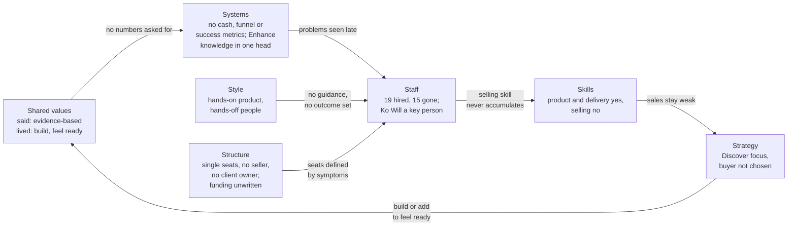

# Step 6a: McKinsey 7S: why the team never held together

As of 2026-10-28. **Revised 2026-10-28 with the founder's answers** to the Steps 1–5 questions (`inputs/deus-fact-sheet.md`, sections "Corrections to the recap and earlier steps" and "Founder answers"). The answers are the founder's account, not the departed staff's or buyers' words: the Step 6c interviews have not run, so this diagnosis stays provisional. Sources: `inputs/DEUS_Company_History_Recap.pdf` (cited as "Recap, Phase N"; the people table as "Recap, Reference: people"), `inputs/deus-fact-sheet.md` ("Fact sheet"; "Correction N" = its numbered corrections; "Founder answers" = its last section), `inputs/DEUS_Pitch.pdf` ("Pitch deck"), `inputs/DEUS_GBA_Presentation_8.pdf` ("GBA deck"), `inputs/Agate_Next_Chapter_GBA_deck.pdf` ("Agate deck"), https://deushcs.com and https://deck.deushcs.com (fetched 2026-10-28; DEUS's own marketing, used only for how DEUS describes itself), `outputs/01-systems-thinking.md` to `outputs/05-pmf.md` ("Step 1" to "Step 5", all revised the same day). Method: McKinsey 7S, the seven elements, the 21-pair alignment matrix and a change-readiness sequence (`mckinsey-7s` skill).

## The answer in one paragraph

DEUS's team problems were mainly **management and role-design problems, with hiring as the visible symptom**, and the founder's answers make that firmer, not softer. **No success metric was ever set** for the four people hired to fix sales (Bu Vera, Fizka, Bu Retno, Yessica; Founder answers), so nobody could tell early whether a hire was working. One role-design decision shows the cost plainly: DEUS wanted one person to do both data and sales, **Fitri left over it**, Wulan took the combined seat, could not handle the data and was let go for poor performance, and **BCG, then DEUS's biggest recurring client at Rp40 juta a month, churned partly because it felt abandoned once Wulan held the account** (Recap, Phases 7–8; Correction 4; Fact sheet). The answers also show that fewer exits were about DEUS than the first pass assumed: four of the 15 were ordinary life or career moves, Fizka's among them (section 1). Of the 21 pairs in the 7S model, **none is aligned: 12 misaligned, 9 partial**. One first-pass finding changes: the founder **has the final say** and the dad is the main funder and a shareholder (Correction 5), so there is one decision-maker, not two decision centres. What stays unwritten is the funding: no amount and no review date, which removes the cash signal that would force trade-offs (Step 1, Loop 5). A new risk moves to the top: **the only revenue (DKB, Rp35 juta a month) runs on Enhance, and keeping Enhance running without Ko Will would be "very hard"** (Founder answers). The five people who remain can work if the company is cut to the narrow focus Steps 2–5 recommend, every seat gets a written outcome, Ko Will's knowledge is written down and backed up, the founder takes the selling seat, and the family funding gets a written amount and review date.

## What this revision changed

| Point | First pass said | Now (founder answers) | Effect on this report |
|---|---|---|---|
| Why people left | Reasons for Bu Vera, Fizka, Bu Retno, Fitri and Wulan not recorded | Bu Vera resigned; Fizka left because of Fizka's father's health; Bu Retno was replaced by Yessica; Fitri left because DEUS wanted one person to do data and sales; Wulan left for poor performance, one of the reasons BCG failed (Founder answers) | Exit count re-cut: role design 5, management 2, hiring and performance 4, life or career 4, unrecorded 0 (section 1). The data-and-sales merge is now traced from one decision to two exits and a lost client |
| Success metrics | "No role outcome recorded" | **None were set** for Bu Vera, Fizka, Bu Retno or Yessica (Founder answers) | Confirms the management gap directly; Systems ↔ Staff stays misaligned on a stated fact, not an absence of records |
| Key person | "Engineering backup" listed as a gap | If Ko Will left, keeping Enhance running would be "very hard" (Founder answers); Enhance-for-DKB is the only revenue (Fact sheet) | Systems ↔ Skills moves from partial to misaligned; backing up Ko Will becomes a first-30-days action (section 7) |
| Who decides | "Two decision centres", the dad's formal position NO DATA | The dad is the **main funder and a shareholder**; the **founder has the final say**; the dad is fine continuing to support DEUS, with no written amount (Correction 5; Founder answers) | Structure ↔ Style moves from misaligned to partial. The issue is no longer who decides but that the funding has no written shape. The founder–dad agreement is rewritten as a funding note (section 7) |
| Own products | Whether DEUS uses Discover or Enhance on itself: NO DATA | DEUS **rarely** uses Discover or Enhance on its own candidates or team (Founder answers) | Confirms the Shared values gap: DEUS sells evidence for people decisions and does not use its own evidence on its people |
| Phase 11 games | "Bought", "Agate sells the same suite directly" | **Not bought.** DEUS is one of five sales partners for Agate's Next Chapter (Correction 1) | Skills and Strategy ↔ Skills reworded: the modules are a partner's, sold by five partners; the part DEUS owns (the personality game) has no validation (Fact sheet, Validation) |
| Telkom | "Fairly lucky"; why Telkom chose DEUS not recorded | Telkom's **Assessment Center** asked Agate for a gamified assessment, and Agate brought DEUS in; no third year because Telkom's MT intake strategy changed (Corrections 2–3) | The "luck" was a partner's referral. No follow-up with Agate is recorded (Step 2), which is a Style and Systems point, not a Staff one |
| BCG churn | Bugs and slow data cleaning | Poor service: bugs, DEUS "weren't able to deliver", and BCG felt abandoned on communication once Wulan handled the account (Correction 4) | "Invested in Our Clients" is lived for DKB, not for BCG; no seat owns client success (pair 8) |
| Current focus | Phase 11: everything at once | Mainly selling Discover; the founder would like to sell Enhance more but can't (Founder answers) | Strategy clarity 2 → 3; execution stays 2 |
| Power BI | Still in use: NO DATA | No longer used (Fact sheet, DKB row) | Systems notes it as gone; no longer a stopgap to count |

## How to read this report

- **Facts** are cited. **Interpretation** is marked as such. Recommendations are in sections 6 and 7. Anything not in the files is labelled **ASSUMPTION**; missing numbers are **NO DATA**.
- **The founder's account** (Corrections, Founder answers) is reported as such. Why someone left, in the founder's words, is better than nothing and weaker than the person's own words.
- **Derived** marks a count or arithmetic on cited facts.
- Scores (1–5) and alignment ratings (✅ aligned, ⚠️ partial, ❌ misaligned) are judgement calls on the cited evidence, not measurements. They are there to rank where to act first.
- Ratings describe DEUS **today** (the five-person team, Phase 11), using the history as evidence of how the organisation behaves.

---

## 1. Why 19 people came and went

### Facts: the seats, not the people

The recap lists 19 people besides the founder; 4 remain, so 15 have left (Recap, Reference: people; derived). Grouped by the seat they held:

| Seat | Who held it, in order | Still here | Source |
|---|---|---|---|
| Sales and account management | Rosi (junior BD) → Bu Vera (senior, "without a sales background", account manager) + Fizka (BD, "partly overlapped with Bu Vera's") → Bu Retno (account manager) + Audrey (marketing and sales) + Wulan (sales and data) → Yessica (account management, "not strong in sales") | Audrey | Recap, Phases 1, 3, 4, 7, 8 |
| Psychometrics and data | Sahid (psychometrics, then data "until he was overloaded") → Fitri (data, three months) → Wulan (sales and data, "replacing Fitri") → Rizkie (psychometrics, "did not have a good work ethic") → Bu Sovie (data only: Enhance client data; Correction 6) | Bu Sovie for data; **nobody for psychometrics** | Recap, Phases 1, 6, 7, 8, 9 |
| Engineering | Ghifari ("no guidance") → Andar (+ Yuli for QA, + Kayyis, "a friend of Andar's", frontend) → Ko Will and David (the rebuild the dad asked for) | Ko Will | Recap, Phases 3, 4, 8, 9, 10 |
| Product and project management | Thania (product: PRDs, Figma, digitised report); Firdaus (project manager, Potentia site) | Thania | Recap, Phases 6, 9, 10 |

- Why five people left, in the founder's words: Bu Vera resigned; Fizka because of Fizka's father's health; Bu Retno because DEUS replaced Bu Retno with Yessica; Fitri because DEUS wanted one person to do both data and sales; Wulan for poor performance, "one of the reasons BCG failed" (Founder answers).
- **No success metrics were set** for Bu Vera, Fizka, Bu Retno or Yessica (Founder answers). Whether Rosi or Wulan had one: NO DATA. No role description, probation review or onboarding is recorded for any hire (Recap, Phases 1–11).
- Five people left in Phase 10 alone (Recap, Phase 10).
- Hiring channels recorded: fresh graduates (Sahid, Rosi; Phase 1), a friend of an existing hire (Kayyis; Phase 9), and people the dad directed onto the rebuild (Ko Will, David; Phase 10). How anyone else was found is not recorded.
- Tenure of each person, and the dates of the phases: NO DATA (Fact sheet). DEUS's own site gives 2022 as the founding year (deushcs.com; deck.deushcs.com), so the 19 hires span about four years (derived).

### Interpretation: what each exit points to

Each exit is classified by the cause the recap and the founder's answers point to most. This is interpretation, and most exits have more than one cause.

| Main cause | People | Count | What the sources say |
|---|---|---|---|
| **Role design** (the seat was defined wrong, overlapped, or combined two jobs) | Bu Vera, Bu Retno, Yessica, Sahid, Fitri | 5 | Account managers hired into a seat whose problem was new revenue, with no success metric (Phases 3, 7, 8; Founder answers); Bu Vera "without a sales background", with no reason given for the resignation; Bu Retno replaced by another account manager, Yessica, so the seat's definition never changed (Phase 8); Sahid, hired for psychometrics, did data work until overloaded (Phases 6, 8); Fitri left because DEUS combined data and sales into one job (Founder answers) |
| **Management and guidance** (nobody could set or judge the standard) | Ghifari, Andar | 2 | "We did not know how to develop systems at all, so Ghifari worked with no guidance" (Phase 3); Andar led Enhance, "had not performed well", and was let go once the parallel rebuild was done (Phases 8, 10) |
| **Hiring choice and performance** (the person did not do the job) | Rosi, Rizkie, Kayyis, Wulan | 4 | Rosi "very junior... without strong product knowledge" (Phase 1); Rizkie "did not have a good work ethic" (Phase 8); Kayyis, hired as a friend, "work was very slow" (Phases 9, 10); Wulan "was not able to handle data well" (Phase 8) and left for poor performance (Founder answers), in the combined seat that Fitri had refused |
| **Life or career** (would happen at any company) | Yuli, David, Firdaus, Fizka | 4 | Moved cities; another job; a project with friends (Phase 10); Fizka's father's health (Founder answers) |

Derived: 5 + 2 + 4 + 4 = 15.

**One decision, two exits and a client.** Read in order, the sources show a single chain (interpretation on cited facts): DEUS decided one person should do data and sales → Fitri, in the data seat, left after three months over that (Recap, Phase 7; Founder answers) → Wulan joined "for sales and data, replacing Fitri" (Recap, Phase 7) → Wulan could not handle the data, cleaning took long, and Enhance stayed buggy (Recap, Phase 8) → BCG, paying Rp40 juta a month (Fact sheet), felt abandoned on communication once Wulan held the account and churned (Correction 4) → Wulan left for poor performance (Founder answers). The merged seat looked cheaper; it cost two people and DEUS's largest recurring client. The founder calls Wulan's performance "one of the reasons" BCG failed; the bugs were the other (Correction 4), so the seat is one cause, not the only one.

**Interpretation, stated plainly.** Hiring is where the problem showed, but it is not where it started:

1. **The seat was defined by the symptom, not the job.** When sales was weak, DEUS hired account managers (Bu Vera, Bu Retno, Yessica), people who look after clients DEUS already has. The job the company needed was finding new buyers, and that was never written into a seat (Step 1, Loop 2). When bugs piled up, it added QA (Yuli); when data piled up, it added a data person, then merged data into sales (Fitri, Wulan). Each seat was a patch on a symptom (Step 1, Loop 1).
2. **Nobody set or judged the outcome.** No success metric for the four sales hires (Founder answers); no one who could set an engineering standard in Phases 3–9 ("we did not know how to develop systems at all", Phase 3); no experienced seller to coach the sales hires. Poor performance was therefore seen late and by its consequence: Wulan's through BCG's churn (Phase 8; Correction 4), Andar's only once a replacement system was finished (Phase 10), Yessica's "eventually" (Phase 9). ASSUMPTION: several people judged as poor fits might have done better with a clear outcome and someone who could coach them.
3. **The hiring profile was cheap and close.** Fresh graduates for the first two seats (Phase 1), a friend for frontend (Phase 9). ASSUMPTION: cost drove the profile. Salaries today average Rp8–10 juta (Fact sheet), which supports this but does not prove it.
4. **Not every exit is a verdict on DEUS.** Four people left for reasons any company would see (Fizka, Yuli, David, Firdaus). Four is about a quarter of the exits (derived): the turnover is still high, but less of it is self-inflicted than the first pass assumed.

So the honest answer to the playbook's question "hiring, role design or management?" (PLAYBOOK.md, section 4, question 5) is: **management first** (no outcome set, no one to judge the work), **role design second** (seats defined around symptoms, overlaps, the data-and-sales merge), **hiring third** (cheap and close profiles that magnified the first two). The founder's answers confirm the first two directly.

---

## 2. The seven elements

### Strategy: what DEUS is trying to win, and how

**Facts.**
- DEUS offers three products today, four on the company profile (Discover, Enhance, Next Chapter, Potentia; deck.deushcs.com), and lists ten industries on its main site (deushcs.com). Next Chapter is Agate's product, which DEUS sells as one of five partners (Correction 1).
- Phase 11 strategy: "for the first time, we stopped relying on my dad's connections and started cold calls", F&B first, then finance; Enhance via Apollo; plus new waves of the dad's network and a rebrand (Recap, Phase 11). Audrey runs the F&B outreach (Founder answers).
- The founder's current focus is "mainly selling Discover"; the founder would like to sell Enhance more but can't (Founder answers).
- Revenue: Rp35 juta a month, all from DKB on Enhance; burn about Rp52–62 juta a month, plus about Rp4 juta for the Enhance server (Fact sheet).
- The revised Steps 2, 4 and 5 recommend one narrow focus: Discover on the parts DEUS owns (its personality game, report and large-intake delivery), aimed at central assessment units with an open search, through Agate and introductions rather than cold email; Next Chapter carried at no cost; Enhance run as a DKB service contract and no longer sold to the market; Potentia exited (Step 2; Step 4; Step 5).

**Interpretation.** There is still no written strategy in the files, but there is now a stated focus: Discover. The trade-offs that make a focus real have not been made yet: outreach is still spread across F&B, finance and Apollo (Fact sheet, Funnel), the founder still wants to sell Enhance, and the buyer type the evidence supports (an assessment unit with an open search; Step 3) is not the one the outreach targets.

**Clarity 3/5. Execution 2/5.** Key issue: a product focus without a buyer focus. The cold outreach is a real change in Phase 11, but it is aimed by industry, not by the buyer type the evidence supports (Step 3).

### Structure: who does what, who decides

**Facts.**
- Today: founder plus four single seats: Ko Will (tech), Thania (product), Audrey (marketing and sales), Bu Sovie (data: Enhance's client data and its manual steps; Correction 6) (Recap, Phase 11; Step 1, Loop 2). Nobody holds a psychometrics, QA, project-management, client-success or dedicated selling seat.
- **The founder has the final say.** The dad is the main funder and a shareholder, and is fine continuing to support DEUS (Correction 5; Founder answers). No funding amount or review date is written (Fact sheet, Money).
- The dad "was never a hire, but he brought the DKB relationship, most early leads, and the request that Ko Will and David rebuild Enhance" (Recap, Reference: people).
- In the past, roles overlapped (Fizka and Bu Vera, Phase 4), two jobs were merged into one seat (data and sales; Phase 7; Founder answers), and two engineering efforts ran in parallel under different direction (Andar's Enhance and the dad-requested rebuild, Phases 9–10).
- The legal entity is PT Investama Persada Kurnia (deushcs.com footer; deck.deushcs.com). Shareholdings, and whether the dad holds a director's role: NO DATA.

**Interpretation.** The first pass read "two decision centres". The founder's answer corrects that: formally there is **one decision-maker, the founder**, and a funder-shareholder who also brings relationships and, at least once, a decisive product request. That is a common and workable shape for a family-backed company. Two things are still unwritten, and both matter. (1) **The funding has no shape**: no amount, no review date. Open-ended support removes the signal that would force the choices in Strategy (Step 1, Loop 5); the dad's willingness to fund is a fact, not evidence that any product works (CLAUDE.md rule 3). (2) **How a request from the funder is weighed against the founder's plan** is not recorded: no request of the dad's is recorded as declined (Recap, Phases 3–11), so whether "final say" has ever been used against one is NO DATA.

**Type:** flat, founder-led, family-funded. **Decision speed:** fast on building (new products, games partnership, rebrand), slow on people (poor fits kept until a replacement was ready). Key issue: every seat is a single point of failure, the seat the strategy needs most (a seller) does not exist, and no one owns client success, the gap through which BCG was lost (Correction 4).

### Systems: the daily processes and the numbers

**Facts.**
- Feature work: "wait for the PRD, wait for the UI/UX, which Thania made from scratch in Figma, the developers build" (Recap, Phase 10).
- No client-data intake standard; messy uploads drove the data workload (Recap, Phase 6; Step 1, Loop 1). Power BI, the Phase 9 stopgap, is no longer used (Fact sheet).
- Money: cash in bank and total invested are NO DATA ("founder doesn't know"); burn and team cost are estimates (Fact sheet).
- Sales: most funnel cells are "?" (Fact sheet, Funnel). The loss reasons now on file are the founder's recollection, not a log (Fact sheet, "Why deals don't close").
- People: **no success metrics were set** for the four sales hires (Founder answers); no role card, probation review or tenure record appears anywhere (Recap; Fact sheet: "Average tenure of departed staff: ?").
- Own products: DEUS **rarely** uses Discover on its own candidates or Enhance on its own team (Founder answers).
- Enhance: how it is deployed and maintained lives with Ko Will; no documentation is recorded (Recap, Phase 10; Founder answers).

**Interpretation.** DEUS has a product-building process and almost no management systems: no money view, no sales log, no people outcomes, and the performance-management product it sells is not used on its own team. Without them, problems are found by their consequence (BCG churning, Phase 8; a person failing after months) instead of by a number moving.

**Information flow:** founder-centred and verbal (ASSUMPTION: nothing written is recorded). Key issue: the founder cannot see cash, pipeline or people performance, so no decision has a trigger.

### Shared values (the centre): what DEUS says vs what it does

**Facts: what DEUS says.**
- Mission: "Menghadirkan solusi berbasis bukti" (to deliver evidence-based solutions) that help organisations understand and develop each individual's best potential (deck.deushcs.com).
- Values: Innovative, Inspiring, Invested in Our Clients, Inclusive, Insightful ("dengan data dan pemahaman yang mendalam", translated: with data and deep understanding), Improvement Oriented (deck.deushcs.com).
- Main site: "Evidence over gut feel"; "Companies say people are their most important asset. Then they make decisions about them with the weakest data they have" (deushcs.com).

**Facts: what the history shows.**
- Discover was built from "an idea we thought was genuinely cool... no psychometric validation and little market validation" (Recap, Phase 1). The personality game DEUS owns still has no validation (Fact sheet, Validation).
- The Phase 11 suite was taken on as a sales partnership, not bought (Correction 1); with it and the rebuilt Enhance, "we have recently felt more ready to sell" (Recap, Phase 11).
- Telkom, the biggest win: "we were fairly lucky to win it" (Recap, Phase 7). The founder now explains the luck: Telkom's Assessment Center asked Agate, and Agate brought DEUS in (Correction 2). No follow-up question to Agate or to the Assessment Center is recorded (Step 2).
- Hiring: fresh graduates, a friend, network-directed hires; no success metric for the four sales hires (section 1; Founder answers).
- DEUS rarely uses Discover or Enhance on its own candidates or team (Founder answers).
- The founder does not know cash in the bank or total invested (Fact sheet).

**Interpretation.** The gap is **critical**, and the founder's answers make it concrete: DEUS sells "evidence over gut feel" for people decisions, sets no success metric for its own hires, and rarely uses its own assessment or appraisal tools on its own people. The lived values, read from behaviour, are closer to: *build or add something and the market will come*, *loyalty and relationships first* (people kept long after poor performance, leads from family friends), and *feeling ready* as the signal to act. Two espoused values are partly lived: **Invested in Our Clients** for DKB (years of work to keep it, Phases 3–10; "quite satisfied" today, Fact sheet), but not for BCG, which felt abandoned on communication (Correction 4); and **Improvement Oriented** in product (the digitised report, the rebuild; Phases 6, 10). The others are not visible in the history. That gap matters beyond the team: a buyer's HR director who learns that DEUS does not use Discover on its own hires may read it as a gap in the product's credibility too (ASSUMPTION).

**Gap: critical.**

### Style: what leadership actually does

**Facts.**
- The founder spent about a year working with Thania on digitising the Discover report (Recap, Phase 6).
- Bad performance was handled late and by replacement: Ghifari let go, Andar "let go once Ko Will's system was done", Yessica "eventually let go", Rizkie's contract "we were not going to extend anyway", Bu Retno replaced by Yessica (Recap, Phases 8, 9, 10; Founder answers). Wulan's poor performance surfaced through a client's churn (Correction 4).
- No success metric was set for the four sales hires (Founder answers), so no conversation about a missed outcome could have taken place against a written target.
- The dad's requests were acted on: the DKB deal and the rebuild order (Recap, Phases 3, 10). The founder has the final say (Correction 5); no request of the dad's is recorded as declined.
- Major build and add decisions were taken without a test set in advance (Step 2).

**Interpretation.** The founder's style is **hands-on in product, hands-off in people**: deep personal time on the report and the product side, while hires in seats nobody could coach were left to find their own way ("no guidance") and replaced when it didn't work. With no outcome set, conflict could only be resolved by avoidance until a replacement existed (interpretation on the founder's answer; the recap records outcomes, not conversations). Risk tolerance is **high for building and adding** (a Rp1 billion game, an acquisition, a partner suite) and **low for selling** (nine phases on warm leads before the first cold call; Recap, Phase 11). The founder holds the final say; how it is used when the dad's request and the founder's plan differ is NO DATA.

**Leadership approach:** mixed: directive on product, laissez-faire on people. Key issue: the founder's time has gone to building, not to selling or to managing.

### Staff: who joins, who stays, who leaves

**Facts.**
- 19 hired, 15 gone, 4 remain plus the founder (Recap, Reference: people). Four of the 15 left for life or career reasons (section 1).
- The four who remain joined in Phases 6, 7 and 9 (Thania, Audrey; Ko Will, Bu Sovie). Thania and Audrey have stayed through the worst stretch: BCG's churn, the Phase 10 departures (Recap, Phases 6–11).
- **Ko Will is a key person:** if Ko Will left, keeping Enhance running would be "very hard" (Founder answers). Enhance-for-DKB is 100% of revenue (Fact sheet).
- Monthly team cost is about Rp40–50 juta, an average of Rp8–10 juta per person (Fact sheet). Ko Will's pay, and what the market pays a comparable engineer: NO DATA.
- No one recorded as an experienced B2B seller has ever been hired (Step 1, Loop 2).

**Interpretation.** The profile DEUS has attracted is early-career or adjacent-skill people at low cost. The ones who stayed are the ones whose seat was clearly defined and matched their skill (product, engineering, psychometrics); the seats that churned are the ones defined around a symptom (sales, data, QA). The remaining team is a **stronger core than the history suggests**: the product person who has stayed longest, the engineer whose system passed "a clear audit" (Recap, Phase 10), a data person who runs Enhance's manual data work (Correction 6), and a marketer who has been through every sales attempt since Phase 7. But the strongest of them is also the biggest risk: **the company's only income depends on one engineer's knowledge**, with no documentation or backup recorded.

**Talent strength 3/5. Critical gaps:** an enterprise seller, client success, data operations, engineering backup. **Retention risk: high**, because each of the four is a single point of failure, Ko Will above all, and pay at Rp8–10 juta on average (Fact sheet) with no revenue growth gives little reason to stay if an outside offer comes (ASSUMPTION).

### Skills: what DEUS can do better than others

**Facts.**
- Product and UX: PRDs, Figma design, the digitised Discover report (Recap, Phases 6, 10).
- Engineering: Ko Will's Enhance "was much better, even under a clear audit" (Recap, Phase 10). The skill sits in one person (Founder answers).
- Large-volume delivery: Telkom plus 6 subsidiaries, 1,000+ MT candidates, 30+ provinces, results in one day (Fact sheet; Pitch deck, Telkom slide). Who on today's team delivered it: NO DATA (Step 5).
- Game content: the first Discover game was built by Agate for DEUS (Recap, Phase 1); the Next Chapter modules (cognitive, neuroscience, simulation) are Agate's, sold by DEUS and four other partners (Correction 1). DEUS's company profile lists "Next Chapter" as one of its own solutions (deck.deushcs.com; Agate deck).
- Validation: the cognitive module (Next Chapter) has one; DEUS's personality game has none; neuroscience and simulation "not fully" (Fact sheet, Validation).
- Selling to companies without a relationship: no deal yet. Telkom's Assessment Center came through Agate (Correction 2; Fact sheet, Funnel).
- Client service: BCG churned over bugs, delivery and communication (Correction 4); DKB is "quite satisfied" (Fact sheet).

**Interpretation.** DEUS's distinctive skills today are **product packaging and delivery** (turning a game into a report HR can use, running a 1,000-candidate intake) and a **rebuilt, configurable Enhance**. The modules buyers may think DEUS owns are a partner's, sold by five partners, and the part DEUS does own has no validation. The skill the strategy needs most, finding and closing new buyers, has never been in the building, and client service has been uneven. **Learning agility: medium**: the product side learns (report digitised, Enhance rebuilt) but the sales and people side does not record what it learned from each attempt.

**Distinctive:** product packaging, high-volume delivery (one case), a rebuilt performance system. **Missing:** enterprise B2B selling, client success, data operations, validation evidence for the personality game, financial management.

---

## 3. Alignment matrix: all 21 pairs

```
              Strategy  Structure  Systems  Shared   Style   Staff   Skills
                                            Values
Strategy         —        ❌         ❌       ⚠️      ❌      ❌      ❌
Structure                 —          ⚠️       ⚠️      ⚠️      ❌      ⚠️
Systems                              —        ❌      ❌      ❌      ❌
Shared Values                                 —       ❌      ⚠️      ⚠️
Style                                                 —       ❌      ⚠️
Staff                                                         —       ⚠️
Skills                                                                —
```

Derived: 12 misaligned, 9 partial, 0 aligned. Two ratings changed in this revision: Structure ↔ Style (❌ → ⚠️) and Systems ↔ Skills (⚠️ → ❌).

| # | Pair | Rating | Why (evidence) |
|---|---|---|---|
| 1 | Strategy ↔ Structure | ❌ | A Discover focus, still spread over three industries and Apollo, for five single seats, none of them a selling seat (Recap, Phase 11; Fact sheet, Funnel; Founder answers) |
| 2 | Strategy ↔ Systems | ❌ | Outreach with no funnel log or pass line (Fact sheet; Step 2); cash unknown and funding open-ended (Correction 5), so no strategy can be steered or stopped |
| 3 | Strategy ↔ Shared Values | ⚠️ | The evidence-based mission fits a Discover focus; "Innovative" as practised (new products, a partner suite, rebrand) feeds the sprawl (Recap, Phases 9, 11) |
| 4 | Strategy ↔ Style | ❌ | The strategy is now sales-led; leadership time has gone to building and the dad's network is still worked in new waves (Recap, Phases 6, 11) |
| 5 | Strategy ↔ Staff | ❌ | No experienced seller ever hired; the one sales person also does marketing and runs the F&B outreach (Recap, Reference: people; Founder answers) |
| 6 | Strategy ↔ Skills | ❌ | Enterprise selling missing; the Next Chapter modules are Agate's and four other partners sell them; DEUS's own personality game has no validation (Correction 1; Fact sheet, Validation) |
| 7 | Structure ↔ Systems | ⚠️ | A flat team of five needs only light systems, but none exist: no documentation, so each exit drains a seat to zero (Step 1, Loop 2) |
| 8 | Structure ↔ Shared Values | ⚠️ | "Invested in Our Clients" is lived for DKB ("quite satisfied"), but no seat owns client success, and BCG felt abandoned once Wulan held the account (Fact sheet; Correction 4) |
| 9 | Structure ↔ Style | ⚠️ | One decision-maker: the founder has the final say (Correction 5). Still unwritten: the funding amount and review date, and how a funder's request is weighed; the dad's rebuild order once ran beside the existing engineering lead (Recap, Phase 10) |
| 10 | Structure ↔ Staff | ❌ | Overlapping roles (Fizka and Bu Vera), a merged data-and-sales seat that Fitri left over and Wulan failed in, a psychometrician doing data (Recap, Phases 4, 6, 7, 8; Founder answers) |
| 11 | Structure ↔ Skills | ⚠️ | Today three seats match their holder's skill (tech, product, psychometrics); no seat exists for the missing skills (selling, client success, data) |
| 12 | Systems ↔ Shared Values | ❌ | "Evidence over gut feel" (deushcs.com) vs no data on cash, invested capital, funnel or staff tenure (Fact sheet), no success metrics for hires, and DEUS rarely using its own products on itself (Founder answers) |
| 13 | Systems ↔ Style | ❌ | Decisions are taken without numbers and leadership has not built a way to get them; the first quality signal was a client leaving (Recap, Phase 8) |
| 14 | Systems ↔ Staff | ❌ | No success metric set for the four sales hires (Founder answers); no role card, onboarding or check-in; poor fits seen in phases, not months (section 1) |
| 15 | Systems ↔ Skills | ❌ | The only revenue runs on Enhance, and running Enhance without Ko Will would be "very hard" (Founder answers): the skill is in one person, not in a documented process; UI drawn "from scratch" each time (Recap, Phase 10) |
| 16 | Shared Values ↔ Style | ❌ | "Insightful" and "Improvement Oriented" vs "fairly lucky" (Phase 7) with no follow-up to Agate recorded (Step 2), no recorded review of BCG's churn, and "feeling ready" as the trigger to sell (Phase 11) |
| 17 | Shared Values ↔ Staff | ⚠️ | Values are not visible in how people were hired (fresh graduates, a friend; Phases 1, 9) or judged (no success metrics); but the core four stayed through hard years, which shows commitment |
| 18 | Shared Values ↔ Skills | ⚠️ | "Innovative" is matched by product and design skill; "evidence-based" is matched only for the cognitive module, not for DEUS's own personality game (Fact sheet, Validation) |
| 19 | Style ↔ Staff | ❌ | "No guidance" (Phase 3), no outcome set, late action on poor performance, replacement instead of a clear expectation (Phases 8–10; Founder answers) |
| 20 | Style ↔ Skills | ⚠️ | The founder builds product skill hands-on (Phase 6) but no one has coached selling, so sales skill never accumulated |
| 21 | Staff ↔ Skills | ⚠️ | The current five can build and deliver; they cannot sell at enterprise level or run data operations at volume |

**The three misalignments that drive the rest:**

1. **Strategy ↔ Staff and Skills (pairs 5, 6).** The strategy has become "sell Discover", and nobody in the company was hired to sell to buyers who don't know the family or Agate. Every other fix waits on this one.
2. **Systems ↔ Staff and Skills (pairs 14, 15): nothing written down about people or knowledge.** No hire was given a success metric, and the only revenue depends on what one engineer knows. The first made the turnover expensive; the second makes the next exit potentially fatal to the DKB contract.
3. **Shared Values ↔ Systems (pair 12): selling evidence, running on gut feel.** This is the centre of the model. Until DEUS uses evidence on itself (cash, funnel, role outcomes, its own assessment on its own hires), its values are wall art, and the decisions in the other 20 pairs keep being made by feel.

The first pass's second driver, "two decision centres", drops out: the founder has the final say (Correction 5). What is left of it, the unwritten funding, is handled under Structure and in section 5.

---

## 4. How the elements connect to the earlier steps



This is the 7S view of Step 1's loops. Loop 2 (the revolving door) is the Staff element; Loop 1 (quality and service → churn) runs through the data-and-sales seat and BCG; Loop 3 (borrowed channels) runs through Structure and Strategy; Loop 5 (build or add to feel ready) is the lived Shared Value, kept alive by funding with no written limit. The point the 7S adds is that the loops are held in place by **the centre**: as long as the lived value is "add until we feel ready" and decisions need no numbers, each new hire, product or channel lands in the same misalignments.

---

## 5. The founder's dad's role

**Facts.**
- Christian Kurnia, a retail senior and long-time director at Matahari Department Store (Recap, Phase 5).
- **The main funder and a shareholder**; fine continuing to support DEUS; no written amount or review date. **The founder has the final say** (Correction 5; Founder answers; Fact sheet, Money).
- Brought the DKB relationship, which became Enhance and is today 100% of revenue (Recap, Phase 3; Fact sheet).
- Most early leads were the dad's: "retail companies and his friends", converted "almost none" (Recap, Phase 5); new waves in Phases 9 and 11 also produced nothing (Recap, Phases 9, 11). About 100 meetings in total; at Enhance's Rp30 juta quote, almost all say no budget or "hold till later" (Fact sheet, Funnel; Founder answers).
- Asked Ko Will and David to build a cleaner Enhance "because Andar had not performed well"; that rebuild is the version DEUS now runs for DKB (Recap, Phase 10). Ko Will is now the key person for it (Founder answers).
- "Was never a hire" (Recap, Reference: people). Whether the dad holds a director's role, and the shareholdings: NO DATA. The monthly gap of about Rp17–31 juta (Fact sheet, derived) is covered by the dad's support (Correction 5); how much has been put in to date: NO DATA.

**Interpretation, said plainly and with respect.** The founder's answer settles the first pass's main worry: decisions have one owner, the founder. The dad's role is **funder, shareholder and senior door-opener**, and two of the dad's interventions had very different results. The **rebuild order was right**: it produced the best asset DEUS has and the engineer who now carries it (Recap, Phase 10; Founder answers), and it came from someone finally judging the engineering work, which the founder's team could not do. The **network as a sales channel did not work**: about one deal from about 100 meetings across nine phases (Step 1, Loop 3). Both point the same way: the dad's value is **judgement and senior access**, not lead volume.

What remains is the funding. Open-ended family money is generous, and it is also the reason no cash signal has ever forced a choice: DEUS added products, a partner suite and a rebrand while revenue fell to one client (Step 1, Loop 5; Step 4). Rule 3 applies in both directions: the dad's willingness to keep funding is not evidence that any product works, and the years already funded are not a reason to continue. **The analysis's call: a written amount and a review date are still needed**, not because the support is in doubt but because they are the only deadline the 60-day experiments in Steps 2 and 5 have (Step 2; Step 5, decision date 2026-11-27).

---

## 6. Change readiness

| Element | Today (1–5) | Target in 6 months (1–5) | Gap | Difficulty | Must change first |
|---|---|---|---|---|---|
| Shared values | 2 | 4 | 2 | High | Nothing; this is the anchor |
| Strategy | 3 | 4 | 1 | Medium | Shared values (agree to decide on evidence) |
| Structure | 2 | 4 | 2 | Low to medium (the founder decides; one funding note with the dad) | Strategy |
| Systems | 1 | 3 | 2 | Low (spreadsheets, Enhance documentation) | Strategy |
| Style | 2 | 3 | 1 | High | Shared values, structure |
| Staff | 3 | 3 | 0 now; +1 with Ko Will backed up and a seller | Medium (cash) | Systems (cash known, Enhance documented), strategy |
| Skills | 2 | 3 | 1 | Medium | Staff, style |

Scores are proposed judgement calls, not measurements. Target scores assume the recommendations below; the founder can move them.

---

## 7. What the five-person team needs to work

The 7S sequence is: anchor the values, set the strategy, then structure and systems, then staff, skills and style. Each recommendation names the element it moves and a check that shows whether it happened. Day 0 is 2026-10-29, the start of Step 5's 30-day plan; the first block ends at Step 5's decision date, 2026-11-27.

### First 30 days (to 2026-11-27)

1. **Anchor (Shared values): one rule, "evidence before we build, add or hire", applied to DEUS itself.** No new product, game, partnership, rebrand or hire is approved without a written number that justifies it (a buyer who has paid or signed; a role outcome; the cash to cover it). The next hire, if any, takes Discover, and every team member gets a goal in Enhance. *Check:* the next build, add or hire decision has a one-page written case.
2. **Direct (Strategy): one product, one buyer type, for six months.** Adopt the revised Steps 2–5 call: Discover on the parts DEUS owns, aimed at central assessment units with an open search, through Agate and introductions; Next Chapter carried at no cost; Enhance run as a DKB service contract and not sold to the market; Potentia exited (Step 2; Step 4; Step 5). Write it on one page the whole team can repeat. *Check:* every person can say in one sentence who DEUS sells to.
3. **Back up the key person (Systems, Skills, Staff).** Ko Will writes down how Enhance is deployed, hosted (the Rp4 juta server), backed up and changed, and what DKB-specific configuration exists; the founder arranges one outside engineer who has read it and could step in (ASSUMPTION: a freelance contact, paid only if used). The founder also asks Ko Will directly what would make Ko Will stay for the next year. *Check:* a person outside the seat can restart Enhance and make one change from the document alone.
4. **Shape the funding (Structure): a one-page note with the dad.** The founder already decides (Correction 5); the note records what the dad is willing to fund (an amount per month and a review date), what the dad's introductions are aimed at (assessment units and HR heads matching Step 3's profile, not general network waves), and a monthly review where both look at the same numbers. This is a family conversation, not a reorganisation; the aim is a deadline the experiments can use, not less support. *Check:* the note exists and the first monthly review happened.
5. **See the company (Systems): a weekly one-page dashboard.** Cash in bank and months of runway at the agreed funding; the funnel per channel (contacts, replies, meetings, proposals, deals, and the loss reason for each "no", in the buyer's words); DKB support hours per week (Step 5's time log); open Enhance bugs. Most cells are "?" or NO DATA today (Fact sheet). *Check:* four consecutive weekly sheets with no "?" in the cash row.

### Days 30–90

6. **Re-cut the five seats around the strategy (Structure, Staff).** Proposed, to be adjusted by the founder (the current split of each person's time is NO DATA; Step 4):

   | Seat | Person | Outcome it owns |
   |---|---|---|
   | Selling (new buyers) | Founder | Meetings and paid pilots with assessment units reached through Agate and introductions (Step 5's 30-day plan) |
   | Marketing and pipeline | Audrey | Target list of assessment units, outreach, case study, funnel and loss-reason log; F&B outreach only as far as Step 5's ten call-backs |
   | Data | Bu Sovie | Enhance's client data and manual steps; candidate data and results files for any intake; client data intake rules (Correction 6) |
| Assessment design | Nobody in the team (Correction 6): bought in from an outside psychologist or institute | Pilot design; a validation plan for DEUS's personality game; norms; the report a buyer reads |
   | Product and client success | Thania | The Discover buyer experience (game length and text size, the founder's loss reasons); DKB as an account: written scope, change requests, a named contact so no client is left unanswered again (Correction 4) |
   | Engineering | Ko Will | Platform for both products; DKB work inside an agreed weekly time cap; the Enhance documentation kept current |

   ASSUMPTION: the founder taking the selling seat is the cheapest way to fill the gap, given the monthly loss (Fact sheet); it is also the seat where the founder's final say and the dad's senior access help most. The table never merges two unrelated jobs into one seat, the mistake that cost Fitri, Wulan and BCG (section 1).
7. **A role card for every seat (Systems, Staff).** One page: the outcome expected in 90 days, who judges it, what support the person gets, and what happens if it is missed. Reviewed in writing at day 30 and day 90. Start with the five people already here, the founder's own card first. This is the success metric none of the four sales hires had (Founder answers). *Check:* five cards, five 30-day reviews on file.
8. **Remove the other single points of failure (Systems, Skills).** Bu Sovie writes Enhance's manual data steps into the run book; the founder files DEUS's Agate partner terms (Fact sheet gap 2). *Check:* a person outside the seat can follow each document.
9. **The next hire is a seller, and only when the numbers allow it (Staff).** No hire until cash and the funding amount are known. When there is a hire, it is someone who has sold to enterprise HR or assessment buyers before, with a role card, and not an account manager (section 1). *Check:* the hiring decision has a written case under rule 1.
10. **Change how the founder spends the week (Style).** Proposed: at least half of the founder's working time on selling and on the weekly numbers, the rest on managing the four (role cards, reviews, coaching); product work is delegated to Thania. ASSUMPTION: today the split leans to product (the year spent on the Discover report with Thania, Phase 6); the actual split is NO DATA. *Check:* the founder's calendar for one week, reviewed at the monthly founder–dad meeting.

**Change sequence:** Shared values → Strategy → Systems and Skills for the key person (Enhance documented, backup engineer) → Structure (funding note, seats) → Systems (dashboard, role cards) → Staff and Skills (the seller hire) → Style (founder's week, made visible by the systems). Backing up Ko Will moves ahead of Structure because it protects the only revenue and costs only time. **Timeline:** the first five steps fit in 30 days and cost nothing but time (the backup engineer only if used); the seat re-cut and role cards take 30–90 days; a seller hire depends on cash and the funding amount, which are NO DATA today. Alignment that holds (shared values and style that match) is a 6–12 month job (ASSUMPTION, based on the skill's change sequence, not on DEUS data).

### Unintended consequences to watch

- **Asking Ko Will to document Enhance and lining up a backup** may read as preparing to replace Ko Will. Guard: say why (the only revenue rests on it), pair it with the direct question of what would make Ko Will stay, and make the documentation part of the role card, not an extra.
- **The funding note** may feel like doubting the dad's support. Guard: frame it around a shared monthly review and the dad's strongest contributions (the rebuild judgement, senior access); the note sets a deadline for the experiments, not a cap on goodwill.
- **Role cards and reviews in a team of five** can feel like surveillance. Guard: start with the founder's own card, and make the review about support as much as results.
- **The founder in the selling seat** means less product time. Guard: Thania already writes the PRDs and designs (Recap, Phase 10); product decisions go to Thania with a written brief.
- **Capping DKB engineering time** could annoy DEUS's only paying client, which already sees the Rp35 juta as covering every feature (Founder answers). Guard: write down what the fee includes first (Step 2, section 6), and raise the cap with that document, not before.

---

## Key findings

1. **The team problems were management first, role design second, hiring third, and the founder's answers confirm it.** No success metric was set for any of the four sales hires (Founder answers). Of 15 exits, five trace mainly to badly defined seats, two to work nobody could judge, four to hiring and performance, and four to ordinary life or career moves (section 1; Recap, Reference: people).
2. **One role-design decision cost two people and the biggest recurring client.** Merging data and sales made Fitri leave; Wulan, in the merged seat, could not handle the data and left for poor performance; BCG (Rp40 juta a month) felt abandoned once Wulan held the account and churned (Recap, Phases 7–8; Correction 4; Founder answers).
3. **None of the 21 pairs is aligned: 12 misaligned, 9 partial.** The three that drive the rest: a sales-led strategy with no one ever hired to sell (Strategy ↔ Staff, Skills); nothing written about people or knowledge, with the only revenue depending on Ko Will (Systems ↔ Staff, Skills); and a company that sells "evidence over gut feel" while rarely using its own products on itself (Shared values ↔ Systems; deushcs.com; Founder answers).
4. **The founder decides; what is unwritten is the funding.** The founder has the final say and the dad is the main funder and a shareholder (Correction 5), so the first pass's "two decision centres" is withdrawn. The dad's value is judgement and senior access, not lead volume (Recap, Phase 10; Fact sheet, Funnel). Open-ended funding with no amount or review date removes the only deadline the experiments have.
5. **What the team needs is a decision rule, a backup and a shape, not more people:** "evidence before we build, add or hire", used on DEUS itself; one product and buyer type; Enhance documented and an outside engineer lined up behind Ko Will; a one-page funding note; a weekly cash and funnel sheet; a role card per seat; the founder in the selling seat. Hire a seller only when cash and the funding amount are known.

## Data gaps

- Tenure of each departed person, and the dates of each phase (NO DATA; Fact sheet). Without them, "fast" or "slow" turnover can't be measured.
- Bu Vera's own reason for resigning, and why DEUS replaced Bu Retno with Yessica (the founder's answers say what happened, not why).
- Whether Rosi or Wulan had a success metric (asked only for four sales hires).
- How each person was found, beyond the four cases recorded (NO DATA).
- The founder's and each team member's current time split across products and tasks (NO DATA; also Step 4).
- The funding amount and review date the dad would agree to; total invested to date; cash in bank (NO DATA; Fact sheet gaps 1, 3).
- Shareholdings in PT Investama Persada Kurnia, and whether the dad holds a director's role (NO DATA).
- Ko Will's pay and what a comparable engineer earns in Jakarta; whether any Enhance documentation exists today (NO DATA).
- Who on today's team delivered the Telkom intakes (NO DATA; Step 5).
- Current salaries per seat, and what an experienced enterprise seller would cost in Jakarta (NO DATA; only the Rp8–10 juta average is known, Fact sheet).

## Questions for the founder

**Answered on 2026-10-28** (Founder answers):
- *What was each sales hire told success looked like after 90 days?* No success metrics were set for Bu Vera, Fizka, Bu Retno or Yessica. Still open: role cards for today's five (recommendation 7).
- *Why did Fitri and Wulan leave?* Fitri because DEUS wanted one person to do data and sales; Wulan for poor performance, one of the reasons BCG failed. Bu Vera resigned; Fizka left because of Fizka's father's health; Bu Retno was replaced by Yessica.
- *Has DEUS used Discover on its own candidates or Enhance on its own team?* Rarely. Still open: would you start with the next hire and with the five of you now?
- *If Ko Will left next month, who could keep Enhance running?* Nobody easily: it would be very hard. Still open: question 2.
- *What is your dad's formal position?* Main funder and a shareholder; you have the final say (Correction 5). Still open: shareholdings and any director's role (data gaps).

**Still open:**
1. When your dad asks for something (a rebuild, a lead to follow up), how do you decide whether DEUS does it? Has there been a request you declined using your final say, and how did it go?
2. Is any part of Enhance written down today (deployment, server, DKB's configuration)? Could Ko Will write it down in the next 30 days, and is there an engineer you trust who could read it and step in?
3. What would make Ko Will stay for the next year, and have you asked? How does Ko Will's pay compare with what an engineer of that level earns elsewhere?
4. Would your dad agree to a one-page note with a monthly amount and a review date, and a monthly meeting where you both look at the same cash and pipeline numbers?
5. How much of your own week goes to selling today, and how much to product? Would you take the selling seat for the next six months?
6. Who owns the DKB relationship day to day now, and who would notice first if DKB started to feel the way BCG did?

Full sources: `inputs/DEUS_Company_History_Recap.pdf`, `inputs/deus-fact-sheet.md` (Corrections, Founder answers), `inputs/DEUS_Pitch.pdf`, `inputs/DEUS_GBA_Presentation_8.pdf`, `inputs/Agate_Next_Chapter_GBA_deck.pdf`, https://deushcs.com and https://deck.deushcs.com (fetched 2026-10-28), `outputs/01-systems-thinking.md` to `outputs/05-pmf.md` (revised 2026-10-28).
