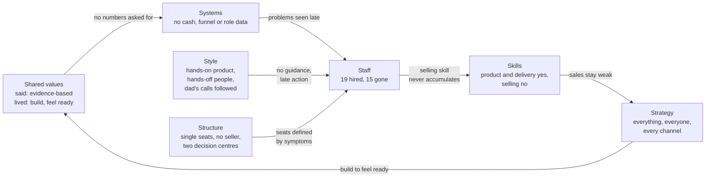

# Step 6a: McKinsey 7S: why the team never held together

As of 2026-10-28. First pass, no interviews yet. Sources: `inputs/DEUS_Company_History_Recap.pdf` (cited as "Recap, Phase N"; the people table as "Recap, Reference: people"), `inputs/deus-fact-sheet.md` ("Fact sheet"), `inputs/DEUS_Pitch.pdf` ("Pitch deck"), `inputs/DEUS_GBA_Presentation_8.pdf` ("GBA deck"), `inputs/Agate_Next_Chapter_GBA_deck.pdf` ("Agate deck"), https://deushcs.com and https://deck.deushcs.com (fetched 2026-10-28; DEUS's own marketing, used only for how DEUS describes itself), `outputs/01-systems-thinking.md` to `outputs/05-pmf.md` ("Step 1" to "Step 5"). Method: McKinsey 7S, the seven elements, the 21-pair alignment matrix and a change-readiness sequence (`mckinsey-7s` skill).

## The answer in one paragraph

DEUS's team problems were mainly **management and role-design problems, with hiring as the visible symptom**. Of the 15 people who left, about half left a seat that was badly defined (a sales seat filled with account managers, a psychometrics hire doing data work, two people covering one business-development job, one person doing "sales and data"), and the tech seat failed twice under nobody who could judge the work ("Ghifari worked with no guidance", Recap, Phase 3). Only three exits are recorded as poor hiring choices in the narrow sense, and three were ordinary life or career moves (section 1). Underneath sits the 7S finding that matters most: **none of the 21 pairs is aligned today**. The sharpest gaps are (1) a sales-led strategy with no one who has ever been hired as an experienced seller, (2) two decision centres, the founder and the founder's dad, with the dad's role never written down although he brought the main client, most leads and the order to rebuild Enhance, and (3) a company whose mission is "evidence-based solutions" for people decisions (deck.deushcs.com) that makes its own people, product and money decisions without evidence: the founder does not know the cash in the bank (Fact sheet), and no role outcome, tenure, funnel or loss reason was recorded. The five people who remain can work, but only if the company is cut to one product and one buyer type, every seat has a written outcome, the founder takes the selling seat, and the dad's role becomes a defined one.

## How to read this report

- **Facts** are cited. **Interpretation** is marked as such. Recommendations are in sections 6 and 7. Anything not in the files is labelled **ASSUMPTION**; missing numbers are **NO DATA**.
- **Derived** marks a count or arithmetic on cited facts.
- Scores (1–5) and alignment ratings (✅ aligned, ⚠️ partial, ❌ misaligned) are judgement calls on the cited evidence, not measurements. They are there to rank where to act first.
- Ratings describe DEUS **today** (the five-person team, Phase 11), using the history as evidence of how the organisation behaves.

---

## 1. Why 19 people came and went

### Facts: the seats, not the people

The recap lists 19 people besides the founder; 4 remain, so 15 have left (Recap, Reference: people; derived). Grouped by the seat they held:

| Seat | Who held it, in order | Still here | Source |
|---|---|---|---|
| Sales and account management | Rosi (junior BD) → Bu Vera (senior, "without a sales background", account manager) + Fizka (BD, "partly overlapped with Bu Vera's") → Bu Retno (account manager) + Audrey (marketing and sales) + Wulan (sales and data) → Yessica (account management, "not strong in sales") | Audrey | Recap, Phases 1, 3, 4, 7, 8 |
| Psychometrics and data | Sahid (psychometrics, then data "until he was overloaded") → Fitri (data, three months) → Wulan (sales and data) → Rizkie (psychometrics, "did not have a good work ethic") → Bu Sovie | Bu Sovie | Recap, Phases 1, 6, 7, 8, 9 |
| Engineering | Ghifari ("no guidance") → Andar (+ Yuli for QA, + Kayyis, "a friend of Andar's", frontend) → Ko Will and David (the rebuild the dad asked for) | Ko Will | Recap, Phases 3, 4, 8, 9, 10 |
| Product and project management | Thania (product: PRDs, Figma, digitised report); Firdaus (project manager, Potentia site) | Thania | Recap, Phases 6, 9, 10 |

- Five people left in Phase 10 alone (Recap, Phase 10).
- Hiring channels recorded: fresh graduates (Sahid, Rosi; Phase 1), a friend of an existing hire (Kayyis; Phase 9), and people the dad directed onto the rebuild (Ko Will, David; Phase 10). How anyone else was found is not recorded.
- No role description, target, probation review or onboarding is recorded for any hire (Recap, Phases 1–11).
- Tenure of each person, and the dates of the phases: NO DATA (Fact sheet). DEUS's own site gives 2022 as the founding year (deushcs.com; deck.deushcs.com), so the 19 hires span about four years (derived).

### Interpretation: what each exit points to

Each exit is classified by the cause the recap's own words point to most. This is interpretation, and most exits have more than one cause.

| Main cause | People | Count | What the recap says |
|---|---|---|---|
| **Role design** (the seat was defined wrong, overlapped, or combined two jobs) | Bu Vera, Fizka, Bu Retno, Yessica, Wulan, Sahid | 6 | Account managers hired into a seat whose problem was new revenue (Phases 3, 7, 8); Fizka's role "partly overlapped" Bu Vera's (Phase 4); Wulan held "sales and data", two unrelated jobs (Phase 7); Sahid, hired for psychometrics, did data work until overloaded and left "wanting work more purely in psychometrics" (Phases 6, 8) |
| **Management and guidance** (nobody could set or judge the standard) | Ghifari, Andar | 2 | "We did not know how to develop systems at all, so Ghifari worked with no guidance" (Phase 3); Andar led Enhance, "had not performed well", and was let go once the parallel rebuild was done (Phases 8, 10) |
| **Hiring choice** (the person did not fit a seat that was defined well enough) | Rosi, Rizkie, Kayyis | 3 | Rosi "very junior... without strong product knowledge" (Phase 1); Rizkie "did not have a good work ethic" (Phase 8); Kayyis, hired as a friend, "work was very slow" (Phases 9, 10) |
| **Life or career** (would happen at any company) | Yuli, David, Firdaus | 3 | Moved cities; another job; a project with friends (Phase 10) |
| **Not recorded** | Fitri | 1 | Left after three months; no reason given (Phase 7) |

Derived: 6 + 2 + 3 + 3 + 1 = 15.

**Interpretation, stated plainly.** Hiring is where the problem showed, but it is not where it started:

1. **The seat was defined by the symptom, not the job.** When sales was weak, DEUS hired account managers (Bu Vera, Bu Retno, Yessica), people who look after clients DEUS already has. The job the company needed was finding new buyers, and that was never written into a seat (Step 1, Loop 2). When bugs piled up, it added QA (Yuli); when data piled up, it added a data person (Fitri, Wulan). Each seat was a patch on a symptom (Step 1, Loop 1).
2. **Nobody could judge the work.** In Phases 3–9 no one at DEUS could set an engineering standard ("we did not know how to develop systems at all", Phase 3), and the recap records no experienced seller who could coach the sales hires. Poor performance was therefore seen late: Andar was let go only once a replacement system was finished (Phase 10), Yessica "eventually" (Phase 9). ASSUMPTION: several people judged as poor fits might have done better with a clear outcome and someone who could coach them.
3. **The hiring profile was cheap and close.** Fresh graduates for the first two seats (Phase 1), a friend for frontend (Phase 9). ASSUMPTION: cost drove the profile. Salaries today average Rp8–10 juta (Fact sheet), which supports this but does not prove it.
4. **The dad's direction created a second line of command** (section 5): the rebuild that replaced Andar's work was the dad's request to two other engineers, run "in parallel" (Phase 10).

So the honest answer to the playbook's question "hiring, role design or management?" (PLAYBOOK.md, section 4, question 5) is: **management first** (no one to set the standard or judge the work), **role design second** (seats defined around symptoms, overlaps, combined jobs), **hiring third** (cheap and close profiles that magnified the first two).

---

## 2. The seven elements

### Strategy: what DEUS is trying to win, and how

**Facts.**
- DEUS offers three products today, four on the company profile (Discover, Enhance, Next Chapter, Potentia; deck.deushcs.com) and lists ten industries on its main site (deushcs.com). The recap describes three (Recap, At a glance).
- Phase 11 strategy: "for the first time, we stopped relying on my dad's connections and started cold calls", F&B first, then finance; Enhance via Apollo; plus new waves of the dad's network and a rebrand (Recap, Phase 11).
- Revenue: Rp35 juta a month, all from DKB on Enhance; burn about Rp52–62 juta a month (Fact sheet).
- Steps 2, 4 and 5 recommend one narrow focus: Discover for Telkom-like volume-hiring buyers, Enhance as a priced DKB service contract, Potentia paused or exited (Step 2; Step 4; Step 5).

**Interpretation.** There is no written strategy in the files. The strategy in practice is "be ready for everyone": every product, every industry, every channel at once. The trade-offs that a five-person team must make (which product, which buyer, which channel) have not been made.

**Clarity 2/5. Execution 2/5.** Key issue: no trade-offs. The cold outreach is a real change in Phase 11, but it is aimed by industry, not by the buyer type the evidence supports (Step 3).

### Structure: who does what, who decides

**Facts.**
- Today: founder plus four single seats: Ko Will (tech), Thania (product), Audrey (marketing and sales), Bu Sovie (psychometrics) (Recap, Phase 11; Step 1, Loop 2). Nobody holds a data, QA, project-management or dedicated selling seat.
- The founder's dad, Christian Kurnia, "was never a hire, but he brought the DKB relationship, most early leads, and the request that Ko Will and David rebuild Enhance" (Recap, Reference: people).
- In the past, roles overlapped (Fizka and Bu Vera, Phase 4) and two engineering efforts ran in parallel under different direction (Andar's Enhance and the dad-requested rebuild, Phases 9–10).
- The legal entity is PT Investama Persada Kurnia (deushcs.com footer; deck.deushcs.com). Who owns it, and who has the final say on hiring, spending and product: NO DATA.

**Interpretation.** Formally the structure is flat and simple. Informally there are **two decision centres**: the founder runs the company day to day; the dad supplies the main client, the leads and, at least once, a decisive product order. That is not wrong in itself, many family-backed companies work this way, but because it is not written down, nobody on the team can know whose call a decision is. The Phase 10 rebuild is the clearest case: an engineer leading a product while a second team, set up by the dad, rebuilt it alongside him.

**Type:** flat, founder-led, with an informal second centre. **Decision speed:** fast on building (new products, games, rebrand), slow on people (poor fits kept until a replacement was ready). Key issue: every seat is a single point of failure, and the seat the strategy needs most (a seller) does not exist.

### Systems: the daily processes and the numbers

**Facts.**
- Feature work: "wait for the PRD, wait for the UI/UX, which Thania made from scratch in Figma, the developers build" (Recap, Phase 10).
- No client-data intake standard; messy uploads drove the data workload (Recap, Phase 6; Step 1, Loop 1).
- Power BI was added as a stopgap display layer (Recap, Phase 9); whether it is still used: NO DATA.
- Money: cash in bank and total invested are "NO DATA (founder doesn't know)"; burn and team cost are estimates (Fact sheet).
- Sales: most funnel cells are "?" (Fact sheet, Funnel by channel); no loss reason is recorded for any lead (Fact sheet, Founder notes).
- People: no role card, probation review, performance target or tenure record appears anywhere in the files (Recap; Fact sheet: "Average tenure of departed staff: ?").

**Interpretation.** DEUS has a product-building process and almost no management systems: no money view, no sales view, no people view. Without them, problems are found by their consequence (BCG churning, Phase 8; a person failing after months) instead of by a number moving. ASSUMPTION: whether DEUS runs its own appraisals in Enhance, or uses Discover on its own candidates, is not recorded; if it does not, the company does not use its own products on itself.

**Information flow:** founder-centred and verbal (ASSUMPTION: nothing written is recorded). Key issue: the founder cannot see cash, pipeline or people performance, so no decision has a trigger.

### Shared values (the centre): what DEUS says vs what it does

**Facts: what DEUS says.**
- Mission: "Menghadirkan solusi berbasis bukti" (to deliver evidence-based solutions) that help organisations understand and develop each individual's best potential (deck.deushcs.com).
- Values: Innovative, Inspiring, Invested in Our Clients, Inclusive, Insightful ("solutions with data and deep understanding"), Improvement Oriented (deck.deushcs.com).
- Main site: "Evidence over gut feel"; "Companies say people are their most important asset. Then they make decisions about them with the weakest data they have" (deushcs.com).

**Facts: what the history shows.**
- Discover was built from "an idea we thought was genuinely cool... no psychometric validation and little market validation" (Recap, Phase 1).
- New games were bought because they "made us more confident in selling"; "we have recently felt more ready to sell" (Recap, Phase 11).
- Telkom, the biggest win: "we were fairly lucky to win it" (Recap, Phase 7); why Telkom chose DEUS is not recorded (Fact sheet, Founder notes: "?").
- Hiring: fresh graduates, a friend, and network-directed hires; no recorded role outcome or check (section 1).
- The founder does not know cash in the bank or total invested (Fact sheet).

**Interpretation.** The gap is **critical**, and it is a specific one: DEUS sells "evidence over gut feel" for people decisions, and makes its own people decisions on gut feel. The lived values, read from behaviour, are closer to: *build something good and the market will come*, *loyalty and relationships first* (people kept long after poor performance, leads from family friends), and *feeling ready* as the signal to act. Two espoused values are genuinely lived: **Invested in Our Clients** (the years of work to keep DKB, Phases 3–10) and **Improvement Oriented** in product (the digitised report, the rebuild; Phases 6, 10). The others are not visible in the history. That gap matters beyond the team: a buyer's HR director who meets DEUS's turnover and unmeasured claims (Step 3 on "40+ brands") may read it as a gap in the product's credibility too (ASSUMPTION).

**Gap: critical.**

### Style: what leadership actually does

**Facts.**
- The founder spent about a year working with Thania on digitising the Discover report (Recap, Phase 6).
- Bad performance was handled late and by replacement: Ghifari let go, Andar "let go once Ko Will's system was done", Yessica "eventually let go", Rizkie's contract "we were not going to extend anyway" (Recap, Phases 8, 9, 10).
- The dad's requests were acted on: the DKB deal and the rebuild order (Recap, Phases 3, 10). The recap does not record any of his requests being declined.
- Major build and buy decisions were taken without a test set in advance (Step 2).

**Interpretation.** The founder's style is **hands-on in product, hands-off in people**: deep personal time on the report and the product side, while hires in seats nobody could coach were left to find their own way ("no guidance") and replaced when it didn't work. Conflict appears to be resolved by avoidance until a replacement exists, not by a direct conversation about the outcome expected (ASSUMPTION: the recap records outcomes, not conversations). Risk tolerance is **high for building** (a Rp1 billion game, an acquisition, a new suite) and **low for selling** (nine phases on warm leads before the first cold call; Recap, Phase 11). ASSUMPTION: the founder defers to the dad on decisions the dad initiates; whether they ever disagree, and how that is settled, is NO DATA.

**Leadership approach:** mixed: directive on product, laissez-faire on people, deferential to the dad. Key issue: the founder's time has gone to building, not to selling or to managing.

### Staff: who joins, who stays, who leaves

**Facts.**
- 19 hired, 15 gone, 4 remain plus the founder (Recap, Reference: people).
- The four who remain joined in Phases 6, 7 and 9 (Thania, Audrey; Ko Will, Bu Sovie). Thania and Audrey have stayed through the worst stretch: BCG's churn, the Phase 10 departures (Recap, Phases 6–11).
- Monthly team cost is about Rp40–50 juta, an average of Rp8–10 juta per person (Fact sheet).
- No one recorded as an experienced B2B seller has ever been hired (Step 1, Loop 2).

**Interpretation.** The profile DEUS has attracted is early-career or adjacent-skill people at low cost. The ones who stayed are the ones whose seat was clearly defined and matched their skill (product, engineering, psychometrics); the seats that churned are the ones defined around a symptom (sales, data, QA). The remaining team is a **stronger core than the history suggests**: the product person who has stayed longest, the engineer whose system passed "a clear audit" (Recap, Phase 10), a psychometrician, and a marketer who has been through every sales attempt since Phase 7.

**Talent strength 3/5. Critical gaps:** an enterprise seller, data operations, engineering backup. **Retention risk: high**, because each of the four is a single point of failure, and pay at Rp8–10 juta (Fact sheet) with no revenue growth gives little reason to stay if an outside offer comes (ASSUMPTION).

### Skills: what DEUS can do better than others

**Facts.**
- Product and UX: PRDs, Figma design, the digitised Discover report (Recap, Phases 6, 10).
- Engineering: Ko Will's Enhance "was much better, even under a clear audit" (Recap, Phase 10).
- Large-volume delivery: Telkom plus 6 subsidiaries, 1,000+ MT candidates, 30+ provinces, results in one day (Fact sheet; Pitch deck, Telkom slide). Who on today's team delivered it: NO DATA (Step 5).
- Game content: built and owned by Agate's teams; the Phase 11 games are Agate's own product, which Agate sells directly (Recap, Phases 1, 11; Agate deck; Step 2). DEUS's company profile lists "Next Chapter", the name of Agate's product, as one of its own solutions (deck.deushcs.com; Agate deck).
- Psychometric validation: none at the start (Recap, Phase 1); what validation exists today: NO DATA (Step 2).
- Selling to companies without a relationship: the Telkom deal (one buyer, already shopping) is the only case (Recap, Phase 7; Step 3).

**Interpretation.** DEUS's distinctive skills today are **product packaging and delivery** (turning a game into a report HR can use, running a 1,000-candidate intake) and a **rebuilt, configurable Enhance**. The core asset buyers would think DEUS owns, the games, is a vendor's, and the skill the strategy needs most, finding and closing new buyers, has never been in the building. **Learning agility: medium**: the product side learns (report digitised, Enhance rebuilt) but the sales and people side does not record what it learned from each attempt.

**Distinctive:** product packaging, high-volume delivery (one case), a rebuilt performance system. **Missing:** enterprise B2B selling, data operations, psychometric validation evidence, financial management.

---

## 3. Alignment matrix: all 21 pairs

```
              Strategy  Structure  Systems  Shared   Style   Staff   Skills
                                            Values
Strategy         —        ❌         ❌       ⚠️      ❌      ❌      ❌
Structure                 —          ⚠️       ⚠️      ❌      ❌      ⚠️
Systems                              —        ❌      ❌      ❌      ⚠️
Shared Values                                 —       ❌      ⚠️      ⚠️
Style                                                 —       ❌      ⚠️
Staff                                                         —       ⚠️
Skills                                                                —
```

Derived: 12 misaligned, 9 partial, 0 aligned.

| # | Pair | Rating | Why (evidence) |
|---|---|---|---|
| 1 | Strategy ↔ Structure | ❌ | Three to four products and ten industries (deushcs.com; deck.deushcs.com) for five single seats, none of them a selling seat (Recap, Phase 11) |
| 2 | Strategy ↔ Systems | ❌ | Cold outreach with no funnel log or pass line (Fact sheet; Step 2); cash unknown (Fact sheet), so no strategy can be steered or stopped |
| 3 | Strategy ↔ Shared Values | ⚠️ | The evidence-based mission fits a Discover focus; "Innovative" as practised (new products, games, rebrand) feeds the sprawl (Recap, Phases 9, 11) |
| 4 | Strategy ↔ Style | ❌ | The strategy is now sales-led; leadership time has gone to building and the dad's network is still worked in new waves (Recap, Phases 6, 11) |
| 5 | Strategy ↔ Staff | ❌ | No experienced seller ever hired; the one sales person also does marketing (Recap, Reference: people) |
| 6 | Strategy ↔ Skills | ❌ | Enterprise selling missing; the games are Agate's, sold by Agate to the same buyers (Agate deck; Step 4) |
| 7 | Structure ↔ Systems | ⚠️ | A flat team of five needs only light systems, but none exist: no documentation, so each exit drains a seat to zero (Step 1, Loop 2) |
| 8 | Structure ↔ Shared Values | ⚠️ | "Invested in Our Clients" is lived for DKB, but no seat owns client success since the account managers left (Recap, Phases 8–11) |
| 9 | Structure ↔ Style | ❌ | Two decision centres, founder and dad; the dad's rebuild order ran beside the existing engineering lead (Recap, Phase 10) |
| 10 | Structure ↔ Staff | ❌ | Overlapping roles (Fizka and Bu Vera), combined roles (Wulan: sales and data), a psychometrician doing data (Recap, Phases 4, 6, 7) |
| 11 | Structure ↔ Skills | ⚠️ | Today three seats match their holder's skill (tech, product, psychometrics); no seat exists for the missing skills (selling, data) |
| 12 | Systems ↔ Shared Values | ❌ | "Evidence over gut feel" (deushcs.com) vs no data on cash, invested capital, funnel, loss reasons or staff tenure (Fact sheet) |
| 13 | Systems ↔ Style | ❌ | Decisions are taken without numbers and leadership has not built a way to get them; the first quality signal was a client leaving (Recap, Phase 8) |
| 14 | Systems ↔ Staff | ❌ | No role card, onboarding or check-in recorded; poor fits seen in phases, not months (section 1) |
| 15 | Systems ↔ Skills | ⚠️ | Engineering skill is now present (Ko Will) but lives in one person, not in a process; UI drawn "from scratch" each time (Recap, Phase 10) |
| 16 | Shared Values ↔ Style | ❌ | "Insightful" and "Improvement Oriented" vs "fairly lucky" (Phase 7), no recorded review of BCG's churn, and "feeling ready" as the trigger to sell (Phase 11) |
| 17 | Shared Values ↔ Staff | ⚠️ | Values are not visible in how people were hired (fresh graduates, a friend; Phases 1, 9); but the core four stayed through hard years, which shows commitment |
| 18 | Shared Values ↔ Skills | ⚠️ | "Innovative" is matched by product and design skill; "evidence-based" is not matched by validation evidence (Recap, Phase 1; Step 2) |
| 19 | Style ↔ Staff | ❌ | "No guidance" (Phase 3), late action on poor performance, replacement instead of a clear expectation (Phases 8–10) |
| 20 | Style ↔ Skills | ⚠️ | The founder builds product skill hands-on (Phase 6) but no one has coached selling, so sales skill never accumulated |
| 21 | Staff ↔ Skills | ⚠️ | The current five can build and deliver; they cannot sell at enterprise level or run data operations at volume |

**The three misalignments that drive the rest:**

1. **Strategy ↔ Staff and Skills (pairs 5, 6).** The strategy has become "sell", and nobody in the company was hired to sell to buyers who don't know the family. Every other fix waits on this one.
2. **Structure ↔ Style (pair 9): two decision centres.** The dad's role is real (main client, most leads, the rebuild order) and unwritten. The team cannot tell whose decision a decision is, and the founder cannot be fully accountable for calls they did not fully make.
3. **Shared Values ↔ Systems (pair 12): selling evidence, running on gut feel.** This is the centre of the model. Until DEUS uses evidence on itself (cash, funnel, role outcomes), its values are wall art, and the decisions in the other 20 pairs keep being made by feel.

---

## 4. How the elements connect to the earlier steps



This is the 7S view of Step 1's loops. Loop 2 (the revolving door) is the Staff element; Loop 3 (the dad's network) runs through Structure and Style; Loop 5 (build to feel ready) is the lived Shared Value. The new point the 7S adds is that the loops are held in place by **the centre**: as long as the lived value is "build until we feel ready" and decisions need no numbers, each new hire, product or channel lands in the same misalignments.

---

## 5. The founder's dad's role

**Facts.**
- Christian Kurnia, a retail senior and long-time director at Matahari Department Store (Recap, Phase 5).
- He brought the DKB relationship, which became Enhance and is today 100% of revenue (Recap, Phase 3; Fact sheet).
- Most early leads were his: "retail companies and his friends", converted "almost none" (Recap, Phase 5); new waves in Phases 9 and 11 also produced nothing (Recap, Phases 9, 11). About 100 meetings in total (Fact sheet).
- He asked Ko Will and David to build a cleaner Enhance "because Andar had not performed well"; that rebuild is the version DEUS now sells (Recap, Phase 10).
- He "was never a hire" (Recap, Reference: people). His formal position (shareholder, director, funder): NO DATA. How the monthly gap of about Rp17–27 juta is covered: NO DATA (Step 1).

**Interpretation, said plainly and with respect.** The dad acts as an **unlisted chairman**: he brings the biggest relationships and makes at least some of the biggest calls, without a defined remit. Two of his interventions had very different results. The **rebuild order was right**: it produced the best asset DEUS has (Recap, Phase 10), and it was made because someone finally judged the engineering work, which the founder's team could not do. The **network as sales channel did not work**: roughly one deal from about 100 meetings across nine phases (Step 1, Loop 3). Both point the same way: the dad's value is **judgement and senior access**, not lead volume. The problem is not his involvement. It is that his involvement has no shape, so (a) the team cannot plan around it, (b) a request from him competes with the founder's plan without a rule for which wins, and (c) the founder carries accountability for decisions the founder did not fully own. ASSUMPTION: if family money covers the monthly gap, it also removes the cash signal that would otherwise force the trade-offs in section 2 (Step 1, Loop 5).

---

## 6. Change readiness

| Element | Today (1–5) | Target in 6 months (1–5) | Gap | Difficulty | Must change first |
|---|---|---|---|---|---|
| Shared values | 2 | 4 | 2 | High | Nothing; this is the anchor |
| Strategy | 2 | 4 | 2 | Medium | Shared values (agree to decide on evidence) |
| Structure | 2 | 4 | 2 | Medium (one conversation with the dad) | Strategy |
| Systems | 1 | 3 | 2 | Low (spreadsheets) | Strategy |
| Style | 2 | 3 | 1 | High | Shared values, structure |
| Staff | 3 | 3 | 0 now, +1 with a seller | Medium (cash) | Systems (cash known), strategy |
| Skills | 2 | 3 | 1 | Medium | Staff, style |

Scores are proposed judgement calls, not measurements. Target scores assume the recommendations below; the founder can move them.

---

## 7. What the five-person team needs to work

The 7S sequence is: anchor the values, set the strategy, then structure and systems, then staff, skills and style. Each recommendation names the element it moves and a check that shows whether it happened.

### First 30 days

1. **Anchor (Shared values): one rule, "evidence before we build, buy or hire".** DEUS applies to itself what it sells. No new product, game, rebrand or hire is approved without a written number that justifies it (a buyer who has paid or signed; a role outcome; the cash to cover it). This is Step 1's highest-leverage rule restated as a value. *Check:* the next build or hire decision has a one-page written case.
2. **Direct (Strategy): one product, one buyer type, for six months.** Adopt the earlier steps' call: Discover for Telkom-like volume-hiring buyers; Enhance as a priced DKB service contract; Potentia paused (Step 2; Step 4; Step 5). Write it on one page the whole team can repeat. *Check:* every person can say in one sentence who DEUS sells to.
3. **Shape the dad's role (Structure): a one-page founder–dad agreement.** It says what the dad decides (for example: funding, and introductions at senior level), what the founder decides (product, hiring, priorities), how a disagreement is settled, and a monthly review where both look at the same numbers. Introductions go only to organisations that match the buyer profile (Step 3). This is a family conversation, not a reorganisation; the aim is clarity, not less involvement. *Check:* the agreement exists and the first monthly review happened.
4. **See the company (Systems): a weekly one-page dashboard.** Cash in bank and months of runway; the funnel per channel (contacts, replies, meetings, proposals, deals, and the loss reason for each "no"); DKB support hours per week; open Enhance bugs. Most cells are "?" or NO DATA today (Fact sheet). *Check:* four consecutive weekly sheets with no "?" in the cash row.

### Days 30–90

5. **Re-cut the five seats around the strategy (Structure, Staff).** Proposed, to be adjusted by the founder (the current split of each person's time is NO DATA; Step 4):

   | Seat | Person | Outcome it owns |
   |---|---|---|
   | Selling (new buyers) | Founder | Meetings and paid pilots with Telkom-like accounts (Step 5's 30-day plan) |
   | Marketing and pipeline | Audrey | Target list, outreach, case study, funnel log |
   | Assessment design and delivery | Bu Sovie | Running pilots, norms and validation evidence, the report a buyer reads; client data intake rules |
   | Product and client success | Thania | The Discover buyer experience; DKB as an account (scope, change requests, satisfaction) |
   | Engineering | Ko Will | Platform for both products; DKB work inside an agreed weekly time cap |

   ASSUMPTION: the founder taking the selling seat is the cheapest way to fill the gap, given the monthly loss (Fact sheet); it is also the seat where the founder's ownership and the dad's senior access help most.
6. **A role card for every seat (Systems, Staff).** One page: the outcome expected in 90 days, who judges it, what support the person gets, and what happens if it is missed. Reviewed in writing at day 30 and day 90. Start with the five people already here. *Check:* five cards, five 30-day reviews on file.
7. **Remove single points of failure (Systems, Skills).** Ko Will documents how Enhance is deployed and maintained; Bu Sovie documents scoring and norms; the founder files DEUS's Agate terms (Fact sheet gap 3). Arrange one outside engineer who could step in for Ko Will (ASSUMPTION: a freelance contact, paid only if used). *Check:* a person outside the seat can follow each document.
8. **The next hire is a seller, and only when the numbers allow it (Staff).** No hire until cash and runway are known. When there is a hire, it is someone who has sold to enterprise HR buyers before, with a role card, and not an account manager (section 1). *Check:* the hiring decision has a written case under rule 1.
9. **Change how the founder spends the week (Style).** Proposed: at least half of the founder's working time on selling and on the weekly numbers, the rest on managing the four (role cards, reviews, coaching); product work is delegated to Thania. ASSUMPTION: today the split leans to product (the year spent on the Discover report with Thania, Phase 6); the actual split is NO DATA. *Check:* the founder's calendar for one week, reviewed at the monthly founder–dad meeting.

**Change sequence:** Shared values → Strategy → Structure (dad's role, seats) → Systems (dashboard, role cards) → Staff and Skills (documentation, the seller hire) → Style (founder's week, made visible by the systems). **Timeline:** the first four steps fit in 30 days and cost nothing but time; the seat re-cut and role cards take 30–90 days; a seller hire depends on cash and runway, which are NO DATA today. Alignment that holds (shared values and style that match) is a 6–12 month job (ASSUMPTION, based on the skill's change sequence, not on DEUS data).

### Unintended consequences to watch

- **The founder–dad conversation** may feel like a loss of trust. Guard: frame it around the dad's strongest contributions (the rebuild judgement, senior access) and make the monthly review the place his judgement is used.
- **Role cards and reviews in a team of five** can feel like surveillance. Guard: start with the founder's own card, and make the review about support as much as results.
- **The founder in the selling seat** means less product time. Guard: Thania already writes the PRDs and designs (Recap, Phase 10); product decisions go to her with a written brief.
- **Capping DKB engineering time** could annoy DEUS's only paying client. Guard: Step 1's menu approach (what's included, what's extra), raised when a second revenue source is in sight.

---

## Key findings

1. **The team problems were management first, role design second, hiring third.** Of 15 exits, six trace mainly to badly defined seats, two to work nobody could judge, three to hiring choices and three to ordinary life moves; one is unrecorded (section 1; Recap, Reference: people).
2. **None of the 21 pairs is aligned: 12 misaligned, 9 partial.** The three that drive the rest: a sales-led strategy with no one ever hired to sell (Strategy ↔ Staff, Skills), two decision centres with the dad's role unwritten (Structure ↔ Style), and a company that sells "evidence over gut feel" while running on gut feel (Shared values ↔ Systems; deushcs.com; Fact sheet).
3. **The dad's real value is judgement and senior access, not lead volume.** His rebuild order produced DEUS's best asset (Recap, Phase 10); his network produced about one deal in about 100 meetings (Fact sheet). His role has no defined shape, which is the problem, not his involvement.
4. **The remaining five are a stronger core than the turnover suggests:** the seats that held were the ones defined clearly and matched to a skill (product, engineering, psychometrics). Each is also a single point of failure, and no one sells.
5. **What the team needs is a decision rule and a shape, not more people:** "evidence before we build, buy or hire"; one product and buyer type; a one-page founder–dad agreement; a weekly cash and funnel sheet; a role card per seat; the founder in the selling seat. Hire a seller only when cash and runway are known.

## Data gaps

- Tenure of each departed person, and the dates of each phase (NO DATA; Fact sheet). Without them, "fast" or "slow" turnover can't be measured.
- Reasons for leaving for Bu Vera, Fizka, Bu Retno, Fitri and Wulan (not recorded; Recap, Reference: people).
- Whether any hire had a written role description, target or probation review (none recorded).
- How each person was found, beyond the four cases recorded (NO DATA).
- The founder's and each team member's current time split across products and tasks (NO DATA; also Step 4).
- The dad's formal position: shareholder, director, funder; who owns PT Investama Persada Kurnia; who has the final say on hiring and spending (NO DATA).
- How the monthly gap of about Rp17–27 juta is funded (NO DATA; Step 1).
- Cash in bank and total invested (NO DATA; Fact sheet gaps 1–2).
- Whether DEUS uses Discover on its own candidates or Enhance on its own team (NO DATA).
- Who on today's team delivered the Telkom intakes (NO DATA; Step 5).
- Current salaries per seat, and what an experienced enterprise seller would cost in Jakarta (NO DATA; only the Rp8–10 juta average is known, Fact sheet).

## Questions for the founder

1. When your dad asks for something (a rebuild, a lead to follow up), how is it decided whether DEUS does it? Has there ever been a request you declined, and what happened?
2. Would you and your dad agree to a one-page note on who decides what, and a monthly review where you both look at the same cash and pipeline numbers?
3. Bu Vera, Fizka, Bu Retno and Yessica were hired to fix sales. What was each of them told success looked like after 90 days, and who checked?
4. Why did Fitri leave after three months, and why did Wulan leave? Was it the data workload?
5. Has DEUS ever used Discover on its own candidates, or Enhance on its own team? If not, would you start with the next hire?
6. How much of your own week goes to selling today, and how much to product? Would you take the selling seat for the next six months?
7. If Ko Will left next month, who could keep Enhance running for DKB?

Full sources: `inputs/DEUS_Company_History_Recap.pdf`, `inputs/deus-fact-sheet.md`, `inputs/DEUS_Pitch.pdf`, `inputs/DEUS_GBA_Presentation_8.pdf`, `inputs/Agate_Next_Chapter_GBA_deck.pdf`, https://deushcs.com and https://deck.deushcs.com (fetched 2026-10-28), `outputs/01-systems-thinking.md` to `outputs/05-pmf.md`.
