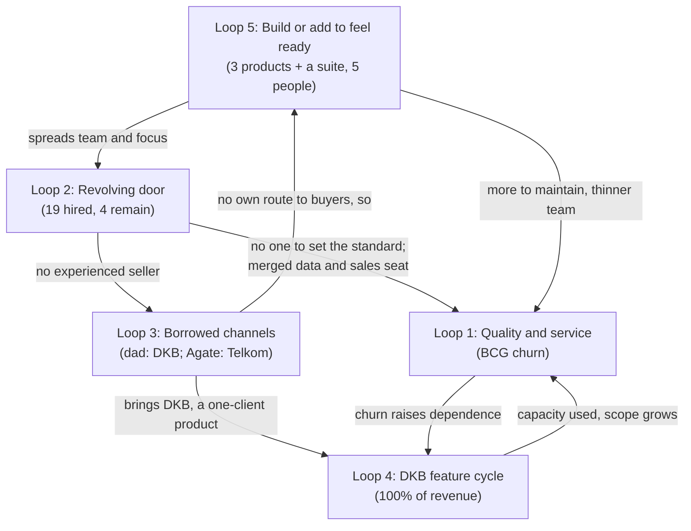

# Step 10: DEUS strategic analysis: the master report

As of 2026-10-28. **Rerun 2026-10-28** after the founder's answers of the same day (Fact sheet, "Corrections" and "Founder answers"). For the founder and the founder's dad; internal. This report combines `outputs/01-systems-thinking.md` to `outputs/09-executive-summary.md` (and the venture review behind Step 8, `ventures/deus/venture-review-2026-10-28.md`) into one document. It adds no claim that is not in a step report; the one exception is the timeline in section 2, which restates `inputs/DEUS_Company_History_Recap.pdf` phase by phase and applies the Fact sheet's corrections to it. Where a later step overruled an earlier one, this report follows the later step and says so (Steps 7 and 8 settle the open conflicts; section 10). Day 0 of the plan is 2026-10-29.

**Provisional.** No buyer, churned client or lost prospect has yet said in their own words why they bought, stayed, left or said no: the Step 6c interviews have not run. The founder's answers explain every loss, but they are the founder's account, and every reason in them lies outside DEUS (Step 7, section 4). The only buyer-side words in the files are four short quotes DEUS chose for its Telkom slide (GBA deck, Success Story). The bank balance is unknown (Fact sheet, Money). After the interviews, Steps 7 to 10 are rerun (IMPLEMENTATION_PLAN.md, owner line).

## How to read this report

- **Facts** are cited. **Interpretation** is marked. **Recommendations** have their own lines or sections (mainly sections 6, 8 and 10). **ASSUMPTION** = not in the files. **NO DATA** = a number that is missing; every NO DATA is collected in section 11. **Derived** = arithmetic on cited numbers.
- Source labels: "Recap, Phase N" (`inputs/DEUS_Company_History_Recap.pdf`; "Recap, Reference: people / clients" for its tables), "Fact sheet" (`inputs/deus-fact-sheet.md`; "Correction N" = its five numbered corrections; "Founder answers" = its last-but-one section), "Pitch deck" (`inputs/DEUS_Pitch.pdf`), "GBA deck" (`inputs/DEUS_GBA_Presentation_8.pdf`), "Agate deck" (`inputs/Agate_Next_Chapter_GBA_deck.pdf`), and "Step N" for the step reports. Web sources keep the numbering of the report that found them and are cited with their step ("Step 4, W8"; "Step 6b, W1"; "Step 7, W1"); the full list is in "Sources" before Key findings.
- Judgement grades, scores and ratings (A to F, 1 to 5, ✅ ⚠️ ❌) are judgements on the cited evidence, not measurements. Pass lines and dates in the plan are proposals, not facts.
- Step 7 labels each conclusion **ACT** (strong enough to act on now), **TEST** (act on it only as a test with a pass line) or **HOLD** (too weak to use as evidence). Sections 3 to 8 carry those labels where Step 7 gave one (section 9).
- **What the founder's answers changed** (Corrections 1–5): DEUS did not buy the Phase 11 games and is, on the founder's account, one of five Agate sales partners for them (Agate's own materials also show direct selling; Step 7, C8); the Telkom buyer was Telkom's Assessment Center, and it came through Agate; Telkom stopped because its MT intake strategy changed; BCG left over bugs, delivery and communication, not lack of need; the dad is the funder and says he will keep supporting DEUS, and the founder has the final say.

| Section | What it answers | Built from |
|---|---|---|
| 1 | The answer in one page | Step 9 |
| 2 | What happened | Recap, with the Fact sheet's corrections |
| 3 | Why it happened | Step 1 |
| 4 | How the products were built | Step 2 |
| 5 | Who buys | Step 3 |
| 6 | Where to focus | Steps 4 and 6b |
| 7 | Is there product-market fit | Step 5 |
| 8 | Team and organisation | Step 6a |
| 9 | Challenges to these conclusions, and how to close them | Steps 7 and 6c |
| 10 | Verdict and next 30 days | Step 8 |
| 11 | Data gaps and open questions | All steps |

---

## 1. Executive summary

*(From `outputs/09-executive-summary.md`, rerun 2026-10-28; method: Pyramid Principle, answer first.)*

### The answer

**DEUS should change course now, in a narrower shape: keep the DKB contract as the base, run one Discover bet for two to three months with dated gates, and shrink to the DKB service if nothing passes.** The verdict calls this PIVOT, narrowed (Step 8). The end is written down before the bet starts.

- **Situation.** Five people, three products, one paying client: DKB, Rp35 juta a month for Enhance. The dad funds the gap, has said he will keep doing so, and the founder has the final say (Fact sheet; Correction 5).
- **Complication.** Costs are about Rp52–66 juta a month, so DEUS loses about Rp17–31 juta a month (derived; Fact sheet, Money). Neither product has product-market fit, every channel DEUS ran itself has closed no deal, and nothing has ever forced a stop (Steps 1, 2, 5).
- **Question.** Keep going as it is, change, or stop?
- **Answer.** Change. Not "keep going": nothing DEUS does today is working. Not "stop": DKB covers about 53–67% of costs, and the questions that decide the rest cost calls, not builds.

### Why: three arguments

**1. DEUS as it runs today is not working.**
- **Fact.** Discover: 0 of 3 buyers pay today and 1 repeated (Telkom's Assessment Center). Enhance: DKB is a retained account, held by the product or the relationship, which is unknown (Step 5). F&B: 100+ contacts, almost 10 meetings, 0 deals. Apollo: 0 meetings. The dad's network: about 100 meetings, DKB and almost nothing else (Fact sheet, Funnel). DKB is 100% of revenue.
- **Fact.** The founder's answers took away Discover's one advantage: Telkom's Assessment Center came through Agate, DEUS is one of five Agate sales partners selling the same modules, and DEUS's own personality game has no validation (Corrections 1–2; Fact sheet, Validation).
- **Interpretation.** No test ever had a pass line set in advance (Step 2), and open family money removed the only signal that forced a choice (Step 1, Loop 5). The reasons for lost deals ("already have an assessment", "no budget", a changed MT strategy) are the founder's account, so the verdict turns them into tests, not facts (Step 7, section 4).

**2. The DKB contract is a real base: enough to keep DEUS alive, not to carry five people.**
- **Fact.** DKB pays Rp35 juta a month, has about 300–400 users, is "quite satisfied" on the founder's account, and pays more than the Rp30 juta quoted to new clients (Fact sheet, DKB row). It covers about 53–67% of costs (derived).
- **Fact.** It is fragile: the scope is unwritten and growing, the notice period and code ownership are unknown, Ko Will is the only engineer who can keep it running, and DKB pays 2.9–4.7 times what packaged HR systems list, so a careless scope talk could start a price comparison (Fact sheet, gap 4 and Team; Step 7, MC6).
- **Interpretation.** As a contract it is sound once four things are fixed: the contract read, a ceiling on free work, a backup for Ko Will and a named account owner. As the whole company it is not; sized to its fee (about three people, no office) it is about break-even, possibly a small loss (Step 8, section 9.1). Enhance was refused on price, not tested on need: the dad's contacts said "no budget" at Rp30 juta (Founder answers; Step 7, C10).

**3. The questions that decide the rest are cheap to answer, so test for two to three months and write the end down first.**
- **Fact.** Agate's lead rule, buyers' own reasons and what anyone would pay for Enhance can be answered in 2–4 weeks by meetings and calls. Two months of the gap cost about Rp34–62 juta, three about Rp51–93 juta, less once the office goes (derived).
- **Interpretation.** The dad's willingness to fund is not evidence that a product works, and money and years already spent are no reason to continue (CLAUDE.md, rule 3). The devil's-advocate review found the draft clock too loose; a sum does not force a choice, a dated consequence agreed in advance does (Step 8, section 6; Step 7, C18).

### The decision (recommendation)

**Stop now, whatever the gates show:** Potentia (zero team hours); Apollo, cold email and new F&B contacts; new builds and hires; and the office (Rp12 juta a month), with notice in week 1 unless the lease penalty is larger than the saving (lease terms NO DATA).

**Keep and secure DKB:** the contract read; DKB's server logs and decision-maker interview; a 30-day internal time log; Ko Will's run book and a named backup engineer; Thania as account owner.

**Run one growth bet.** Discover as a service to the heads of central assessment units and owners of large MT or graduate intakes, reached through Agate's leads and at least 5 named introducers, never cold email, priced per intake from Bu Sovie's costing, not from Telkom's per-candidate price (Step 8, section 8; Step 7, C5).

**Make one cheap check.** The founder calls five of the dad's "no budget" contacts and asks what they use and what a DKB-like system would have to cost, quoting no price. Enhance gets a money test only if two name a price at or above the floor plus Rp5 juta a month.

| Date | What is judged | Fail, and what happens that week |
|---|---|---|
| 2026-11-04 | The clock: the founder and the dad sign one page (the gates, what a fail means, the last month family money covers a growth gap, who stays if DEUS shrinks); bank balance and every recurring cost written down | Money figures missing: the money bar stays at 2026-12-28 |
| 2026-11-11 | Gate 1, a route: Agate's written lead rule, or 5 named introducers; the Telkom Assessment Center interviewed; DKB's contract read | No Agate rule and fewer than 5 introducers: the bet ends and DEUS shrinks |
| 2026-11-27 | Gate 2, meetings: at least 2 with a dated intake; the intake costed; the Enhance check scored | Fewer than 2, or most owners say "already have one": the bet ends and DEUS shrinks |
| 2026-12-28 | The money bar: at least 5 owner meetings and a paid first stage of a dated intake at list price or above, or a signed order. Moves to 2027-01-26 only if Agate has passed DEUS a qualified lead by 2026-11-27 | DEUS shrinks (unless Enhance's money test is still running to 2027-01-26) |

A pass sets the next bar: by 2027-04-30, a contracted deal whose costed margin covers at least three months of the gap. **If nothing passes, DEUS shrinks to the DKB service** and the growth bet ends, a clean result, not a failure. If DKB gives notice before any gate passes, DEUS winds down in an orderly way (Step 8, section 8).

**The founder's questions of 2026-10-28** (Step 8, section 9):
1. **Is Enhance as a DKB service contract a fine business model?** Yes as a contract and as the base, once its scope, terms and key person are secured. No as the whole company at five people.
2. **Is DEUS still worth continuing, and in what way?** Yes, for two to three months, in this narrower shape, with the end already written down. Not as today's three-product company on open-ended family money.
3. **What to do to make it profitable?** Cut what buys no test (the office alone cuts the gap to about Rp5–19 juta a month), secure DKB's Rp35 juta, then add contracts whose margin is known. Both margins are NO DATA, so the next 30 days measure what one intake costs to run and what DKB costs to serve.
4. **Should DEUS spend big on very good salespeople?** Not now: there is no sale that works yet to scale. After the money bar passes, one experienced seller with a 90-day target in money (Step 8, section 9.4).

The next 30 days are in section 10.8.

**The verdict changes if:** Agate passes DEUS a lead (the money bar moves to 2027-01-26) or does not (the bet rests on introductions); DKB's contract bars selling Enhance (its money test cannot run); the burn is materially higher than Rp52–66 juta (the cost of the bet is recomputed) (Step 8, section 11).

---

## 2. What happened: a short timeline

Facts only, restated from the recap, which "records how that happened, phase by phase, without analysis or lessons" (Recap, About this recap), with the Fact sheet's corrections applied where they overrule it (marked "Correction N"). The recap gives phases, not dates (Fact sheet: dates NO DATA). DEUS's own site gives 2022 as the founding year (deushcs.com; deck.deushcs.com, via Step 6a), and Phase 10 is "three to four years in" (Recap, Phase 10).

| Phase | What happened | People |
|---|---|---|
| 1. Founding and Discover v1 | DEUS starts from "an idea we thought was genuinely cool" and goes "straight to building"; no psychometric validation and little market validation first. Agate builds a medieval situational-judgment game for almost Rp1 billion; it takes almost two hours to play and the reports are very simple (Recap, Phase 1; Fact sheet) | Sahid (psychometrics), Rosi (junior business development) |
| 2. Partners and first client | MoMs signed, but the partners "never sold our product". First client Boga Group: 600 employees at a low price (Rp60 juta; Fact sheet); many bugs, a long process, simple reports, "did not seem fully satisfied" (Recap, Phase 2) | |
| 3. Enhance is born | Through the dad's relationship, DKB needs a performance management system for a very complex KPI and appraisal setup; DEUS builds it as its second product. BCG signs a recurring deal while Enhance is still in development (Recap, Phase 3) | Rosi let go; Bu Vera (account manager, no sales background); Ghifari (first tech hire, "no guidance"; his version "very buggy") |
| 4. Development struggles | Enhance takes "a very long time", with many changes and bugs. Agate moves to the metaverse; Discover goes to Skyfy for almost a year, which cannot fix bugs; the project returns to Agate and DEUS pays extra to shorten the game (Recap, Phase 4; Recap, Reference: clients, partners and vendors) | Andar (tech), Yuli (QA), Fizka (business development, overlapped with Bu Vera) |
| 5. Sales attempts and recognition | Sales "all through my dad's connections" (Christian Kurnia, a retail senior, long a director at Matahari Department Store); mostly retail companies and his friends; "we converted almost none". Only revenue: recurring Enhance from DKB and BCG. Startup Studio Indonesia and a free InnovFest Singapore booth (Komdigi) converted nothing (Recap, Phase 5) | |
| 6. Product team | Enhance keeps its bugs; messy client data has to be uploaded; the founder and Thania spend about a year turning the Discover report into a digitised report (Recap, Phase 6) | Thania (product); Fitri (data), because Sahid was overloaded |
| 7. Sales push and Telkom's Assessment Center | More emphasis on sales. A large deal with Telkom: support for its MT recruitment programme two years in a row, "one of our biggest accomplishments" (Recap, Phase 7). The buyer was Telkom's Assessment Center, the unit that tests all Telkom recruits, and the deal came through Agate: the Assessment Center asked Agate for a gamified assessment and Agate brought DEUS in (Correction 2). The recap: "fairly lucky to win it, because Telkom was specifically looking for gamification vendors. Apart from Telkom, we struggled very hard to sell anything" | Bu Retno (account manager), Audrey (marketing and sales), Wulan (sales and data); Bu Vera, Fizka and Fitri gone |
| 8. Setbacks | Cleaning data takes long, Enhance stays buggy, and BCG, the biggest deal, churns: "a huge blow" (Recap, Phase 8). The founder's reason: poor service, a lot of bugs and DEUS "weren't able to deliver", and BCG felt abandoned on communication once Wulan handled the account; BCG does not want to come back (Correction 4) | Sahid resigns, Rizkie replaces him ("did not have a good work ethic"); Ghifari let go, Andar leads Enhance; Yessica replaces Bu Retno ("not strong in sales") |
| 9. Holding DKB, adding Potentia | "Afraid DKB would churn too": Power BI as a temporary display layer (no longer used; Founder answers); the proper Enhance website keeps being built in parallel. Potentia (kids' assessment) is acquired, free of charge (Founder answers); one deal (Sekolah Kristen Calvin), "extremely hard to sell". New waves of the dad's network fail for Discover and Enhance (Recap, Phase 9) | Ko Will and David; Kayyis (Andar's friend, frontend); Bu Sovie replaces Rizkie; Firdaus (project manager); Yessica let go |
| 10. Rebuild and departures | The dad asks Ko Will and David to build a cleaner Enhance because Andar "had not performed well". "Three to four years in", Enhance is still not done because DKB keeps adding features; each feature waits for a PRD, then for UI/UX drawn from scratch in Figma, then is built. Ko Will's version is "much better, even under a clear audit". Potentia gets its own website (Recap, Phase 10) | Five leave: Andar (let go), Firdaus, David, Yuli, Kayyis (not extended) |
| 11. Today | The recap says DEUS acquired Agate's cognitive, neuroscience and simulation games, making Discover a full suite and DEUS "more confident in selling". The founder corrects this: DEUS did not buy them; it is one of five Agate sales partners for Next Chapter, at no purchase cost (Correction 1). For the first time, cold outreach instead of the dad's network: F&B "a good number of responses", no deals; finance "not many replies"; Apollo for Enhance zero meetings from hundreds of contacts; new waves of the dad's network "nothing; no assessment sales and no Enhance sales". Website, presentations and company profile are being rebranded (Recap, Phase 11) | Team of five: the founder, Ko Will, Thania, Audrey, Bu Sovie |

What the corrections add to the timeline: Telkom stopped after two years because its MT intake strategy changed, and it could not introduce DEUS to similar groups (Correction 3; Founder answers). DKB keeps adding features without paying extra and is now "quite satisfied" (Founder answers). The dad is the main funder and a shareholder; the founder has the final say (Correction 5).

### Where DEUS stands today (Fact sheet unless cited)

| Item | Value |
|---|---|
| Revenue | Rp35 juta a month, DKB only (Enhance) |
| Burn | About Rp52–62 juta a month (team Rp40–50 juta plus office Rp12 juta; founder's estimate). The Enhance server, about Rp4 juta a month, may be extra, so costs may be Rp52–66 juta |
| Gap | About −Rp17 to −27 juta a month, or −Rp21 to −31 juta with the server on top (derived) |
| Cash in bank, runway, total invested | NO DATA (the founder doesn't know). The dad says he can support and is fine continuing, with no written limit (Correction 5) |
| Buyers ever | Six: Boga Group (Discover, Rp60 juta, one-off; now has its own systems), DKB (Enhance, Rp35 juta a month, ongoing), BCG (Enhance, Rp40 juta a month for about a year, about Rp480 juta, churned), Telkom's Assessment Center (Discover, two years, second deal Rp380 juta, ended: MT intake strategy changed), Sekolah Kristen Calvin (Potentia, about Rp12 juta), SPH (Discover, about Rp12 juta; not in the recap) |
| People | 19 hired besides the founder, 4 remain (Recap, Reference: people) |

---

## 3. Why it happened: loops and root causes

*(From `outputs/01-systems-thinking.md`, revised 2026-10-28. Method: causal loop diagrams, stocks and flows, archetypes and Meadows' leverage points. R = reinforcing loop, B = balancing loop.)*

DEUS's problems were not eleven phases of separate bad luck. **Five feedback loops produced them, and four are still running.** Each time a problem appeared, the company applied a fix that relieved the pressure (another hire, a Power BI layer, another wave of the dad's network, another product or game suite, another free feature for DKB) instead of the harder fix underneath (an engineering and service standard, a sales role with a seller in it, its own route to a repeatable buyer type, a product scope not set by one client). The pattern is "shifting the burden": the quick fixes worked well enough to remove the urgency of the real fix. The founder's answers sharpen one point: **both repeat buyers came through someone else's channel** (DKB through the dad, Telkom's Assessment Center through Agate; how BCG first reached DEUS is NO DATA), and DEUS's own outreach has not closed a deal yet (Step 1). The full causal loop diagram of each loop is in `outputs/01-systems-thinking.md`. The highest-leverage change is a rule: **nothing new gets built, added or rebranded until a named buyer type has paid for what already exists, more than once.** Step 7 rates the loop labels a lens rather than a finding: the same events fit a plainer story of an underfunded first-time team learning by doing, so it says to act on the rules the loops imply (cheap, and they hold either way) and not to cite the labels as proven (Step 7, C1; section 9).

**What the founder's answers changed in this step** (Step 1, "What this revision changed"):

| Point | First pass said | Now | Effect on the loops |
|---|---|---|---|
| Phase 11 games | DEUS "acquired more games from Agate" | Not bought; DEUS is one of five sales partners for Next Chapter, no purchase cost (Correction 1) | Loop 5 cost no cash this time, but the pattern held; new risk: four other partners sell the same suite |
| Telkom | Lead source unknown | Telkom's Assessment Center asked Agate; Agate brought DEUS in; it stopped because the MT intake strategy changed (Corrections 2–3) | Loop 3 now has a second borrowed channel |
| BCG churn | Data problems and bugs | Bugs, DEUS "weren't able to deliver", poor communication once Wulan held the account; BCG won't come back (Correction 4) | Loop 1 confirmed, with a service link added |
| DKB features | Unknown | DKB still adds features, pays no extra, has never accepted a priced scope; "quite satisfied" (Founder answers) | Loop 4 confirmed; the "price each change" lever is known to be resisted |
| Funding | Unknown | The dad funds and will keep supporting, no written limit; the founder decides (Correction 5) | Loop 5: open-ended support hides the cash signal |

### Loop 1: quality and service → client experience → churn (weakened, not gone)

- **Facts.** Boga met "many bugs", a long process and simple reports (Recap, Phase 2). Enhance's first developer "worked with no guidance" because "we did not know how to develop systems at all" (Recap, Phase 3); QA was hired "because there were so many bugs" (Recap, Phase 4); "messy client data" overloaded the data person (Recap, Phases 6, 7). BCG, paying Rp40 juta a month (more than DKB's Rp35 juta; Fact sheet), churned (Recap, Phase 8). The founder's account of why: a lot of bugs, DEUS "weren't able to deliver", and BCG felt abandoned on communication once Wulan handled the account; BCG does not want to come back; Wulan left for poor performance, "one of the reasons BCG failed" (Correction 4; Founder answers). Fearing DKB would churn too, DEUS put Power BI on top of Enhance "as a temporary solution" (Recap, Phase 9); Power BI is no longer used. Ko Will's rebuild was "much better, even under a clear audit" (Recap, Phase 10), and DKB, with about 300–400 users, is now "quite satisfied" (Founder answers).
- **Loop.** Bugs and messy data → manual workarounds → slow, error-prone delivery → worse client experience → churn → less money for guided engineering → more bugs (R1). Workarounds also eat the time that would remove the bugs (R1b). New in the revision, a service link: the same overloaded person who cleaned data also held the client relationship (Wulan, "sales and data"), so when data work swamped her, communication with BCG dropped. The quick fix (QA, a data person, Power BI) eases the symptom and adds a layer to maintain (B1).
- **Archetype: shifting the burden**, with a fixes-that-fail side effect. The fundamental fix was a way of building software, a standard for how client data comes in, and an account owner whose time is protected from data work; the symptomatic fix was a person or a layer each time.
- **Interpretation.** The root cause was not the individual hires: nobody at DEUS could set or check engineering quality in Phases 3–9. BCG's churn reason, as the founder tells it, is a quality-and-service failure, not a lack of need, so BCG is evidence that a group like it would pay Rp40 juta a month for Enhance, and evidence that DEUS lost it on delivery. ASSUMPTION: the rebuild succeeded partly because Ko Will brought the standard himself. Step 7 adds that "not lack of need" is the founder's inference, and BCG won't talk (Step 7, C7).
- **Leverage points.** A data intake rule (no client data enters unless it meets a written template; cleaning quoted and paid for); one account owner per client whose job is not data cleaning, with a set rhythm of contact; a weekly count of open bugs and cleaning hours per client; one senior person (an advisor is enough) to set the standard before any technical hire.
- **Still active?** Weakened, not gone. The bug stock was largely cleared by the rebuild, Power BI is gone and DKB is satisfied. But no data person is on today's team of five, so the next client with messy data reopens the loop; all engineering sits with Ko Will, and the founder says that if he left, keeping Enhance running would be "very hard"; and who would look after a second Enhance client is NO DATA (Recap, Phase 11; Founder answers).

### Loop 2: hiring, turnover and the role that was never filled (active, as a risk)

- **Facts.** 19 people besides the founder have worked at DEUS; 4 remain, so 15 left (Recap, Reference: people; derived). Seven people held sales or account roles (Rosi, Bu Vera, Fizka, Bu Retno, Audrey, Wulan, Yessica); only Audrey remains and runs the F&B outreach; no hire is recorded as an experienced B2B seller. Data and psychometrics passed through five people (Sahid, Fitri, Wulan, Rizkie, Bu Sovie); engineering through Ghifari, Andar and Kayyis before Ko Will and David (Recap, Phases 1–10). Five left in Phase 10 alone. Average tenure: NO DATA. Why some left, in the founder's words: Bu Vera resigned; Fizka's father had health problems; Bu Retno was replaced by Yess; Fitri left because DEUS wanted one person to do both data and sales; Wulan for poor performance. No success metrics were set for Bu Vera, Fizka, Bu Retno or Yess. DEUS rarely uses Discover or Enhance on its own candidates or team (Founder answers).
- **Loop.** A capability gap → pressure to fill the seat fast → a quick, junior, friend or adjacent-skill hire → poor fit → exit → knowledge lost → the gap reopens (R2). Each exit loads the people who remain (R2b). The variable missing from the history is a written definition of success in the role and someone able to judge it, which the founder confirms was absent for four hires.
- **Archetype.** Fixes that fail for the sales seat (the fix was an account manager or a junior, never the seller the problem called for); shifting the burden for the data and tech seats.
- **Interpretation, stated plainly.** The founder's reasons let the loop be separated from bad luck. Not the loop: Fizka (family health) and Bu Vera (resigned). The loop: Fitri left because two jobs were merged into one seat; Wulan held that merged seat, failed at it, and the founder links her to the BCG loss; Bu Retno was replaced rather than given a target to hit; and none of the four named hires had a success metric. The evidence points more to role design and management than to hiring luck, though every description is the founder's (Step 7, C15). One telling fact: an assessment company that rarely assesses its own candidates skipped the cheapest check it had on its own hires. Step 6a tests this further (section 8).
- **Leverage points.** A one-page role card with a 90-day outcome, a named judge and a consequence; a written 90-day check for every hire; documenting what each person knows, starting with Ko Will; using Discover on DEUS's own candidates.
- **Still active?** Yes, as a risk: five people, each in a single seat, each a single point of failure, and Ko Will's is the one the founder names. Selling today is Audrey (F&B) and the founder (current focus: mainly selling Discover); neither is recorded as an experienced B2B seller; how much of the founder's week goes to selling is NO DATA (Recap, Phase 11; Founder answers).

### Loop 3: borrowed channels, the dad's network and then Agate (partly broken, still running)

- **Facts.** Sales ran "all through my dad's connections"; "most leads he brought were retail companies and his friends"; "we converted almost none" (Recap, Phase 5). The network produced DKB (Recap, Phase 3) and about 100 meetings in total, "almost no others" converting (Fact sheet, founder's estimate): roughly one deal per hundred meetings (derived, rough). Offered Enhance at Rp30 juta a month, the dad's connections "almost all" say no budget or hold till later (Founder answers). New waves failed in Phases 9 and 11 (Recap, Phases 9, 11); recognition programmes and partner MoMs produced no sales (Recap, Phases 2, 5).
- **Telkom came through Agate.** Telkom's Assessment Center, the unit that tests all Telkom recruits, contacted Agate for a gamified assessment, and Agate brought DEUS in (Correction 2). The second deal was Rp380 juta for 1,000 candidates (Fact sheet), about 11 months of today's DKB revenue (derived). It ended because Telkom's MT intake strategy changed; Telkom could not introduce DEUS to similar groups (Correction 3).
- **Cold outreach** started only in Phase 11: F&B 100+ contacts, almost 10 meetings, 0 deals; finance about 100 contacts, most don't reply; Apollo "hundreds" of contacts, 0 meetings; DEUS "can't make" organisations like Telkom respond (Recap, Phase 11; Fact sheet, Funnel; Founder answers). Why deals don't close, in the founder's account: most often the company is curious but already has its own assessment; also "we'll discuss internally" then silence, "we don't need it now", the game experience (long, small text), personal preference (Fact sheet).
- **Outside pressure.** Agate sells Next Chapter through five partners, DEUS and four others (Correction 1). Agate's own deck shows a price list and "Book Your Live Demo", and Agate launched the suite publicly with free pilots (Agate deck, Pricing Structure; Step 4, W8). How leads are shared is unknown (Fact sheet, gap 2).
- **Loop.** Need for leads → use a channel someone else owns → meetings, sometimes a deal → pressure eases (B3a). The fundamental fix, building an own channel and learning who buys, has a long delay and always lost (B3b). Courtesy meetings with the dad's friends give a sense of pipeline that reduces effort on the own channel (R3).
- **Archetype: shifting the burden, with a second outsider.** The first pass treated Telkom as proof that DEUS could win outside the family network. It was outside the family network, but not DEUS's own channel: Agate found the buyer and brought DEUS in. DEUS's own outreach has produced zero deals. The buyer profile survives (an open need, high volume, a recruitment use case, and now a central assessment unit that tests recruits for a whole group); the route to it does not.
- **Interpretation.** "We already have our own assessment" says DEUS mostly meets companies with no open need; Telkom's Assessment Center was the opposite. ASSUMPTION: the buyers worth chasing are the ones already running a vendor search, and today Agate hears about those searches before DEUS does. Said plainly, with respect: the dad's network gave DEUS its only current revenue (DKB) and Agate gave it its largest deal, but neither is a channel DEUS owns, and nine phases of network waves at roughly one deal per hundred meetings, with nothing in Phase 11, is not a reason to keep using the network as the main channel. Sunk effort is not evidence.
- **Leverage points.** Change what counts as a lead (an organisation with an open need, not a leader who knows the family); put the Agate channel in writing (terms, lead allocation); log every channel's funnel weekly with the loss reason in the buyer's words; build the Telkom loop on purpose (case study → central assessment units and MT programmes at other large groups → second reference), with a warm first route because cold outreach to them has not worked (ASSUMPTION).
- **Still active?** Yes, in a new form. Phase 11's cold outreach is the first real attempt at the fundamental fix but has closed no deal, the network is still worked in new waves, and the one route that has produced a Telkom-like buyer is Agate's, shared with four other partners. Telkom is not coming back for a third year (Correction 3).

### Loop 4: the Enhance feature-request cycle with DKB (active, at its strongest)

- **Facts.** DKB came through the dad with "very complex" KPI and appraisal needs; DEUS "decided to take it on" as its second product (Recap, Phase 3). "Many changes came in while it was being built" (Recap, Phase 4). "Three to four years in, and Enhance was still not fully done because DKB kept adding more and more features" (Recap, Phase 10), through a fixed PRD → Figma → build sequence. DEUS feared "DKB would churn too" (Recap, Phase 9). **DKB still adds features** (its own KPI groupings, a year-end summary) and **pays no extra**: it sees the Rp35 juta as covering them and has never accepted a written scope with a price per change; it is "quite satisfied", with about 300–400 users (Founder answers). DKB's Rp35 juta is about 53–67% of costs (derived; Fact sheet), and about Rp31 juta after the Rp4 juta server (derived), before any share of Ko Will's or Thania's time (NO DATA). New clients are quoted Rp30 juta; the dad's connections almost all say no budget; Apollo produced zero meetings; the founder "would like to sell Enhance more but can't" (Founder answers).
- **Loop (success to the successful).** DKB pays, so it gets the development capacity; Enhance fits DKB better and the market less; no other clients arrive; DKB's share of revenue and DEUS's fear of losing it rise (R4). New in the revision (R4b): every free feature confirms that extras are included, which makes the next request free too, and is why DKB now refuses a priced scope. The slow PRD → design → build sequence makes each request expensive.
- **Interpretation.** The evidence leans clearly toward "Enhance is a service contract for DKB, not yet a product": built from one client's complex needs, shaped by that client's additions for years, still taking unpriced requests, and zero meetings when offered to the market. That is not a failure in itself: a satisfied client paying Rp35 juta a month is real. The loop becomes dangerous only when DEUS treats the DKB work as product development for a market that is not buying.
- **The founder's question** (is running Enhance as a DKB service contract still a fine business model?) seen from the loops: yes, as a way to break R4, on two conditions: what Rp35 juta buys each month has to be written down, or R4b keeps growing the free scope; and the contract rests on one client and one engineer, so it is a cash line to protect, not a base to build on. The full answer is in section 10.
- **Leverage points.** Decide what Enhance is for (a service contract for DKB, or a product that needs a second paying client before more features); fix what the fee includes (a set amount of development time a month, ASSUMPTION: DKB accepts a capacity limit more easily than a price list); track the share of dev time that goes to DKB-only work (NO DATA); a shared component library to shorten the feature pipeline.
- **Still active?** Yes, at its strongest: DKB is 100% of revenue, still adds features and pays nothing extra. If DKB leaves, revenue goes to zero; if Ko Will leaves, DEUS may not be able to serve DKB (Founder answers).

### Loop 5 (cross-cutting): build or add to feel ready to sell (active)

- **Facts.** Discover was built "straight" from "an idea we thought was genuinely cool" for almost Rp1 billion, with no psychometric validation (Recap, Phase 1); its personality game still has none (Fact sheet, Validation). After a weak first client DEUS spent about a year digitising the report (Recap, Phase 6) and paid Agate extra to shorten the game (Recap, Phase 4; amount NO DATA). Enhance was taken on off one client; Potentia was acquired free while the first two were weak, then expanded, and was "extremely hard to sell" (Recap, Phases 3, 9; Founder answers). **Phase 11, corrected:** DEUS did not buy new games; it became one of five sales partners for Agate's Next Chapter suite at no purchase cost (Correction 1). The cognitive module has a validation; neuroscience and simulation are "not fully" validated. The suite "made us more confident in selling", and a rebrand followed (Recap, Phase 11). Three products plus a partner suite for five people; neither Discover nor Potentia has a recorded paying client today. The dad is the main funder and says he will keep supporting; there is no written limit and the bank balance is not known (Correction 5).
- **Loop (fixes that fail).** Weak sales → belief that the product is not ready → build, add or rebrand → confidence → a short-lived sense that sales will now come (B5). Each addition costs team time and adds a product to learn and maintain → less focus on any one buyer → sales stay weak → the next addition (R5). The missing brake: a monthly loss should create pressure to decide what to stop, and open-ended family funding cancels that pressure.
- **Archetype: fixes that fail.** The fix treats a sales problem as a product problem. The most common loss reason, "we already have our own assessment", is about need and switching, which no added game fixes; the one product reason on record is that the game is long and its text small, a usability fix to the game buyers already see. Telkom's Assessment Center bought the single-personality-game version (Recap, Phase 7), before the Phase 11 suite existed.
- **What the correction changes, fairly stated.** The Phase 11 move was cheaper and more sensible than the first pass assumed: no purchase price, and the only validated module DEUS can sell. What still holds is the belief behind it ("now we are ready to sell") and the added scope. A new problem: **the suite is not DEUS's**; four other partners sell it and Agate launched it publicly with a price list and free pilots, so the suite cannot be what makes a buyer choose DEUS. Step 7 agrees on the rule and softens the charge: assessment units test cognitive ability, so the suite may be what makes the beachhead reachable; "no new builds, modules or rebrand until a buyer pays" is ACT, and carrying the suite is not a mistake to undo (Step 7, C2).
- **On the family funding** (CLAUDE.md, rule 3): the dad's willingness is a fact, not evidence that any product works, and money already spent is no reason to spend more. In this system the cash gap is the only signal that forces a choice, so a written amount and a review date would give the founder that signal while keeping the support. Step 7 says this is interpretation and that the plan already has dated gates with written fail lines (Step 7, C18; section 10).
- **Leverage points.** Replace "build, then sell" with "sell, then build"; one product and one buyer type for a fixed period; know the cash and write the funding down; fix what buyers actually named (a shorter game with larger text) before any new module.
- **Still active?** Yes: Phase 11 is the loop running again (a partner suite, then a rebrand), in a cheaper form, while revenue (Rp35 juta) is below costs (Rp52–62 juta), a gap of about Rp17–27 juta a month, or Rp21–31 juta with the server on top (Fact sheet).

### How the loops connect



**The common root: DEUS never built its own way to reach the buyer who needs it before deciding what to build.** Loop 3 (borrowed channels, no own route) feeds Loop 5 (add product to feel ready) and Loop 4 (build for the one buyer you have). Those create the scope and quality load in Loop 1 and the hiring churn in Loop 2. Loop 2 in turn leaves no experienced seller, which keeps Loop 3 running. The founder's answers did not break any link in this picture; they moved Telkom from "proof DEUS can sell on its own" to "proof of the right buyer, reached through a partner" (Step 1).

### Leverage points, ranked

| Rank | Change | Meadows level | Loops it breaks | Easy to start? |
|---|---|---|---|---|
| 1 | "Sell, then build": nothing new built, added or rebranded until a buyer has paid or signed for it | 2 Paradigm | 5, 4, 1 | Yes: a decision, no cost |
| 2 | Pick one buyer type from the evidence (Telkom's Assessment Center: a central assessment unit, volume hiring, an open vendor search) and one product for a fixed period | 3 Goal | 3, 5 | Yes, after Steps 3–5 |
| 3 | Put the Agate partnership in writing (terms, lead allocation) and log every channel's funnel weekly | 5 Rules, 6 Information | 3 | Needs a talk with Agate; the log is a spreadsheet |
| 4 | Enhance as a written service contract: what Rp35 juta includes each month (a set amount of dev time), the rest waits | 3 Goal, 5 Rules | 4, 1 | Needs a talk with DKB |
| 5 | A written family funding amount and review date; know the cash | 6 Information | 5 | Yes: one conversation with the dad |
| 6 | A role card with a 90-day outcome before any hire; document what Ko Will knows | 5 Rules, 11 Buffers | 2, 1 | Yes, before the next hire |
| 7 | Client data intake template; cleaning quoted as paid work; an account owner who is not the data cleaner | 5 Rules | 1 | Yes |

**Unintended consequences to watch** (Step 1): "sell, then build" can make the team pitch things that don't exist yet (guard: sell only what can be delivered by an agreed date, in writing); changing DKB's terms could trigger the churn DEUS fears, and DKB has already refused a priced scope (guard: frame it as how the team plans its month, not a price rise); asking Agate for written terms could cool a partner that owes DEUS nothing (guard: ask for clarity on how leads are shared, not for exclusivity); a written funding limit could feel like distrust (guard: the founder's own tool, with the amount set by the dad); narrowing to one buyer type means saying no to easy network leads (a matching referral is still welcome); logging the funnel can show that a favourite channel doesn't work (the founder and the dad should agree up front that the numbers decide).

---

## 4. How the products were built: a validation review

*(From `outputs/02-lean-startup.md`, revised 2026-10-28. Method: Build-Measure-Learn, value and growth hypotheses, innovation accounting, pivot types. The pass/fail thresholds are proposed decision lines, not data.)*

**DEUS has run the Build half of Build-Measure-Learn many times and the Measure and Learn halves almost never.** Across eleven phases every product decision was a build or an addition (a Rp1 billion game, a second product off one client, a year-long digital report, a free kids' product whose report DEUS then expanded, a full Enhance rebuild, a partner game suite, a rebrand), and no phase records a test set up in advance with a number that would have said "stop". The founder's answers change two facts and confirm the pattern. The Phase 11 games were **not bought**: DEUS is one of five sales partners for Agate's Next Chapter (Correction 1). And **both repeat buyers came through someone else's channel**: DKB through the dad, Telkom's Assessment Center through Agate (Correction 2; how BCG arrived is NO DATA). The loss reasons the founder reports point at buyers who already have an assessment and at the game's usability, not at missing modules (Fact sheet, Funnel). The cold outreach is the first genuine experiment DEUS has run, but nobody wrote down beforehand what result would count as a pass (Step 2).

### Where each product stands

| Product | Stage | Why |
|---|---|---|
| Discover | Problem-solution fit with **one** buyer type, reached through a partner; no product-market fit | Telkom's Assessment Center paid twice (second deal Rp380,000 per candidate; Fact sheet). It came through Agate and ended when Telkom's MT intake strategy changed (Corrections 2–3). No other repeat buyer; Boga was one-off and "not fully satisfied" (Recap, Phase 2) and now has its own systems; SPH paid about Rp12 juta once. No Discover client is recorded as paying today (Fact sheet). Step 2's comparison of Telkom's price with today's list price is withdrawn: Step 7 found it unlike for like (Step 7, C5; section 9) |
| Enhance | A paid custom system for **one** client; no evidence of a market at the quoted price | DKB pays Rp35 juta a month, has about 300–400 users, is "quite satisfied", and is all of today's revenue. BCG paid and churned over bugs and service (Correction 4). At Rp30 juta a month the dad's connections say no budget; Apollo gave zero meetings (Founder answers; Recap, Phase 11) |
| Potentia | Before problem-solution fit | One deal, Sekolah Kristen Calvin, about Rp12 juta (Fact sheet); "extremely hard to sell" (Recap, Phase 9); free to acquire, then DEUS expanded the report (Founder answers). Purchases on deuspotentia.com: NO DATA |

### The hypotheses each product was betting on

| # | Hypothesis | Type | Evidence today |
|---|---|---|---|
| D1 | HR buyers want game-based assessment instead of conventional tests | Value | Partly supported for one buyer type: Telkom's Assessment Center asked Agate for a gamified assessment and bought twice (Correction 2). Against: the most common loss reason is "we already have our own assessment" (Fact sheet, Funnel) |
| D2 | The game measures what it claims | Value | **Split by module.** Cognitive (Next Chapter): validated (who ran it: NO DATA). DEUS's own personality game: no validation. Neuroscience and simulation: "not fully" (Fact sheet, Validation). Both DEUS decks claim validation and Indonesian norming (Pitch deck, slide 8; GBA deck): the decks claim more than the founder's account supports for the personality game, which is the one DEUS owns and the one Telkom's Assessment Center bought |
| D3 | A long medieval text game is an acceptable candidate experience | Value | Partly disproved and acted on once (Recap, Phases 2, 4; cost NO DATA). Still open: lost prospects name "a bit long" with small text (Fact sheet, Funnel); DEUS rarely uses Discover on its own candidates (Founder answers) |
| D4 | Partners and recognition bring buyers | Growth | Disproved for MoMs, Startup Studio Indonesia and InnovFest: zero sales (Recap, Phases 2, 5). One partner did bring a buyer: Agate brought Telkom's Assessment Center (Correction 2) |
| D5 | The dad's retail network will buy assessments | Growth | Disproved over Phases 5, 9 and 11: "converted almost none", new waves "nothing" (Recap, Phases 5, 9, 11); about 100 meetings, DKB and almost no others (Fact sheet, Funnel) |
| D6 | Buyers didn't buy because Discover was personality-only; a full suite will sell | Value | Untested and contradicted by the loss reasons: none the founder reports is "you lack cognitive tests". Telkom's Assessment Center bought the single personality game before the suite existed (Recap, Phases 7, 11). The suite added the only validated module, at no purchase cost. Step 7 adds that the suite may be what makes MT screening credible (Step 7, C2) |
| D7 | Buyers will choose DEUS to buy Next Chapter from | Value / growth | **Revised.** Agate sells only through partners and four others have DEUS's role (Correction 1), so a buyer can buy from any of five. Partner terms: NO DATA (Fact sheet, gap 2). Agate's own deck shows a price list (Rp49,999–300,000 per user, 30% off for early adopters) and "Book Your Live Demo", and Agate launched publicly with free pilots (Agate deck; Step 4, W8), so how buyers reach a partner is unclear |
| E1 | Companies with complex KPI and appraisal setups pay monthly for a system that handles them | Value | Holds for DKB (Rp35 juta, "quite satisfied"); BCG signed before the product existed, then churned over service, not lack of need on the founder's account (Recap, Phase 3; Corrections 4) |
| E2 | What DKB needs is what others need | Value | Not supported: "DKB kept adding more and more features" for three to four years, still adds its own KPI groupings (Recap, Phase 10; Fact sheet); no third client. Whether Ko Will's rebuild is general or a cleaner DKB system: NO DATA |
| E3 | DEUS can build, run and serve this software reliably | Value | Disproved for Phases 3–9 on code and service (Correction 4). Supported for the rebuild ("much better, even under a clear audit", Recap, Phase 10), but it rests on one engineer |
| E4 | New Enhance clients can be found by cold email or the network | Growth | Answered at today's price: Apollo hundreds of contacts, zero meetings; the dad's network at Rp30 juta almost all "no budget" or "hold till later" (Recap, Phase 11; Founder answers). Step 7 notes only one price was tested (Step 7, C10) |
| P1–P3 | Schools or parents pay; DEUS can reach them with HR channels; a self-serve site sells without a salesperson | Value / growth | One deal, about Rp12 juta at Rp120,000 per student (list today Rp329,000 per child); "extremely hard to sell"; site sales NO DATA |

**Interpretation.** For all three products the riskiest hypotheses were the growth ones (who buys and how they are reached), and DEUS never designed a test for them. The two growth successes (DKB, Telkom's Assessment Center) were both introductions by someone else, and every channel DEUS ran itself (MoMs, events, network waves, cold email) has produced no deal (Fact sheet, Funnel). The value hypotheses got real tests by accident (Boga, BCG, Telkom).

### The Build-Measure-Learn ledger

| Phase | Build | Measure | Loop closed? |
|---|---|---|---|
| 1 | Discover v1, almost Rp1 billion | Nothing before the build (Recap, Phase 1) | No |
| 2 | Partner MoMs; first client Boga | Partner sales zero; Boga "not fully satisfied" | Partly: feedback acted on (game shortened, Phase 4; report digitised over about a year, Phase 6), but one client's view drove over a year of building with no paid test in between |
| 3 | Enhance for DKB; BCG signs before it is done | Two recurring contracts | Partly: strong signal, but what the two buyers share was not captured |
| 5 | Accelerator, InnovFest booth | Selection and a free booth | No: vanity metrics |
| 6 | Digital Discover report, about a year | NO DATA that a buyer asked for it | No |
| 7 | Telkom's Assessment Center, MT recruitment, two years, brought in by Agate | Paid twice; 1,000+ candidates, Telkom and 6 subsidiaries, 30+ provinces, results in 1 day (Pitch deck, slide 10) | **No**: the clearest validation was not turned into a next hypothesis or a managed channel; no source records asking Agate how such leads arise; Telkom could not refer peers (Correction 3) |
| 8 | (BCG churns) | Reason now given: bugs, delivery, communication under Wulan (Correction 4) | Partly: a people fix (Wulan let go), not a process fix |
| 9 | Power BI over Enhance; Potentia acquired free, report expanded; network waves | DKB kept; one Potentia deal | Mixed: Power BI was a cheap stopgap, close to a "Wizard of Oz" MVP (now retired), but a third product was added while two were unsold |
| 10 | Full Enhance rebuild | Quality: "much better, even under a clear audit"; DKB "quite satisfied" | No: quality measured, demand not |
| 11 | Next Chapter partnership (not bought); rebrand | Team confidence: "more confident", "more ready to sell" | No: the measure is a feeling, not a buyer |
| 11 | **Cold outreach** (F&B, finance, Apollo) | F&B 100+ contacts, almost 10 meetings, 0 deals; finance about 100 contacts, most don't reply; Apollo hundreds, 0 meetings | **First real Measure step**; no pass lines set in advance |

What the ledger shows (Step 2): eleven builds or additions and at most two closed loops (two cost no purchase price, Potentia and the partner suite, but each took team time); **the best signals were wasted**, and both came through someone else's door; the measures used were vanity metrics (programme selection, a booth, MoMs, team confidence, and "40+ brands", which the founder says counts brands inside about six paying groups); **the cheapest test was never run**, using the products in-house (DEUS rarely uses Discover or Enhance on its own candidates or team); loops were measured in years; and "build to feel ready" is the mental model behind it. **Said plainly:** the problem was never that the products were bad (Telkom's quotes, DKB's satisfaction and Ko Will's rebuild suggest they can be good; GBA deck, Success Story; Recap, Phase 10). It is that DEUS spent its money and years answering "can we build it?" when the open question, every time, was "who will pay for it, and how do we reach more of them?". Sunk cost (the Rp1 billion, the years of Enhance) is not evidence for either product, and neither is the dad's willingness to keep funding (Correction 5): it decides how long DEUS can look for the answer, not what the answer is.

### The current moves: what each one tests

| Move (Recap, Phase 11; Founder answers) | Is it an experiment? | What would tell DEUS in 30–60 days |
|---|---|---|
| Next Chapter partner suite (Agate's product, five sellers) | **No**: already in place; the only measure is confidence; no cash cost | Log which modules buyers ask for (fewer than half of quotes with a Next Chapter module in 60 days = breadth was not the blocker); get partner terms in writing and ask Agate how it decides which partner gets a lead |
| Rebrand | **No**, and it can barely be made one (no baseline reply rate) | Treat it as a cost and cap its time; make the decks say only what DEUS can show (D2) |
| F&B cold outreach (Audrey) | **Yes**, the first | 0 paid pilots from about 10 met prospects = F&B is not the beachhead at today's offer |
| Finance cold outreach | Yes, with no pass line | At least 3 meetings with the owner of a graduate or MT programme in 60 days, or stop the list |
| Enhance via Apollo | Yes, and **already answered** (0 meetings) | Stop |
| Enhance via the dad's network at Rp30 juta | Yes, and **answered at this price** | Stop offering it as a product; run Enhance as a DKB service contract unless a company asks on its own |
| The Agate channel | **Not yet**, and it is the one channel with a deal behind it | Written partner terms and a count of leads Agate passes DEUS in 60 days |

Of seven current moves, two are additions with no test, two are experiments without a pre-set pass line, two are repeat tests whose answer is already in, and the one channel that has produced a large deal (Agate) is not being measured at all (Step 2).

### Pivot or persevere, per product (Step 2's call, as later settled)

| | Discover | Enhance | Potentia |
|---|---|---|---|
| Step 2's call | **Persevere on the product, zoom in on the buyer and own the channel** (customer-segment pivot): central assessment units with volume hiring programmes, the only profile that paid twice; reached through Agate and introductions, not cold lists | **Business-architecture pivot, confirmed**: a written service contract with DKB, not a product for the market | **Pause**: no new spend or sales time |
| Toward more investment | At least 1 paid pilot from a Telkom-like unit in 60 days, or Agate passing qualified leads under written terms | A second company signs a service contract with a written scope; or DKB accepts a written scope and the time log shows the contract earns more than it costs | Self-serve sales on deuspotentia.com without sales effort |
| Toward pivot or stop | 0 paid pilots and no Agate leads in 60 days; Agate's lead sharing leaves DEUS no share; or buyers ask for validation DEUS can't show | The time log shows DKB work costs as much as the fee; DKB signals it will leave; Ko Will leaves with no backup | Already in "pause" |

Pivot types if Discover fails: value capture (sell the Telkom-style service, running a large intake in one day across provinces, rather than the games four other partners also sell) or channel (Agate's implementation partner for large assessment centers). Growth engine: only a sticky, repeat engine (annual MT and campus programmes) fits a five-person team selling to large employers; Telkom stopped after two years and could not refer peers, so a programme buyer may be worth one or two years, not an open run (Correction 3). **Status after Steps 7 and 8:** Potentia is **exit**, not pause (Step 8 settles Step 2's "pause" against Step 4's "exit"); Discover and Enhance are not backed alone but tested side by side: one gated Discover bet and five Enhance price-and-scope calls, on a DKB base (section 10).

### The founder's question about Enhance (Step 2, section 6)

**"If I run Enhance as a DKB service contract, is that still fine as a business model?" Yes for the contract, no for the company.** As a way to run the DKB relationship it is better than what DEUS does now; as DEUS's business model it covers only part of the cost, depends on one client and one engineer, and has an unpriced scope. In Lean Startup terms it is a business-architecture pivot: custom work for one buyer at a high price. The tests, applied to DKB:

| Test | DKB today | Verdict |
|---|---|---|
| Does the client value it? | Rp35 juta a month, about 300–400 users, "quite satisfied"; pays above the Rp30 juta quoted to new clients (Fact sheet) | **Yes.** About Rp88,000–117,000 per user per month (derived) |
| Does it earn more than it costs? | Fee Rp35 juta; server about Rp4 juta, leaving about Rp31 juta (derived). Ko Will's and Thania's time on DKB: NO DATA | **Probably, not proven.** Illustration only (ASSUMPTION): one person full-time at the team's average salary of Rp8–10 juta would leave about Rp21–23 juta for the rest of DEUS (derived: Rp35 juta − Rp4 juta server − Rp8–10 juta) |
| Is the scope written? | No: DKB adds features without paying extra and has never accepted a priced scope; start date, notice period, code ownership NO DATA (Fact sheet, gap 4) | **No.** The main weakness: an unwritten scope grows with every free feature |
| Can it survive a departure? | If Ko Will left, keeping Enhance running "would be very hard" (Fact sheet, Team) | **No.** One engineer for 100% of revenue |
| Does it pay for the company? | Rp35 juta against Rp52–62 juta: about 56–67% of the base burn, a gap of about Rp17–27 juta a month (Rp21–31 juta with the server on top) (derived) | **No.** It reduces the loss; it does not remove it |
| Can DEUS win more such contracts? | At Rp30 juta the dad's connections say no budget; Apollo zero meetings (Founder answers) | **Not shown.** No second client has signed since BCG left |

What it would take to be fine: write down what Rp35 juta includes (a set amount of development time, hosting and support; the rest waits) and find the notice period and code ownership; log DKB hours for 30 days; document how Enhance runs so a second person could keep it going; and no product spending on Enhance beyond what DKB pays for. If a second company signs a service contract with a written scope, Enhance becomes a small service line worth growing; if DKB leaves, or the time log shows the work costs as much as the fee, the contract stops paying for anything else. Step 8 gives the final answer (section 10.10, question 1).

### The three cheapest experiments (Step 2), and what became of them

| Experiment | What it tests | Pass / fail (proposed) | Where it went |
|---|---|---|---|
| 1. Telkom-like assessment units, through Agate and introductions | Can DEUS reach organisations with Telkom's profile, and will they pay? Does the Agate route send leads on known terms? Nothing to build: 20–30 named organisations, the Telkom slide, one meeting with Agate, introductions only (cold email to this list has not drawn responses; Founder answers) | Pass: at least 1 paid pilot within 60 days and either written Agate terms with 1 lead or at least 5 meetings with programme owners. Fail: 0 paid pilots, fewer than 2 meetings, no written answer from Agate | Became the **Discover bet and its gates**: Agate's written lead rule or 5 named introducers by 2026-11-11, two programme-owner meetings with dated intakes by 2026-11-27, a paid first stage of a dated intake by 2026-12-28 (section 10.7) |
| 2. Write the DKB contract down and log its cost | Does the contract earn more than it costs once its real cost is counted, and will DKB accept a written limit on what Rp35 juta includes (a set amount of development time, since DKB refused a price per change)? 30 days of hours logged by Ko Will and Thania plus the server; a one-page scope | Pass: logged cost clearly below Rp35 juta and DKB agrees to a written monthly scope or a notice period. Fail: cost at or above the fee, or DKB refuses any written scope (the contract is then open-ended and its price reopened at renewal) | Became the internal 30-day DKB time log; a monthly development allowance is proposed only if DKB work costs more than about Rp15.5 juta a month in people time, otherwise at renewal (section 10.7) |
| 3. Test "we already have an assessment" with a side-by-side pilot | Is the most common loss reason a hard no or a soft no? Would a prospect pay Rp999,000 (5 candidates; Pitch deck, A7) to run Discover beside its tool? A five-question call script and a one-line log | Pass: a reason in the buyer's words from at least 7 of 10 and at least 1 paid side-by-side pilot. Fail: fewer than 5 reachable, or every "already have one" stays a no even at Rp999,000 | Became **reasons only**: the F&B calls run as Step 6c interviews and Step 5's M3, the Rp999,000 pilot is offered only in those calls as a learning signal, and F&B gets no selling time and does not count toward the Discover pass (section 10.3) |

**Baseline for innovation accounting (Fact sheet):** revenue Rp35 juta a month, DKB only; costs about Rp52–62 juta (estimate), plus about Rp4 juta for the Enhance server if not already in it; cash and runway NO DATA (the dad will keep supporting, no written amount or date); F&B almost 10 meetings → 0 deals; finance about 100 contacts → most don't reply; the dad's network about 100 meetings → DKB, almost no others; Enhance cold contacts hundreds → 0 meetings; Agate leads → deals 1 → 1 (Telkom's Assessment Center), leads since NO DATA; repeat buyers Telkom's Assessment Center (Discover, ended), DKB (Enhance), BCG (Enhance, churned); reasons lost in the founder's account only; DKB hours per month NO DATA.

---

## 5. Who buys: ICP and anti-profile

*(From `outputs/03-icp-profile.md`, revised 2026-10-28, with the qualifications from Step 7. Method: ideal customer profile card, jobs-to-be-done with the four forces, assumed vs evidenced, anti-profile. "Backed" = rests on a cited fact; "Backed (founder)" = rests on the founder's answers, which are the founder's account, not a buyer's; "Assumption" = a reasonable reading that no file confirms.)*

**DEUS has one buyer type with real evidence behind it, and DEUS did not find it itself.** The only repeat Discover buyer was **Telkom's Assessment Center: a central unit that tests every recruit for a large group, running a high-volume management-trainee (MT) intake, that went looking for a gamified assessment and asked Agate, which brought DEUS in** (1,000+ candidates, Telkom plus 6 subsidiaries, 30+ provinces, two years in a row, Rp380,000 per candidate in the second year; Recap, Phase 7; Pitch deck; Corrections 2–3). It stopped after two years because Telkom's MT intake strategy changed, and it could not introduce DEUS to similar groups. The buyers who paid a large amount (Telkom's Assessment Center, DKB, BCG) arrived with a need already in hand, and the two that repeated came through someone else's door: Agate and the dad. Every channel DEUS ran itself (the dad's wider network, MoM partners, recognition programmes, F&B, finance and Apollo outreach, and cold outreach to organisations like Telkom) produced no deal (Fact sheet, Funnel; Founder answers). The most common reason prospects give for not buying is that **they already have an assessment**. So the profile is sharper and the channel problem is worse: the buyer DEUS wants is an assessment unit with an open search, and those go to a vendor they already know, not to a cold email. For Enhance there is still no ICP: one satisfied client tied to the family, one that churned over service (Step 3). **Step 7's qualification:** the profile rests on one account and is a TEST, not a finding (Step 7, C4); "both repeat buyers came through someone else's channel" is ACT, but "every large deal" is not, because BCG, the largest by total, has no recorded route (Step 7, C3).

### Evidence ledger

| Id | Buyer | Product | What was paid | Repeat? | Lead source | Source |
|---|---|---|---|---|---|---|
| W01 | Boga Group | Discover | Rp60 juta for 600 employees (about Rp100,000 each), "at a low price" | No: one-off; bugs, long process, simple reports, "not fully satisfied"; now has its own systems (C02) | NO DATA | Recap, Phase 2; Fact sheet |
| W02 | Delamibrands (DKB) | Enhance | Rp35 juta a month, ongoing; 100% of revenue; about 300–400 users; start date NO DATA | Yes, recurring; "quite satisfied" | The dad's relationship | Recap, Phases 3, 9, 10; Fact sheet |
| W03 | Binacitra Group (BCG) | Enhance | Rp40 juta a month for about a year, about Rp480 juta (estimate) | Churned (C01): bugs, delivery, communication under Wulan; won't come back | NO DATA | Recap, Phases 3, 8; Correction 4 |
| W04 | **Telkom's Assessment Center** | Discover (single personality game, before the suite) | Second deal Rp380 juta (Rp380,000 × 1,000); first deal NO DATA | Two years, then no third (C03: MT intake strategy changed) | **Agate** | Recap, Phase 7; Pitch deck; Corrections 2–3 |
| W05 | Sekolah Kristen Calvin | Potentia | About Rp12 juta | One deal | NO DATA | Recap, Phase 9; Fact sheet |
| W06 | Sekolah Pelita Harapan (SPH) | Discover | About Rp12 juta ("a smaller project, plus training their staff") | NO DATA | NO DATA | Fact sheet (not in the recap) |

**Channels and lead groups that did not convert (L01–L09):** the dad's network, Phases 5 and 9 (mostly retail companies and his friends; about 100 meetings across all waves; DKB the only recorded deal) and Phase 11 ("nothing"; for Enhance at Rp30 juta almost all say no budget or "hold till later"); early MoM partners ("never sold our product"); Startup Studio Indonesia and InnovFest ("converted nothing"); F&B cold outreach (100+ contacts, almost 10 meetings, 0 deals); finance (about 100 contacts, most don't reply); Apollo (hundreds of contacts, 0 meetings); Potentia partnerships ("extremely hard to sell"); cold outreach to organisations similar to Telkom ("can't make them respond") (Recap, Phases 2, 5, 9, 11; Fact sheet; Founder answers).

**Interpretation.** Six buyers, of which two repeated (DKB, Telkom's Assessment Center). The three largest amounts (DKB, BCG, Telkom's Assessment Center, each roughly Rp380–480 juta a year) came from groups with many entities and an existing, structured HR process. Lead sources are now known for the two repeat buyers, and both are someone else's channel; no channel DEUS ran itself appears as the source of any deal.

### Discover: the ideal customer profile card

| Field | Content | Status |
|---|---|---|
| Buyer unit | A **central assessment unit** (assessment center or group talent-acquisition team) that tests recruits for a whole group, not one company's HR team | Backed (W04; Correction 2), one case |
| Industry | Not defined by industry: the repeat buyer is a telecom state-owned group; the one F&B buyer did not repeat. ASSUMPTION: the job (volume early-career hiring run centrally) matters more than the industry | Facts Backed; conclusion Assumption |
| Size and region | A large group (a parent plus several subsidiaries; 1,000+ candidates in one intake); Indonesia-wide (30+ provinces at once) | Backed (W04) |
| Trigger and need | The yearly MT intake: a fixed date, a big pool, a shortlist needed fast. An **open search for gamified assessment**: the Assessment Center went to Agate before DEUS was involved | Backed (W04; Correction 2) |
| How it is reached | Through a vendor it already asks (Agate); cold outreach to similar organisations got no response | Backed (founder), one case |
| Who feels the pain / who pays | The Assessment Center running the MT intake (exact role ASSUMPTION). Who signed and from which budget: NO DATA | Unit Backed; role Assumption |
| Signals visible from outside | (1) A public MT, graduate or campus programme with a yearly intake; (2) a central assessment unit serving several group companies; (3) an active vendor search, which is **not visible from outside** | (1) and (2) Backed as Telkom's traits, Assumption as predictors |
| Why accounts stay or stop | A second year at Rp380,000 per candidate (W04). Step 3 read the price as above today's top list price (Rp279,000) and so not decisive; **Step 7 holds that out**: it bought the single personality game and the comparison is not like for like (Step 7, C5; section 9). It stopped because the programme changed (C03): a programme buyer is worth as long as its programme | Backed (founder) |
| Deal-breakers | (a) "We already have our own assessment", the most common loss reason; (b) a long or hard-to-read candidate experience (Boga; "a bit long" with small text; the full suite is 3 h 20 min of play); (c) validity: the personality game has no validation, cognitive has one | (a), (b) Backed (founder's account); (c) Backed as a fact about the product, Assumption as a buyer's reason |

**Confidence: low.** The whole profile rests on one repeat buyer that reached DEUS through Agate: the best evidence DEUS has, not strong evidence, and evidence about a buyer more than about a channel DEUS controls.

**The job (Backed for the situation and the scale, Assumption for the wording):** "When our yearly MT intake opens and we have to assess 1,000+ candidates for 7 companies across 30+ provinces at once, we want a modern, game-based assessment that scores everyone the same way, so we can shortlist fast and fairly." **Forces:** pull is Backed (the Assessment Center asked Agate for a gamified assessment before DEUS arrived, so the pull was towards game-based assessment and Agate, not DEUS; results in 1 day; Pitch deck); push, anxiety and habit are NO DATA. **Interpretation:** the first pass said the repeatable part was finding more organisations in that state; the new facts say such organisations show that state by asking a vendor they already know, which DEUS cannot see from outside. So the repeatable part is being where those requests land: Agate, and others that assessment units ask (ASSUMPTION: which others exist is not in the files). Agate now has four other partners, so a request that reaches Agate may go to any of five (Correction 1; Fact sheet, gap 2). Step 7 keeps all of this as a hypothesis: why Telkom stopped and how it found DEUS are the founder's account (Step 7, C6, C8).

### Enhance: the ICP card, very low confidence

Two buyers, both signed while the product was unfinished or before it existed (Recap, Phase 3), one churned; cold demand from outside is zero meetings from hundreds of contacts, and warm demand at Rp30 juta a month is "no budget". Backed: the trigger ("their KPI and performance appraisal setup was very complex"), the price paid (Rp35–40 juta), who signed (the HR head or the owner), and the deal-breaker (poor service: bugs, failure to deliver, a client left without communication; BCG churned on exactly this). NO DATA: industry, size of BCG, who feels the pain, current workaround. ASSUMPTION: DKB is fashion or lifestyle retail and Enhance buyers are multi-brand groups that tie pay to KPIs. DKB's strongest force is the relationship (the dad's) and a team that builds what it asks for without charging per change, plus DEUS's own fear of losing it ("We were afraid DKB would churn too", Recap, Phase 9). **Interpretation:** the evidence describes buyers of a custom-built system, not buyers of a product (consistent with Step 2 and Step 1, Loop 4). For BCG: it had the need and was willing to pay Rp40 juta a month, and DEUS lost it on delivery (Correction 4); Step 7 adds that "not lack of need" is the founder's inference (Step 7, C7).

### Different buyers, assumed against evidenced

Discover's evidenced buyer is a central assessment unit with a yearly volume hiring event; Enhance's buyers are groups with complex KPI and pay systems that want a system built around them. The trigger, the budget line and the likely decision-maker differ. **No buyer has bought both products** (Fact sheet), so the site's "One partner to hire, develop and pay" pitch is not supported by any purchase so far. Potentia's buyers are schools (W05; SPH bought Discover, not Potentia): a separate, low-value segment, not a third ICP to chase now.

| | Assumed by DEUS (where it shows) | Evidenced by the data |
|---|---|---|
| Industry | Retail first (the dad's network); then F&B and finance (Phase 11); the website lists ten industries (deushcs.com) | The only repeat Discover buyer is telecom (W04); the one F&B buyer did not repeat; F&B outreach 0 deals; retail leads converted almost none. Industry does not predict buying in this data |
| Buyer unit | The company's HR team, any company | A central assessment unit serving a group (W04; Correction 2) |
| Size | Small batches: packages of 5, 28, 60 and 100, a 5-candidate Pilot at Rp999,000, a Starter tier up to 250, a free trial (Pitch deck, A8, A9) | 1,000+ candidates in one intake (W04) is the only repeat; Boga's 600 did not repeat |
| Use case | "Fit the role, they perform. Fit your company, they stay": culture fit for any hire (Pitch deck, slides 1–3) | MT recruitment at volume (W04); the GBA deck and website list "Annual MT Recruitment" first, so DEUS knows the use case, but the targeting did not follow |
| How they arrive | Warm introductions from the dad, then cold outreach by industry and to Telkom-like organisations | Telkom's Assessment Center asked Agate, which brought DEUS in; DKB came through the dad with an urgent problem in hand; no deal came from DEUS's own outreach |
| Breadth | "Trusted by 40+ brands" (deushcs.com) | Six paying buyers; the logos are brands inside those groups |

**The "40+ brands" gap, now answered.** The site shows 11 logos (Telkom Indonesia, Boga Group, JVC Kenwood, Delamibrands, SPH, Pepper Lunch, Wrangler, Paradise Dynasty, Telin, Colorbox, Sekolah Kristen Calvin; deushcs.com). Five are recorded buyers. The founder says the others are companies inside the paying groups (Pepper Lunch under Boga), "all of them are paid" (Founder answers). So "40+ brands" counts brands within about six paying groups, not 40+ buyers. ASSUMPTION (general knowledge; the founder confirmed only the Pepper Lunch pattern): Telin sits under Telkom, Paradise Dynasty under Boga, Wrangler and Colorbox under Delamibrands; JVC Kenwood's group is NO DATA. The logos are honest in that each brand was served through a paying group, but they read as ten industries and 40+ customers, which is the picture that justified spreading outreach. Step 7 rates it ACT: show the six groups, and say what is and is not validated before any assessment-unit meeting (Step 7, C22).

**Interpretation, stated plainly.** The customer DEUS has been chasing was chosen by who could be reached; the customer the evidence shows was chosen by who already had the problem and asked for a solution, and both repeat buyers came through someone else. The first pass said the gap was calling organisations in the right state. The founder's answers show calling does not reach them, and that the most common answer from organisations not in that state is "we already have one". So the gap is about where DEUS stands when such a buyer asks, not about the next list to call.

### Anti-profile: who DEUS should stop chasing

| Stop chasing | Evidence | Status |
|---|---|---|
| Companies that already run an assessment they are content with, with no intake forcing a change | "We already have our own assessment" is the most common loss reason; such prospects are "curious about Discover" but don't buy. Telkom's Assessment Center also had its own testing, but it was actively asking for a gamified one: the difference is the open search | Backed (founder's account). Step 7: ACT as a list filter, TEST what it means in the calls: it may be the polite form of "your game is long" or "show me the validation" (Step 7, C19) |
| Companies reached through a relationship but with no active need | About 100 meetings across all waves of the dad's network, almost no deals; DKB is the exception and had an urgent need. **Keep** introductions only to companies that pass the ICP signals | Backed |
| F&B for Discover | One F&B buyer, one-off and unsatisfied; 100+ contacts, almost 10 meetings, 0 deals; long cycles, then "we already have an assessment" or silence | Outcome Backed; cause Assumption. Step 7: ACT on no new F&B contacts while the loss calls run, HOLD on "F&B is the wrong segment" |
| Enhance as a product to new companies: cold lists, and the dad's connections at Rp30 juta a month | Hundreds of Apollo contacts, 0 meetings; the dad's connections almost all "no budget" or "hold till later"; both Enhance buyers came through a relationship or an existing need | Backed (founder for the network). Step 7 notes only one price was tested (Step 7, C10) |
| Cold outreach to Telkom-like organisations as the main route to them | "Can't make them respond"; the one such buyer came through Agate. Keep the profile, change the route | Backed (founder) |
| Partners and resellers on MoMs without a sales target or named first deal; recognition programmes and booths as a sales channel | MoMs signed, no transactions; Startup Studio Indonesia and InnovFest 0 conversions. Contrast: a partner that buyers ask (Agate) produced a deal | Backed |
| Small, one-off internal-assessment buyers at low prices; school partnerships for Potentia (for now) | Boga only (one case, weak); Potentia "extremely hard to sell", one deal of about Rp12 juta | Backed |

**Not yet an anti-profile:** finance. About 100 contacts and most don't reply; meetings and deals are NO DATA. Finance firms with a central assessment unit or a formal MT programme would fit the profile (ASSUMPTION); cold email has not worked for that kind of organisation, so a finance test needs an introduction or Agate, not more cold email.

### Words customers use

**Almost none.** The only buyer-side words are four short quotes on the GBA deck's Telkom slide: three from participants and one from Telkom Group Selection praising DEUS's professionalism, chosen by DEUS for its marketing; none says why Telkom's Assessment Center bought (GBA deck, Success Story). The founder's answers give prospects' reasons as the founder heard them ("we'll discuss internally" then silence, "we don't need it now", "we already have an assessment", "a bit long" with small text, "send a proposal" then quiet), which are paraphrases, not recorded words. There are no DKB, BCG or Boga words and no lost-deal reasons from the buyers themselves. This is the largest weakness of the profile; the interviews in section 9 fill it.

---

## 6. Where to focus: portfolio decision and target market

### 6.1 The portfolio decision (Step 4: BCG matrix)

*(From `outputs/04-bcg-matrix.md`, revised 2026-10-28. Method: BCG growth-share matrix, cash-flow dynamics, portfolio balance. "Derived" marks arithmetic on cited numbers. Web market figures come from paid-report vendors' public summaries that disagree with each other and none sizes DEUS's exact niche: direction, not measurement.)*

**On the classic matrix DEUS still has no Star and no Cash Cow: every product is low-share in a market growing roughly 7–12% a year.** The founder's answers change two placements. **Discover is really two units**: DEUS's own personality game, the one DEUS owns and the one Telkom's Assessment Center bought for two years, and Agate's Next Chapter modules (cognitive, neuroscience, simulation), which DEUS did not buy and sells as one of five partners (Correction 1). The Telkom proof point came through Agate's door, not DEUS's (Correction 2). **Enhance as a product for the market moves from Question Mark to Dog**: its own market (HCM software) grows below 10%, and at the Rp30 juta a month DEUS now quotes, the dad's connections almost all say "no budget" and cold outreach gets no meeting, at a price about 2.5–4 times what a packaged HRIS lists for a company of DKB's size (Step 4, W2, W10; derived). Read by cash, **Enhance-for-DKB is the only cash** (Rp35 juta a month, about Rp31 juta after the Rp4 juta server, before team time; Fact sheet).

| Market | Size and growth | Source | Reading |
|---|---|---|---|
| Indonesian HR tech | USD 420 million (2025); 15.42% CAGR 2020–25; 11.94% forecast CAGR 2025–32 | Step 4, W1 (Ken Research) | Just above the 10% line |
| Indonesian HCM software | USD 145.6 million (2024), 9.4% CAGR; a second report from the same vendor says USD 240 million, 7.0% | Step 4, W2 (Market Research Future) | Below the line; the two conflict. The closer market for Enhance |
| Hiring assessment in Indonesia | NO DATA. The nearest figure, employment screening (USD 145 million), is mostly background checks | Step 4, W9 | Not usable |
| Volume hiring demand (a signal, not a size) | Rekrutmen Bersama BUMN 2025: 1.4 million+ registrants by 19 March 2025, up 20%, for 2,000+ vacancies in 107 state companies (about 700 applicants per vacancy, derived) | Step 4, W7 | Volume is growing and the funnel is very wide |
| Indonesian edtech | USD 3.61 billion (2025), 11.42% forecast CAGR; K-12 is 42.6%; assessment not a named segment | Step 4, W5 (IMARC) | Above the line; kids' assessment NO DATA |

No market DEUS is in is shrinking; growth is not the problem, share is. No source gives market shares. As a proxy (competitors' own claims, an order of magnitude only): Discover's own game has 3 lifetime buyers against Talentlytica's and Talentics's 300+ companies (about 0.01); Enhance has 2 against Mekari Talenta's thousands (below 0.001); Potentia 1 school deal. The Next Chapter modules are not DEUS's share to hold: four other partners sell them and Agate launched them publicly with free pilots (Step 4, W3, W6b, W8). Telkom and Telkomsel appear as clients of Talentlytica, Talentics and Agate: DEUS's best account is a buyer several competitors also serve (Step 4, W3, W4).

```
                   RELATIVE MARKET SHARE
            HIGH (leader)  ◀───────────▶  LOW
          ┌────────────────────┬──────────────────────────────┐
  HIGH    │ STARS              │ QUESTION MARKS               │
 GROWTH   │  (none)            │  Discover, own game          │
 (>10%)   │                    │   (share ~0.01; Telkom, via  │
          │                    │   Agate)                     │
          │                    │  Next Chapter modules        │
          │                    │   (resold, 1 of 5 partners)  │
          │                    │  Potentia (acts like a Dog)  │
          ├────────────────────┼──────────────────────────────┤
  LOW     │ CASH COWS          │ DOGS                         │
 GROWTH   │  (none in market   │  Enhance as a market product │
 (<10%)   │   terms; Enhance-  │   (HCM 7–9%; share <0.001;   │
          │   for-DKB is one   │   no takers at Rp30 juta)    │
          │   in cash terms)   │                              │
          └────────────────────┴──────────────────────────────┘
```

**Cash today (Fact sheet; derived):** revenue Rp35 juta a month, costs about Rp52–62 juta (the server's Rp4 juta may be on top), gap about −Rp17 to −27 juta a month (−Rp204 to −324 juta a year), or −Rp21 to −31 juta (−Rp252 to −372 juta) with the server; cash in bank and runway NO DATA. The dad covers the gap and says he will keep doing so, with no written amount; that is a fact, not evidence that any unit will work (CLAUDE.md rule 3; Correction 5). The skill's two danger signs both apply: no Cash Cows (the funders are one client and the dad) and too many Question Marks.

| Unit | Deal size achieved or quoted | Deals per year to cover the gap (derived) |
|---|---|---|
| Discover (own game, or with Next Chapter modules) | Rp380 juta (Telkom's Assessment Center, second deal); the same 1,000 candidates on all 4 modules at today's list would be Rp199 juta (Pitch deck, A9) | 1 at Telkom's price; about 2 at list (372 ÷ 199 = 1.9), more if Agate's share of the Next Chapter part is large |
| Enhance | Rp35–40 juta a month achieved; Rp30 juta a month quoted = Rp360 juta a year | 1 more client at the quote covers the gap except at its very top; no prospect has said yes at that price |
| Potentia | About Rp12 juta (Calvin) | 17–31 deals of that size |

*Step 7 qualifies this table:* it sets revenue against a cash gap, but a gap is closed by margin, and delivery cost is NO DATA, so "one good deal a year closes the gap" is HOLD (Step 7, C14, MC4). Step 4's comparison of Telkom's price with today's list price is held out for the same reason as in section 5 (Step 7, C5). The cost of keeping each unit is mostly NO DATA: how team time splits across products is not recorded; DKB's Rp35 juta less the server covers about 3.1–3.9 people at the Rp8–10 juta average, so Enhance is cash-positive only if it takes fewer than about three people's time, change requests included (derived; Step 4, section 3.3; Step 7, MC5).

**Step 4's call per unit** (later settled in sections 9 and 10):

| | Discover, own game | Next Chapter modules | Enhance | Potentia |
|---|---|---|---|---|
| Call | **Invest, narrowly**: sales time, not build money; no new games, modules or rebrand work until paid deals from Telkom-like assessment units; sell what only DEUS sells (its report and large-intake delivery) through Agate and introductions | **Hold at no cost** inside the Discover offer; get Agate's partner terms in writing | **Maintain as a DKB service contract** (run for cash); **exit as a market product** | **Exit**: zero team hours; decide within 90 days whether to sell, hand back, license or shut the site |
| Why | The only unit with a buyer who paid a large amount twice, and the only one of the four DEUS owns outright in a growing market | Costs nothing; adds the only validated module (cognitive) and the Agate route, which produced the one large Discover buyer; but it is not DEUS's share to build | The only cash today; as a product: below-10% market, 0 meetings, no takers at Rp30 juta | One deal of about Rp12 juta; a different buyer; 17–31 such deals needed |
| What would change it | Down: 0 paid pilots and no Agate leads in 60 days; or buyers ask for validation DEUS can't show | Up: Agate puts terms in writing and passes qualified leads. Out: its lead sharing leaves DEUS none | Up: a second company signs a written-scope contract. Down: DKB work costs as much as the fee, DKB signals it will leave, or Ko Will leaves with no backup | Back in: self-serve sales on the site without sales effort (NO DATA) |
| Status after Steps 7–8 | Not backed alone: a TEST (section 10) | Carried at no cost | Not dismissed as a market product: tested by five calls (section 10) | **Exit stands** (Step 8 settles Step 2's "pause" against Step 4's "exit"; section 10) |

**The founder's question, from the portfolio side:** Step 2 answers it (yes for the contract, no for the company), and the matrix adds three points. It is the right way to run a Dog that pays (stop investing, collect the cash). It does not fund the portfolio: even with no team time, Rp31 juta covers about half to 60% of costs (derived), so it is a bet with a sponsor, and the bet it sponsors should be Discover. And it is only as safe as two people: one client is 100% of revenue and one engineer can keep it running (Fact sheet, Team).

**The ICP test (Step 4, section 5).** The recommendation holds against Step 3: back Discover narrowly on the buyer's situation (an open search in an assessment unit) and through the route that found it (Agate and introductions); put Agate's terms first because the bet partly rests on Agate's lead flow, shared with four partners; sell what only DEUS sells, not more modules, since a buyer content with its current tool will not switch for modules four other partners also offer (ASSUMPTION; Step 2, Experiment 3 tests it); maintain Enhance as a contract and exit it as a product; exit Potentia. **The risk the matrix hides:** the ICP buyer is where competitors are strongest (Talentlytica and Talentics name Telkom-group companies, state banks and conglomerates), and Agate decides which of five partners gets each lead while its own deck carries a price list and a demo button. Why Agate brought DEUS, not another partner, to Telkom's Assessment Center is NO DATA: if the answer is "DEUS was the only partner then" or "luck", DEUS has no defensible share in its own ICP and the Discover bet should be smaller and shorter. **Limits (Step 4):** the matrix is weak for a company this small and is used for its cash logic and "pick one Question Mark" rule, not its share arithmetic; market definitions move the dots (defined as "custom systems for DKB", Enhance has 100% share and is a Cash Cow); web figures conflict; competitor client counts are their own claims; there is no customer voice.

### 6.2 The target market (Step 6b: STP)

*(From `outputs/06b-stp.md`, revised 2026-10-28. Method: segmentation, five validity tests, weighted attractiveness scoring, targeting matrix, perceptual map, points of parity and difference, positioning statement. Scores are judgements with their reasons in Step 6b; no segment has a measured size.)*

**The beachhead stays the Telkom type of buyer, but it is now defined by the buyer unit, not the company: the central assessment unit of a large state-owned group that tests recruits for several companies at once (S1, 54 of 80), with private groups that have the same kind of unit in the same list (S2, 49).** Telkom's buyer was its Assessment Center, which asked Agate for a gamified assessment; Agate brought DEUS in; it paid up to Rp380,000 per candidate for two yearly MT intakes and stopped when Telkom changed its MT intake strategy (Corrections 2–3). Two facts make this beachhead harder than the first pass said. First, **the rivals for these buyers are now Agate's four other Next Chapter partners and Agate's own business-development team, selling the same modules at the same list** (Correction 1; Step 4, W8), so S1's competition score falls to the lowest on the scale and its total from 59 to 54. Second, **an assessment unit always "already has an assessment"**: the signal that matters is an open search, and it reaches the vendor the unit already asks, not a cold email (Step 3). So the beachhead has two routes, Agate's leads (if Agate's written terms say who gets them) and introductions, and two audiences for its positioning: the assessment unit, and Agate. A new segment is worth one test: **assessment-centre providers that run assessments for other organisations** (S9, 46); Telkom's own unit appears to be one (a 2017 report describes Telkom's Assessment Center Indonesia serving state companies and government offices; Step 6b, W7; that it is the same unit is ASSUMPTION). **F&B (39), small batches (34) and education (39) stay off the list; finance stays only for firms with a programme and an introduction (47).**

| Id | Segment | Total (of 80) | Reading |
|---|---|---|---|
| **S1** | Central assessment units of state-owned groups (yearly MT intake for several companies) | **54** | Beachhead; the only reference and a known unit, but it came through Agate and cannot refer. Step 7: TEST (C20) |
| **S2** | **Private** multi-company groups with a central unit or group-run MT or graduate intake | **49** | Same list as S1; no buyer, contact or loss data yet |
| S3 | Banks and finance firms with an officer-development or MT programme | 47 | Selective: the right event in the most contested territory; only with an introduction |
| S9 | Assessment-centre providers that run assessments for others (new) | 46 | One conversation, not a list |
| S4 | State companies hiring only through the joint recruitment | 44 | Monitor: the volume stage is central (Step 6b, W1, W2) |
| S7 | Internal talent mapping and promotion | 40 | Monitor: Boga's one-off |
| S5 | F&B and retail frontline | 39 | **Exit**: Boga paid about Rp100,000 a head once; 0 deals from about 10 meetings |
| S8 | Schools and education groups | 39 | Exit |
| S6 | Mid-size companies, small irregular batches | 34 | Exit: Rp10 juta minimum orders; needs self-serve marketing DEUS lacks |

Scoring weights: size, growth, profitability and company fit ×3; competition and risk ×2; each 1–5. **Step 7 treats the order as a tie within judgement** (MC8): S1's profitability score of 5 rests on the above-list-price comparison that Step 7 holds out (C5), and its growth score on the joint recruitment's applicant growth, which is also a threat to S1; scored at S2's level S1 would be 48 against S2's 49. Practical effect small, because S1 and S2 sit in one list: **the gates decide, not the scores** (Step 7, C20). Segmenting by industry fails in DEUS's data: telecom repeated, F&B and retail did not, finance barely replied (Step 3). **Strategy: concentrated (niche)**, because a five-person team with no experienced seller and a gap of about Rp17–27 juta a month (Rp21–31 juta with the server) cannot run the differentiated offers the website already attempts (ten industries, packages from 5 to 10,000 candidates, a free trial), which produced no Discover sale since Telkom (Step 6b; Step 5). The dad's funding removes the cash deadline but not the choice (Correction 5).

**Positioning.** Today DEUS is one of six sellers of the same game-based platform (five partners plus Agate's own team), at the same list price, with no published difference. The open space is **game-based assessment delivered as a service**, run with the unit rather than for it: an assessment unit employs its own assessors and is unlikely to hand over its whole screening (ASSUMPTION; Step 6b).

| Candidate point of difference | Verdict (Step 6b) |
|---|---|
| **A. Proven at Telkom's Assessment Center** (1,000+ candidates, Telkom and 6 subsidiaries, 30+ provinces, results in 1 day, two years) | **Lead proof point.** Distinctive on present evidence (the other partners' cases are NO DATA), but it decays: the account stopped when the programme changed, and it was DEUS's own game, not Next Chapter |
| **B. Runs the game-based stage alongside the unit's assessors** (setup, candidate support across provinces, a ranked result within 1 day, a psychologist's debrief) | **Lead claim, with A as its proof.** At risk on feasibility: of the Phase 7 team only Audrey remains, who delivered Telkom is NO DATA, and DEUS's one recorded service failure lost BCG. Step 7: TEST on the first account before it goes on the website (C21) |
| C. DEUS's own personality game and report | A difference in waiting: no validation yet, and a unit employing psychologists will ask. DEUS can build this one rather than defend it |
| D. In-house psychometrician (Bu Sovie) | Support only; single point of failure |
| E. One platform for assessment and performance (Discover plus Enhance) | Drop: no buyer has bought both |

Points of parity DEUS must match, not lead with: the Next Chapter modules, bulk upload, anti-cheat and automatic reports (listed almost line for line in both decks), the cognitive validation (Agate's, so every partner can show it), a price per candidate within the market range (Rp69,000–279,000 against Agate's Rp49,999–300,000), and "fun, doesn't feel like a test". **DEUS's only defensible difference is service and track record, not technology** (Step 6b).

> **Positioning statement for the buyer (Step 6b).** For the head of a central assessment unit at a large Indonesian group, the team that tests recruits for several companies at once, who has to assess hundreds or thousands of MT candidates fairly, at the same time across provinces, and wants a modern, game-based first stage without giving up its own assessment, DEUS Discover is the game-based screening stage, run alongside your assessors, that takes the intake from candidate invitations to a ranked result in one day, ready for your own next stages, because DEUS ran Telkom's Assessment Center's MT screening for Telkom and six subsidiaries, 1,000+ candidates in 30+ provinces at once, two years in a row, with results in one day (Recap, Phase 7; GBA deck, Success Story; Pitch deck, Telkom slide).

Cautions (Step 6b): using Telkom's Assessment Center by name needs its permission (not yet asked); "run alongside your assessors" must be something today's five people can deliver, proven on the first account before it goes on the website; and no validity claim for the personality game until a validation exists. **A second statement, for Agate as the channel:** Agate decides which of its five partners gets an open-search lead, so DEUS needs a position in Agate's mind too ("the partner for large, multi-company intakes, that runs the intake end to end with the buyer's team so the buyer stays with Next Chapter"). That is a recommendation for the meeting with Agate, not a fact about how Agate routes leads, and Agate's own team piloting directly suggests it may also want those buyers for itself (ASSUMPTION; Step 6b, section 3.5; Step 4, W8).

**Repositioning and mix (Step 6b, recommendations).** An image repositioning: from "game-based assessment and performance management for Indonesian companies" across ten industries to "the game-based MT screening stage, run with your assessment team" for one buyer type; the logo wall shows the six paying groups with their brands under each, Telkom's Assessment Center first (with permission), not "40+ brands". Product: a screening set for an MT first stage (ASSUMPTION that 3 h 20 min of play is too long for volume screening), plus setup, candidate support, a one-day ranked result and a debrief. Price: one price per intake instead of two price lists in two decks, and a side-by-side pilot at the Rp10 juta minimum. Step 6b suggested anchoring that price on what Telkom's Assessment Center paid; **Step 8 later replaces this**: the price comes from the cost of running the intake, not from Telkom's per-candidate price (Step 8, section 8; Step 7, C5; section 10). Place: Agate's leads (if the written terms allow) and introductions to unit heads timed to each group's intake calendar, no cold email. Step 6b also set a 90-day plan whose gates the verdict now carries (section 10.7).

**Risks and contingencies (Step 6b):** Agate's leads go to other partners or to its own team (introductions only; lead with A and B; do not compete on the modules' price); units say "already have one" (the side-by-side pilot; if owners still say no, the bet fails at the gate); a programme buyer lasts only as long as its programme (sell to the unit across intakes); validity questions from the unit's psychologists (offer the cognitive validation now, plan a study for the personality game); five people cannot deliver a 1,000-candidate intake or repeat BCG's service failure (a dry run, one named account owner, limit first deals to intakes the team can run); the beachhead is too small (fewer than about 20 groups is an ASSUMPTION threshold; widen to S3 with introductions, or S9, not to F&B).

---

## 7. Product-market fit diagnosis

*(From `outputs/05-pmf.md`, revised 2026-10-28, made with the venture suite's `pmf` skill; venture files in `ventures/deus/04-pmf/`. Scope: Discover and Enhance; Potentia is not assessed because Step 4 recommends exit and one deal of about Rp12 juta is too little to score. Benchmarks are the skill's global rules of thumb, none built for 2–3 buyers: used to say "weak" or "unknown", never "strong". Funnel counts are the founder's rough estimates.)*

**Neither product has product-market fit, and the founder's answers make the reasons clearer, not the verdict softer.** Discover's best evidence is still one buyer, Telkom's Assessment Center, which paid for two yearly MT intakes. It now has a recorded reason for stopping (Telkom changed its MT intake strategy) and a recorded source: **it asked Agate, and Agate brought DEUS in** (Corrections 2–3). So the one proof point shows that a buyer with an open search will pay well, not that DEUS can find one. No Discover buyer pays today, and every channel DEUS ran itself has converted zero (Fact sheet, Funnel). The founder's account of why prospects say no ("we already have an assessment" most often, then a long game with small text, then "we'll discuss internally" and silence) points to one gap in the channels tried so far: DEUS has been selling to buyers who have no open search. For the narrower segment Step 4 backs, assessment units, two other gaps weigh as much: the personality game DEUS owns has no validation, and four other Agate partners sell the same modules while Agate's own launch page has its business-development team running pilots directly. Enhance has a different shape: **one account that stays and is "quite satisfied" on the founder's account (DKB, about 300–400 employees with access, Rp35 juta a month) and a market that has said no** at Rp30 juta a month. BCG, the one client that left, left over service, not lack of need, on the founder's account (Correction 4). That is a retained account, held by the relationship or the product (unknown which), not product-market fit, and it supports Step 4: run Enhance as a DKB service contract and stop selling it to the market. Step 7 agrees that "no fit" is ACT (no spending on scaling, no sales team), while "fit unknown" is as fair as "no fit" for Enhance-for-DKB, since both are measured on 2–3 buyers (Step 7, C13).

### The scorecard

Verdicts: pass · borderline · fail · not measured. **No pass on either product.**

| Product | Pass | Borderline | Fail | Not measured |
|---|---|---|---|---|
| Discover (6 signals scored) | 0 | 1 | 3 | 2 |
| Enhance (7 signals scored) | 0 | 1 | 3 | 3 |

| Signal | Discover | Enhance |
|---|---|---|
| Retention | **Fail.** Ever repeated 1 of 3 (Telkom's Assessment Center); paying today 0 of 3. Telkom stopped because its MT intake strategy changed, on the founder's account (Correction 3): the reason softens the reading, not the number. n = 3 | **Fail.** 1 of 2 (DKB stays; BCG churned after about a year over bugs, delivery and communication; Correction 4). n = 2, both signed on the pre-rebuild system |
| Sean Ellis "very disappointed" % (benchmark 40%+) | Not measured; no buyer or user surveyed or interviewed | Not measured; "quite satisfied" is the founder's word |
| Usage | Not measured: two data points from one account | Not measured: about 300–400 users is access, not use; logins and appraisal cycles run in the system NO DATA (DEUS's own server logs could show them) |
| Organic or referral share | **Fail:** Telkom's Assessment Center came by partner referral (Agate), a sales channel, not pull towards DEUS; 0 customer referrals (Telkom could not introduce DEUS to similar groups) | **Fail:** no inbound or referral recorded |
| Conversion to paid | **Fail** in every channel DEUS ran itself: F&B 100+ contacts → almost 10 meetings → 0 deals; finance about 100 contacts → most don't reply; cold Telkom-like organisations: no response; the dad's network about 100 meetings, DKB the only deal | **Fail:** Apollo hundreds of contacts → 0 meetings; the dad's network at Rp30 juta almost all "no budget" or "hold till later" |
| Qualitative pull and pricing power | Borderline, low confidence: Telkom's Assessment Center arrived with the need in hand, and Telkom Group Selection praised the professionalism of the service (GBA deck, Success Story), but the team that delivered it has mostly left; elsewhere prospects are "curious about Discover" and keep their own assessment; the personality game has no validation. The price comparison with today's list is held out (Step 7, C5) | Borderline, low confidence: DKB stays and pays above the quote, but gets new features free and has never accepted a priced scope; outside DKB no takers at about 2.5–4 times packaged HRIS list prices |

Recorded buyer-side words: three participant quotes ("tidak terasa seperti psikotest. Sangat menyenangkan!") and one from Telkom Group Selection, all on DEUS's own slide (GBA deck, Success Story, translated).

### Why the funnel stalled: three questions

The founder's answers now give the reasons prospects gave, as the founder heard them. They are paraphrases, not buyers' words, so every "why" is interpretation until the calls run (Step 5, section 3).

| Question | Most likely causes (interpretation) | Support |
|---|---|---|
| **F&B: why responses did not convert** (100+ contacts, almost 10 meetings, 0 deals) | (1) **No open search: the meeting was curiosity**; the prospects had an assessment they were content with (strongest on the founder's account, but equally consistent with "not good enough to switch to"). (2) The candidate experience: "a bit long", small text; the full suite is 3 h 20 min of play. (3) No one owns the decision ("we'll discuss internally", then silence). (4) Price against frontline hiring budgets: not among the reasons reported, which does not rule it out (unranked) | Fact sheet, Funnel; Founder answers; Pitch deck, slide 7. "A good number of responses" was the vanity metric |
| **Finance: why replies are low** (about 100 contacts) | (1) **Cold email is not how these buyers choose a vendor**: the one Telkom-like buyer asked a vendor it knew (strongest). (2) Incumbents already serve large finance firms (Step 4, W3). (3) The list was an industry, not a hiring event. (4) Regulated buyers may ask for validity evidence (ASSUMPTION) | Corrections 2; Founder answers; Step 3. Finance may still contain Telkom-like buyers; cold email does not reach them |
| **Apollo: why zero meetings for Enhance** (hundreds of contacts) | (1) **No defined buyer** (custom-system clients, not an ICP). (2) The price is far above the category: about 2.5–4 times a packaged HRIS for a company of DKB's size; that this is their reason is ASSUMPTION. (3) A crowded category with no reason to switch. (4) "Send a proposal" is a polite no. (5) Execution of the campaign: NO DATA | Step 4, section 2.2 (W1, W6b, W10); Founder answers. Two channels, cold and warm, gave the same answer at the same price |

### Fit segment analysis

Discover: the only account that ever repeated is a central assessment unit of a large group with a high-volume MT intake (1,000+ candidates, Telkom plus 6 subsidiaries, 30+ provinces, results in 1 day) that went looking for a gamified assessment and asked Agate. It lasted as long as the programme. The account that did not retain bought an internal assessment of existing staff at a low price and now has its own systems (Boga). The segments tried since (F&B, finance, the dad's retail network, cold Telkom-like lists) had no open search. What Telkom praised was a service-led MT assessment project run by a team most of whom have since left (who delivered it: NO DATA), using the single personality game, not today's 3 h 20 min suite. In Phase 7 Agate was the vendor it asked, before Agate launched Next Chapter as its own product; today Agate sells it through five partners on the founder's account while its launch page has its own business-development team scoping pilots, and it has run a Telkomsel assessment itself (Step 4, W4, W8). Whether Agate would pass DEUS an open-search lead now is unverified. Enhance: the account that retained (DKB) came through the dad and gets features built on request, so whether the relationship or the product holds it is unknown; the account that left (BCG) had the need and left over service. Neither describes a market segment; both are custom-system clients of a family network.

### The devil's advocate pass

The venture suite requires a fresh-context red-team before the verdict. It rated the draft "survives with downgrades" and Step 5 accepted the objections, handled as follows (Step 5, section 5):

- **The Agate route is "unverified, with a possible conflict of interest"**, not a proven channel: the referral was made before Agate launched its own product. The gate passes only on written terms that say who gets open-search leads; a vague reply fails it.
- **For assessment units, validation and "why DEUS" bind before the segment question**, and "already have one" fits both "wrong segment" and "not better enough to switch to". "Asks for validation" is now a coded loss reason and a down-trigger.
- **The founder's paraphrases changed verdicts, and every loss in them lies outside DEUS** (a changed strategy, a departed account manager, a buyer who already has a tool): price was restored as an open, unranked cause and each reason is labelled "founder's account".
- **Borderline scores not earned**: a partner referral is a channel, not pull (referral share now a fail); two points from one account is not a frequency (usage now not measured).
- **"One-account fit" for DKB is inflated**: "300–400 use it" is access, not use, scope grows free, and an HR-sent survey on an appraisal tool measures politeness. DKB is relabelled "retained account; relationship or product unknown"; the server logs and the decision-maker lead, the survey is secondary.
- **The plan could not falsify "wrong segment"**: a kill row was added, a Rp999,000 pilot now counts only as willingness to try (switching needs an order at the Rp10 juta minimum), loss calls move away from the seller who lost the deal, and year-end is a quiet season for MT searches (ASSUMPTION).

The likeliest failure of the plan, in the agent's words: Agate keeps open-search leads for its own team and for partners with validated offers, the gate "passes" on a vague reply, assessment-unit owners take meetings, ask for validation and go elsewhere, and each checkpoint reads meetings as "segment confirmed" while the monthly gap is funded with no written limit.

### Verdict and diagnosis

- **Discover: NO FIT YET.** One proof point that ended for a reason outside the product, reached through a partner, not a fit segment (retention, referral and conversion signals).
- **Enhance as a market product: NO FIT.** 0 meetings from hundreds of cold contacts, no takers at Rp30 juta among warm contacts, no inbound, and the one other client left over service. **Enhance for DKB: a retained account, not a measured fit**; the service-contract call stands either way.
- Confidence in the verdict: **medium**. In any positive reading: **low**, because the signals that could show fit (Sean Ellis, usage, loss reasons in buyers' words) have never been measured.

| | Discover | Enhance |
|---|---|---|
| Rung on the skill's gap ladder | In the channels tried: **① wrong segment, buyers without an open search**. In the segment Step 4 backs (assessment units): **③ validation and experience at the same level as ①**; "already have one" fits both | Market: **① no defined segment**, with price far above the category. DKB: none needed. BCG: **③ under-delivery** (bugs, service) |
| Co-equal question | **Why DEUS?** Four other Agate partners sell the same modules, Agate decides who gets each lead and scopes pilots itself, and incumbents name Telkom-group and state-bank clients. Why Agate chose DEUS for Telkom: NO DATA | Incumbents sell performance modules inside full HR systems at a fraction of the quote |
| What would move it | Programme owners met who also say "already have one" or ask for validation → the narrow bet fails; no meetings even through Agate and introductions → "DEUS not chosen"; prospects naming another partner or an incumbent → "why DEUS" | Shallow use in the server logs or a weak answer from DKB's decision-maker → DKB is a relationship, not a product client |

**Recommendation (Step 5):** Discover: **narrow to buyers with an open search** (central assessment units or owners of an annual MT, graduate or campus intake of several hundred candidates or more), reached through Agate and introductions, sold as a service-led project, behind a gate (Agate's written lead rule; a vague reply is a fail); no new builds (fixing text size and offering shorter module sets is not a build). Enhance: a structured stop as a market product (no Apollo, no Rp30 juta offers to the dad's contacts, no features beyond DKB's scope), and keep and measure the DKB account. **Said plainly:** DEUS has asked "how do we sell more" when the evidence says it has not yet found a buyer who comes back on its own. The founder's account explains the losses better than before, and that is useful, but it is still the founder's account. Thirty days of asking (Agate, ten F&B prospects, DKB's users) costs calls, not money.

### The 30-day measurement plan (Step 5; its checkpoint date is 2026-11-27)

The full plan, including a Sean Ellis survey for DKB's users in Bahasa Indonesia, is in `ventures/deus/04-pmf/pmf-measurement-plan-2026-10-28.md`. One shared log, one row per account (date, account, segment, contact role, route, intake month, open search now, stage, loss reason code, "who else are you looking at", next step); Audrey owns it and the founder reads it every Friday (ASSUMPTION: roles). The lines are proposals; Step 8 merged them into one set (section 10).

| # | Measure | 30-day line (proposed) |
|---|---|---|
| M1 | Named organisations with a central assessment unit or an MT, graduate or campus programme; meetings with the **owner of that programme** via Agate or introductions (no cold email) | On track: 20–30 named, at least 10 asked for an introduction, at least 2 programme-owner meetings held or booked, each with its next intake date. Off track: 0 meetings from at least 10 introductions asked |
| M2 | Paid pilots from the log | Not expected by day 30. Experiment 3: at least 1 paid side-by-side pilot; a Rp999,000 pilot shows willingness to try, only an order at the Rp10 juta minimum counts as switching |
| M3 | Coded loss reasons in the buyer's words (already has an assessment, game length, wants validation, timing, no budget owner, price, another Agate partner, other) | A usable reason from at least 7 of the ~10 F&B prospects, called by the founder or Thania, not the seller who lost the deal |
| M4 | **Agate (the gate, by 2026-11-11):** written partner terms (margin, prices, exclusivity, lead sharing among the five), whether Agate's own team sells or pilots directly, why Agate chose DEUS for Telkom | Written terms that say who gets open-search leads; a vague or verbal reply is a fail |
| M5 | DKB: first DEUS's own server logs (monthly active users; did the latest appraisal cycle run fully in the system), then a 30-minute interview with the decision-maker ("what would you do if Enhance stopped tomorrow?"), then the Sean Ellis survey read with caution | Logs pulled; interview held; survey n ≥ 30, benchmark ≥40%, biased upwards by HR distribution |
| M6 | DKB cost: Ko Will's and Thania's hours plus the Rp4 juta server against Rp35 juta; DKB's answer to a one-page monthly scope | 30 days logged; DKB's answer recorded (Step 2, Experiment 2) |
| M7 | Candidate experience in any pilot: completion time per module, drop-offs, complaints about length or text | Recorded for every pilot candidate |

**What each result would mean on 2026-11-27** (Step 5): Agate puts terms in writing and passes at least 1 qualified lead → the channel that found Telkom works on known terms; no clear written lead rule → the Discover bet should be smaller and shorter. At least 2 programme-owner meetings with dated intakes → the segment answers; F&B reasons mostly "already have one" with no paid side-by-side → incumbency is a hard wall, stop F&B; reasons mostly game length → fix the product before more selling. **Kill row:** at least 2 programme owners met and most say "already have one" or ask for validation DEUS can't show → the narrow bet fails and goes to the verdict as a fail, not as a reason to widen the list. Logs show the last cycle ran fully in Enhance and the decision-maker would have to replace it → DKB's use is embedded; shallow use or a shrug → treat DKB churn as the top risk. Stop during the 30 days: Apollo; Enhance offers at Rp30 juta to the dad's contacts; cold email to finance and Telkom-like lists; new F&B outreach (calls to existing prospects only); new builds. Calls to BCG and Boga are dropped (Correction 4). The load is the whole team (Audrey the log, the founder Agate and the DKB scope, Ko Will and Thania the time log), so nothing else new starts in these 30 days.

---

## 8. Team and organisation

*(From `outputs/06a-mckinsey-7s.md`, revised 2026-10-28. Method: McKinsey 7S, the seven elements, the 21-pair alignment matrix, a change-readiness sequence. Scores and ratings are judgements; they rank where to act first. Every account of a person is the founder's, not the person's own (Step 7, C15, C16).)*

**DEUS's team problems were mainly management and role-design problems, with hiring as the visible symptom, and the founder's answers make that firmer.** No success metric was ever set for the four people hired to fix sales (Bu Vera, Fizka, Bu Retno, Yessica; Founder answers), so nobody could tell early whether a hire was working. One role-design decision shows the cost: DEUS wanted one person to do both data and sales, **Fitri left over it**, Wulan took the combined seat, could not handle the data and was let go for poor performance, and **BCG, then DEUS's biggest recurring client at Rp40 juta a month, churned partly because it felt abandoned once Wulan held the account** (Recap, Phases 7–8; Correction 4). The answers also show that fewer exits were about DEUS than the first pass assumed: four of the 15 were ordinary life or career moves. Of the 21 pairs in the 7S model, **none is aligned: 12 misaligned, 9 partial** (derived). One first-pass finding is withdrawn: the founder **has the final say** and the dad is the main funder and a shareholder (Correction 5), so there is one decision-maker, not two decision centres; what stays unwritten is the funding. A new risk moves to the top: **the only revenue (DKB, Rp35 juta a month) runs on Enhance, and keeping Enhance running without Ko Will would be "very hard"** (Founder answers).

### Why 19 people came and went

The recap lists 19 people besides the founder; 4 remain, so 15 left (Recap, Reference: people; derived). Five left in Phase 10 alone. Hiring channels recorded: fresh graduates (Phase 1), a friend of an existing hire (Kayyis, Phase 9), people the dad directed onto the rebuild (Ko Will and David, Phase 10). No role description, probation review or onboarding is recorded for any hire; tenure and phase dates are NO DATA. Why five left, in the founder's words: Bu Vera resigned; Fizka's father had health problems; Bu Retno was replaced by Yessica; Fitri left because DEUS wanted one person to do both data and sales; Wulan for poor performance, "one of the reasons BCG failed" (Founder answers).

| Main cause (interpretation) | People | Count | What the sources say |
|---|---|---|---|
| **Role design** (the seat was defined wrong, overlapped, or combined two jobs) | Bu Vera, Bu Retno, Yessica, Sahid, Fitri | 5 | Account managers hired into a seat whose problem was new revenue, with no success metric; Sahid, hired for psychometrics, did data work until overloaded; Fitri left because DEUS combined data and sales into one job (Recap, Phases 3, 6, 7, 8; Founder answers) |
| **Management and guidance** (nobody could set or judge the standard) | Ghifari, Andar | 2 | "No guidance" (Phase 3); Andar led Enhance, "had not performed well", and was let go once the parallel rebuild was done (Phases 8, 10) |
| **Hiring choice and performance** | Rosi, Rizkie, Kayyis, Wulan | 4 | Rosi "very junior" (Phase 1); Rizkie "did not have a good work ethic" (Phase 8); Kayyis "work was very slow" (Phases 9, 10); Wulan "not able to handle data well" (Phase 8), in the combined seat Fitri had refused |
| **Life or career** | Yuli, David, Firdaus, Fizka | 4 | Moved cities; another job; a project with friends (Phase 10); Fizka's father's health |

**One decision, two exits and a client.** DEUS decided one person should do data and sales → Fitri left after three months over that → Wulan joined "for sales and data, replacing Fitri" → Wulan could not handle the data, cleaning took long, Enhance stayed buggy → BCG felt abandoned on communication and churned → Wulan left for poor performance (Recap, Phases 7–8; Correction 4). The merged seat looked cheaper; it cost two people and the largest recurring client. The bugs were the other cause, so the seat is one cause, not the only one.

**Interpretation, stated plainly.** Hiring is where the problem showed, not where it started. The seat was defined by the symptom, not the job (sales weak → account managers; bugs → QA; data → a data person, then merged into sales). Nobody set or judged the outcome, so poor performance was seen late and by its consequence (Wulan through BCG's churn, Andar once a replacement system was finished). The hiring profile was cheap and close (ASSUMPTION: cost drove it). And not every exit is a verdict on DEUS: about a quarter were ordinary life or career moves. The first pass ranked management first, role design second, hiring third. **Step 7 qualifies the ranking:** all descriptions are the founder's, no departed person's view exists, tenure is NO DATA, there is no base rate for turnover at a small startup paying an average of Rp8–10 juta a month, and Step 6a's own count puts role design (5 exits) and hiring and performance (4) ahead of management (2). Its verdict: **ACT** on role cards, success metrics and never merging two unrelated jobs into one seat (no regret whatever the cause); **HOLD** the ranking as a verdict on people (Step 7, C15, C16).

### The seven elements

| Element | What the evidence shows | Score (1–5) |
|---|---|---|
| **Strategy** | No written strategy in the files, but now a stated focus: "mainly selling Discover" (Founder answers). Outreach is still spread across F&B, finance and Apollo, aimed by industry, not by the buyer type the evidence supports; the founder still wants to sell Enhance (Fact sheet, Funnel). Next Chapter is Agate's, sold by five partners (Correction 1) | Clarity 3, execution 2 |
| **Structure** | Founder plus four single seats (Ko Will tech, Thania product, Audrey marketing and sales, Bu Sovie psychometrics); no data, QA, project-management, client-success or dedicated selling seat. **The founder has the final say**; the dad is the main funder and a shareholder, "was never a hire" but brought the DKB relationship, most early leads and the rebuild request. No funding amount or review date is written; shareholdings and any director's role are NO DATA | 2 |
| **Systems** | A product-building process (PRD → Figma → build) and almost no management systems: cash in bank and total invested unknown; most funnel cells "?"; no success metrics, role cards or tenure records; no client-data intake standard; Enhance's deployment lives with Ko Will, undocumented; DEUS rarely uses its own products on its own people. Power BI is gone | 1 |
| **Shared values** | Said: "evidence-based solutions"; "Evidence over gut feel" (deck.deushcs.com; deushcs.com). Lived: Discover built "from an idea we thought was genuinely cool", the suite taken on because it "made us more confident in selling", Telkom won because "we were fairly lucky", cash unknown. Two values are genuinely lived: Invested in Our Clients (for DKB, not for BCG) and Improvement Oriented in product. **Gap: critical**: DEUS sells evidence for people decisions and makes its own on gut feel | 2 |
| **Style** | Hands-on in product (a year with Thania on the report), hands-off in people (bad performance handled late, by replacement). High risk tolerance for building, low for selling (nine phases on warm leads before the first cold call). The dad's requests were acted on and none is recorded as declined; how "final say" works when the dad's request and the founder's plan differ is NO DATA | 2 |
| **Staff** | 19 hired, 15 gone, 4 remain; the seats that held are the ones clearly defined and matched to a skill (product, engineering, psychometrics). A stronger core than the history suggests, and each is a single point of failure, **Ko Will above all**; no experienced B2B seller ever hired; pay Rp8–10 juta on average. **Retention risk: high** (ASSUMPTION on cause) | 3 |
| **Skills** | Distinctive: product packaging (PRDs, Figma, the digitised report), a rebuilt Enhance that passed "a clear audit", high-volume delivery (Telkom: one case, who delivered it NO DATA). Missing: enterprise B2B selling, client success, data operations, validation evidence for the personality game, financial management. The Next Chapter modules are Agate's, though DEUS's company profile lists "Next Chapter" as one of its solutions (deck.deushcs.com; Agate deck) | 2 |

### The alignment matrix: all 21 pairs

```
              Strategy  Structure  Systems  Shared   Style   Staff   Skills
                                            Values
Strategy         —        ❌         ❌       ⚠️      ❌      ❌      ❌
Structure                 —          ⚠️       ⚠️      ⚠️      ❌      ⚠️
Systems                              —        ❌      ❌      ❌      ❌
Shared Values                                 —       ❌      ⚠️      ⚠️
Style                                                 —       ❌      ⚠️
Staff                                                         —       ⚠️
Skills                                                                —
```

**12 misaligned, 9 partial, 0 aligned.** Two ratings changed in the revision: Structure ↔ Style (❌ → ⚠️, because the founder decides) and Systems ↔ Skills (⚠️ → ❌, because Enhance runs on one person's knowledge). The three misalignments that drive the rest (Step 6a):

1. **Strategy ↔ Staff and Skills.** The strategy is now "sell Discover", and nobody was hired to sell to buyers who don't know the family or Agate. Every other fix waits on this one.
2. **Systems ↔ Staff and Skills: nothing written down about people or knowledge.** No hire was given a success metric, and the only revenue depends on what one engineer knows. The first made the turnover expensive; the second makes the next exit potentially fatal to the DKB contract.
3. **Shared values ↔ Systems: selling evidence, running on gut feel.** The centre of the model: until DEUS uses evidence on itself (cash, funnel, role outcomes, its own assessment on its own hires), its values are wall art and the other pairs keep being decided by feel.

These are the 7S view of Step 1's loops: Loop 2 is the Staff element, Loop 3 runs through Structure and Strategy, Loop 5 is the lived Shared Value, and the loops are held in place by the centre.

### The founder's dad's role

Christian Kurnia, a retail senior and long-time director at Matahari Department Store (Recap, Phase 5), is **the main funder and a shareholder**, is fine continuing to support DEUS, and the founder has the final say (Correction 5). He brought the DKB relationship, which became Enhance and is 100% of revenue; most early leads (converted "almost none"); and the request that Ko Will and David rebuild Enhance (Recap, Phases 3, 5, 10). Shareholdings, any director's role, and how much has been put in to date: NO DATA. **Interpretation, said plainly and with respect:** the founder's answer settles the first pass's main worry, because decisions have one owner. Two of the dad's interventions had very different results: the **rebuild order was right** (it produced the best asset DEUS has, because someone finally judged the engineering work), and the **network as a sales channel did not work** (about one deal from about 100 meetings across nine phases). His value is judgement and senior access, not lead volume. What remains is the funding: open-ended family money is generous, and it is also the reason no cash signal has ever forced a choice. Rule 3 applies in both directions: his willingness to fund is not evidence that any product works, and the years already funded are no reason to continue. Step 6a called for a written amount and review date. **Step 7 refines this:** the founder decides, and what forces a choice is a dated gate with a consequence agreed in advance, not a sum of money; a written amount adds a family negotiation that may read as distrust. So: **ACT** on a dated decision whose consequence is agreed with the dad, with a written amount as one form of it, the founder's call (Step 7, C18). Step 8 carries this as the one-page note (section 10.7).

### What the five-person team needs to work (Step 6a, recommendations)

The change sequence is shared values → strategy → systems and skills for the key person → structure → systems → staff and skills → style. Day 0 is 2026-10-29.

**First 30 days:**
1. **Anchor: one rule, "evidence before we build, add or hire", applied to DEUS itself.** No new product, game, partnership, rebrand or hire without a written number that justifies it (a buyer who has paid or signed; a role outcome; the cash to cover it).
2. **Direct: one product and one buyer type for six months**, the revised Steps 2–5 call (settled in section 10), written on one page the whole team can repeat.
3. **Back up the key person.** Ko Will writes down how Enhance is deployed, hosted (the Rp4 juta server), backed up and changed, and what DKB-specific configuration exists; the founder arranges one outside engineer who has read it and could step in (ASSUMPTION: a freelance contact, paid only if used). The founder asks Ko Will directly what would make Ko Will stay. Step 7: **ACT**, documentation and a named backup within 30 days (Step 7, C17).
4. **Shape the funding: a one-page note with the dad**: what the dad is willing to fund and until when, what his introductions are aimed at (assessment units and HR heads matching Step 3's profile, not general network waves), and a monthly review where both look at the same numbers.
5. **See the company: a weekly one-page dashboard**: cash and months of runway; the funnel per channel with the loss reason for each "no" in the buyer's words; DKB support hours per week; open Enhance bugs. Most cells are "?" or NO DATA today.

**Days 30–90:**
6. **Re-cut the five seats around the strategy** (proposed; the current time split is NO DATA): founder in the selling seat (meetings and paid pilots with assessment units, through Agate and introductions); Audrey on marketing and pipeline (target list, outreach, case study, funnel and loss-reason log); Bu Sovie on assessment design and delivery (pilots, norms, a validation plan, client data intake rules); Thania on product and client success (the buyer experience, game length and text size; DKB as an account with a written scope and a named contact, so no client is left unanswered again); Ko Will on engineering within an agreed weekly time cap for DKB. No seat merges two unrelated jobs. **Step 7 rates the founder in the selling seat TEST, not ACT:** the founder's own selling record is NO DATA and the ten F&B meetings were Audrey's (Step 7, C24); it is judged on Gate 2.
7. **A role card for every seat**: the 90-day outcome, who judges it, what support the person gets, what happens if it is missed; reviewed in writing at day 30 and day 90, the founder's own card first.
8. **Remove the other single points of failure**: Bu Sovie documents scoring and norms; the founder files DEUS's Agate terms.
9. **The next hire is a seller, and only when the numbers allow it**: someone who has sold to enterprise HR or assessment buyers before, with a role card, not an account manager; no hire until cash is known. (Step 8 sets the condition: after the money bar passes; section 10.)
10. **Change how the founder spends the week**: at least half on selling and the weekly numbers (ASSUMPTION: today's split leans to product; the actual split is NO DATA).

**Change readiness (Step 6a, proposed scores, today → six months):** shared values 2 → 4 (high difficulty, the anchor); strategy 3 → 4; structure 2 → 4; systems 1 → 3 (low difficulty: spreadsheets); style 2 → 3; staff 3 → 3 (+1 with Ko Will backed up and a seller); skills 2 → 3. **Unintended consequences (Step 6a):** documenting Enhance and lining up a backup may read as preparing to replace Ko Will (say why, and ask what would make Ko Will stay); the funding note may feel like doubting the dad (frame it around the dad's strongest contributions); role cards can feel like surveillance (start with the founder's own); the founder in the selling seat means less product time (product decisions go to Thania in writing); capping DKB engineering time could annoy the only paying client, which already sees the Rp35 juta as covering every feature (write down what the fee includes first, then raise the cap with that document).

---

## 9. Challenges to these conclusions

*(From `outputs/07-sense-check.md`, rerun 2026-10-28 on the revised Steps 1–6c, and `outputs/06c-interview-guide.md`, revised the same day. Method: the strategy-consultant `sense-check` skill (claim inventory, triangulation, steel-man counter-arguments, math checks, analytical traps, a question-answer precision verdict) and the customer-research `interview-guide` skill. "Derived" marks arithmetic on cited numbers. Claim numbers C1–C24, checks MC1–MC10 and risks E1–E11 are Step 7's.)*

**The revised analysis is more accurate than the first pass and still only partly answers its questions. Verdict: PARTIAL.** The customer's voice is still missing: the founder's answers explain every loss, but they are the founder's account, and every reason in them lies outside DEUS (a changed MT strategy at Telkom, a departed account manager at BCG, prospects who "already have an assessment"). The cash gap is no longer the blocker (the dad will keep funding; Correction 5), but no step weighs stopping or shrinking, which two of the founder's questions and the playbook's last question ask about. Within those limits the conclusions sort into three groups (Step 7):

- **Strong enough to act on now:** the cheap, reversible moves every step agrees on: no new builds, zero hours on Potentia, stop Apollo and the Rp30 juta Enhance offers, Agate's terms and lead rule in writing, interviews with Telkom's Assessment Center and DKB (after its server logs), Ko Will's Enhance written down with a backup named, the validity claims and logo wall corrected, role cards, and a dated decision whose consequence is agreed with the dad.
- **Act on only as a test with a pass line:** the assessment-unit buyer profile, the Agate route, selling the service rather than the modules, backing DEUS's own game, the beachhead order, and the founder in the selling seat.
- **Too weak to use as evidence:** "Telkom's Assessment Center paid above list" (still in four step reports after the first pass held it), "one deal closes the gap" (revenue, not margin), "every large deal came through someone else's channel" (BCG's route is unknown), "Agate sells only through partners" (the founder's account; Agate's own deck and launch page say otherwise) and "Enhance has no market" (it was refused at one price).

**The strongest counter-case is still Enhance, for a new reason:** Discover's most common "no" is about need ("we already have one"), Enhance's is about price ("no budget" at 2.5–4 times packaged HR-system lists), and the steps give all selling time to the product with the harder objection without ever testing the easier one.

### Where the evidence comes from

| Source | Written by | Independent of the founder? |
|---|---|---|
| Recap (Phases 1–11) | The founder, "without analysis or lessons" | No |
| Fact sheet, corrections and founder answers | The founder's answers and estimates, given 2026-10-28 | No |
| DEUS decks, deushcs.com, deck.deushcs.com | DEUS marketing | No |
| Agate deck; Agate's launch page and Telkomsel case (Step 4, W4, W8) | Agate | Yes |
| Web sources (Steps 4, 5, 6b) | Report vendors, competitors, news sites | Yes, though market and client figures are the vendors' and competitors' own claims |
| Buyers, churned clients, lost prospects, departed staff | — | **None.** Only four quotes chosen by DEUS (GBA deck, Success Story) |

**Interpretation.** The founder's answers are a second account by the same narrator. Where they match what the recap said before anyone asked (Wulan's data work and BCG's churn, Phase 8; Telkom "specifically looking for gamification vendors", Phase 7), they are consistent, which is worth something; they are not corroboration by a buyer. Two things are worth naming. **The answers point one way:** every reason they add lies outside DEUS, and two of them softened verdicts (Telkom stopped for its own reasons; BCG left over service, so the need was real). **One founder statement is contradicted by an independent source:** "Agate can't sell [Next Chapter] themselves" against Agate's own price list, "Book Your Live Demo" and enterprise e-mail (Agate deck, Pricing Structure) and pilots "assisted and adjusted directly by the Agate Business Development team" (Step 4, W8). Steps 1 to 6c read the same founder account through six frameworks and cite each other, so a claim repeated in four reports is one claim, not four.

### Do the questions get answered? (the seven key questions in PLAYBOOK.md section 4, and the founder's)

| # | Question | Status in Steps 1–6c |
|---|---|---|
| 1 | Is there a buyer type that buys repeatably, and what does Telkom tell us? | THIN: one profile, sharper than before, reached through Agate; why it bought and stopped in its own words is missing |
| 2 | Is Enhance a product the market wants, or a custom system for DKB? | THIN, **altitude mismatch**: the evidence answers "no takers at Rp30 juta"; no step tested a standard scope at a market price |
| 3 | Can five people sustain three products, and which deserves the focus? | COVERED ("not three") / THIN ("which one", partly on HOLD claims) |
| 4 | Why did the dad's leads not convert; what did F&B, finance and Apollo show? | THIN: the founder's reasons, coded into causes; none in a prospect's own words |
| 5 | Hiring, role design or management? | THIN: five exit reasons from the founder and a classification of 15 exits |
| 6 | Which assets are genuinely strong today? | THIN in Steps 1–7; answered in Step 8 (section 10.3) |
| 7 | The honest verdict: double down, persevere, pivot or stop? | Step 8's job; "stop" and "shrink" were only fallbacks in Steps 1–6c, never weighed |
| F1–F5 | The founder's questions of 2026-10-28 (Enhance as a DKB service contract; continue or not; profit; reasons to end DEUS; big salespeople) | PARTIAL, GAP or THIN in Steps 1–6c; answered in Step 8 (section 10) |

### Claim by claim: what holds (Step 7, section 3)

| # | Claim (where) | Verdict | Why |
|---|---|---|---|
| C1 | Five loops, mostly shifting the burden, explain the history (Step 1) | **ACT** on the rules it implies | The same events fit a plainer story: an underfunded first-time team learning by doing; loops are a lens, not a finding |
| C2 | "Sell, then build"; the Phase 11 suite repeated "add to feel ready" (Steps 1, 2) | **ACT** on "no new builds, modules or rebrand until a buyer pays" | "No test set" is strong; the suite cost no cash and brought the only validated module, and assessment units test cognitive ability, so carrying it is not a mistake to undo |
| C3 | Both repeat buyers came through someone else's channel; DEUS's own Phase 11 outreach closed nothing (Steps 1–5) | **ACT** on the repeat-buyer form; **HOLD** "every large deal" | BCG, the largest by total, has no recorded route. If BCG came from DEUS's own effort, DEUS once won a large buyer itself, for Enhance |
| C4 | One evidenced Discover buyer type: a central assessment unit with a volume MT intake and an open search (Steps 3, 5, 6b) | **TEST** (Gates 1 and 2) | One account, two deals, ended; the unit is itself an assessment provider with its own assessors, so it may be atypical, and state groups now run early screening through the joint recruitment |
| C5 | Telkom's Assessment Center paid above list price, so price was not decisive (Steps 2, 3, 4, 6b) | **HOLD**: not to be cited | Apples to oranges (MC1): it bought the single personality game; like for like Rp380,000 is 2.4–5.5 times list (derived), which reads as a fee for running the intake across 30+ provinces, not pricing power |
| C6 | Telkom stopped for a reason outside DEUS: its MT intake strategy changed (Steps 3, 5, 6b) | **TEST** in the Telkom interview | The founder's account; the recap does not record the stop; "the strategy changed" can mean a cheaper vendor, Agate directly, another partner or the joint process |
| C7 | BCG left over service, not lack of need (Steps 1–6a) | **ACT** on the service lessons; **HOLD** "not lack of need" | The recap links Wulan's data work, the bugs and the churn; "the need was real" is the founder's inference and BCG won't talk |
| C8 | Agate is the channel to work; Agate sells Next Chapter only through its five partners (Steps 1–6b) | **TEST** through Gate 1; **HOLD** "Agate sells only through partners" as a fact | The channel rests on one referral in Phase 7, before Agate had its own product; Agate's materials contradict "only through partners". A lead Agate can close itself, or pass to any of five, is not one it owes DEUS |
| C9 | Discover is two units; DEUS owns only its personality game, report and delivery record (Step 4) | **ACT** on "don't lead with the modules"; **TEST** "back the owned parts" | Owning a part makes it defensible, not wanted: the owned game is the unvalidated one that prospects call long |
| C10 | Enhance is a Dog as a market product; stop selling it to the market (Steps 2, 4, 5) | **ACT** on "stop Apollo and the Rp30 juta offers"; **HOLD** "no market" | One price was tested; Rp30 juta is 2.5–4 times packaged HR-system lists. Against: at a market price DEUS would need 2–5 more clients, each a load on one engineer (MC6) |
| C11 | Enhance as a DKB service contract is right for the contract, not enough for the company (Steps 1, 2, 4) | **ACT** on the four conditions; Step 8 answers at both levels | It answers "does DKB fund today's company?" more than "is a retainer a sound model?"; a retainer can be a sound small business at a smaller size, margin unknown until the time log |
| C12 | DKB stays and is "quite satisfied"; relationship or product is unknown (Steps 3, 5, 6c) | **ACT**: server logs and the decision-maker interview before any scope talk | "300–400 users" is access, not use; DKB pays 2.9–4.7 times packaged lists (MC6), so a scope talk could start a price comparison |
| C13 | Neither product has product-market fit (Step 5) | **ACT**: no scaling spend, no sales team | "Fit unknown" is as fair as "no fit" for Enhance-for-DKB |
| C14 | One Telkom-size deal, or one Enhance client at the quote, closes the yearly gap (Steps 4, 6b) | **HOLD** until one deal's margin is known | Revenue against a cash gap; delivery cost, Agate's share and DKB-style service load are NO DATA |
| C15 | Team problems were management first, role design second, hiring third (Steps 1, 6a) | **ACT** on role cards, success metrics and no merged seats; **HOLD** the ranking as a verdict on people | Step 6a's own count puts role design and hiring ahead of management; no base rate for turnover |
| C16 | One decision, merging data and sales, cost Fitri, Wulan and BCG (Step 6a) | **ACT** on "never merge two unrelated jobs into one seat" | The bugs were the other cause |
| C17 | Ko Will is a single point of failure for 100% of revenue (Steps 1, 2, 6a) | **ACT**: documentation and a named backup within 30 days | No serious counter; code ownership is NO DATA, which adds to the risk |
| C18 | A written family funding amount and review date is needed (Steps 1, 2, 4, 6a) | **ACT** on a dated decision whose consequence is agreed with the dad | What forces a choice is a gate with a consequence agreed in advance, not a sum; a written amount is one form of it, the founder's call |
| C19 | "We already have an assessment" is the strongest anti-profile signal (Steps 3, 5, 6b) | **ACT** as a list filter; **TEST** what it means in the calls | It may be the polite form of "your game is long" or "show me the validation" |
| C20 | Beachhead: S1 (54) before S2 (49); assessment-centre providers as a test (S9, 46) (Step 6b) | **TEST**: the gates decide, not the scores | False precision (MC8): scored at S2's level, S1 is 48 against 49; S1 and S2 sit in one list |
| C21 | The point of difference is the Telkom track record plus running the game-based stage alongside the unit's assessors (Step 6b) | **TEST** on the first account before it goes on the website | One quote; the Phase 7 delivery team has mostly left; DEUS's one recorded service failure lost BCG |
| C22 | Public claims overstate: "40+ brands" are brands inside about six paying groups, and the decks claim validation and Indonesian norms the personality game lacks (Steps 2, 3, 6b) | **ACT**: show the six groups; say what is and is not validated before any assessment-unit meeting | Strong (Founder answers; GBA deck, "Four credibility pillars") |
| C23 | Potentia: pause (Step 2) or exit (Steps 4, 5, 6b) | **ACT** on zero team hours; Step 8 settles pause vs exit | Free to acquire; if the site sells by itself at near-zero cost it is a free option (site sales NO DATA) |
| C24 | The founder should take the selling seat (Step 6a) | **TEST**, judged on Gate 2 | The founder's own selling record is NO DATA; the ten F&B meetings were Audrey's |

### The strongest counter-case: Enhance, not Discover

Step 7 steel-mans three cases against the emerging conclusion (narrow to Discover's own parts through Agate and introductions; run Enhance as a DKB service contract and stop selling it; exit Potentia; build nothing; write down the DKB scope, Ko Will's knowledge and the funding).

**A. Back the product that was refused on price, not the one refused on need.** The founder's answers removed both reasons the analysis gave for backing Discover: Telkom did not find DEUS, Agate did, when Agate had no product of its own, and today Agate sells that suite itself and through four other partners; what DEUS owns of Discover is the personality game, which has no validation and which prospects call long with small text. Enhance is the only product with a buyer paying today (Rp35 juta a month, 300–400 people with access, "quite satisfied"); its other buyer left over service on a system since rebuilt and audited. The market's answer to Enhance was "no budget" at 2.5–4 times packaged-system prices: an answer about price, which a few calls can test; "we already have an assessment" is about need, which no call fixes. *What weakens it:* at Talenta-level prices (about Rp7.5–12 juta a month for DKB's size) closing the gap would take 2–5 new clients before their own costs (MC6), each a load on Ko Will, which is what lost BCG. So case A justifies a few calls, not a switch of focus.

**B. Shrink first, then test.** Both products failed in every channel DEUS ran itself, and the gap of about Rp17–31 juta a month (Rp204–372 juta a year) is paid by the dad with no end date. DKB's fee, about Rp31 juta after the server, covers about three people at today's pay. A company sized to DKB, without the Rp12 juta office, would stop most of the family money now, keep the only paying client and keep Discover alive through Agate referrals at no fixed cost (ASSUMPTION that it can run that lean), and every test could still run from that base, more slowly. *What weakens it:* it would cost Audrey, Bu Sovie or Thania, the people who "stayed through the worst stretch", and with them the capacity to deliver an intake if Gate 1 passes; restarting costs more than pausing; and rule 3 cuts both ways. So case B is an option for the verdict to weigh, with triggers.

**C. A written funding amount is not what is missing.** The founder has the final say and the dad will keep funding; the plan already has dated gates with fail lines written before the tests start. What forces a choice is a gate with a consequence agreed in advance. *What weakens it:* no phase in the history set such a line before (Step 2), so the agreed consequence is the core, and it needs the dad's agreement in some form (C18).

**What would move the call toward A:** two or more of the dad's "no budget" contacts name a price and scope that covers Enhance's delivery cost; DKB's server logs show its appraisal cycle runs fully in Enhance; Gate 1 fails. **Toward B:** Gate 1 fails, no programme-owner meetings by 2026-11-27, and no Enhance price interest. **Confirming the current call:** Agate puts a lead rule in writing and passes DEUS at least one lead; two programme-owner meetings with dated intakes; Telkom's Assessment Center says it bought the service (H2). Step 7 asked the verdict to decide explicitly whether to spend a few founder calls on an Enhance price-and-scope test, and to weigh case B with triggers; it did (section 10).

### Three key vulnerabilities (Step 7)

1. **The Discover bet rests on a channel DEUS does not control, whose incentives changed.** The one Telkom-type buyer came through Agate in Phase 7, when Agate had built DEUS's game and had no product of its own. Since June 2026 Agate sells its own suite with its own business-development team, a demo button, an enterprise e-mail and four other partners. Gate 1 handles this (a vague reply fails it); if it fails, the route is introductions alone, to units that by definition already have an assessment.
2. **The Discover-over-Enhance call rests on weaker ground than the steps say.** Step 4 separated the two by "an open search and above-list price twice" (C5, HOLD) against "no at Rp30 juta" (one price, C10). On what remains, both products failed every channel DEUS ran itself, Enhance has the only paying client and the larger recorded revenue (MC3: about Rp900 juta against about Rp452 juta, plus Telkom's first deal), and Discover's main objection is need while Enhance's is price.
3. **Every new reason points outside DEUS.** If the verdict treats the founder's reasons as facts, it will be kinder to the products than the evidence allows. They are hypotheses H2–H5 to be heard from the other side.

### Math checks (Step 7, section 6)

| # | Check | Result |
|---|---|---|
| MC1 | Telkom's price against list, like for like | It bought the single personality game for 1,000 candidates. Like-for-like list today is Rp69,000 (one module, Growth tier) or about Rp160,000 (personality package, Rp15,999,000 ÷ 100); Rp380,000 is 2.4–5.5 times that (derived). Steps 2, 3, 4 and 6b compared it with Rp279,000, the four-module Starter price |
| MC2 | Cash gap | Burn Rp52–62 juta (Rp56–66 juta with the server), revenue Rp35 juta: gap Rp17–27 juta or Rp21–31 juta a month; × 12 = Rp204–324 juta or Rp252–372 juta a year. Arithmetic correct; tool costs such as Apollo are NO DATA, so the gap is more likely a floor than a midpoint (ASSUMPTION) |
| MC3 | Recorded lifetime revenue by product (derived) | Discover: Rp60 juta (Boga) + Rp380 juta (Telkom's second deal) + about Rp12 juta (SPH) = about Rp452 juta, plus Telkom's first deal (NO DATA). Enhance: about Rp480 juta (BCG) + about Rp420 juta (DKB, last 12 months) = about Rp900 juta. Enhance leads unless Telkom's first deal exceeds about Rp450 juta |
| MC4 | "One deal a year closes the gap" | Revenue arithmetic correct (Rp380 juta exceeds Rp372 juta; at list 1,000 × Rp199,000 = Rp199 juta, so about 2 deals), but a gap is closed by margin. Step 4's "fewer if Agate's share is large" pointed the wrong way: a larger share leaves DEUS less per deal, so it means more deals (corrected in Step 4) |
| MC5 | DKB contract contribution | Rp35 juta − Rp4 juta = Rp31 juta, covers 3.1–3.9 people at Rp8–10 juta; one full-time person on DKB leaves Rp21–23 juta; per user about Rp88,000–117,000 a month. Correct |
| MC6 | Enhance against packaged HR-system list prices | Talenta lists Rp25,000–30,000 per employee a month: Rp7.5–12 juta for 300–400 users (Step 4, W10, W10b). The Rp30 juta quote is 2.5–4 times that; DKB's Rp35 juta is 2.9–4.7 times. At Rp7.5–12 juta per client, closing a Rp17–31 juta gap takes 2–5 new clients, before each one's delivery cost. List "from" prices are not like for like with a custom system |
| MC7–MC10 | Counts and smaller figures | 19 hired, 4 remain, 15 left; 12 + 9 = 21 pairs; STP totals recompute, but the order is a tie within judgement (S1 54, S2 49, scored at S2's level S1 is 48); Telkom's second deal is about 11 months of DKB's fee; about 700 applicants per joint-recruitment vacancy; play time 60 + 20 + 30 + 90 = 3 h 20 min. All correct |

### Risks the evidence implies (Step 7, section 8) and analytical traps found

| # | Risk | Action needed |
|---|---|---|
| E1 | DKB is 100% of revenue and pays several times what a packaged system lists for its size | A contingency for the month DKB gives notice; read a scope talk as a churn risk |
| E2 | Ko Will is the only engineer, and who owns the Enhance code is unknown | Read DKB's contract before any scope talk; documentation and a named backup |
| E3 | Agate is supplier, channel and competitor at once, and has dropped DEUS before (the metaverse, Skyfy for almost a year; Recap, Phase 4) | Agate's terms should also cover support for DEUS's own game and what happens if the partnership ends |
| E4 | The burn is understated (server, tools such as Apollo) | List every recurring cost beside the bank balance |
| E5 | Year-end may be a quiet season for MT searches (ASSUMPTION) | Read a quiet Gate 2 against each listed group's intake month; the kill row still stands |
| E6 | A service-led offer costs people on every deal, and DEUS's one service failure lost its biggest client | Cost one 1,000-candidate intake before quoting the service |
| E7 | Validity claims DEUS cannot show for its own game, in front of buyers who employ psychologists | Correct the decks before any assessment-unit meeting |
| E8 | Price confusion: two Discover price lists, three pilot prices across the steps | One price list and one pilot price before outreach |
| E9 | The steps' 30-day plans, added together, exceed five people's time | Cut to a short list in priority order (the verdict does; section 10.8) |
| E10 | The joint state-company recruitment may keep shrinking S1 | Ask the Telkom unit what changed; note which listed groups still run their own MT tests |
| E11 | The reports name former staff with performance judgements, and the repository is public | The owner's call; worth a look before the link is shared beyond the family |

**Traps found (Step 7, section 10):** consensus by citation ("Telkom's Assessment Center paid above list" repeated in four reports; "Agate sells only through partners" restated from one founder answer); a single narrator, one direction; over-generalising ("every large deal"); altitude mismatch ("no market" from one price); apples to oranges (MC1); revenue read as margin (MC4); false precision (54 against 49); composition (each 30-day plan fits, together they don't); structural change read as history (the Agate referral predates Agate's own product); internal inconsistency (Step 6a's ranking against its own count); missing "compared to what?" (no base rate for turnover or B2B sales cycles); missing options (shrink and stop appeared only as fallbacks). **Sunk cost was not found:** every step rejects the Rp1 billion and the years spent as reasons (CLAUDE.md rule 3). One to watch: "back the parts DEUS owns" is a defensibility argument, and owning the game is not evidence that buyers want it.

**Corrections made by the sense-check:** "every large deal" now reads "both repeat buyers" with BCG's route marked NO DATA (Steps 1, 2, 4); Step 4's Agate-share sign error; and "paid twice at Rp380,000 per candidate" now reads "Rp380,000 per candidate in the second deal" (the first deal's value is NO DATA).

### How to close the gap: the interviews (Step 6c)

**DEUS has never asked a buyer why.** Step 6c turns DEUS's current beliefs into five hypotheses a buyer or partner can contradict, and sets up about 14–16 conversations in four groups. Two groups are new: **Agate comes first**, in week 1 (it decides the route, and its gate is 2026-11-11), and **Telkom's Assessment Center** replaces "Telkom". **BCG and Boga are not interviewed**: BCG does not want to come back and Boga has its own systems (Correction 4), so their reasons stay the founder's account. Questions the founder has answered are dropped.

| # | Hypothesis (DEUS's current belief) | What would contradict it | Tests it |
|---|---|---|---|
| H1 | **Agate's door is a channel for DEUS:** assessment units ask Agate for gamified assessment, and Agate passes some to DEUS on a rule it can state | Requests are rare; Agate's own team scopes pilots; leads go to another partner by default; Agate cannot say why it chose DEUS for Telkom | Agate |
| H2 | The Assessment Center bought **the service, not the game**: DEUS running a 1,000+ candidate intake in 30+ provinces with results in one day | The buyer names the game content, the report, the price or Agate itself as the deciding reason | Telkom's Assessment Center |
| H3 | The stop was **outside DEUS's control**, and **a need remains** the center could buy for (other recruits, outside clients) | The buyer names a DEUS cause or another vendor, or says the center no longer uses game-based assessment for anyone | Telkom's Assessment Center |
| H4 | DKB stays **for the relationship and the fit to its own KPI setup**, not because its people would miss the product | The latest cycle ran fully in Enhance, the decision-maker names a cost Enhance removed, and "if Enhance stopped" means a real replacement project | DKB |
| H5 | F&B prospects met DEUS **out of curiosity, already holding an assessment**, with no hiring event | Prospects describe a specific hiring problem and name price, validity proof, the game's length or text, or another partner as the reason they stopped | F&B prospects |

| Group | Who | How many | Who interviews, and when |
|---|---|---|---|
| (a) Agate | Whoever handled the Telkom request in Phase 7, and the partner-programme lead | 1–2 (one meeting) | Founder asks, Thania takes notes; week 1, first; research questions kept apart from the ask for written terms |
| (b) Telkom's Assessment Center | The head of the center or the MT programme lead (the selection lead named on the GBA deck) | 1–2 | Founder asks, Audrey takes notes; weeks 1–2, after Agate |
| (c) DKB | The decision-maker for Enhance and 1–2 managers who used it in the latest cycle | 2–3 | Founder or Thania asks, Ko Will listens; the dad does not attend; weeks 1–2, after the server logs are pulled |
| (d) F&B prospects | The person who met DEUS at each of the ~10 prospects | At least 7 of ~10 | Founder or Thania, not Audrey who ran the outreach; weeks 1–3; short version |

The rules that matter more than any question: **ask what happened the last time, not what they would do**, and **don't sell during the interview** (the commercial asks come after, separately). Some gaps are DEUS's own records, not interview questions: any written agreement with Agate, Telkom's first deal value and what the Rp380 juta covered, who delivered the Telkom intakes, when DKB started paying and its contract terms, and DKB's usage from the server logs. **What would change a decision (Step 6c):** H1 fails → introductions carry the beachhead alone and the Discover bet gets smaller and shorter; H2 fails → "why DEUS" is an open question; H3 fails with a DEUS cause → fix delivery before outreach; H4 holds (relationship, not product) → DKB churn is the top risk; H5 holds → incumbency is a hard wall in F&B and the exit stands. Interviews show which reasons exist, not how common they are; "how many" comes from the outreach log, Agate's request count and DKB's logs. **After the interviews:** code each note the same day, add the answers to `inputs/deus-fact-sheet.md`, then untick 5.1–5.6 and R5 in `IMPLEMENTATION_PLAN.md` and run `autorun all` again so Steps 7 to 10 use the customer's voice. Raw notes name real companies and roles and this repository is public, so keep them out of git and add only coded answers (Step 6c, sections 5 and 7).

---

## 10. Verdict and next 30 days

*(From `outputs/08-verdict.md`, rerun 2026-10-28; the same text as `ventures/deus/venture-review-2026-10-28.md`. Method: the venture suite's `review` skill: scorecard, coherence check, mandatory devil's-advocate pass, one committed call, next 30 days. Dates count from this rerun: day 0 is 2026-10-29, day 30 is 2026-11-27, day 60 is 2026-12-28, day 90 is 2027-01-26.)*

### 10.1 The verdict

**PIVOT, narrowed: DKB pays the base, one Discover bet gets two to three months with dated gates, and DEUS shrinks to the DKB service if nothing passes.** This verdict is **provisional**: no buyer, churned client or lost prospect has said in their own words why they bought, stayed, left or said no, and every reason in the founder's answers lies outside DEUS; the verdict turns those reasons into tests, not facts (Step 7, section 4, item 3). DEUS as it runs today is not working: neither product has product-market fit (Step 5), every channel DEUS ran itself has closed no deal (Fact sheet, Funnel), all revenue is one client, and the company loses about Rp17–31 juta a month (Fact sheet, Money). The founder's answers made two things clearer. **Enhance has been refused on price, not tested on need**: the dad's contacts say "no budget" at Rp30 juta a month, 2.5–4 times what packaged HR systems list for a company of DKB's size (Founder answers; Step 7, MC6). And **Discover's one big buyer came through Agate's door**, not DEUS's, while four other partners now sell the same Next Chapter modules and DEUS's own personality game has no validation (Corrections 1–2; Fact sheet, Validation). So DEUS changes now. It **keeps and secures the DKB contract** (the contract read, Ko Will backed up, a named account owner). It **stops** Potentia, Apollo, cold lists, new builds, hires and, unless the lease makes it cost more than it saves, the office. It runs **one growth bet**: Discover sold as a service to central assessment units, through Agate and introductions. The bet needs a route by **2026-11-11**, two programme-owner meetings with dated intakes by **2026-11-27**, and a paid first stage of a dated intake or a signed order by **2026-12-28**, a date that moves to **2027-01-26** only if Agate has passed DEUS a real lead. Beside it, **five founder calls** ask the dad's "no budget" contacts what Enhance would have to cost; only if two name a price above its cost plus a margin does Enhance get a money test. If nothing passes, **DEUS becomes a company sized to DKB's fee**. By **2026-11-04** the founder and the dad sign one page with these dates, what a fail means and who would stay, so open-ended family money cannot quietly move them.

**What changed since the first review (earlier on 2026-10-28):** test B (sell Enhance to DKB-like groups through the dad's introductions) is dropped, because those contacts already said "no budget", and replaced by five price-and-scope calls; test A's route is now Agate's leads and introductions only, no cold outreach; the clock is a one-page note signed with the dad (an amount is optional) instead of a written funding limit; the money bar is 2026-12-28, moving to 2027-01-26 only if Agate passes a qualified lead by 2026-11-27, with earlier fail lines on 2026-11-11 and 2026-11-27 and a pass that sets the next bar.

### 10.2 Scorecard

| Dimension | Source | Grade | Evidence |
|---|---|---|---|
| Problem and demand validation | Step 3; Step 6c | **D** | Two buyers arrived with the need in hand (Telkom's Assessment Center asked Agate; DKB's KPI setup); the most common "no" is "we already have an assessment"; no buyer interviewed |
| Market attractiveness | Step 4; Step 6b | **C** | HR tech about USD 420 million (2025), about 12% a year; HCM software 7–9%; hiring assessment and the number of central assessment units not sized; the joint state-company recruitment is a threat to the beachhead |
| Competitive position | Step 4; Step 6b | **D** | Four other Agate partners sell the same modules and Agate's own team runs pilots; incumbents name Telkom-group and state-bank clients; DEUS's own game is unvalidated; its one candidate difference rests on a team that has mostly left; Enhance's quote is 2.5–4 times packaged lists |
| Product-market fit | Step 5 | **D** both | Discover: 0 of 3 buyers pay today, 1 repeated. Enhance: no fit as a market product; DKB a retained account, relationship or product unknown |
| GTM execution and traction | Step 2; Step 5; Fact sheet | **F** | F&B 100+ contacts → 0 deals; finance most don't reply; Apollo 0 meetings; the dad's network about 100 meetings, DKB and almost nothing else; no funnel log, no pass line ever set in advance |
| Economics | Fact sheet; Step 4; Step 7 | **D**, runway funded but open-ended | Revenue Rp35 juta against costs of about Rp52–66 juta (DKB covers about 53–67%); margin per DKB month, Discover intake and Agate-routed deal NO DATA; bank balance NO DATA |
| Team and organisation | Step 6a | **D** | 19 hired, 4 remain; no success metric ever set for the four sales hires; none of 21 7S pairs aligned; Ko Will the only person who can keep Enhance running; the founder now holds the final say |

**Reading.** No grade is above C, and the two the skill weights most for a launched company, fit and traction, are D and F, unchanged from the first review. The founder's answers moved no grade up: they explained the losses in the founder's words and removed the one advantage the first pass gave Discover (a buyer who found DEUS on its own). The one thing that improved is not a grade: the money to keep testing is there, which makes the missing rule for stopping, not the missing cash, the main problem.

### 10.3 Coherence, settled conflicts, and the assets

**Coherence check.** The revised steps mostly agree with each other, which Step 7 warns is weaker than it looks. The incoherences are between what the plans say and what DEUS does or claims: the sales effort ("mainly selling Discover" through F&B and finance lists) does not match the segment the evidence points to (a central assessment unit with an open search, reached through Agate); all selling time goes to Discover, which earns Rp0, while Enhance earns 100% and gets none, coherent only if the bet has an end date; two Discover price lists and three pilot prices are in circulation; Enhance is quoted at Rp30 juta to new clients while DKB pays Rp35 juta; "40+ brands" and the validity claims overstate the files; Agate is supplier, channel and competitor at once and dropped DEUS once before; and every plan has dates, but nothing happens on a missed date while the family covers the gap (Step 8, section 3).

**Inconsistencies between steps, settled by the verdict:**

| Inconsistency | Settled as |
|---|---|
| Potentia: "pause" (Step 2) vs "exit" (Steps 4, 5, 6b) | **Exit.** Zero team hours; the site stays up only while it costs close to nothing; sell, hand back, license or shut it by 2027-01-26, once its sales and running cost are known (NO DATA) |
| Three pilot prices | **One rule:** only an order at or above the Rp10 juta minimum order counts toward any pass line; the Rp999,000 pilot is offered only in the F&B reason calls, as a learning signal |
| Two Discover price lists | **The per-module table** (in both decks) is the list; the fixed packages leave the beachhead materials; an intake is quoted per intake from its costed delivery |
| Telkom's price as the anchor (Step 6b) vs pricing from cost | **Cost.** The first quote starts from what the intake costs to run (Bu Sovie's costing), never from Telkom's Rp380,000 (Step 7, C5) |
| Dates spread over Steps 2, 5 and 6b | **One set** (section 10.7): Step 5's dates, Step 6b's day 90 only if Agate passes DEUS a lead |
| Step 2's side-by-side pilot for F&B vs Step 6b's F&B exit | **Reasons only:** the F&B calls run as Step 6c interviews and Step 5's M3; F&B gets no selling time and does not count toward the Discover pass |

**Riskiest assumptions still untested** (open since Phase 7 without anyone asking a buyer): that central assessment units with an open search exist in numbers and Agate or introductions can reach them (Gates 1 and 2); that Agate passes DEUS open-search leads rather than keeping them (Gate 1); that a unit buys DEUS's service although its own game has no validation (Gate 2's fail line); that Telkom's Assessment Center bought the service and stopped for its own reasons (the interview); that DKB stays for the product (server logs, interview); that the DKB contract earns more than it costs and DKB would accept an allowance (time log); that DEUS owns the Enhance code and DKB's contract has a notice period (read by 2026-11-11); that someone other than DKB pays above the cost of serving (five calls); that five people can deliver a 1,000-candidate intake (costing, dry run); that the burn estimate is complete (every recurring cost written down by 2026-11-04).

**What is real: the assets** (what each would fetch if kept, sold, partnered or handed over is NO DATA for every row; PLAYBOOK question 6):

| Asset | What the files show | How solid |
|---|---|---|
| DKB contract | Rp35 juta a month, 100% of revenue; about 300–400 users; "quite satisfied"; above the Rp30 juta quoted to new clients | Solid cash today; start date, notice period, code ownership, what the fee covers NO DATA; pays 2.9–4.7 times packaged lists, so the price rests on the custom fit or the relationship |
| Rebuilt Enhance | "Much better, even under a clear audit" (Recap, Phase 10) | Solid as one client's system; never sold at a price a second buyer accepted; runs on one engineer |
| Telkom case | Two yearly MT intakes; Telkom plus six subsidiaries; 1,000+ candidates; 30+ provinces; results in one day; four quotes | Real, lapsed, reached through Agate; permission to use it by name NO DATA; the delivery people have mostly left |
| DEUS's own personality game and report | DEUS owns them; the report was digitised with Thania | The only Discover part no other partner sells; no validation; called long with small text |
| Next Chapter partnership | One of five sales partners; no purchase cost; the cognitive module is validated | A point of parity, not a difference; terms, margin and lead rule NO DATA |
| Psychometric skill; the four who stayed | Bu Sovie; Ko Will, Thania, Audrey, Bu Sovie | Real; each is the only person in their seat |
| The dad's funding, judgement and senior access | Funds the gap and will continue; ordered the rebuild; brought DKB | Real for funding, judgement and introductions; about one deal from about 100 meetings as a lead channel |
| Potentia site | Sells codes at Rp329,000–429,000 per child | Sales and running cost NO DATA; free to acquire |

### 10.4 The options, weighed

Step 7 asked for the company-level options to be weighed, not only the product calls (Step 7, section 9, item 2).

| Option | For | Against | Call |
|---|---|---|---|
| Keep going as today (three products, current channels) | No change cost | No deal from any channel DEUS ran itself; a loss of about Rp17–31 juta a month | Rejected |
| (a) The narrow Discover bet alone (Steps 2, 4, 5, 6b) | The only buyer type that repeated; cheap to test; dated gates exist | Rests on Agate's door, which DEUS doesn't control; own game unvalidated; gives no time to the product refused only on price | Part of the call |
| **(b) The narrow Discover bet, plus five Enhance price-and-scope calls, on a DKB base** | Answers Step 7's strongest counter-case (case A) for about five calls; keeps selling focus on one product | One more thing for the founder in the first month | **Chosen** |
| (c) Back Enhance as the main bet (Step 7, case A) | The only product with a paying client; refused on price, which can be tested; about Rp900 juta recorded revenue against about Rp452 juta (MC3) | At packaged-system prices DEUS needs 2–5 more clients, each a custom setup on one engineer; service load is what lost BCG | Not chosen; the five calls decide whether it earns a money test |
| (d) Shrink to the DKB service now; Discover only as Agate commission (case B) | Stops most of the loss at once; every test could still run, slower | Cuts the people the DKB backup, the intake costing and the list need before the gates answer in 2–4 weeks; restarting costs more than pausing | **The default if nothing passes.** Ready to shrink from week 1: who stays is named on 2026-11-04 and the no-regret part (office, tools, Potentia) starts now |
| (e) Become Agate's delivery partner for large intakes | Agate sells consultation as an add-on; DEUS has the Telkom delivery record | Terms NO DATA; Agate dropped DEUS once | A question in the Agate meeting, not a direction |
| (f) Stop now | Ends the loss | DKB covers about 53–67% of costs; the tests cost calls, not builds; discards the only revenue before a single buyer has been asked why | Rejected now; end triggers in section 10.10 |

### 10.5 The devil's advocate pass

The `venture:devils-advocate` agent, with a fresh context, attacked the draft scorecard and call. Its verdict: **"survives with downgrades"**. The shape held (the stop list, DKB as the base, one growth bet with a fail line, the Enhance check Step 7 asked for), but every change made after the founder's answers loosened the clock, while the same answers made Discover weaker, and the Enhance floor was built wrongly. Each objection and how it was handled (Step 8, section 6):

| # | Objection | Severity | Handled |
|---|---|---|---|
| 1 | Nothing makes the clock enforce itself: the founder decides, the dad funds with no end date, the amount was optional | Critical | **Accepted.** The note names the last month family money covers a growth gap and who stays if DEUS shrinks; what each person would be owed is worked out by 2026-11-27. If the bank balance and every recurring cost are not written down by 2026-11-04, the money bar stays at 2026-12-28 |
| 2 | Day 90 is drift unless Agate's route works; "asked for a proposal" is the brush-off the files record; a Rp10 juta pilot from the network can be a favour; nothing came after a pass | High | **Accepted.** Money bar 2026-12-28, moving to 2027-01-26 only if Agate's written rule is in by 2026-11-11 and Agate has passed a qualified lead by 2026-11-27. A pilot counts only as the paid first stage of a dated intake at list price or above; a pass sets the next bar (by 2027-04-30) |
| 3 | The Rp14 juta Enhance floor covers cost only, contradicts the draft's own staffing, and a price near Rp47,000 per user invites DKB to ask what its extra money buys; "final" after five calls rebuilds "no market" | High | **Accepted.** The floor comes from the DKB time log, never below Rp14 juta, and a DKB-comparable scope is never priced below DKB's per-user rate; pass only at the floor plus Rp5 juta; "final" became "until a buyer comes to DEUS on its own" |
| 4 | Shrinking first is under-weighed; the break-even leaves out statutory employer costs and taxes | High | **Accepted in part.** Not a shrink now (the backup, the costing and the list need the team in month 1), but **ready to shrink now**; the shrink result restated as "about break-even, possibly a small loss" (statutory costs NO DATA) |
| 5 | The route may not reach the segment: without Agate the meetings rest on the dad's network, mostly retail | Medium | **Accepted.** By 2026-11-11 at least 5 named introducers; if Agate's rule fails and fewer than 5 are named, the bet ends on 2026-11-11; the Telkom interview is due by then |
| 6 | The founder is the only path through every gate; proposing an allowance to a client that refuses priced scopes risks 100% of revenue to save hours | Medium | **Accepted.** The time log stays internal; the allowance is proposed only if DKB work costs more than about Rp15.5 juta a month in people time (derived: Rp31 juta ÷ 2), otherwise at renewal; Thania leads the F&B calls and Audrey books the founder's meetings |

**The agent's pre-mortem, kept as the failure to watch for.** It is 2027-02-01. The note was signed without a date that binds. Agate replied warmly but vaguely, so the bet ran on the dad's introductions. Two HR heads gave intakes "around March", so the meetings gate passed; one asked for a proposal in December, so the next gate passed. In January the answer was "budget after Lebaran"; a friend of the dad offered a Rp10 juta pilot and it was ruled a pass with no next bar. Meanwhile two Enhance contacts said "maybe Rp15 juta", Ko Will built demos, and DKB heard the price. Three more months went and the shrink never happened. Each rule added closes one step of that story. **What would change the agent's mind**, kept as tests: Agate's written lead rule with a lead passed; five named introducers; a DKB time log showing the contract takes 1.5 people or fewer with a contract that allows a sale.

### 10.6 Top 3 risks

| Rank | Risk | Cheapest mitigation or test |
|---|---|---|
| 1 | **The dates slip because nothing forces them.** The dad covers the gap with no written end; no phase in DEUS's history set a pass line in advance; if a missed gate only produces a new plan, the bet runs on at Rp17–31 juta a month (Correction 5; Step 1, Loop 5; Step 2) | The one-page note by 2026-11-04 (gates, fail lines, the last month of growth funding, who stays if DEUS shrinks); missing money figures keep the money bar at 2026-12-28; read every Friday against the log; a fail line, once missed, is acted on that week |
| 2 | **All revenue rests on one client and one engineer.** DKB is 100% of revenue, its terms are NO DATA, and it pays several times what packaged systems list, so a scope talk could start a price comparison; keeping Enhance running without Ko Will would be "very hard" (Step 7, E1, E2, MC6) | Read DKB's contract by 2026-11-11; server logs and the decision-maker interview before any scope talk; Ko Will's run book and a named backup engineer by 2026-11-27; Thania as account owner (the BCG lesson) |
| 3 | **In its one segment, DEUS may be replaceable.** The route that found Telkom belongs to Agate, which routes leads among five partners and its own team; DEUS's game is unvalidated; incumbents name Telkom-group clients; the joint recruitment may absorb state groups' screening (Step 7, C8, E3, E10) | Gate 1 by 2026-11-11; "who else are you looking at" logged in every meeting; the honest validity note before the first meeting; a signed order for a dated 2027 intake counts as a pass, so intake calendars don't fail a real buyer |

### 10.7 The recommendation: PIVOT, narrowed

**The call.** From 2026-10-29 DEUS stops being a three-product company that sells to whoever is reachable. It runs as a small company whose base is the DKB contract, with **one growth bet, Discover for central assessment units, judged at dated gates**, and **one cheap check on Enhance's price**. It is **ready to shrink from the first week**. This is falsifiable: **DEUS keeps a growth line only IF the Discover bet clears every gate and brings a paid first stage of a dated intake, or a signed order, by 2026-12-28 (2027-01-26 if Agate has passed DEUS a qualified lead by 2026-11-27), or Enhance passes its own money test by 2027-01-26. Otherwise it shrinks to the DKB service.**

**Stops now (no-regret, whatever the gates show).** *Potentia:* zero team hours; the site's future decided by 2027-01-26. *Outreach:* Apollo; cold email to finance and Telkom-like lists; new F&B contacts; Enhance offers at Rp30 juta; waves of the dad's network to companies that fail the buyer filter. *Building:* no new games, modules, Enhance features beyond what DKB already gets, website or rebrand work, except two fixes before the first assessment-unit meeting: the six paying groups instead of "40+ brands", and validity claims that say only what DEUS can show (cognitive validated; personality not yet) (Step 7, C22). *Hiring:* none until a gate passes and the margin is known. *The office (Rp12 juta a month):* notice in week 1 at the earliest date the lease allows, unless the penalty is larger than the saving (lease terms NO DATA; ASSUMPTION that the team can work without it). *Other recurring costs:* list every one (tools, the Potentia site, the server) by 2026-11-04 and cancel any no test uses.

**Keep and secure the DKB contract, in this order** (DKB pays several times packaged lists and has refused every priced scope, so a scope talk could start a price comparison): (1) read the contract by 2026-11-11 (start date, notice period, who owns the Enhance code, what the Rp35 juta covers); (2) pull DEUS's own server logs for DKB's last appraisal cycle and interview DKB's decision-maker by 2026-11-27, without the dad; (3) log 30 days of DKB work by Ko Will and Thania, internally; (4) propose a monthly development allowance only if the log shows DKB work costing more than about Rp15.5 juta a month in people time, otherwise nothing changes until renewal; (5) Ko Will's run book and a named outside engineer by 2026-11-27, and Thania as DKB's named account owner.

**The Discover bet.** *Buyer:* the head of a central assessment unit, or the owner of an MT, graduate or campus intake of several hundred candidates, at a large group; state-owned and private in one list, ordered after the Telkom interview; assessment-centre providers get one question in that interview, not a list. *Offer:* the game-based screening stage of an intake, run as a service alongside the unit's assessors: fixed scope, one price per intake **from Bu Sovie's costing of one intake, never from Telkom's Rp380,000**, the Telkom record (with permission) and an honest validity note. *Routes:* Agate's leads, if its written rule gives DEUS some, and introductions from at least 5 named people; no cold email. Anything short of a line on its date is a fail, acted on that week; there is no extra round.

**The Enhance price check (to 2026-11-27).** The founder calls five of the dad's contacts who said "no budget", reconnected by the dad. They are interviews, not pitches: what do you use today for KPIs and appraisals, what does it cost, what would a system like DKB's have to do and cost for you to switch. **No price is quoted.** The floor, set on 2026-11-27 when the time log ends, is DKB's measured cost per user times the prospect's users, plus a server (about Rp4 juta a month) and setup (NO DATA), never below **Rp14 juta a month**, and a scope comparable to DKB's is never priced below DKB's rate of about Rp88,000–117,000 per user. **Pass:** at least 2 of the 5 name a price at or above the floor plus Rp5 juta a month for a scope the rebuilt Enhance already covers; then Enhance gets a money test to 2027-01-26 (a paid pilot or a deposit), on conditions: DKB's contract allows the sale, no direct competitor of DKB, DKB is told before a second client signs, and the backup engineer is in place before a second client goes live. **Fail:** Enhance stays a DKB service contract and is offered to no one until a buyer comes to DEUS on its own.

**The decision dates.**

| Date | What is judged | Pass | Fail, and what happens that week |
|---|---|---|---|
| **2026-11-04** | The clock, the money, the shrink team | The founder and the dad sign one page: the gates and their fail lines; the last month family money covers a growth gap; who stays if DEUS shrinks. Bank balance and every recurring cost written down. Office notice given, or the penalty shown to exceed the saving | **Money figures missing:** the money bar is 2026-12-28, whatever Agate does. **Note not signed:** the dates still apply, because they are this verdict's and the founder decides |
| **2026-11-11** | **Gate 1: a route** | Agate's written rule says who gets open-search leads, and DEUS gets some; at least 5 named introducers; the Telkom Assessment Center interview held; DKB's contract read | **Agate vague, verbal or no:** introductions carry the bet alone, money bar 2026-12-28. **Agate fails and fewer than 5 introducers:** the Discover bet ends now; DEUS shrinks |
| **2026-11-27** | **Gate 2: meetings**; the Enhance check; DKB | At least 2 meetings held or booked with an assessment-unit or programme owner, each with a dated intake, and most owners met did not say "already have one" or ask for validation DEUS can't show. If Agate has passed a qualified lead under its written rule, the money bar moves to 2027-01-26. The intake is costed; the Enhance check scored | Fewer than 2 such meetings, or most owners say "already have one" or ask for validation: **the Discover bet ends; DEUS shrinks**. The `/venture:pmf` rerun in Mode B scores the log the same day |
| **2026-12-28** | **The money bar** (or Gate 3 if it moved) | At least 5 programme-owner meetings in total **and** a paid pilot at list price or above as the first stage of a dated intake, or a signed order naming the budget owner, price and intake date. Gate 3: at least 1 second meeting with a budget owner, with candidate volume and a budget line named | **DEUS shrinks** (unless Enhance's money test is still running; it decides on 2027-01-26) |
| **2027-01-26** | The money bar if it moved; Enhance's money test | Discover: the money-bar line. Enhance: a paid pilot or deposit at the floor plus Rp5 juta or above | **Neither passes: DEUS shrinks.** Both pass: the larger contracted value minus estimated delivery cost over 12 months leads |
| **After a pass** | The next bar | By **2027-04-30**: a contracted intake (or Enhance contract) whose costed margin covers at least three months of the gap | DEUS shrinks |

**What "shrink" means (the default).** Enhance for DKB, with team and costs sized to DKB's fee: Rp35 juta less the Rp4 juta server leaves Rp31 juta, about three people at the Rp8–10 juta average and no office (derived: about Rp1–7 juta a month left), **about break-even, possibly a small loss** (whether the team-cost estimate includes statutory employer costs and taxes is NO DATA). Who stays was named on 2026-11-04; notice and severance follow the team's contracts (NO DATA); the DKB service needs Ko Will and DKB's account owner. Discover continues as Agate commission sales only if Agate's terms pay DEUS for them; otherwise it stops. Potentia is sold, handed back or shut. The growth bet ends, and that is a clean result, not a failure.

**At any time.** *DKB gives notice before any gate has passed:* an orderly wind-down is the default (stop outreach that cannot pay within the notice period, hand DKB its data cleanly, give the team fair notice, settle with Agate and Potentia's buyers); the dad's willingness to keep paying is no reason to continue without a client or a passed test (rule 3). *Ko Will gives notice:* engage the backup at once and tell DKB with a transition plan; if no one can keep Enhance running, treat it as DKB's notice. *Agate ends the partnership:* the bet continues on introductions alone, money bar 2026-12-28.

**What sets the clock.** The first review asked for a written family funding limit. The founder has since said the dad will keep funding and the founder decides (Correction 5), and Step 7 judged that what forces a choice is a dated consequence agreed in advance, not a sum (Step 7, C18). So **by 2026-11-04 the founder and the dad sign one page**; after the money-bar month the dad's money covers only the cost of shrinking. An amount is the founder's choice; at today's burn two months of the gap cost about Rp34–62 juta and three about Rp51–93 juta, less once the office is gone (derived). The family's money buys time to test, never time to build.

**Who does what for the first 30 days** (proposed from Step 4's split and Step 6a's seats; ASSUMPTION: today's split of time is NO DATA; nothing else new starts): **Founder:** the Agate meeting, the Telkom interview, the DKB decision-maker interview (with Thania), every programme-owner meeting, the five Enhance calls, the note with the dad, the Friday review. **The dad:** at least 5 named introducers (heads of assessment units and HR heads who fit the profile, not general network waves), reconnecting the five Enhance contacts, signing the note; he does not attend the DKB interview. **Audrey:** the list of 20–30 groups, at least 10 introductions asked, booking the founder's meetings, the shared log. **Thania:** leads the F&B reason calls (at least 7 of about 10), DKB's account owner, the one-page intake offer, the two deck fixes. **Bu Sovie:** the cost of one 1,000-candidate intake by 2026-11-27, the validity note, a validation plan for the personality game. **Ko Will:** the DKB service, server logs, the time log, the run book and the backup engineer by 2026-11-27.

### 10.8 Next 30 days

| # | Action | When | Owner |
|---|---|---|---|
| 1 | **Set the clock and know the money.** The one-page note signed with the dad; bank balance; every recurring cost; office lease and notice; the stop list announced to the team; one shared log read every Friday by the founder and the dad; what each person would be owed in a shrink | Note and money by 2026-11-04; Fridays from 2026-11-06; amounts owed by 2026-11-27 | Founder, the dad |
| 2 | **Find the route.** Agate meeting and written lead rule; at least 5 named introducers; the Telkom Assessment Center interview (H2, H3, permission to use the case, the S9 question); the list of 20–30 groups ordered after it, 10+ introductions asked | All by 2026-11-11 (Gate 1) | Founder, the dad, Audrey |
| 3 | **Get the meetings and the costs.** At least 2 programme-owner meetings with dated intakes (Gate 2), "who else are you looking at" logged; the intake costed; the two deck fixes before the first meeting; the five Enhance calls and the F&B reason calls, coded the same day | By 2026-11-27 | Founder, Thania, Bu Sovie, Audrey |
| 4 | **Secure DKB.** Contract read; server logs; decision-maker interview; internal 30-day time log; the allowance proposed only if the log shows heavy work; Ko Will's run book and a named backup engineer; Thania as account owner | Contract by 2026-11-11; the rest by 2026-11-27 | Ko Will, Thania, founder |
| 5 | **Checkpoint on 2026-11-27.** Score Gate 2, Agate's leads (which set the money-bar date), the Enhance check and its floor; act on a fail that week; rerun `/venture:pmf` in Mode B on the log; add the interview answers to the fact sheet, then rerun Steps 7–10 | 2026-11-27 | Founder |

### 10.9 What would change this verdict

| If this happens | The verdict changes to |
|---|---|
| Agate states a lead rule and passes DEUS a qualified lead by 2026-11-27 (H1 holds) | Agate's leads come first; the money bar moves to 2027-01-26; the channel positioning is worth the work |
| Agate's leads go to its own team or another partner (H1 fails) | Introductions carry the bet alone, money bar 2026-12-28; with fewer than 5 named introducers the bet ends on 2026-11-11 |
| Telkom's Assessment Center says it bought the service (H2 holds) and stopped for its own reasons (H3 holds) | Supports the offer as written; ask the center about one pilot for its other recruits or outside clients |
| The center names a DEUS cause for stopping (H3 fails), or chose the game or Agate (H2 fails) | Discover has a delivery problem before a sales problem: the costing and a dry run come before any quote; "why DEUS among five partners" has no answer yet |
| DKB's server logs show the last cycle ran fully in Enhance and the decision-maker names a cost it removed | DKB's churn risk drops; the allowance talk can be firmer |
| Shallow use in the logs, or the decision-maker shrugs (H4 holds) | DKB churn becomes the top risk; the wind-down plan is written now |
| DKB's contract says DEUS does not own the Enhance code, or forbids selling it | The Enhance money test cannot run, whatever the calls say |
| Two or more of the five Enhance calls name a price at or above the floor plus Rp5 juta | Enhance gets its money test to 2027-01-26 |
| DKB's time log shows the contract takes more than about Rp15.5 juta a month of people time | The monthly development allowance is proposed now, after the decision-maker interview |
| Most F&B prospects describe a real hiring need and stopped on price, proof or game length (H5 fails) | F&B may return after 2027-01-26 with a different offer; game length and text size go ahead of more selling |
| The burn turns out materially higher than Rp52–66 juta | The cost of the bet and the shrink's result are recomputed before 2026-11-27 |

### 10.10 The founder's questions of 2026-10-28 (Step 8, section 9)

**1. "If I run Enhance as a DKB service contract, is that still fine as a business model?" Yes as a contract, and as the base that pays most of DEUS's bills, once four things are fixed. No as the whole company at its current size.** *The contract on its own:* sound if four conditions are met, its margin not yet proven: DKB values it (Rp35 juta a month, about 300–400 users, "quite satisfied", above the Rp30 juta quote), and after the server about Rp31 juta a month covers about 3.1–3.9 people at the team's average pay (Step 7, MC5); the hours it takes are NO DATA until the time log. *DEUS at today's size:* no; it covers about 53–67% of costs, leaving a gap of about Rp17–31 juta a month. *DEUS sized to the contract:* a small business at about break-even (about three people, no office, about Rp1–7 juta a month left, before statutory costs), one client and one engineer away from zero. **Why it is fragile today (facts):** the scope is unwritten and grows (DKB asks for its own KPI groupings and a year-end summary and sees the Rp35 juta as covering them); the terms are unknown (start date, notice period, code ownership); one engineer keeps it running; and DKB pays 2.9–4.7 times what packaged HR systems list, so a careless scope talk could start a price comparison (interpretation: DKB values the custom fit, or the relationship carries the price). **What makes it sound:** the contract read and its gaps written down; a monthly development allowance, proposed only if the time log shows heavy work, otherwise at renewal; Ko Will's run book and a backup engineer; no product spending on Enhance beyond what DKB pays for unless a second client signs first; and a named account owner who is not the developer (the BCG lesson). **What it is not:** a growth business: no second client has signed since BCG left, and the market's answer at Rp30 juta was "no budget"; whether a second client exists at a lower price is what the five calls test.

**2. "Is DEUS still worth continuing, and in what way?" Yes, for two to three months, in a narrower shape, with the end already written down.** *Why continue:* the base is real (DKB covers about 53–67% of costs); the questions that decide the call (Agate's lead rule, buyers' reasons in their own words, whether anyone would pay for Enhance above its cost) can be answered within 2–4 weeks by meetings and calls, not builds; and the cost of finding out is bounded, about Rp34–62 juta for two months at today's burn, Rp51–93 juta if the money bar moves, less once the office goes (derived). *Why not as it runs today:* every channel DEUS ran itself closed no deal; three products for five people, each getting some time and none enough; open-ended family money removes the only signal that has ever forced a choice; and rule 3 cuts both ways (the dad's willingness to fund is no evidence a product works, and the Rp1 billion and the years already spent are no reason to continue). *In what way:* the DKB service as the base, one Discover bet to central assessment units through Agate and introductions, five Enhance calls, everything else stopped. **Reasons that would end DEUS** (company-level triggers): DKB gives notice before any gate has passed; Ko Will leaves before anyone else can keep Enhance running and DKB won't wait; or the money bar finds no pass and the founder does not want to run a DKB-sized service company, in which case the honest options are to transfer the DKB service to someone who will run it (with DKB's agreement) or to close cleanly. **Reasons that sound good but aren't:** the money and years already spent; a bad month or one lost deal between gates; "it will never be big" (a small company that pays its way is a real outcome); the past exits, four of which were ordinary life or career moves.

**3. "What do I do from here to make it profitable?"** Profit means DKB's fee plus what new contracts leave after their costs is larger than DEUS's costs; today costs are about Rp52–66 juta and DKB pays Rp35 juta. Three moves, in order: **(1) Cut what buys no test, now.** The office is Rp12 juta a month; without it costs fall to about Rp40–54 juta and the gap to about **Rp5–19 juta a month** (derived); tools and the Potentia site are NO DATA, cancel what no test uses. **(2) Secure the Rp35 juta**; losing DKB would undo every other move. **(3) Add contracts whose margin is known.** "One deal closes the gap" counts revenue, not what is left after costs (Step 7, C14): a Discover intake leaves its price minus Agate's share of any Next Chapter modules minus the cost of running it (both NO DATA), and an Enhance client leaves its fee minus its server and the people time (NO DATA until the time log). For scale only (revenue, before those costs): 1,000 candidates at Growth-tier list would be Rp69 juta on DEUS's own game alone and Rp199 juta on all four modules, while the yearly gap after the office cut is about Rp60–228 juta (derived), so whether one intake a year closes it depends on the price per candidate and the delivery cost, not on landing a deal alone. **How many contracts it takes** is the remaining gap divided by the margin per contract; neither margin is known, so the next 30 days measure the two numbers that decide it (the cost of one 1,000-candidate intake, and the DKB time log), and a pass sets the bar in those terms: by 2027-04-30, one contracted deal whose costed margin covers at least three months of the gap. **The two routes, said plainly:** the fastest certain route to losing little or nothing is cost (the shrink is about break-even); the only route to a company worth growing is a second buyer type that pays more than it costs to serve, and nobody has shown one yet.

**4. Also asked that day: should DEUS spend big on very good salespeople?** **No, not now** (Step 7, F5). A sales team scales a sale that works, and DEUS has none yet (no fit); the reasons buyers give for "no" are about the offer and the target, not effort; the four sales hires so far had no success metric. Until the money bar the founder sells, because the first meetings for a new offer need the person who decides in the room. **After the money bar passes**, hire one experienced seller who has sold to HR or assessment buyers at large Indonesian groups, with a 90-day target measured in money and pay weighted to commission (the pay structure is an ASSUMPTION). **A team** only when there are two or three paid wins in one segment from a route DEUS can repeat, a known margin per deal, and a seller who has closed without the founder.

---

## Sources

**Local files.** `inputs/DEUS_Company_History_Recap.pdf` (Recap), `inputs/deus-fact-sheet.md` (Fact sheet), `inputs/DEUS_Pitch.pdf` (Pitch deck), `inputs/DEUS_GBA_Presentation_8.pdf` (GBA deck), `inputs/Agate_Next_Chapter_GBA_deck.pdf` (Agate deck); `outputs/01-systems-thinking.md` to `outputs/09-executive-summary.md` (all revised or rerun 2026-10-28), `outputs/R4-review.md`; `ventures/deus/VENTURE.md`, `ventures/deus/venture-review-2026-10-28.md` and `ventures/deus/04-pmf/`; PLAYBOOK.md section 4 (the seven key questions). `outputs/notes/2026-10-28-founder-questions.md` was not used as a source (it says so itself; only the founder's four questions were taken from it). Public sites (DEUS's own marketing, fetched 2026-10-28 and used only for how DEUS describes itself): https://deushcs.com, https://deck.deushcs.com.

**Web sources, with the numbering of the step that found them** (all fetched or searched 2026-10-28; the market figures are paid-report vendors' public summaries and competitors' own claims: direction, not measurement). Steps 5 and 6c reuse Step 4's W4 and W8; Steps 7 and 8 add no new web source.

*Step 4:*
- W1 Ken Research, Indonesia HR Tech Market, 2025–2032: https://www.kenresearch.com/industry-reports/indonesia-hr-tech-market.md ; W1b (USD 6.1 billion, a much broader scope): https://www.kenresearch.com/indonesia-hr-technology-market
- W2 Market Research Future, Indonesia Human Capital Management Software Market: https://www.marketresearchfuture.com/reports/indonesia-human-capital-management-software-market-60613 and https://marketresearchfuture.com/reports/indonesia-human-capital-management-market-60123
- W3 Talentlytica co-founder's LinkedIn profile (client claims): https://id.linkedin.com/in/aswinjanuarsjaf ; Talentlytica company profile: https://en.dailysocial.id/post/talentlytica-hr-tech ; Talentics graduate-employer page (client claims): https://hk.prosple.com/graduate-employers/talentics
- W4 Level Up powered by Agate, Telkomsel working-culture assessment (7,000+ users): https://agatelevelup.com/level-up-powered-by-agate-teams-up-with-telkomsel-for-an-immersive-working-culture-assessment/
- W5 IMARC, Indonesia EdTech Market: https://www.imarcgroup.com/indonesia-edtech-market
- W6 Kids' talent and interest test providers (no sizing, no prices): https://guruinovatif.id/tes-minat-bakat/area/jabodetabek/katalog-paket ; https://sites.google.com/view/psikologjogja ; W6b Mekari Talenta HRIS pages (client claims): https://www.talenta.co/en/solution/hris/ and https://www.talenta.co/id/features/hris-software
- W7 Rekrutmen Bersama BUMN 2025 registrants and vacancies: https://jambi.antaranews.com/berita/608537/pendaftaran-rekrutmen-bersama-bumn-diperpanjang-hingga-19-maret-2025 ; https://ekonomi.republika.co.id/berita/staz9v423/rekrutmen-bersama-bumn-masih-dibuka-hingga-19-maret ; https://www.cnbcindonesia.com/tech/20250305170922-37-615993/link-pendaftaran-rekrutmen-bersama-bumn-2025-dibuka-pekan-ini
- W8 Level Up powered by Agate, launch of Next Chapter Game-Based Assessment at "The 7th Assessment Centre by Intipesan" (10–11 June 2026; free pilots "assisted and adjusted directly by the Agate Business Development team"; no sales partners named; re-checked 2026-10-28): https://agatelevelup.com/officially-launched-at-the-7th-assessment-centre-next-chapter-game-based-assessment-is-ready-to-change-the-face-of-indonesian-recruitment/
- W9 Ken Research, Indonesia Employment Screening Services Market: https://www.kenresearch.com/indonesia-employment-screening-services-market
- W10 Mekari Talenta, "Perbandingan Software HRIS Mekari Talenta vs Kompetitor" (updated 24 February 2026; "mulai dari Rp25.000 per karyawan per bulan", with a performance management and KPI feature): https://talenta.co/blog/software-hris-mekari-talenta-vs-kompetitor ; W10b HashMicro, HRIS software list (third-party; Talenta at Rp10,000 / 20,000 / 30,000 per user per month): https://www.hashmicro.com/id/blog/software-hrm-distributor-alat-berat/

*Step 6b (its own numbering, W1–W8; W8 is Step 4's W8; not the same sources as Step 4's W1–W7):*
- W1 Antara, test stages of Rekrutmen Bersama BUMN 2025 (Ministry of SOEs with FHCI; company-level field tests, psychological test and interview after the online tests): https://www.antaranews.com/berita/4698141/mengenal-jenis-materi-tes-seleksi-rekrutmen-bersama-bumn-2025
- W2 Kompas TV, online test rules and passing grades: https://www.kompas.tv/ekonomi/588053/simak-berikut-aturan-tes-online-rekrutmen-bersama-bumn-2025-dan-passing-grade-twk-tkd
- W3 Kompas TV, BCA Management Trainee 2025 (10-stage selection including an online test): https://www.kompas.tv/ekonomi/620010/lowongan-kerja-bca-management-trainee-2025-dibuka-s1-fresh-graduate-wajib-simak
- W4 Good News From Indonesia, management trainee programmes and selection stages (15 October 2025): https://www.goodnewsfromindonesia.id/2025/10/15/management-trainee-tugas-tahapan-seleksi-dan-kelebihan-yang-bikin-fresh-graduate-rebutan
- W5 Bank officer-development programmes, 2025: https://kabar24.bisnis.com/read/20251212/243/1936239/lowongan-kerja-desember-2025-januari-2026-ada-bca-bni-bri-dan-mandiri ; https://fisip.undip.ac.id/?p=20070
- W6 deushcs.com home page (headline, tagline, industries, use cases): https://deushcs.com
- W7 detikInet, "Assessment Center Telkom tak cuma jago kandang" (14 June 2017): Assessment Center Indonesia (ACI) PT Telkom handles Telkom's internal recruitment and serves outside clients; the 2017 date means it may no longer hold: https://inet.detik.com/business/d-3530748/assesment-center-telkom-tak-cuma-jago-kandang

---

## Key findings

1. **The call is PIVOT, narrowed.** DEUS as it runs today is not working: fit D for both products, traction F, one client paying 100% of revenue, a monthly loss of about Rp17–31 juta and an unknown bank balance (Steps 5, 8; Fact sheet). DEUS keeps and secures the DKB contract as its base, stops Potentia, Apollo, cold lists, builds, hires and the office, and runs one Discover bet through Agate and introductions, with gates on 2026-11-11 and 2026-11-27 and a money bar on 2026-12-28 (2027-01-26 only if Agate passes DEUS a lead). If nothing passes, it shrinks to the DKB service, about break-even (Step 8).
2. **The root cause is a pattern, not eleven bad breaks:** DEUS built before it measured, sold through channels it did not own, hired for symptoms and never set a rule for stopping. Five loops explain the history and four still run (Step 1); no phase set a test with a pass line in advance (Step 2); no success metric was set for the four sales hires and none of the 21 7S pairs is aligned (Step 6a). The highest-leverage fix is a rule: sell before building (Steps 1, 6a).
3. **The founder's answers weakened Discover's edge and removed the first review's Enhance test.** Telkom's Assessment Center came through Agate and stopped when its MT intake strategy changed; DEUS is one of five Agate sales partners selling the same modules, and its own personality game has no validation; the dad's contacts said "no budget" for Enhance at Rp30 juta, 2.5–4 times packaged HR-system lists, so Enhance was refused on price, not tested on need (Corrections 1–3; Step 7, C10). The one evidenced buyer type is a hypothesis from one ended account, to be tested at the gates (Step 7, C4).
4. **Enhance as a DKB service contract is sound as a base, not as the whole company.** It covers about 53–67% of costs; sized to its fee, DEUS is about break-even, one client and one engineer from zero. It becomes sound with the contract read, Ko Will backed up, a named account owner and, if the time log shows heavy work, a monthly development allowance (Step 8; Step 7, MC5, MC6).
5. **Everything here is provisional, and the end must be dated before the bet starts.** No buyer's own words are in the evidence and every reason in the founder's account lies outside DEUS, so the Step 6c interviews decide what changes (Step 7). Open-ended family money has never forced a choice, so the founder and the dad sign one page by 2026-11-04 with the gates, what a fail means, the last month of growth funding and who stays if DEUS shrinks (Step 8, section 6; Step 1, Loop 5).

## 11. Data gaps and open questions

Every NO DATA in the step reports is in the lists below, grouped by theme and de-duplicated; the step reports carry their own lists with the source of each gap. The founder's answers of 2026-10-28 closed several first-pass gaps (how Telkom found DEUS and why it stopped, why BCG left, who decides, who funds, whether Power BI is still used, DKB's user count and satisfaction as the founder's account, where the logos come from, SPH's deal value, who ran the F&B outreach, whether DEUS uses its own products); what is left of each is listed below, as the part the founder could not answer. The first three groups gate the 30-day plan (section 10.8).

### Data gaps

**Money and runway** (gates the clock; Fact sheet, gaps 1 and 3)
- Cash in bank, total invested to date, and how much more the family will put in and until when: the dad says he will keep supporting, with no written amount or date (NO DATA; Fact sheet; Steps 1, 2, 4, 6a, 7, 8).
- Every recurring cost beyond the team, the office and the server (Apollo and other tools, the Potentia site, Agate); whether the Rp4 juta server is inside the Rp52–62 juta estimate; the office lease's notice terms and penalty; severance and notice costs for the shrink branch; whether the Rp8–10 juta average salary includes statutory employer costs and taxes (NO DATA; Steps 4, 7, 8).
- Current salaries per seat, Ko Will's pay against the market, and what an experienced enterprise seller would cost in Jakarta (NO DATA; Step 6a).
- Margin per DKB month, per Discover intake and per Agate-routed deal; the cost of running one 1,000-candidate intake with today's team; CAC and LTV per channel and product; what each asset in section 10.3 would fetch if kept, sold or partnered (NO DATA; Steps 2, 4, 7, 8).
- The cost of shortening the first game (Recap, Phase 4) (NO DATA; Steps 1, 2, 4).

**Agate, rights and claims** (gates the Discover bet)
- Agate's partner terms: DEUS's share or margin, prices, exclusivity, the rule for routing leads among five partners and Agate's own business-development team, whether Agate's team sells or pilots directly, support for DEUS's own game and what happens if the partnership ends; how many leads Agate has passed since Telkom; why Agate chose DEUS for Telkom and how many partners it had then (NO DATA; Fact sheet, gap 2; Steps 1–8).
- Who the four other Next Chapter partners are, and their cases and prices (NO DATA; Step 6b).
- DKB's contract: start date, notice period, who owns the Enhance code, whether it allows selling Enhance to others, what the Rp35 juta covers (NO DATA; Fact sheet, gap 4; Steps 2, 7, 8).
- Which Discover price list is used in sales; which games the decks' validation and Indonesian-norm claims cover and on what data; who ran the cognitive validation; a validation plan and cost for the personality game (NO DATA; Fact sheet; Steps 2, 6b, 7).

**Telkom's Assessment Center** (gates the interview and the offer)
- What "Telkom's MT intake strategy changed" means (the joint state-company recruitment, an in-house tool, another vendor, a smaller intake), and whether the center still buys game-based assessment for other recruits or outside clients; whether it is the unit called Assessment Center Indonesia in a 2017 report (NO DATA; Correction 3; Step 6b, W7).
- Who signed and from which budget; the first deal's value; what the Rp380 juta covered; who invoiced it (DEUS or Agate) and whether Agate took a share; what delivering it cost (NO DATA; Fact sheet, gap 5; Steps 3, 7, 8).
- Who on the team delivered the intakes and whether a run sheet remains; whether DEUS may use the case and quotes by name (NO DATA; Steps 5, 6b, 8).

**The customer's voice** (the purpose of Step 6c)
- Every buyer's and lost prospect's own reason for buying, staying, leaving or saying no; the founder's account of each is on file, none in a buyer's words (NO DATA; Steps 2, 3, 5, 6c, 7).
- How BCG first reached DEUS; lead sources for Boga, Calvin and SPH; whether SPH bought again; which group JVC Kenwood belongs to and what was bought through it; who signed at each buyer and from which budget (NO DATA; Steps 3, 7).
- DKB: active users and appraisal cycles run in the system (DEUS's own server logs, not yet pulled), satisfaction measured from its users, the decision-maker's view, headcount and industry of DKB and BCG (NO DATA; Steps 3, 5, 6c).
- Customer verbatims beyond the four quotes on the GBA deck's Telkom slide (NO DATA; Step 3).

**Sales funnel**
- Finance outreach: meetings, deals, contact roles, which firms run an MT or officer programme; Apollo contact count, roles, sequence and open and reply rates; cold outreach to Telkom-like organisations (count, period, route); who attended the F&B meetings; the dad's network funnel cells (NO DATA; Fact sheet, gap 6; Steps 3, 5, 6c).
- How much of the founder's week goes to selling (NO DATA; Steps 1, 6a).

**Product**
- Whether Ko Will's Enhance can serve a second client without custom building; the hours Ko Will and Thania spend on DKB each month; what a standard Enhance scope would sell for, if anything (NO DATA; Steps 1, 2, 7, 8).
- Potentia's site sales and running cost (NO DATA; Steps 2, 4, 7).

**Market and competition**
- How many state and private groups have a central assessment unit or run their own MT intake, their intake sizes and calendars, and which state companies run their own psychological tests after the central stage (NO DATA; Steps 6b, 8).
- An Indonesia-specific size and growth rate for hiring assessment, game-based assessment and kids' assessment; verified market shares and client counts for competitors; Talentlytica's and Talentics's product format and prices; assessment budgets per segment; how buyers see DEUS against the other partners and providers (NO DATA; Steps 4, 6b).
- Base rates: B2B assessment renewal and meeting-to-deal rates in Indonesia; staff turnover at small Indonesian startups (NO DATA; Steps 5, 6a, 7).

**Team and organisation**
- Tenure of each departed person and the dates of each phase; Bu Vera's own reason for resigning and why Bu Retno was replaced by Yessica; whether Rosi or Wulan had a success metric; how each person was found; each person's current time split across products and tasks (NO DATA; Steps 1, 4, 6a).
- Shareholdings in PT Investama Persada Kurnia and whether the dad holds a director's role; how a request from the dad is weighed against the founder's plan; what the dad would want to see, and by when, to feel his support is working (NO DATA; Steps 6a, 7).

### Questions for the founder

**The clock, the money and the rights (before 2026-11-04 and 2026-11-11)**
1. Will you and your dad sign a one-page note by 2026-11-04 with the gates, what a fail means, the last month family money covers a growth gap, and who would stay if DEUS shrinks? What would your dad want to see, and by when, to feel his support is working? (Steps 1, 7, 8)
2. How much is in the bank today, and what does DEUS pay every month beyond salaries and the office (Apollo and other tools, hosting, Agate)? What does the office lease say about notice, and could the team work without the office from next month? (Steps 7, 8)
3. What does DKB's contract say about notice, code ownership and what the Rp35 juta covers, and does it allow DEUS to sell Enhance to others? (Steps 2, 7, 8)
4. Where is DEUS's written agreement with Agate for Next Chapter, and what does it say about prices, lead sharing, supply and support? At the Agate meeting, can you get in writing how Agate decides which of the five partners gets a request, who the four others are, whether Agate's own team sells or pilots directly, and why Agate chose DEUS for Telkom? (Steps 3, 4, 5, 6b, 6c, 8)

**Telkom's Assessment Center and Agate**
5. Can you reach the head of Telkom's Assessment Center or the MT lead named on the GBA deck, through Agate or directly? What changed in the MT intake strategy, does the center still use game-based assessment for anyone, and may you use its name and quote in a case study? (Steps 3, 6b, 6c)
6. Who invoiced Telkom's Assessment Center, DEUS or Agate, and what did delivering the intake cost? Who on the team ran it day to day, and could today's five people run a 1,000-candidate intake? (Steps 5, 6b, 8)

**Customers**
7. Who are the five people, at least, who can introduce DEUS to the owner of an assessment unit or MT intake at a large group? Do you or your dad know large private groups with their own MT programme? (Steps 6b, 8)
8. Which five of your dad's "no budget" contacts will you call about Enhance, and will your dad reconnect you? Are you prepared to hear that the answer is price, not need, or that nothing at any price works? (Steps 7, 8)
9. Will you interview DKB's decision-maker without your dad present, after Ko Will pulls the server logs, and are you prepared to hear that DKB stays mainly because of the relationship? Would DKB accept a set amount of development time each month in place of open requests? (Steps 2, 5, 6c)
10. Will you or Thania call the roughly ten F&B prospects, instead of Audrey, and which of them could take a paid side-by-side pilot? (Steps 5, 6c)
11. How did BCG first reach DEUS: through your dad, someone else, or DEUS's own effort? (Steps 3, 7)

**The team**
12. If DEUS shrinks, would you rather run the DKB-sized service company, transfer the DKB service, or close DEUS, and which of the five would stay? If Ko Will left next month, who could keep Enhance running for DKB, and what would make Ko Will stay for the next year? (Steps 6a, 8)
13. How much of your own week goes to selling today? Would you take the selling seat for the next six months, with a role card and a 90-day outcome? (Steps 1, 6a, 7)
14. When your dad asks for something (a rebuild, a lead to follow up), how do you decide whether DEUS does it, and has there been a request you declined? (Step 6a)

**Claims, price and products**
15. Which Discover price list is used in sales today? Which games do the decks' "validated" and "normed on Indonesian candidates" claims refer to, and could DEUS show the data if a buyer asked? Which group does JVC Kenwood belong to, and would you show the six paying groups with their brands under each instead of "40+ brands"? (Steps 2, 3, 6b, 7)
16. What does the Potentia site cost to run and has it sold anything on its own? Would you stop all work on it now and decide its future by 2027-01-26? (Step 4)
17. When a prospect says the game is "a bit long" with small text, which modules were they shown, and could Discover be sold as a shorter set without new building? Would the team take its own Discover game for every hire from now on? (Steps 2, 5, 6a)

Full per-step sources and data gaps: `outputs/01-systems-thinking.md`, `outputs/02-lean-startup.md`, `outputs/03-icp-profile.md`, `outputs/04-bcg-matrix.md`, `outputs/05-pmf.md`, `outputs/06a-mckinsey-7s.md`, `outputs/06b-stp.md`, `outputs/06c-interview-guide.md`, `outputs/07-sense-check.md`, `outputs/08-verdict.md`, `outputs/09-executive-summary.md`, `inputs/DEUS_Company_History_Recap.pdf`, `inputs/deus-fact-sheet.md`.
