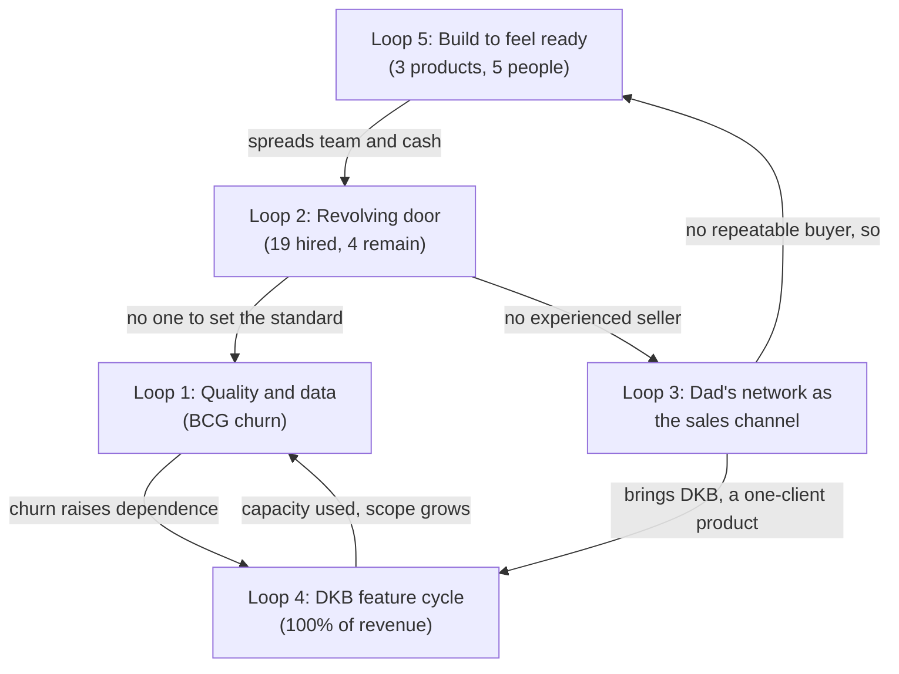
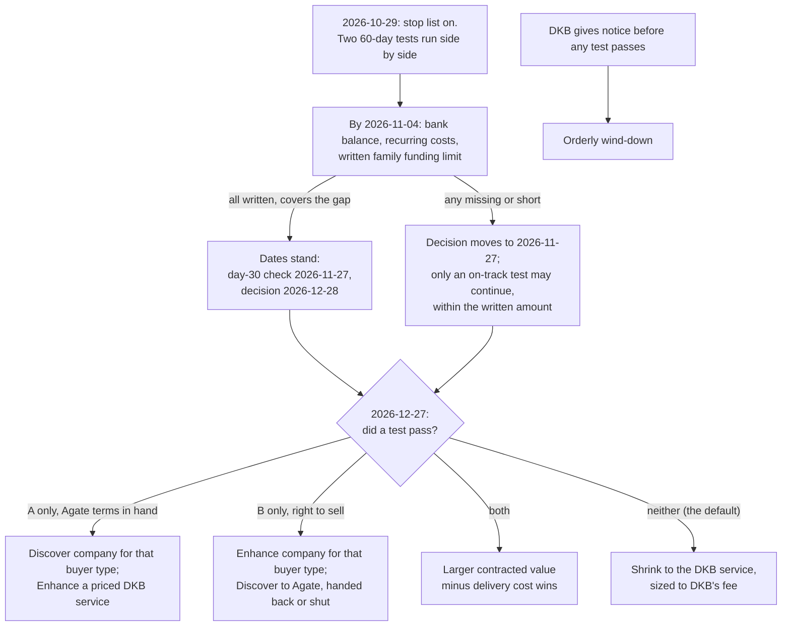

# Step 10: DEUS strategic analysis: the master report

As of 2026-10-28. For the founder and the founder's dad; internal. This report combines `outputs/01-systems-thinking.md` to `outputs/09-executive-summary.md` (and the venture review behind Step 8) into one document. It adds no claim that is not in a step report; the one exception is the timeline in section 2, which restates `inputs/DEUS_Company_History_Recap.pdf` phase by phase. Where a later step overruled an earlier one, this report follows the later step and says so (Steps 7 and 8 settle the open conflicts; section 10).

**Provisional.** No buyer, churned client or lost prospect has yet said in their own words why they bought, stayed, left or said no: the Step 6c interviews have not run, and the only buyer-side words in the files are four short quotes DEUS chose for its Telkom slide (GBA deck, Success Story). The bank balance is unknown (Fact sheet). After the interviews, Steps 7 to 10 are rerun (IMPLEMENTATION_PLAN.md, owner line).

## How to read this report

- **Facts** are cited. **Interpretation** is marked. **Recommendations** have their own lines or sections (mainly sections 6, 8 and 10). **ASSUMPTION** = not in the files. **NO DATA** = a number that is missing; every NO DATA is collected in section 11. **Derived** = arithmetic on cited numbers.
- Source labels: "Recap, Phase N" (`inputs/DEUS_Company_History_Recap.pdf`; "Recap, Reference: people / clients" for its tables), "Fact sheet" (`inputs/deus-fact-sheet.md`), "Pitch deck" (`inputs/DEUS_Pitch.pdf`), "GBA deck" (`inputs/DEUS_GBA_Presentation_8.pdf`), "Agate deck" (`inputs/Agate_Next_Chapter_GBA_deck.pdf`), and "Step N" for the step reports. Web sources keep the numbering of the report that found them and are cited with their step ("Step 4, W3"; "Step 6b, W1"; "Step 7, W1"); the full list is in "Sources" before Key findings.
- Judgement grades, scores and ratings (A to F, 1 to 5, ✅ ⚠️ ❌) are judgements on the cited evidence, not measurements. Pass lines and dates in the plan are proposals, not facts.
- Step 7 labels each conclusion **ACT** (strong enough to act on now), **TEST** (act on it only as a test with a pass line) or **HOLD** (too weak to use as evidence). Sections 3 to 8 carry those labels where Step 7 gave one (section 9).

| Section | What it answers | Built from |
|---|---|---|
| 1 | The answer in one page | Step 9 |
| 2 | What happened | Recap |
| 3 | Why it happened | Step 1 |
| 4 | How the products were built | Step 2 |
| 5 | Who buys | Step 3 |
| 6 | Where to focus | Steps 4 and 6b |
| 7 | Is there product-market fit | Step 5 |
| 8 | Team and organisation | Step 6a |
| 9 | Challenges to these conclusions, and how to close them | Steps 7 and 6c |
| 10 | Verdict and next 30 days | Step 8 |
| 11 | Data gaps and open questions | All steps |

---

## 1. Executive summary

*(From `outputs/09-executive-summary.md`; method: Pyramid Principle, answer first.)*

### The answer

**DEUS should change course now: stop everything that is not selling, give Discover and Enhance 60 days each to bring in money, and shrink to the DKB service if neither does.** The verdict calls this PIVOT, with shrinking to what pays as the default (Step 8).

- **Situation.** Five people, three products, one paying client: DKB, Rp35 juta a month (Fact sheet).
- **Complication.** DEUS spends Rp52–62 juta a month, so it loses about Rp17–27 juta, probably more. Nobody knows the bank balance or how much more the family will put in (Fact sheet; Step 7, E4). No Discover or Enhance deal is recorded from any channel tried since Telkom (Recap, Phases 8–11).
- **Question.** Keep going, change, or stop?
- **Answer.** Change, with a date: DEUS grows again only if Discover or Enhance brings money, or a commitment backed by money, by **2026-12-27**. Otherwise on **2026-12-28** it shrinks to the DKB service (Step 8, section 8).

### Why: three arguments

**1. The products have not found buyers.**
- **Fact.** Six buyers ever; none interviewed, no loss reason recorded (Step 3). Neither product has fit: Discover 0 of 3 buyers pay today and 1 of 3 ever repeated (Telkom, two intakes in Phase 7, nothing since); Enhance 1 of 2 kept, BCG left over bugs and slow data cleaning (Step 5).
- **Fact.** Since Telkom: F&B about 10 meetings, 0 deals; Apollo zero meetings from hundreds of contacts; the dad's network about one deal from about 100 meetings, and its Phase 11 waves brought "nothing; no assessment sales and no Enhance sales" (Recap, Phase 11; Fact sheet).
- **Interpretation.** DEUS built a lot and measured almost nothing: eleven phases of builds, no test with a pass line set in advance (Step 2). It sold to the people it could reach; the buyers who paid came with a need already in hand (Step 3). Seven people held sales or account seats, but no one was hired to sell (Step 1; Step 6a).

**2. The money does not last, and it rests on one client.**
- **Fact.** DKB is 100% of revenue and covers 56–67% of the burn (derived: Rp35 juta against Rp52–62 juta; Step 7, MC2); the burn probably leaves out tools the recap names (Step 7, E4). Cash in bank, total invested and how the family has covered the gap: NO DATA (Fact sheet).
- **Fact.** DKB's satisfaction is NO DATA; it is held by a family relationship and custom features (Step 3). Ko Will is the only engineer, and 15 of the 19 people hired have left (Step 6a). Two more months at today's gap cost about Rp34–54 juta (derived; Step 8, section 5).
- **Interpretation.** The danger is not one bad month; it is that nobody knows how many months there are, and family money can quietly make every deadline slide and restart the build-before-selling loop (Step 7, section 4; Step 1, Loop 5).

**3. Two assets are real, but the evidence cannot say which product to back.**
- **Fact.** Enhance for DKB pays Rp35 juta a month, kept through years of bugs; Ko Will's rebuild "was much better, even under a clear audit" and has never been offered to a second qualified buyer (Recap, Phases 3–9 and 10; Step 7, C8). Telkom bought two intakes for itself and 6 subsidiaries, 1,000+ candidates, and why it stopped is unknown (Recap, Phase 7; GBA deck; Step 5).
- **Fact.** Enhance has about twice Discover's recorded revenue (about Rp900 juta against Rp440 juta plus unknowns); Discover has the only repeat buyer (Step 7, MC3). Discover's edge is thin: Agate built the games and sells the same suite directly from Rp49,999 per user, with free pilots and an MT pitch (Agate deck); the joint state-company recruitment may absorb state groups' own screening (Step 7, MC8).
- **Interpretation.** One account and one quote cannot choose. "Telkom paid above list" and "Telkom came without a relationship" are not used as evidence (Step 7, C5, C6). So both products get the same cheap test, and only money counts.

### The decision (recommendation)

**Stop now, whatever the tests show** (Step 8, section 8): Potentia (zero team hours; its site's future decided by 2027-01-26); Apollo, new F&B contacts and network waves to groups that don't fit; new builds and hiring; the office (Rp12 juta a month), with notice in week 1 unless the lease penalty exceeds the saving (lease terms NO DATA).

**Two tests, 2026-10-29 to 2026-12-27.** Anything short of a pass is a fail; there is no extra round.

| | Test A: Discover as a managed MT-screening service | Test B: Enhance as a fixed-scope system |
|---|---|---|
| Buyer | Groups with their own yearly MT or campus intake of several hundred candidates | Multi-brand groups with a KPI and appraisal setup as complex as DKB's (ASSUMPTION); no direct competitor of DKB |
| Pass line | At least 5 programme-owner meetings **and** a paid pilot (minimum Rp10 juta) or a signed order for a dated intake with a named budget owner | At least 2 groups pay for a pilot or sign an intent backed by a deposit, at or above a price floor written before the first meeting |
| Needed to count | DEUS's Agate terms in writing | DKB's contract read and allowing DEUS to sell Enhance |

Said plainly: test B runs through the dad's network, which brought "no Enhance sales" in Phase 11 (Recap, Phase 11), so it must clear the same money bar. Meetings alone, or "asks for a proposal", do not pass.

**On 2026-12-28:** one test passes, DEUS becomes a company for that product and buyer type; both pass, the larger contracted value minus delivery cost wins; **neither passes (the default), DEUS shrinks to the DKB service** and the growth bet ends. If DKB gives notice before any test passes, DEUS winds down in an orderly way (Step 8, section 8).

**The clock is a written family funding limit, not hope.** By **2026-11-04** the founder writes down the bank balance and every recurring cost, and the founder and the dad agree in writing how much more family money goes in and until what date. If any is missing, the decision moves to **2026-11-27** (Step 8, section 8). Family money buys time to test, never time to build.

The next 30 days are in section 10.8. The dad's parts are the funding limit, up to 10 introductions (only to groups that fit) and the Friday review; he does not attend the DKB interview (Step 8, section 8). His value is judgement and senior access, not lead volume; his rebuild order produced DEUS's best asset (Recap, Phase 10; Step 6a).

**The verdict changes if:** the funding limit isn't written or doesn't cover 60 days (decision moves to 2026-11-27); Telkom says its MT screening now runs only through the joint recruitment (test A targets private groups); DKB's contract bars selling Enhance (test B stops) (Step 8, section 10).

---

## 2. What happened: a short timeline

Facts only, restated from the recap, which "records how that happened, phase by phase, without analysis or lessons" (Recap, About this recap). The recap gives phases, not dates (Fact sheet: dates NO DATA). DEUS's own site gives 2022 as the founding year (deushcs.com; deck.deushcs.com, via Step 6a), and Phase 10 is "three to four years in" (Recap, Phase 10).

| Phase | What happened | People |
|---|---|---|
| 1. Founding and Discover v1 | DEUS starts from "an idea we thought was genuinely cool" and goes "straight to building"; no psychometric validation and little market validation first. Agate builds a medieval situational-judgment game for almost Rp1 billion; it takes almost two hours to play and the reports are very simple (Recap, Phase 1; Fact sheet) | Sahid (psychometrics), Rosi (junior business development) |
| 2. Partners and first client | MoMs signed, but the partners "never sold our product". First client Boga Group: 600 employees at a low price (Rp60 juta; Fact sheet); many bugs, a long process, simple reports, "did not seem fully satisfied" (Recap, Phase 2) | |
| 3. Enhance is born | Through the dad's relationship, DKB needs a performance management system for a very complex KPI and appraisal setup; DEUS builds it as its second product. BCG signs a recurring deal while Enhance is still in development (Recap, Phase 3) | Rosi let go; Bu Vera (account manager, no sales background); Ghifari (first tech hire, "no guidance"; his version "very buggy") |
| 4. Development struggles | Enhance takes "a very long time", with many changes and bugs. Agate moves to the metaverse; Discover goes to Skyfy for almost a year, which cannot fix bugs; the project returns to Agate and DEUS pays extra to shorten the game (Recap, Phase 4; Recap, Reference: clients, partners and vendors) | Andar (tech), Yuli (QA), Fizka (business development, overlapped with Bu Vera) |
| 5. Sales attempts and recognition | Sales "all through my dad's connections" (Christian Kurnia, a retail senior, long a director at Matahari Department Store); mostly retail companies and his friends; "we converted almost none". Only revenue: recurring Enhance from DKB and BCG. Startup Studio Indonesia and a free InnovFest Singapore booth (Komdigi) converted nothing (Recap, Phase 5) | |
| 6. Product team | Enhance keeps its bugs; messy client data has to be uploaded; the founder and Thania spend about a year turning the Discover report into a digitised report (Recap, Phase 6) | Thania (product); Fitri (data), because Sahid was overloaded |
| 7. Sales push and Telkom | More emphasis on sales. Telkom Indonesia buys MT recruitment support two years in a row: "fairly lucky to win it, because Telkom was specifically looking for gamification vendors. Apart from Telkom, we struggled very hard to sell anything" (Recap, Phase 7) | Bu Retno (account manager), Audrey (marketing and sales), Wulan (sales and data); Bu Vera, Fizka and Fitri gone |
| 8. Setbacks | Cleaning data takes long, Enhance stays buggy, and BCG, the biggest deal, churns: "a huge blow" (Recap, Phase 8) | Sahid resigns, Rizkie replaces him ("did not have a good work ethic"); Ghifari let go, Andar leads Enhance; Yessica replaces Bu Retno ("not strong in sales") |
| 9. Holding DKB, adding Potentia | "Afraid DKB would churn too": Power BI as a temporary display layer; the proper Enhance website keeps being built in parallel. Potentia (kids' assessment) is acquired; one deal (Sekolah Kristen Calvin), "extremely hard to sell". New waves of the dad's network fail for Discover and Enhance (Recap, Phase 9) | Ko Will and David; Kayyis (Andar's friend, frontend); Bu Sovie replaces Rizkie; Firdaus (project manager); Yessica let go |
| 10. Rebuild and departures | The dad asks Ko Will and David to build a cleaner Enhance because Andar "had not performed well". "Three to four years in", Enhance is still not done because DKB keeps adding features; each feature waits for a PRD, then for UI/UX drawn from scratch in Figma, then is built. Ko Will's version is "much better, even under a clear audit". Potentia gets its own website (Recap, Phase 10) | Five leave: Andar (let go), Firdaus, David, Yuli, Kayyis (not extended) |
| 11. Today | Discover expands with Agate's cognitive, neuroscience and simulation games ("more confident in selling"). For the first time, cold outreach instead of the dad's network: F&B "a good number of responses", no deals; finance "not many replies"; Apollo for Enhance zero meetings from hundreds of contacts; new waves of the dad's network "nothing; no assessment sales and no Enhance sales". Website, presentations and company profile are being rebranded (Recap, Phase 11) | Team of five: the founder, Ko Will, Thania, Audrey, Bu Sovie |

### Where DEUS stands today (Fact sheet unless cited)

| Item | Value |
|---|---|
| Revenue | Rp35 juta a month, DKB only (Enhance) |
| Burn | About Rp52–62 juta a month (team Rp40–50 juta plus office Rp12 juta; founder's estimate, "no other recurring costs") |
| Gap | About −Rp17 to −27 juta a month (derived) |
| Cash in bank, runway, total invested | NO DATA (the founder doesn't know) |
| Buyers ever | Six: Boga Group (Discover, Rp60 juta, one-off), DKB (Enhance, Rp35 juta a month, ongoing), BCG (Enhance, Rp40 juta a month for about a year, about Rp480 juta, churned), Telkom (Discover, two years, second deal Rp380 juta, third year not recorded), Sekolah Kristen Calvin (Potentia, about Rp12 juta), SPH (Discover, value NO DATA; not in the recap) |
| People | 19 hired besides the founder, 4 remain (Recap, Reference: people) |

---
## 3. Why it happened: loops and root causes

*(From `outputs/01-systems-thinking.md`. Method: causal loop diagrams, stocks and flows, archetypes and Meadows' leverage points. R = reinforcing loop, B = balancing loop.)*

DEUS's problems were not eleven phases of separate bad luck. **Five feedback loops produced them, and four are still running.** Each time a problem appeared, the company applied a fix that relieved the pressure (another hire, a Power BI layer, another wave of the dad's network, another product or game, another feature for DKB) instead of the harder fix underneath (an engineering and data standard, a sales role with a seller in it, a repeatable buyer type, a product scope not set by one client). The pattern is "shifting the burden": the quick fixes worked well enough to remove the urgency of the real fix, and in several cases made it harder. The highest-leverage change is a rule: **nothing new gets built, bought or rebranded until a named buyer type has paid for what already exists, more than once.** Telkom is the only evidence of what that buyer looks like (Step 1). Step 7 rates the loop labels a lens rather than a finding: the same events fit a plainer story of an underfunded first-time team learning by doing (Step 7, C1; section 9), but the rules the loops imply are cheap and hold either way.

### Loop 1: quality → data cleaning → client experience → churn (weakened, not gone)

- **Facts.** Boga met "many bugs", a long process and simple reports (Recap, Phase 2). Enhance's first developer "worked with no guidance" because "we did not know how to develop systems at all" (Recap, Phase 3); QA was hired "because there were so many bugs" (Recap, Phase 4); "messy client data" overloaded the data person (Recap, Phases 6, 7). BCG, paying Rp40 juta a month (more than DKB's Rp35 juta; Fact sheet), churned "amid ongoing bugs and slow data cleaning" (Recap, Phase 8; Reference: clients). Fearing DKB would churn too, DEUS put Power BI on top of Enhance "as a temporary solution" (Recap, Phase 9). Ko Will's rebuild was "much better, even under a clear audit" (Recap, Phase 10).
- **Loop.** Bugs and messy data → manual workarounds → slow, error-prone delivery → worse client experience → churn → less money for guided engineering → more bugs (R1). Workarounds also eat the time that would remove the bugs (R1b). The quick fix (QA, a data person, Power BI) eases the symptom and adds a layer to maintain (B1).
- **Archetype: shifting the burden**, with a fixes-that-fail side effect. The fundamental fix was a way of building software and a standard for how client data comes in; the symptomatic fix was a person or a layer each time.
- **Interpretation.** The root cause was not the individual hires: nobody at DEUS could set or check engineering quality in Phases 3–9. ASSUMPTION: the rebuild succeeded partly because Ko Will brought the standard himself.
- **Still active?** Weakened. The bug stock was largely cleared by the rebuild (Recap, Phase 10), but no data person is on today's team, so the next client with messy data reopens the loop; all engineering sits with one person; whether Power BI is still used is NO DATA.

### Loop 2: hiring, turnover and the role that was never filled (active, as a risk)

- **Facts.** 19 people besides the founder have worked at DEUS; 4 remain, so 15 left (Recap, Reference: people; derived). Seven people held sales or account roles (Rosi, Bu Vera, Fizka, Bu Retno, Audrey, Wulan, Yessica); only Audrey remains; no hire is recorded as an experienced B2B seller. Data and psychometrics passed through five people (Sahid, Fitri, Wulan, Rizkie, Bu Sovie); engineering through Ghifari, Andar and Kayyis before Ko Will and David (Recap, Phases 1–10). At least five were let go or not extended; five left in Phase 10 alone. Average tenure: NO DATA (Fact sheet).
- **Loop.** A capability gap → pressure to fill the seat fast → a quick, junior, friend or adjacent-skill hire → poor fit → exit → knowledge lost → the gap reopens (R2). Each exit loads the people who remain (R2b). What is missing from the history is a written definition of success in the role and someone able to judge it.
- **Archetype.** Fixes that fail for the sales seat (the fix was an account manager or a junior, never the seller the problem called for); shifting the burden for the data and tech seats.
- **Interpretation, stated plainly.** The evidence points more to role design and management than to bad luck in hiring: the seat meant to fix sales was filled four times without a seller; roles overlapped (Fizka and Bu Vera) or combined two jobs (Wulan, "sales and data"); a psychometrics hire ended up doing data work until overloaded (Recap, Phases 4, 6, 7). Step 6a tests this further (section 8).
- **Still active?** Yes, as a risk: five people, each in a single seat, each a single point of failure; the seller seat is still unfilled by an experienced seller; who leads selling today is NO DATA.

### Loop 3: lead source dependence, the dad's network (partly broken, still running)

- **Facts.** Sales ran "all through my dad's connections"; "most leads he brought were retail companies and his friends"; "we converted almost none" (Recap, Phase 5). The network produced DKB (Recap, Phase 3) and about 100 meetings in total, "almost no others" converting (Fact sheet, founder's estimate): roughly one deal per hundred meetings (derived, rough). New waves failed in Phases 9 and 11 (Recap, Phases 9, 11). Recognition programmes and partner MoMs produced no sales (Recap, Phases 2, 5). Telkom, the one large Discover win, came from a buyer "specifically looking for gamification vendors", not from the dad's network (no lead source is recorded; Recap, Phase 7). Cold outreach began only in Phase 11: F&B 100+ contacts, almost 10 meetings, 0 deals; finance about 100 contacts, "not many" replies; Apollo "hundreds" of contacts, 0 meetings (Recap, Phase 11; Fact sheet).
- **Loop.** Need for leads → use the network (easy meetings) → pressure eases (B3a). The fundamental fix, building an own channel and learning who buys, has a long delay and always lost to the quick one (B3b). Courtesy meetings with the dad's friends also give a sense of pipeline that reduces effort on the own channel (R3).
- **Archetype: shifting the burden.** The network is fast, free and friendly, and it removed the urgency of asking "who buys this, and why?". Its side effect was to send DEUS to retail companies run by the dad's friends, a segment chosen by who the dad knows, not by who needs game-based assessment.
- **Interpretation.** The buyer who repeated (Telkom) had three features the network leads did not: a need it was already shopping for, high candidate volume (1,000+ MT candidates, 30+ provinces; Pitch deck, Telkom slide) and a recruitment use case. ASSUMPTION: the Phase 11 industries (F&B, finance) were chosen for reachability, not because they match the Telkom pattern. Said plainly, with respect: the network gave DEUS its only current revenue (DKB), but as a sales channel it has run for nine phases at roughly one deal per hundred meetings. Sunk effort is not a reason to keep using it as the main channel.
- **Still active?** Partly broken, still running: Phase 11's cold outreach is the first real attempt at the fundamental fix, but the network is still worked in new waves and the outreach targets were not chosen from the Telkom evidence.

### Loop 4: the Enhance feature-request cycle with DKB (active, at its strongest)

- **Facts.** DKB came through the dad with "very complex" KPI and appraisal needs; DEUS "decided to take it on" as its second product (Recap, Phase 3). "Many changes came in while it was being built" (Recap, Phase 4). "Three to four years in, and Enhance was still not fully done because DKB kept adding more and more features" (Recap, Phase 10), through a fixed PRD → Figma → build sequence. DEUS feared "DKB would churn too" (Recap, Phase 9). DKB pays Rp35 juta a month, about 56–67% of the Rp52–62 juta burn (derived; Fact sheet). Enhance pricing is not published (Fact sheet).
- **Loop (success to the successful).** DKB pays, so it gets the development capacity; Enhance fits DKB better and the market less; no other clients arrive; DKB's share of revenue and DEUS's fear of losing it rise (R4). The slow PRD → design → build sequence makes each request expensive.
- **Interpretation.** The history leans toward "a custom system for DKB, not a product": built from one client's complex needs, shaped by that client's additions for years, and zero meetings when offered to the market (Recap, Phases 3, 10, 11). Whether Ko Will's rebuild is a general product or a cleaner DKB system is NO DATA.
- **Still active?** Yes: DKB is 100% of revenue (Fact sheet), so if it leaves, revenue goes to zero. Whether DKB still adds features, and how much developer time it takes, is NO DATA.

### Loop 5 (cross-cutting): build to feel ready to sell (active)

- **Facts.** Discover was built "straight" from "an idea we thought was genuinely cool" for almost Rp1 billion (Recap, Phase 1); after a weak first client DEUS spent about a year digitising the report (Recap, Phase 6) and paid Agate extra to shorten the game (Recap, Phase 4; amount NO DATA). Enhance was taken on off one client; Potentia was acquired while the first two were hard to sell and was "extremely hard to sell" (Recap, Phases 3, 9). Phase 11 added Agate's games ("made us more confident in selling"; "we have recently felt more ready to sell"), then a rebrand; their cost is NO DATA (Recap, Phase 11; Fact sheet). Three products for five people; no Discover or Potentia client is recorded as paying today (Fact sheet).
- **Loop (fixes that fail).** Weak sales → belief that the product is not ready → build, buy or rebrand → confidence → a short-lived sense that sales will now come (B5). Each build costs cash and team time and adds a product to maintain, which reduces focus on any one buyer (R5). The recap never records a lost buyer naming the product as the reason (loss reasons are NO DATA; Fact sheet, Founder notes). Telkom bought the single personality game, before the Phase 11 suite existed (Recap, Phases 7, 11).
- **Interpretation.** The mental model is "if we build it well enough, it will sell". ASSUMPTION: building feels like progress and is in DEUS's control, while selling depends on strangers saying no. Step 7 adds a caution: MT screening normally tests cognitive ability, so the suite may be what makes the recommended beachhead reachable; "no new builds until a buyer pays" is ACT, "the suite was the wrong buy" is HOLD (Step 7, C2).
- **Still active?** Yes: Phase 11 is the loop running again (new games, then a rebrand) while revenue is about Rp17–27 juta a month below burn (Fact sheet). ASSUMPTION: if family money covers the gap, it hides the cash signal that would otherwise force a decision.

### How the loops connect



**The common root: DEUS never fixed who it sells to before deciding what to build.** Loop 3 (no repeatable buyer) feeds Loop 5 (build to feel ready) and Loop 4 (build for the one buyer you have). Those create the scope and quality load in Loop 1 and the hiring churn in Loop 2. Loop 2 in turn leaves no experienced seller, which keeps Loop 3 running (Step 1).

### Leverage points, ranked

| Rank | Change | Meadows level | Loops it breaks | Easy to start? |
|---|---|---|---|---|
| 1 | "Sell, then build": nothing new built, bought or rebranded until a buyer has paid or signed for it | 2 Paradigm | 5, 4, 1 | Yes: a decision, no cost |
| 2 | One buyer type from the evidence (Telkom: volume hiring, existing need, recruitment use) and one product for a fixed period | 3 Goal | 3, 5 | Yes, after Steps 3–5 |
| 3 | Enhance: fixed core plus paid custom work for DKB, with a change-request price | 5 Rules | 4, 1 | Needs a talk with DKB |
| 4 | Know the cash and log every channel's funnel weekly | 6 Information | 5, 3 | Yes: a spreadsheet |
| 5 | A role card with a 90-day outcome before any hire; the first sales hire is an actual seller | 5 Rules | 2, 3 | Yes, before the next hire |
| 6 | Client data intake template; cleaning quoted as paid work | 5 Rules | 1 | Yes |

**Unintended consequences to watch** (Step 1): "sell, then build" can make the team pitch things that don't exist yet (guard: sell only what can be delivered by an agreed date, in writing); changing DKB's terms could trigger the churn DEUS fears (guard: propose a menu of what is included and what is extra, not a price rise, once a second revenue source is in sight); narrowing to one buyer type means saying no to easy network leads (a referral that matches the profile is still welcome); logging the funnel can show that a favourite channel doesn't work, so the founder and the dad should agree up front that the numbers decide.

---
## 4. How the products were built: a validation review

*(From `outputs/02-lean-startup.md`. Method: Build-Measure-Learn, value and growth hypotheses, innovation accounting, pivot types. The pass/fail thresholds are proposed decision lines, not data.)*

**DEUS has run the Build half of Build-Measure-Learn many times and the Measure and Learn halves almost never.** Across eleven phases every product decision was a build or a purchase, and no phase records a test set up in advance with a number that would have said "stop". The two moments that did produce real learning, BCG signing for Enhance before it existed (Recap, Phase 3) and Telkom buying Discover two years in a row (Recap, Phase 7), were not turned into the next hypothesis. Phase 11 repeats the pattern: the games and the rebrand are builds, not tests. The cold outreach is the first genuine experiment DEUS has run, but nobody wrote down beforehand what result would count as a pass. A new fact the recap does not mention: the Phase 11 games are Agate's own product, which Agate sells directly to the same buyers (Agate deck) (Step 2).

### Where each product stands

| Product | Stage | Why |
|---|---|---|
| Discover | Problem-solution fit with **one** buyer type; no product-market fit | Telkom paid twice (second deal Rp380,000 per candidate; Fact sheet). No other repeat buyer; Boga was one-off and "not fully satisfied" (Recap, Phase 2). No Discover client is recorded as paying today (Fact sheet). Step 2's comparison of Telkom's price with today's list price is withdrawn: Step 7 found it unlike for like (Step 7, C5, MC1; section 9) |
| Enhance | A paid custom system for **one** client; no evidence of a market | DKB pays Rp35 juta a month, all of today's revenue (Fact sheet). BCG paid and churned (Recap, Phase 8). Apollo: zero meetings from hundreds of contacts (Recap, Phase 11) |
| Potentia | Before problem-solution fit | One deal, Sekolah Kristen Calvin, about Rp12 juta (Fact sheet); "extremely hard to sell" (Recap, Phase 9). Purchases on deuspotentia.com: NO DATA |

### The hypotheses each product was betting on

| # | Hypothesis | Type | Evidence today |
|---|---|---|---|
| D1 | HR buyers want game-based assessment instead of conventional tests | Value | Partly supported: Telkom "was specifically looking for gamification vendors" (Recap, Phase 7). One buyer type, two purchases |
| D2 | The game measures what it claims | Value | NO DATA for the original game ("we did no psychometric validation", Recap, Phase 1). Both DEUS decks now claim a four-step process ending in validation and Indonesian norming (Pitch deck, slide 8; GBA deck); the same process appears in Agate's deck as Agate's own (Agate deck). Which games the claims cover is a founder question |
| D3 | A two-hour medieval text game is an acceptable candidate experience | Value | Disproved and acted on: Boga found it long and not enjoyable (Recap, Phase 2); DEUS paid Agate to shorten it (Recap, Phase 4). The Pitch deck now lists Personality at 60 minutes |
| D4 | Partners and recognition bring buyers | Growth | Disproved: MoMs, Startup Studio Indonesia and InnovFest produced zero sales (Recap, Phases 2, 5) |
| D5 | The dad's retail network will buy assessments | Growth | Disproved over Phases 5, 9 and 11: "converted almost none", new waves "nothing" |
| D6 | Buyers didn't buy because Discover was personality-only; a full suite will sell | Value | Untested. Counter-evidence: Telkom bought the single personality game (Recap, Phases 7, 11). Step 7 adds that the suite may be what makes MT screening credible (Step 7, C2) |
| D7 | Buyers will buy these games from DEUS rather than from the company that makes them | Value / growth | New risk: Agate sells "Next Chapter: Game-Based Assessment" directly, with the same game names, the same CMS features and Rp49,999–300,000 per user with 30% off for early adopters (Agate deck; GBA deck). Agate's terms with DEUS: NO DATA |
| E1 | Companies with complex KPI and appraisal setups pay monthly for a system that handles them | Value | Strong start (DKB asked; BCG signed before the product existed: the best validation DEUS has had), weakened by BCG's churn (Recap, Phases 3, 8) |
| E2 | What DKB needs is what others need | Value | Not supported: "DKB kept adding more and more features" for three to four years; no third client ever signed (Recap, Phase 10). Whether Ko Will's rebuild is general or a cleaner DKB system: NO DATA |
| E3 | DEUS can build and run this software reliably | Value | Disproved for Phases 3–9 (Recap, Phases 4, 6, 8, 9); now supported for the rebuild (Recap, Phase 10) |
| E4 | New Enhance clients can be found by cold email or the network | Growth | Disproved in the form tried: Apollo zero meetings from hundreds of contacts; network waves "no Enhance sales" (Recap, Phases 9, 11) |
| P1–P3 | Schools or parents pay; DEUS can reach them with HR channels; a self-serve site sells without a salesperson | Value / growth | One deal, about Rp12 juta at Rp120,000 per student (list today Rp329,000 per child; Fact sheet); "extremely hard to sell" (Recap, Phase 9); site sales NO DATA |

**Interpretation.** For all three products the riskiest hypotheses were the growth ones (who buys and how they are reached), and those are exactly the ones DEUS never designed a test for. The value hypotheses got some real tests by accident (Boga, BCG, Telkom).

### The Build-Measure-Learn ledger

| Phase | Build | Measure | Loop closed? |
|---|---|---|---|
| 1 | Discover v1, almost Rp1 billion | Nothing before the build (Recap, Phase 1) | No |
| 2 | Partner MoMs; first client Boga | Partner sales zero; Boga "not fully satisfied" | Partly: feedback acted on (game shortened, Phase 4; report digitised over about a year, Phase 6), but one client's view drove over a year of building with no paid test in between |
| 3 | Enhance for DKB; BCG signs before it is done | Two recurring contracts | Partly: strong signal, but what the two buyers share was not captured |
| 5 | Accelerator, InnovFest booth | Selection and a free booth | No: vanity metrics |
| 6 | Digital Discover report, about a year | NO DATA that a buyer asked for it | No |
| 7 | Sales push; Telkom MT recruitment, two years | Telkom paid twice; 1,000+ candidates, 7 companies, 30+ provinces, results in 1 day (Pitch deck, slide 10) | **No**: the clearest validation was not turned into a next hypothesis |
| 8 | (BCG churns) | Churn reason NO DATA | No |
| 9 | Power BI over Enhance; Potentia acquired; network waves | DKB kept; one Potentia deal | Mixed: Power BI was a cheap, fast stopgap, close to a "Wizard of Oz" MVP, but a third product was added while two were unsold |
| 10 | Full Enhance rebuild | Quality: "much better, even under a clear audit" | No: quality measured, demand not |
| 11 | New games; rebrand | Team confidence: "more confident", "more ready to sell" | No: the measure is a feeling, not a buyer |
| 11 | **Cold outreach** (F&B, finance, Apollo) | F&B 100+ contacts, almost 10 meetings, 0 deals; finance about 100 contacts; Apollo hundreds, 0 meetings (Fact sheet) | **First real Measure step**; no pass lines set in advance |

What the ledger shows (Step 2): eleven builds or buys and at most two closed loops; **the best signals were wasted** (BCG and Telkom never became a buyer profile, a lookalike list or a price test); the measures used were vanity metrics (programme selection, a booth, MoMs, team confidence, "40+ brands" against five clients in the recap plus SPH); loops were measured in years (the report took about a year, Enhance three to four years, the vendor switch almost a year); and "build to feel ready" is the mental model behind it. **Said plainly:** the problem was never that the products were bad (Telkom's quotes and Ko Will's rebuild suggest they can be good; GBA deck, Success Story; Recap, Phase 10). It is that DEUS spent its money and years answering "can we build it?" when the open question, every time, was "who will pay for it, and how do we reach more of them?". Sunk cost (the Rp1 billion, the years of Enhance) is not evidence for either product.

### The current moves: what each one tests

| Move (Recap, Phase 11) | Is it an experiment? | What would tell DEUS in 30–60 days |
|---|---|---|
| Expanded game suite | **No**: already bought; the only measure is confidence | Log which modules buyers ask for; get Agate's terms in writing (D7) |
| Rebrand | **No**, and it can barely be made one (no baseline reply rate) | Treat it as a cost and cap its time |
| F&B cold outreach | **Yes**, the first | Call back every meeting, record the reason for no deal; 0 paid pilots from about 10 met prospects = F&B is not the beachhead at today's offer |
| Finance cold outreach | Yes, but no pass line | At least 5 meetings with a programme owner and at least 1 paid pilot in 60 days, or switch lists |
| Enhance via Apollo | Yes, and **already answered** (0 meetings) | Stop until there is a new hypothesis |
| New waves of the dad's network | Tested in Phases 5, 9, 11; answered each time | Stop as a sales channel; introductions only to buyers who fit a defined profile |

Of six current moves, two are builds with no test, two are experiments without a pre-set pass line, and two are repeat tests whose answer is already in (Step 2).

### Pivot or persevere, per product (Step 2's call, as later settled)

| | Discover | Enhance | Potentia |
|---|---|---|---|
| Step 2's call | **Persevere on the product, zoom in on the buyer**: volume-hiring programmes (MT, graduate, campus) at large groups, the only profile that paid twice | **Pivot the business architecture**: a paid service contract with DKB, not a product for the market, until a second buyer pays | **Pause** |
| Toward more investment | 2+ paid pilots from Telkom-like accounts in 60 days; Telkom confirms a third year | 2 of 10 DKB-like companies agree to a paid pilot at a fixed price | Self-serve sales without sales effort |
| Toward pivot or stop | 0 paid pilots from 20–30 Telkom-like accounts and no third Telkom year; or Agate selling the same games directly at a lower price | DKB signals it will leave, or DKB-only work takes more of Ko Will's time than Rp35 juta covers | Already in "pause" |

Pivot types if Discover fails: value capture (sell the Telkom-style service and reporting, not the games) or channel (partner with Agate as its implementation or local-norms partner). Growth engine: only a sticky, repeat engine (annual MT and campus programmes, fed by references) fits a five-person team selling to large employers; ASSUMPTION: each Telkom-like client could buy every year. **Status after Steps 7 and 8:** Potentia is **exit** (Step 4) rather than pause; Discover and Enhance are not chosen between yet but tested side by side (section 10).

### The three cheapest experiments (Step 2), and what became of them

| Experiment | What it tests | Pass / fail (proposed) | Where it went |
|---|---|---|---|
| 1. Telkom-lookalike paid pilots | Do organisations with Telkom's profile buy Discover when approached directly? Nothing to build: 20–30 named accounts, the Telkom slide, one ask to Telkom (third year, two introductions) | Pass: at least 5 meetings with a programme owner and at least 1 paid pilot within 60 days. Fail: fewer than 2 meetings, or 0 paid pilots from 20–30 qualified accounts | Became **test A** (section 10) |
| 2. Enhance fixed-scope offer to 10 DKB-like companies | Will any company other than DKB pay for the rebuilt Enhance at a stated price? A one-page offer; the price is part of the test | Pass: 2 of 10 pay for a pilot or sign an intent at the stated price. Fail: 0 of 10 | Became **test B**, run now rather than after day 30 (Step 8) |
| 3. Ask the F&B prospects why they didn't buy | What blocks a prospect who already took a meeting: price, trust in the science, timing, no budget or no need? | Pass: a usable reason from at least 7 of 10 and at least 1 paid pilot | Became the F&B reason calls (Step 5, M3; Step 6c) |

**Baseline for innovation accounting (Fact sheet):** revenue Rp35 juta a month, DKB only; burn about Rp52–62 juta (estimate); cash and runway NO DATA; F&B almost 10 meetings → 0 deals; finance meetings and deals NO DATA; the dad's network about 100 meetings → DKB, almost no others; Enhance cold contacts hundreds → 0 meetings; repeat buyers Telkom (Discover), DKB and BCG (Enhance, recurring); reasons lost NO DATA.

---
## 5. Who buys: ICP and anti-profile

*(From `outputs/03-icp-profile.md`, with its one correction from Step 7. Method: ideal customer profile card, jobs-to-be-done with the four forces, assumed vs evidenced, anti-profile. "Backed" = rests on a cited fact; "Assumption" = a reasonable reading that no file confirms.)*

**DEUS has one buyer type with real evidence behind it, and it is not the one DEUS has been chasing.** The only repeat Discover buyer is a **large national group running an annual, high-volume management-trainee (MT) intake that was already shopping for a gamified assessment vendor** (Telkom: 1,000+ candidates, Telkom plus 6 subsidiaries, 30+ provinces, two years in a row; Recap, Phase 7; Pitch deck; Fact sheet). Every buyer who paid a large amount (Telkom, DKB, BCG) arrived with a need it already had; every channel that brought companies without an existing need (the dad's network, MoM partners, recognition programmes, F&B and finance cold outreach, Apollo) produced almost nothing. DEUS's targeting has been set by who is reachable: retail friends of the family, then F&B, then finance, plus a website that names ten industries. For Enhance there is no ICP yet, only two custom-system clients, one of whom churned. The evidence base is very thin (six buyers, no recorded customer words, no lost-deal reasons), so almost every line is Assumption (Step 3). **Step 7's qualification:** the profile rests on one account and is a TEST, not a finding (Step 7, C3).

### Evidence ledger

| Id | Buyer | Product | What was paid | Repeat? | Source |
|---|---|---|---|---|---|
| W01 | Boga Group | Discover | Rp60 juta for 600 employees (about Rp100,000 each), "at a low price" | No: one-off; bugs, long process, simple reports; "did not seem fully satisfied" (C02) | Recap, Phase 2; Fact sheet |
| W02 | Delamibrands (DKB) | Enhance | Rp35 juta a month, ongoing; 100% of today's revenue; start date NO DATA | Yes, recurring | Recap, Phases 3, 9, 10; Fact sheet |
| W03 | Binacitra Group (BCG) | Enhance | Rp40 juta a month for about a year, about Rp480 juta (estimate) | Churned (C01) "amid ongoing bugs and slow data cleaning"; BCG's own reason NO DATA | Recap, Phases 3, 8; Fact sheet |
| W04 | Telkom Indonesia | Discover (single personality game, before the suite) | Second deal Rp380 juta (Rp380,000 × 1,000); first deal NO DATA | Two years in a row; third year NO DATA | Recap, Phase 7; Pitch deck; Fact sheet |
| W05 | Sekolah Kristen Calvin | Potentia | About Rp12 juta | One deal | Recap, Phase 9; Fact sheet |
| W06 | Sekolah Pelita Harapan (SPH) | Discover | NO DATA ("a smaller project, plus training their staff") | NO DATA | Fact sheet (not in the recap) |

**Channels and lead groups that did not convert (L01–L08):** the dad's network, Phases 5 and 9 (mostly retail companies and his friends, Recap, Phase 5; about 100 meetings across all waves; DKB the only recorded deal) and Phase 11 ("nothing"); early MoM partners ("never sold our product"); Startup Studio Indonesia and InnovFest ("converted nothing"); F&B cold outreach (100+ contacts, almost 10 meetings, 0 deals); finance (about 100 contacts, "not many replies"); Apollo (hundreds of contacts, 0 meetings); Potentia partnerships ("extremely hard to sell") (Recap, Phases 2, 5, 9, 11; Fact sheet).

**Interpretation.** Six buyers, two of which repeated (DKB, Telkom). The three largest amounts (DKB, BCG, Telkom, each roughly Rp380–480 juta a year; Fact sheet) all came from groups with many entities and an existing, structured HR process (an MT programme across 7 companies; a complex KPI and appraisal system). Lead sources are known for only one buyer (DKB), the biggest hole in the profile.

### Discover: the ideal customer profile card

| Field | Content | Status |
|---|---|---|
| Industry | Not defined by industry: the repeat buyer is a telecom state-owned group; the one F&B buyer did not repeat. ASSUMPTION: the job (volume early-career hiring) matters more than the industry | Facts Backed (W04, W01, C02); conclusion Assumption |
| Size and region | A large group (a parent plus several subsidiaries; 1,000+ candidates in one intake); Indonesia-wide (30+ provinces at once) | Backed (W04) |
| Trigger | The yearly MT intake: a fixed date, a big candidate pool, a shortlist needed fast | Backed (W04: two consecutive years; "results in 1 day") |
| Who feels the pain / who pays | ASSUMPTION: the HR or talent-acquisition lead running the MT programme (the GBA deck names "HR team running MT recruitment, campus drives" as the batch report's user, DEUS marketing). Who pays: NO DATA | Assumption |
| Signals visible from outside | (1) A public MT, graduate or campus programme with a yearly intake; (2) an active search for a gamified assessment vendor; (3) a group with several subsidiaries hiring through one programme | (2) Backed (Recap, Phase 7); (1) and (3) Backed as Telkom's traits, Assumption as predictors |
| Why accounts stay | Telkom came back a second year (Fact sheet). Step 3 added that Telkom paid above today's top list price, so price was not decisive; **Step 7 withdrew that** (HOLD, Step 7, C5, MC1) | Backed for the repeat only |
| Deal-breakers | ASSUMPTION: a buggy or long candidate experience (Boga; the original game took almost two hours, Recap, Phase 1; the suite today is 3 h 20 min of play, Pitch deck slide 7); no validity evidence an HR team can show (Recap, Phase 1) | Assumption |

**Confidence: low.** The whole Discover profile rests on one repeat buyer.

**The job (Telkom, Backed for the situation, Assumption for the wording):** "When our yearly MT intake opens and we have to screen 1,000+ candidates across 7 companies and 30+ provinces at once, we want a modern, game-based assessment that scores everyone the same way, so we can shortlist fast and fairly." **Forces:** pull is Backed (Telkom "was specifically looking for gamification vendors" before DEUS arrived; results in 1 day, Pitch deck); push, anxiety and habit are NO DATA. The founder's reading, "we were fairly lucky to win it" (Recap, Phase 7), is interpreted by Step 3 as the profile, not luck: a buyer with the pull already in place is one DEUS does not have to educate. Step 7 keeps this as a hypothesis, because how Telkom found DEUS is NO DATA (Step 7, C6).

### Enhance: the ICP card, very low confidence

Two buyers, both signed while the product was unfinished or before it existed (Recap, Phase 3), one churned; cold demand from outside is zero meetings from hundreds of contacts. Backed: the trigger ("their KPI and performance appraisal setup was very complex"; Recap, Phase 3), the price paid (Rp35–40 juta a month) and the deal-breaker (bugs and slow data cleaning, Recap, Phase 8). NO DATA: size, who feels the pain, who pays, current workaround. ASSUMPTION: DKB is fashion or lifestyle retail and Enhance buyers are multi-brand groups that tie pay to KPIs. DKB's strongest force is the relationship (the dad's) and a team that builds what it asks for, plus DEUS's own fear of losing it ("We were afraid DKB would churn too", Recap, Phase 9). **Interpretation:** the evidence describes buyers of a custom-built system, not buyers of a product (consistent with Step 2 and Step 1, Loop 4).

### Different buyers, assumed against evidenced

Discover's evidenced buyer is an HR or talent-acquisition team with a yearly volume hiring event; Enhance's buyers are groups with complex KPI and pay systems that want a system built around them. The trigger, the budget line and the likely decision-maker differ (ASSUMPTION for the decision-maker; NO DATA on who signed either deal). **No buyer has bought both products** (Fact sheet), so the site's "One partner to hire, develop and pay" pitch (deushcs.com) is not supported by any purchase so far. Potentia's buyers are schools (W05; also W06 for Discover): a separate, low-value segment, not a third ICP to chase now.

| | Assumed by DEUS (where it shows) | Evidenced by the data |
|---|---|---|
| Industry | Retail first (the dad's network); then F&B and finance (Phase 11); the website lists ten industries (deushcs.com) | The only repeat Discover buyer is telecom (W04); the one F&B buyer did not repeat; F&B outreach 0 deals; retail leads converted almost none. Industry does not predict buying in this data |
| Size | Small batches: packages of 5, 28, 60 and 100, a 5-candidate Pilot at Rp999,000, a Starter tier up to 250, a free trial (Pitch deck, A8, A9) | 1,000+ candidates in one intake (W04) is the only repeat; Boga's 600 did not repeat |
| Use case | "Fit the role, they perform. Fit your company, they stay": culture fit for any hire (Pitch deck, slides 1–3) | MT recruitment at volume (W04). The GBA deck and deushcs.com list "Annual MT Recruitment" and campus recruitment first; the targeting did not follow |
| How they arrive | Warm introductions from the dad; then cold calls by industry | Telkom arrived already looking for vendors (how it found DEUS: NO DATA); DKB came through the dad but with an urgent problem already in hand |
| Breadth | "Trusted by 40+ brands" (deushcs.com) | Six buyers (Recap, Reference: clients; Fact sheet) |

**The "40+ brands" gap.** The site shows 11 logos (Telkom Indonesia, Boga Group, JVC Kenwood, Delamibrands, SPH, Pepper Lunch, Wrangler, Paradise Dynasty, Telin, Colorbox, Sekolah Kristen Calvin; deushcs.com). Five are recorded buyers. ASSUMPTION (general knowledge, not in the files; the founder should confirm): Telin is a Telkom subsidiary; Pepper Lunch and Paradise Dynasty are Boga Group brands; Wrangler and Colorbox are Delamibrands brands. If so, the logos are mostly the same few buyers counted by brand, plus JVC Kenwood, which appears nowhere in the recap or the fact sheet (NO DATA). Counting brands makes it look as if ten industries buy DEUS, the evidence that justified spreading outreach, and it is not real evidence (Step 3). Step 7 rates the gap itself ACT (six buyers recorded) and the sub-brand explanation ASSUMPTION (Step 7, C21).

**Interpretation, stated plainly.** The customer DEUS has been chasing was chosen by who could be reached; the customer the evidence shows was chosen by who already had the problem. The gap is not which industry to call next, but calling organisations in the right state (a volume hiring event coming up, a vendor search open) regardless of industry (Step 3).

### Anti-profile: who DEUS should stop chasing

| Stop chasing | Evidence | Status |
|---|---|---|
| Companies reached through a relationship but with no active need | About 100 meetings across all waves of the dad's network, almost no deals; DKB is the exception and had an urgent need (Fact sheet). **Keep** introductions only to companies that pass the ICP signals | Backed |
| F&B for Discover | One F&B buyer, one-off and unsatisfied; 100+ contacts, almost 10 meetings, 0 deals. ASSUMPTION for the cause: frontline hiring at low per-head budgets against Rp69,000–279,000 per candidate (Pitch deck, A9) | Outcome Backed; cause Assumption. Step 7: ACT on "no new F&B contacts while the loss calls run", HOLD on "F&B is the wrong segment" (Step 7, C19) |
| Cold Enhance outreach to general lists | Hundreds of Apollo contacts, 0 meetings; both Enhance buyers came through a relationship or an existing need | Backed |
| Partners and resellers on MoMs without a sales target or first named deal | MoMs signed, no transactions (Recap, Phase 2) | Backed |
| Recognition programmes and booths as a sales channel | Startup Studio Indonesia and InnovFest: 0 conversions (Recap, Phase 5) | Backed |
| Small, one-off internal-assessment buyers at low prices | Boga only | Backed by one case; weak |
| School partnerships for Potentia (for now) | "Extremely hard to sell"; one deal of about Rp12 juta | Backed |

**Not yet an anti-profile:** finance. About 100 contacts and "not many replies" is too early; meetings and deals are NO DATA. Finance firms with a formal MT or graduate programme would fit the Discover profile (ASSUMPTION); those without would not (Step 3).

### Words customers use

**Almost none.** The only buyer-side words are four short quotes on the GBA deck's Telkom slide: three from participants and one from Telkom Group Selection praising DEUS's professionalism from preparation to the end of the process, chosen by DEUS for its marketing (GBA deck, Success Story). There are no DKB, BCG or Boga words and no lost-deal reasons (Fact sheet, Founder notes). (Step 3 first said there were none; Step 5 found the quotes and Step 7 corrected Step 3.) This is the largest weakness of the profile: DEUS does not yet know, in buyers' words, why they bought or didn't. The questions that fill it (Telkom, DKB, BCG, Boga, F&B and finance prospects) became the Step 6c interview guide (section 9).

---
## 6. Where to focus: portfolio decision and target market

### 6.1 The portfolio decision (Step 4: BCG matrix)

*(From `outputs/04-bcg-matrix.md`. Method: BCG growth-share matrix, cash-flow dynamics, portfolio balance. "Derived" marks arithmetic on cited numbers. Web market figures come from paid-report vendors' public summaries that disagree with each other and none sizes DEUS's exact niche: direction, not measurement.)*

**On the classic matrix all three products are Question Marks: DEUS has three low-share products and no Cash Cow, the most dangerous portfolio shape.** Read by cash instead of market, the picture is sharper: **Enhance-for-DKB is the only unit that brings in cash** (Rp35 juta a month, 100% of revenue), **Discover is the only unit with evidence it can win a large deal again** (Telkom, Rp380 juta in one deal), and **Potentia has neither** (Step 4; Fact sheet).

| Market | Size and growth | Source | Reading |
|---|---|---|---|
| Indonesian HR tech | USD 420 million (2025); 15.42% CAGR 2020–25; 11.94% forecast CAGR 2025–32 to USD 925 million | Step 4, W1 (Ken Research) | Just above the 10% line |
| Indonesian HCM software | USD 145.6 million (2024), 9.4% CAGR; a second report from the same vendor says USD 240 million, 7.0% | Step 4, W2 (Market Research Future) | Below the line; the two conflict |
| Hiring assessment in Indonesia | NO DATA. The nearest figure, employment screening (USD 145 million), is mostly background checks | Step 4, W9 | Not usable |
| Volume hiring demand (a signal, not a size) | Rekrutmen Bersama BUMN 2025: 1.4 million+ registrants by 19 March 2025, up 20%, for 2,000+ vacancies in 107 state companies (about 700 applicants per vacancy, derived) | Step 4, W7 | Volume is growing and the funnel is very wide |
| Indonesian edtech | USD 3.61 billion (2025), 11.42% forecast CAGR; K-12 is 42.6%; assessment not a named segment | Step 4, W5 (IMARC) | Above the line; kids' assessment NO DATA |

No market DEUS is in is shrinking; growth is not the problem, share is. No source gives market shares. As a proxy (competitors' own claims, an order of magnitude only): Discover has 3 lifetime buyers against Talentlytica's and Talentics's 300+ companies (about 0.01); Enhance has 2 against Mekari Talenta's and LinovHR's thousands (below 0.001); Potentia 1 school deal (Step 4, W3, W1, W6b). Telkom and Telkomsel appear as clients of Talentlytica, Talentics and Agate: DEUS's best account is a buyer several competitors also serve (Step 4, W3, W4).

```
                   RELATIVE MARKET SHARE
            HIGH (leader)  ◀───────────▶  LOW
          ┌────────────────────┬────────────────────────────┐
  HIGH    │ STARS              │ QUESTION MARKS             │
 GROWTH   │  (none)            │  Discover  (share ~0.01)   │
 (>10%)   │                    │  Potentia  (share ~0)      │
          │                    │  Enhance   (borderline     │
          │                    │   growth; share <0.001)    │
          ├────────────────────┼────────────────────────────┤
  LOW     │ CASH COWS          │ DOGS                       │
 GROWTH   │  (none in market   │  (none on market growth;   │
          │   terms; Enhance-  │   Potentia behaves like    │
          │   for-DKB is one   │   one in practice)         │
          │   in cash terms)   │                            │
          └────────────────────┴────────────────────────────┘
```

**Cash today (Fact sheet; derived):** revenue Rp35 juta a month, burn about Rp52–62 juta, gap about −Rp17 to −27 juta a month (−Rp204 to −324 juta a year); cash in bank and runway NO DATA. The skill's two danger signs both apply: no Cash Cows (the one funding source is a single client; Step 1, Loop 4) and too many Question Marks.

| Product | Deal size actually achieved | Deals per year to cover the gap (derived) |
|---|---|---|
| Discover | Rp380 juta (Telkom, second deal); at today's list, 1,000 candidates on all 4 modules is Rp199 juta | 1 at Telkom's price; 1–2 at list |
| Enhance | Rp35–40 juta a month per client = Rp420–480 juta a year | 1 more client like DKB or BCG |
| Potentia | About Rp12 juta (Calvin) | 17–27 deals of Calvin's size |

*Step 7 qualifies this table:* it sets revenue against a cash gap, but a gap is covered by margin, and delivery cost is NO DATA, so "one good deal a year closes the gap" is HOLD (Step 7, C14, MC4). The cost of keeping each product is mostly NO DATA: how team time splits across products is not recorded; the person-to-product mapping in Step 4 is ASSUMPTION; DKB's Rp35 juta covers about 3.5–4.4 people at the Rp8–10 juta average (derived), so Enhance is cash-positive only if it takes fewer than about 3.5 people's time, including change requests (Step 4, section 3.3).

**Step 4's call per product** (later settled in sections 9 and 10):

| | Discover | Enhance | Potentia |
|---|---|---|---|
| Call | **Invest, narrowly**: sales time, not build money; no new games, modules or rebrand work until 2 paid deals from Telkom-like buyers; build an evidence pack for large-group HR | **Maintain** as a priced service contract for DKB: a written scope, a monthly fee, a price per change request, Ko Will's time capped; revisit only if 2 of 10 DKB-like companies agree to a paid pilot | **Exit**: zero team hours; decide within 90 days whether to sell, hand back or shut the site |
| Why | The only product with evidence that a buyer pays a large amount and comes back (Recap, Phase 7; Fact sheet) | The only cash today; as a product it has no second buyer and no channel | One deal of about Rp12 juta; a different buyer; 17–27 such deals would be needed |
| Status after Steps 7–8 | Not backed alone: becomes **test A** | Not dismissed: becomes **test B** | **Exit stands** (Step 8 settles Step 2's "pause" against Step 4's "exit") |

**The risk the ICP did not show (Step 4, section 5).** The ICP buyer (large groups with MT programmes) is where competitors are strongest: Talentlytica and Talentics name Telkom-group companies, state banks and conglomerates (Step 4, W3), and Agate, DEUS's own game supplier, sells the same suite directly with free pilots (Step 4, W4, W8; Agate deck). "Invest in Discover" is sound only if DEUS can answer why Telkom chose DEUS over them (NO DATA). **Limits (Step 4):** the matrix is weak for a company this small and is used for its cash logic and "pick one Question Mark" rule, not its share arithmetic; market definitions move the dots; web figures conflict; competitor client counts are their own claims; there is no customer voice.

### 6.2 The target market (Step 6b: STP)

*(From `outputs/06b-stp.md`. Method: segmentation, five validity tests, weighted attractiveness scoring, targeting matrix, perceptual map, points of parity and difference, positioning statement. Scores are judgements with their reasons in Step 6b; no segment has a measured size.)*

**Segment Discover's market by the hiring event a buyer has, not by industry.** Of eight segments, the beachhead is **state-owned groups that run their own yearly MT intake for several companies at once**, the segment Telkom belongs to (S1, 59 of 80). It scores highest because it is the only segment where DEUS has a reference, a named contact and a price above list; that last point, as Step 7 showed, rested on a comparison that is not like for like (Step 7, C5, MC1), and with it removed **S1 and S2 are a tie within judgement** (Step 7, MC8; settled in Step 8, section 3). It carries the two biggest risks in this report: the joint state-company recruitment now runs early screening centrally for 107 companies (Step 6b, W1; Step 4, W7), and Agate sells the same games to the same buyers (Agate deck). So the beachhead comes with a **switch rule:** if the Telkom call shows state-company MT screening has moved into the joint process, the same offer goes to **private groups with their own MT intake** (S2, 54 of 80). **F&B leaves the target list (39); finance stays only for firms with an officer-development or MT programme (47), and after the first two.**

| Id | Segment | Total (of 80) | Reading |
|---|---|---|---|
| **S1** | State-owned groups running their **own** yearly MT intake | **59** | Beachhead; the only reference and named contact. Step 7: TEST (C20) |
| **S2** | **Private** multi-company groups running their own MT or graduate intake | **54** | Second; the switch if the Telkom call goes badly. No buyer, contact or loss data yet |
| S3 | Banks and finance firms with an officer-development or MT programme | 47 | Selective: the right event in the most contested territory (incumbents name BRI, Bank Indonesia, Mandiri and BNI; Step 4, W3) |
| S4 | State companies hiring only through the joint recruitment | 44 | Monitor: the volume stage is central (Step 6b, W1, W2) |
| S7 | Internal talent mapping and promotion | 40 | Monitor: Boga's one-off, no data |
| S5 | F&B and retail frontline | 39 | **Exit**: Boga paid about Rp100,000 a head once; 0 deals from about 10 meetings |
| S8 | Schools and education groups | 39 | Exit |
| S6 | Mid-size companies, small irregular batches | 34 | Exit: Rp10 juta minimum orders; needs self-serve marketing DEUS lacks (Step 6a) |

Scoring weights: size, growth, profitability and company fit ×3; competition and risk ×2; each 1–5. Segmenting by industry fails in DEUS's data: telecom repeated, F&B and retail did not, finance barely replied (Step 3, section 5). Three segments pass all five validity tests (S1, S2, S3). **Strategy: concentrated (niche)**, because a five-person team with no seller and a gap of Rp17–27 juta a month cannot run the differentiated offers the website already attempts (ten industries, packages from 5 to 10,000 candidates, a free trial), which produced no sale since Telkom (Step 6b; Step 5).

**Positioning.** Today DEUS sits where Agate sits: the same games, a higher list floor (Rp69,000 against Agate's Rp49,999; Fact sheet; Agate deck) and far less reach, pitched as a platform with packages and a free trial. The open space is **game-based assessment delivered as a managed MT-screening service**; it may be empty because buyers want it and nobody offers it, or because buyers prefer a platform, and only S1 and S2 buyers can say which (Step 6b, Step 6c).

| Candidate point of difference | Verdict (Step 6b) |
|---|---|
| **A. Runs the whole MT screening for the buyer** (setup, candidate support across provinces, a ranked shortlist within 1 day, a psychologist's debrief) | **Use as the lead.** At risk on feasibility: of the Phase 7 sales and account hires only Audrey remains, and who ran the Telkom intakes is NO DATA. Step 7: TEST on the first account before it goes on the website (C12) |
| B. Proven at Telkom-group scale | Use as proof, not as the claim; it decays because the account has lapsed |
| C. An in-house psychometrician (Bu Sovie) | Support only; single point of failure |
| D. "Fun, doesn't feel like a test" | A point of parity, not of difference: the same games are Agate's |
| E. One platform for assessment and performance (Discover plus Enhance) | Drop: no buyer has bought both |

Points of parity DEUS must match, not lead with: the game modules, bulk upload, anti-cheat and automatic reports (listed almost line for line in both decks; GBA deck; Agate deck), a validity story (claimed in both decks; the original game had none, Recap, Phase 1; which modules the claim covers is NO DATA), and a price per candidate within the market range (Rp69,000–279,000 against Rp49,999–300,000). **DEUS's only defensible difference is service and track record, not technology; the games are a point of parity at best and a liability at worst, because the supplier sells them too** (Step 6b).

> **Positioning statement (Step 6b).** For group HR and talent-acquisition teams at large Indonesian groups that run a yearly management-trainee intake for several companies at once, who have to screen hundreds or thousands of candidates fairly, at the same time across provinces, and choose a shortlist fast, DEUS Discover is the game-based MT screening service that runs the whole screening for you, from candidate invitations to a ranked shortlist in one day, because DEUS ran Telkom's MT selection for Telkom and six subsidiaries, 1,000+ candidates in 30+ provinces at once, two years in a row, with results in one day (Recap, Phase 7; GBA deck, Success Story; Pitch deck, Telkom slide).

Two cautions (Step 6b): the claim is only as strong as Telkom's answer to the week-1 call, and "runs the whole screening for you" must be something the current team can still deliver. Key messages and their proof: "your MT intake, screened in one day, everywhere at once" (Telkom, one account); "we run it; your team doesn't have to" (one quote; current capacity ASSUMPTION); "candidates enjoy it" (participant quotes; the employer-branding effect is vendor marketing); "built on established science, normed in Indonesia" is **not yet a proof point** and needs Bu Sovie's validity note per module. Repositioning is an image repositioning: from "game-based assessment and performance management for Indonesian companies" across ten industries (deushcs.com) to "MT screening, run for you" for one buyer type, with paying-buyer logos only and Telkom first.

**Marketing mix for the beachhead (Step 6b, recommendations):** a screening configuration fit for an MT first stage (ASSUMPTION that 3 h 20 min is too long for volume screening) plus setup, candidate support, a one-day shortlist and a debrief; **one price per intake** instead of two price lists in two decks (Step 8 later specifies that the price comes from delivery cost, not from Telkom's recalled fee; section 10); direct, founder-led outreach to the MT programme owner timed to each group's intake calendar; one case, one use case, paying-buyer logos only, and the validity note.

**Risks and contingencies (Step 6b):** the joint process has replaced own MT screening at state groups (switch to S2 the same week); Agate sells the same games cheaper (lead with the service; if buyers want only a platform, DEUS has no difference to sell); five people cannot deliver a 1,000-candidate intake (a dry run, and limit the first deals to intakes the team can run); state procurement outlasts the runway; the beachhead is too small (fewer than about 20 groups with their own MT intake is an ASSUMPTION threshold; widen to S3, not to F&B).

---
## 7. Product-market fit diagnosis

*(From `outputs/05-pmf.md`, made with the venture suite's `pmf` skill; venture files in `ventures/deus/04-pmf/`. Scope: Discover and Enhance; Potentia is not assessed because Step 4 recommends exit and one deal of about Rp12 juta is too little to score. Benchmarks are the skill's global rules of thumb, none built for 2–3 buyers: used to say "weak" or "unknown", never "strong". Funnel counts are the founder's rough estimates.)*

**Neither product has product-market fit yet.** Discover's best evidence is one account, Telkom, that bought two yearly MT intakes and then stopped or paused for reasons nobody has recorded; no Discover buyer pays today, and every segment tried since converted zero (Recap, Phases 7–11; Fact sheet). Enhance has one paying relationship (DKB, 100% of revenue), one churned client and zero meetings from hundreds of cold contacts (Fact sheet; Recap, Phases 8, 11). The three stalled funnels share one cause the files support well: DEUS sold to people who had no hiring event or problem in hand, and never recorded why they said no. For Discover the likely gap is **the wrong segment** (a hypothesis: the Telkom-like segment has not been approached since Phase 7), with an equally serious open question: **whether DEUS is replaceable**, since Agate sells the same games directly and incumbents already serve Telkom-group firms (Agate deck; Step 4).

### The scorecard

Verdicts: pass · borderline · fail · not measured. **No pass on either product.**

| Product | Pass | Borderline | Fail | Not measured |
|---|---|---|---|---|
| Discover (6 signals scored) | 0 | 2 | 2 | 2 |
| Enhance (7 signals scored) | 0 | 1 | 3 | 3 |

| Signal | Discover | Enhance |
|---|---|---|
| Retention | **Fail.** Ever repeated 1 of 3 (Telkom; Boga one-off; SPH NO DATA); paying today 0 of 3. Telkom's deals were in Phase 7 and later phases record no third year. n = 3 | **Fail.** 1 of 2 (DKB stays; BCG churned after about a year "amid ongoing bugs and slow data cleaning"; Recap, Phase 8). n = 2, both on the pre-rebuild system |
| Sean Ellis "very disappointed" % (benchmark 40%+) | Not measured; no buyer or user has been surveyed or interviewed | Not measured; DKB's users never surveyed |
| Usage | Borderline: matches the job's own yearly cycle, for one account | Not measured: DKB logins and appraisal cycles run in the system NO DATA |
| Organic or referral share | Not measured: how Boga, Telkom and SPH found DEUS is NO DATA | **Fail:** no inbound or referral recorded |
| Conversion to paid | **Fail** in every segment tried since Telkom: F&B 100+ contacts → "a good number" of replies → almost 10 meetings → 0 deals; finance about 100 contacts → "not many" replies; the dad's network about 100 meetings, DKB the only recorded deal | **Fail:** Apollo hundreds of contacts → 0 meetings; the dad's network "no Enhance sales" |
| Qualitative pull and pricing power | Borderline: Telkom arrived with the need in hand; four quotes on the GBA deck's Telkom slide, the selection lead praising the service, not the tool; price not usable as evidence | Borderline: DKB stays, but its strongest tie is the relationship and custom building; Power BI was added "against churn"; no price published, no case study |

Recorded quotes at the Telkom slide, in Step 5's wording: three from participants ("tidak terasa seperti psikotest. Sangat menyenangkan!") and one from Telkom Group Selection praising DEUS's professionalism throughout the preparation to the end of the process (GBA deck, Success Story, translated).

### Why the funnel stalled: three questions

No lost-deal reason is recorded for any channel (Fact sheet, Founder notes), so every cause below is interpretation, ranked by how well the files support it.

| Question | Most likely causes (interpretation) | Support |
|---|---|---|
| **F&B: why responses did not convert** (100+ contacts, almost 10 meetings, 0 deals) | (1) **No hiring event behind the meeting**: interest in games is curiosity, not demand (strongest). (2) Per-candidate price against frontline hiring budgets (plausible, untested; ASSUMPTION). (3) The pitch sells culture fit for any hire, while the repeat buyer bought a one-day screen of 1,000+ candidates (plausible). (4) Nobody asked why: certain as a gap, not as a cause | Step 3, key finding 2; Pitch deck, slides 1–3, A9. The product is not ruled out: the full suite is 3 h 20 min of play (ASSUMPTION that this is long for frontline hiring). "A good number of responses" is the strongest sign in Phase 11 and the most likely vanity metric |
| **Finance: why replies are low** (about 100 contacts, "not many") | (1) Incumbents already serve large finance firms (Step 4, W3). (2) Finance buyers may ask for validity evidence first (ASSUMPTION). (3) The list was an industry, not a hiring event: firms with an MT or officer programme fit, firms without don't, and the list did not separate them. (4) Too early to read | Finance is the first industry DEUS chose that could contain Telkom-like buyers; the low reply rate does not yet say finance is wrong |
| **Apollo: why zero meetings for Enhance** (hundreds of contacts) | (1) **No defined buyer** (Enhance has custom-system clients, not an ICP). (2) A crowded category: Mekari Talenta and LinovHR sell performance modules inside full HR systems (Step 4, W1, W6b). (3) Nothing to show a stranger: no price, no case study, no reference client. (4) Execution of the campaign: NO DATA, cannot be ruled out | Zero from hundreds is the clearest answer any channel has given DEUS; Step 2 called it disproved in the form tried (Step 2, E4) |

### Fit segment analysis

Discover: the only account that ever repeated, and since lapsed or paused, is a large national group with an annual, high-volume MT intake (1,000+ candidates, Telkom plus 6 subsidiaries, 30+ provinces, results in 1 day) that was already looking for a gamified vendor (Recap, Phase 7; Pitch deck). What that account praised was a **service-led MT assessment project** run by a team most of whom have since left (Bu Retno, Wulan and Sahid left; Audrey remains; who delivered Telkom is NO DATA), using the single personality game, not today's 3 h 20 min suite (Step 3; Pitch deck slide 7). The segments tried since (F&B, finance, the retail network) are none of that. Telkom group now also takes part in the joint state-company recruitment (investortrust, 13 March 2025, cited in Step 5); whether its MT intake still buys outside assessment is NO DATA. Enhance: the account that retained (DKB) is held by a family relationship and features built on request; the one that left (BCG) left over quality; neither describes a market segment.

### The devil's advocate pass

The venture suite requires a fresh-context red-team before the verdict. It rated the draft "survives with downgrades" and Step 5 accepted all seven objections (Step 5, section 5):

- **Telkom is lapsed, not retained** (retention rescored to 0 of 3 paying today), and Telkom group now also uses the joint recruitment, which may have replaced its own MT assessment.
- **"DEUS is replaceable" is co-equal with "wrong segment"**: Agate sells the same suite directly with free pilots; incumbents name Telkom-group and state-bank clients.
- **The draft said "no customer quote"**; the GBA deck's Telkom slide has four, and the praise is for the service, not the tool.
- **"Above list price" compares a past deal with a later list**, and the Rp380 juta is a recalled round figure that may include delivery across 30+ provinces, so price is no longer counted as fit evidence.
- "Wrong segment" is a hypothesis; F&B's interest then silence fits other causes too. Loss calls move to weeks 1–2.
- A 60-day paid-pilot line ignores intake dates and procurement cycles (false-negative risk); the 30-day checkpoint now scores leading indicators.
- Enhance's gap is a missing segment plus the competitive question.

The likeliest failure of the plan, in the agent's words as Step 5 summarises them: state companies point to the joint recruitment, private groups run Agate's free pilot, and the missed line is read as "Telkom was a one-off". The Telkom gate and the shortlist question exist so the result says why.

### Verdict and diagnosis

**NO FIT YET, for both products as sold today.** Confidence in the verdict is medium; confidence in any positive reading is low, because the signals that could show fit (Sean Ellis, usage, loss reasons) have never been measured. (Step 7 agrees: no fit is ACT, but "fit unknown" is as fair as "no fit", since it is measured on 2–3 buyers; Step 7, C15.)

| | Discover | Enhance |
|---|---|---|
| Rung on the skill's gap ladder | **① Wrong segment, hypothesised**; ② messaging close behind | **① No defined segment**; ③ quality for BCG |
| Co-equal question | **Is DEUS replaceable?** (Agate Rp49,999–300,000 per user with free pilots; incumbents name Telkom-group and state-bank clients) | Incumbents sell performance modules inside full HR systems with thousands of claimed clients |
| What would move it | Telkom-like accounts saying no for product reasons → ③; no meetings even with the right buyer and message → ④; buyers naming Agate or an incumbent on price → "replaceable" | DKB's users not valuing it → DKB is a relationship, not a product client |

**Recommendation (Step 5):** Discover: **narrow to segment X after a gate**, where X = large groups with an annual MT, graduate or campus intake of several hundred candidates or more, sold as a service-led project, with the gate in week 1 (Telkom's reason for no third year, and DEUS's Agate terms); no new builds. Enhance: **structured hold** as a priced DKB service contract; no new cold outreach; measure whether DKB's users value it. Step 5 agrees with Step 4's calls and adds a one-week gate and the point that the bet is on a service DEUS delivers, not on the games. **Said plainly:** DEUS has been asking "how do we sell more" when the evidence says it has not yet found a buyer who comes back on its own.

### The 30-day measurement plan (Step 5; its checkpoint date is 2026-11-27)

One shared log, one row per account (date, account, segment, contact role, channel, intake month, intake within 6 months, joint-process recruiter, stage, loss reason code, "who else are you looking at", next step). The lines are proposals; Step 8 later merged them into one set (section 10).

| # | Measure | 30-day line (proposed) |
|---|---|---|
| M1 | Leading indicators: qualified accounts with an intake in the next 6 months, open vendor searches, meetings with the owner of an MT, graduate or campus programme | On track: at least 10 named accounts with an intake in 6 months, at least 15 qualified accounts contacted, at least 2 programme-owner meetings held or booked. Off track: 0 meetings from at least 15 contacted |
| M2 | Paid pilots from qualified accounts | Not expected by day 30; the day-60 line (at least 1 paid pilot) is read against intake dates |
| M3 | Coded loss reasons (no need · timing · price · wants proof of validity · already has a vendor · Agate · no budget owner · other) | A usable reason from at least 7 of the ~10 F&B prospects |
| M4 | Reply rate with the finance list split by firms with or without an MT or officer programme (ASSUMPTION: banks commonly run such programmes) | At least 10 firms with a programme contacted; compare their reply rate with the old list's |
| M5 | DKB: Sean Ellis "very disappointed" % among Enhance users and whether the latest appraisal cycle ran fully in the system | n of 30 or more answered; if fewer than 30 use Enhance, report anecdotes, not a % (benchmark 40%) |
| M6 | **Telkom: why no third year**, third year yes / no / when, does its MT intake still buy outside assessment, two introductions | **The gate**, one call by the founder in week 1 (the GBA deck names the contact) |
| M7 | Competition per prospect: who else is on the shortlist, and the price gap to Agate | A named alternative recorded for every meeting; Agate terms in hand |

What each result would mean on 2026-11-27 (Step 5): at least 2 programme-owner meetings with reasons pointing to timing or proof confirm rung ①; 0 meetings from at least 15 means change the message once, then Discover moves toward Step 2's pivot options; meetings where buyers name Agate or an incumbent on price mean the question becomes "why DEUS"; Telkom saying no third year means its reason decides the next step; DKB "very disappointed" 40% or more supports the priced service contract, below 25% makes DKB churn the top risk. Stop during the 30 days: Apollo, new waves of the network to companies that fail the ICP filter, new F&B outreach (calls to existing prospects only), and new builds.

---
## 8. Team and organisation

*(From `outputs/06a-mckinsey-7s.md`. Method: McKinsey 7S, the seven elements, the 21-pair alignment matrix, a change-readiness sequence. Scores and ratings are judgements; they rank where to act first. Every account of a person is the founder's (Step 7, C16).)*

**DEUS's team problems were mainly management and role-design problems, with hiring as the visible symptom.** Of the 15 people who left, about half left a seat that was badly defined (a sales seat filled with account managers, a psychometrics hire doing data work, two people covering one business-development job, one person doing "sales and data"), and the tech seat failed twice under nobody who could judge the work ("Ghifari worked with no guidance", Recap, Phase 3). Only three exits are recorded as poor hiring choices in the narrow sense, and three were ordinary life or career moves. Underneath sits the 7S finding that matters most: **none of the 21 pairs is aligned today** (12 misaligned, 9 partial; derived). The sharpest gaps are (1) a sales-led strategy with no one ever hired as an experienced seller, (2) two decision centres, the founder and the founder's dad, with the dad's role never written down although he brought the main client, most leads and the order to rebuild Enhance, and (3) a company whose mission is "evidence-based solutions" for people decisions (deck.deushcs.com) that makes its own people, product and money decisions without evidence: the founder does not know the cash in the bank (Fact sheet), and no role outcome, tenure, funnel or loss reason was recorded (Step 6a).

### Why 19 people came and went

The recap lists 19 people besides the founder; 4 remain, so 15 left (Recap, Reference: people; derived). Five left in Phase 10 alone. Hiring channels recorded: fresh graduates (Phase 1), a friend of an existing hire (Kayyis, Phase 9), people the dad directed onto the rebuild (Ko Will and David, Phase 10). No role description, target, probation review or onboarding is recorded for any hire (Recap, Phases 1–11). Tenure and phase dates: NO DATA (Fact sheet).

| Main cause (interpretation) | People | Count | What the recap says |
|---|---|---|---|
| **Role design** (the seat was defined wrong, overlapped, or combined two jobs) | Bu Vera, Fizka, Bu Retno, Yessica, Wulan, Sahid | 6 | Account managers hired into a seat whose problem was new revenue; Fizka's role "partly overlapped" Bu Vera's; Wulan held "sales and data"; Sahid, hired for psychometrics, did data work until overloaded and left "wanting work more purely in psychometrics" (Recap, Phases 3, 4, 6, 7, 8) |
| **Management and guidance** (nobody could set or judge the standard) | Ghifari, Andar | 2 | "No guidance" (Phase 3); Andar led Enhance, "had not performed well", and was let go once the parallel rebuild was done (Phases 8, 10) |
| **Hiring choice** | Rosi, Rizkie, Kayyis | 3 | Rosi "very junior... without strong product knowledge" (Phase 1); Rizkie "did not have a good work ethic" (Phase 8); Kayyis, a friend, "work was very slow" (Phases 9, 10) |
| **Life or career** | Yuli, David, Firdaus | 3 | Moved cities; another job; a project with friends (Phase 10) |
| **Not recorded** | Fitri | 1 | Left after three months (Phase 7) |

**Interpretation, stated plainly.** Management first (no one to set the standard or judge the work), role design second (seats defined around symptoms, overlaps, combined jobs), hiring third (cheap and close profiles that magnified the first two). The seat was defined by the symptom, not the job: when sales was weak DEUS hired account managers; when bugs piled up, QA; when data piled up, a data person. Poor performance was seen late (Andar let go once a replacement system was finished; Yessica "eventually"). The dad's direction created a second line of command: the rebuild that replaced Andar's work was the dad's request to two other engineers (Step 6a). Step 7 qualifies the claim: all descriptions are the founder's, no departed person's view exists, tenure is NO DATA and there is no base rate for turnover at a small startup paying an average of Rp8–10 juta a month, so pay may explain as much as management (ASSUMPTION). Its verdict: ACT on role cards and 30/90-day reviews (no regret whatever the cause); HOLD on judgements about named people (Step 7, C16).

### The seven elements

| Element | What the evidence shows | Score (1–5; clarity / execution where given) |
|---|---|---|
| **Strategy** | No written strategy in the files; in practice "be ready for everyone": three products (four on the company profile, deck.deushcs.com), ten industries (deushcs.com), every channel at once. Phase 11 cold outreach is a real change but aimed by industry, not by the evidence (Recap, Phase 11; Step 3) | 2 / 2 |
| **Structure** | Founder plus four single seats (Ko Will tech, Thania product, Audrey marketing and sales, Bu Sovie psychometrics); no data, QA, project-management or dedicated selling seat. Informally **two decision centres**: the dad "was never a hire" but brought the DKB relationship, most early leads and the rebuild request (Recap, Reference: people). Who owns PT Investama Persada Kurnia and who has the final say: NO DATA | 2 |
| **Systems** | A product-building process (PRD → Figma → build; Recap, Phase 10) and almost no management systems: cash in bank and total invested "NO DATA (founder doesn't know)"; most funnel cells "?"; no loss reason, role card, probation review or tenure record (Fact sheet). No client-data intake standard (Recap, Phase 6). Whether DEUS uses its own products on itself: NO DATA | 1 |
| **Shared values** | Said: "evidence-based solutions"; "Evidence over gut feel" (deck.deushcs.com; deushcs.com). Lived: Discover built "from an idea we thought was genuinely cool" (Recap, Phase 1), games bought because they "made us more confident in selling" (Phase 11), Telkom won because "we were fairly lucky" (Phase 7), cash unknown. Two values are genuinely lived: Invested in Our Clients (years of work to keep DKB) and Improvement Oriented in product (the report, the rebuild). **Gap: critical.** DEUS sells evidence over gut feel for people decisions and makes its own on gut feel | 2 |
| **Style** | Hands-on in product (a year with Thania on the report, Recap, Phase 6), hands-off in people (bad performance handled late and by replacement); the dad's requests acted on, none recorded as declined. High risk tolerance for building (a Rp1 billion game, an acquisition, a new suite), low for selling (nine phases on warm leads before the first cold call). ASSUMPTION: the founder defers to the dad on decisions the dad initiates | 2 |
| **Staff** | 19 hired, 15 gone, 4 remain; the seats that held are the ones clearly defined and matched to a skill (product, engineering, psychometrics). A stronger core than the history suggests, and each is a single point of failure; no experienced B2B seller ever hired; pay Rp8–10 juta on average (Fact sheet). **Retention risk: high** (ASSUMPTION on cause) | 3 |
| **Skills** | Distinctive: product packaging (PRDs, Figma, the digitised report), a rebuilt Enhance that passed "a clear audit", high-volume delivery (Telkom: one case, who delivered it NO DATA). Missing: enterprise B2B selling, data operations, psychometric validation evidence, financial management. The games are Agate's; its Next Chapter is listed on DEUS's company profile as one of DEUS's solutions (deck.deushcs.com; Agate deck) | 2 |

### The alignment matrix: all 21 pairs

```
              Strategy  Structure  Systems  Shared   Style   Staff   Skills
                                            Values
Strategy         —        ❌         ❌       ⚠️      ❌      ❌      ❌
Structure                 —          ⚠️       ⚠️      ❌      ❌      ⚠️
Systems                              —        ❌      ❌      ❌      ⚠️
Shared Values                                 —       ❌      ⚠️      ⚠️
Style                                                 —       ❌      ⚠️
Staff                                                         —       ⚠️
Skills                                                                —
```

**12 misaligned, 9 partial, 0 aligned.** The three misalignments that drive the rest (Step 6a):

1. **Strategy ↔ Staff and Skills.** The strategy has become "sell", and nobody in the company was hired to sell to buyers who don't know the family. Every other fix waits on this one.
2. **Structure ↔ Style: two decision centres.** The dad's role is real (main client, most leads, the rebuild order) and unwritten. The team cannot tell whose decision a decision is, and the founder cannot be fully accountable for calls they did not fully make.
3. **Shared values ↔ Systems: selling evidence, running on gut feel.** The centre of the model: until DEUS uses evidence on itself (cash, funnel, role outcomes), its values are wall art and the other 20 pairs keep being decided by feel.

The 7S view of Step 1's loops: Loop 2 is the Staff element, Loop 3 runs through Structure and Style, Loop 5 is the lived Shared Value; the loops are held in place by the centre.

### The founder's dad's role

Christian Kurnia, a retail senior and long-time director at Matahari Department Store (Recap, Phase 5), brought the DKB relationship, which became Enhance and is 100% of revenue; most early leads (converted "almost none"); and the request that Ko Will and David rebuild Enhance (Recap, Phases 3, 5, 10). His formal position (shareholder, director, funder) and how the monthly gap is covered: NO DATA. **Interpretation, said plainly and with respect:** he acts as an unlisted chairman. His rebuild order was right: it produced the best asset DEUS has, because someone finally judged the engineering work. The network as a sales channel did not work: roughly one deal from about 100 meetings across nine phases. **His value is judgement and senior access, not lead volume.** The problem is not his involvement but that it has no shape: the team cannot plan around it, a request from him competes with the founder's plan without a rule for which wins, and the founder carries accountability for decisions not fully owned. ASSUMPTION: if family money covers the monthly gap, it also removes the cash signal that would force trade-offs (Step 6a; Step 1, Loop 5). Step 7: ACT on a one-page note, framed around his strengths (Step 7, C18).

### What the five-person team needs to work (Step 6a, recommendations)

The change sequence is shared values → strategy → structure → systems → staff and skills → style.

**First 30 days:**
1. **Anchor: one rule, "evidence before we build, buy or hire."** No new product, game, rebrand or hire without a written number that justifies it (a buyer who has paid or signed; a role outcome; the cash to cover it).
2. **Direct: one product and one buyer type for six months** (the earlier steps' call; settled in section 10).
3. **Shape the dad's role: a one-page founder–dad agreement** on what the dad decides (for example funding and senior introductions), what the founder decides (product, hiring, priorities), how a disagreement is settled, and a monthly review of the same numbers. A family conversation, not a reorganisation; clarity, not less involvement.
4. **See the company: a weekly one-page dashboard** of cash and months of runway, the funnel per channel with the loss reason for each "no", DKB support hours per week, and open Enhance bugs.

**Days 30–90:**
5. **Re-cut the five seats around the strategy** (proposed; the current time split is NO DATA): founder in the selling seat (meetings and paid pilots with Telkom-like accounts); Audrey on marketing and pipeline (target list, outreach, case study, funnel log); Bu Sovie on assessment design and delivery (pilots, norms, validation evidence, client data intake rules); Thania on product and client success (the Discover buyer experience; DKB as an account: scope, change requests, satisfaction); Ko Will on engineering within an agreed weekly time cap for DKB. ASSUMPTION: the founder taking the selling seat is the cheapest way to fill the gap given the monthly loss; Step 7 rates it TEST because the founder's own selling record is NO DATA (Step 7, C17).
6. **A role card for every seat**: the 90-day outcome, who judges it, what support the person gets, what happens if it is missed; reviewed in writing at day 30 and day 90, starting with the five people already here.
7. **Remove single points of failure**: Ko Will documents how Enhance is deployed and maintained; Bu Sovie documents scoring and norms; the founder files DEUS's Agate terms; one outside engineer is arranged who could step in for Ko Will (ASSUMPTION: a freelance contact, paid only if used).
8. **The next hire is a seller, and only when the numbers allow it**: someone who has sold to enterprise HR buyers, with a role card, not an account manager; no hire until cash and runway are known.
9. **Change how the founder spends the week**: at least half of working time on selling and the weekly numbers; product work delegated to Thania (ASSUMPTION: today's split leans to product; actual split NO DATA).

**Change readiness (Step 6a, proposed scores, today → six months):** shared values 2 → 4 (high difficulty, the anchor); strategy 2 → 4; structure 2 → 4 (one conversation with the dad); systems 1 → 3 (low difficulty: spreadsheets); style 2 → 3; staff 3 → 3 (+1 with a seller); skills 2 → 3. **Unintended consequences (Step 6a):** the founder–dad conversation may feel like a loss of trust (frame it around the dad's strongest contributions); role cards can feel like surveillance (start with the founder's own); the founder in the selling seat means less product time (product decisions go to Thania in writing); capping DKB engineering time could annoy DEUS's only paying client (use the menu approach, raised when a second revenue source is in sight).

---
## 9. Challenges to these conclusions

*(From `outputs/07-sense-check.md` and `outputs/06c-interview-guide.md`. Method: the strategy-consultant `sense-check` skill (claim inventory, triangulation, steel-man counter-arguments, math checks, analytical traps, a question-answer precision verdict) and the customer-research `interview-guide` skill. "Derived" marks arithmetic on cited numbers.)*

**The analysis asks the right questions about the right company, but it can only partly answer them, because two things every conclusion needs are missing. Verdict: PARTIAL.** The customer's voice is missing: no buyer, churned client or lost prospect has said in their own words why they bought, stayed, left or said no (the only buyer-side words are four short quotes DEUS chose for its Telkom slide; GBA deck). The cash is missing: the founder does not know the bank balance (Fact sheet). Until the Step 6c interviews run, every conclusion about who buys and why is DEUS's own reading of events. Within that limit the conclusions fall into three groups (Step 7):

- **Strong enough to act on now:** the cheap, reversible moves every step agrees on, which hold whatever the interviews say (no new builds, zero hours on Potentia, stop Apollo and untargeted network waves, find out the cash and Agate's terms, make the Telkom, F&B and DKB calls, correct the "40+ brands" and validity claims).
- **Act on only as a test with a pass line:** the Telkom-shaped buyer profile, the state-group beachhead, the "we run your MT screening" positioning, and the founder in the selling seat, each resting on one lapsed account or one quote.
- **Too weak to use as evidence:** "Telkom paid above list price", "Telkom came without a relationship" and "one good deal a year closes the cash gap".

The strongest counter-case is not against narrowing but against *which* product: Enhance has about twice Discover's recorded revenue and two of two qualified buyers paid, so the Discover-over-Enhance call is closer than Steps 2–5 said.

### Where the evidence comes from

| Source | Written by | Independent of the founder? |
|---|---|---|
| Recap (Phases 1–11) | The founder, "without analysis or lessons" | No |
| Fact sheet | The founder's answers and estimates, plus the recap and decks | No |
| DEUS decks, deushcs.com, deck.deushcs.com | DEUS marketing | No |
| Agate deck; Agate's launch article (Step 4, W8) | Agate | Yes |
| Web sources (Steps 4, 5, 6b) | Report vendors, competitors, news sites | Yes, though market and client figures are the vendors' and competitors' own claims |
| Buyers, churned clients, lost prospects | — | **None.** Only four quotes chosen by DEUS |

**Interpretation.** Steps 1 to 6c agree with each other on most points, but that agreement is weaker than it looks: they read the same founder account through six frameworks and cite each other, so a claim repeated in four reports is one claim, not four. The only independent evidence is about competitors and markets; there is none about customers (Step 7).

### Do the questions get answered? (the seven key questions in PLAYBOOK.md section 4)

| # | Question | Status |
|---|---|---|
| 1 | Is there a buyer type that buys repeatably, and what does Telkom tell us? | THIN: one hypothesised type, from one account that has not bought since Phase 7 |
| 2 | Is Enhance a product the market wants, or a custom system for DKB? | THIN: history says custom system; the rebuild is untested on a second client |
| 3 | Can five people sustain three products, and which deserves the focus? | COVERED ("not three") / THIN ("which one") |
| 4 | Why did the dad's leads not convert; what did F&B, finance and Apollo reveal? | THIN: patterns and ranked likely causes; no loss reason from any prospect |
| 5 | Were the team problems hiring, role design or management? | THIN: a classification from the founder's descriptions |
| 6 | Which assets are genuinely strong? | THIN in Steps 1–7; answered in Step 8 (section 10.3) |
| 7 | The honest verdict: double down, persevere, pivot or stop? | Step 8's job (section 10) |

### Claim by claim: what holds

| # | Claim (where) | Step 7's verdict | Why |
|---|---|---|---|
| C1 | Five loops, mostly shifting the burden, explain the history (Step 1) | **ACT** on the rules it implies | The same events fit a plainer story: an underfunded first-time team learning by doing |
| C2 | Builds without a pre-set test; the Phase 11 games repeat it (Steps 1, 2) | **ACT** on "no new builds until a buyer pays"; **HOLD** on "the suite was the wrong buy" | MT screening normally tests cognitive ability: the joint recruitment's central stage tests basic ability (Step 6b, W1) and Agate pitches the same suite for MT |
| C3 | One evidenced buyer type: a large group with a yearly MT intake already shopping for a vendor (Steps 3, 4, 6b) | **TEST** | One account; DEUS was "fairly lucky" (Recap, Phase 7); Telkom has not bought since; its group now hires through the joint process; Agate, Talentlytica and Talentics name Telkom-group clients (Step 4, W3, W4) |
| C4 | Buyers with the need in hand paid; prospects without one didn't (Steps 3, 5) | **ACT** as a list filter, not as proof | Partly circular: a need recorded before contact exists for two of six buyers (Telkom's vendor search, DKB's complex KPI setup) |
| C5 | Telkom paid above list price, so price was not decisive (Steps 2, 3, 4, 6b) | **HOLD**: not to be cited | Apples to oranges (MC1): Telkom bought the single personality game; like for like it paid 2.4–5.5 times list (derived), which reads as a fee for running the intake, a recall error, or a price that has since fallen |
| C6 | Telkom came without a relationship, which is why Discover is backed over Enhance (Steps 1, 4) | **HOLD** | How Telkom found DEUS is NO DATA, and so is BCG's route; the Phase 5 sales ran "all through my dad's connections" |
| C7 | Telkom has lapsed (Steps 5, 6b) | **TEST**: one call settles it | Nothing records Telkom ending; a yearly buyer between intakes looks the same. The selection lead's quote ends with a hope the cooperation continues (GBA deck, Success Story, translated) |
| C8 | Enhance is a custom system for DKB, not a product (Steps 1–5) | **ACT** on "no unpriced DKB features"; **TEST** "it can't be a product" | BCG paid more than DKB and signed before the product existed: two of two qualified buyers paid; the rebuild's only cold test was an Apollo campaign with unknown targeting |
| C9 | Invest narrowly in Discover, maintain Enhance, exit Potentia (Steps 2, 4, 5) | **ACT** on Potentia and no builds; **TEST** Discover vs Enhance | A close call (below) |
| C10 | Potentia: pause or exit | **ACT** on zero team hours | If the site sells by itself at Rp329,000–429,000 per child at near-zero cost, it is a free option; its sales are NO DATA |
| C11 | Agate sells the same games directly to the same buyers | **ACT**: get the terms; don't lead with the games | Strong; DEUS's contract may give it exclusivity or a channel role (NO DATA); Agate's deck itself pitches "Measure Leadership Readiness for Management Trainee" (Agate deck), so the overlap reaches DEUS's beachhead |
| C12 | DEUS's only difference is running the whole MT screening (Steps 5, 6b) | **TEST** on the first account | One quote praising professionalism; who delivered Telkom is NO DATA; a service needs people per deal; Agate sells consultation as an add-on |
| C13 | The dad's network doesn't work as a sales channel (Steps 1, 3, 6a) | **ACT** on "no untargeted waves; introductions only to qualified accounts" | It produced 100% of today's revenue (DKB) and the Phase 5–9 meetings sold a buggy game and an unfinished Enhance, so channel and product are tangled; the Phase 11 waves still produced "nothing" |
| C14 | One good deal a year closes the cash gap (Step 4) | **HOLD** | Revenue, not margin; delivery cost NO DATA; the burn may be understated |
| C15 | Neither product has product-market fit (Step 5) | **ACT**: no spend on scaling | "Fit unknown" is as fair as "no fit", on 2–3 buyers |
| C16 | Team problems were management first, role design second, hiring third (Steps 1, 6a) | **ACT** on role cards and reviews; **HOLD** on judgements about named people | Every description is the founder's; pay may explain as much |
| C17 | No experienced seller ever held the sales seat, so the founder should take it (Steps 1, 6a) | **TEST** | Audrey's and Bu Retno's backgrounds are not recorded; the founder's own selling record is NO DATA |
| C18 | The dad's role is unwritten, making two decision centres (Step 6a) | **ACT** (cheap), framed around his strengths | Three recorded events don't show how decisions are made week to week |
| C19 | F&B leaves the target list; finance stays only where a programme exists (Step 6b) | **ACT** on "no new F&B contacts while the loss calls run"; **HOLD** on "F&B is the wrong segment" | Ten meetings without a deal may be normal for a B2B sale (ASSUMPTION; no benchmark in the files) |
| C20 | S1 (59) before S2 (54) (Step 6b) | **TEST**; the switch rule makes the plan robust | False precision: two defensible score changes reverse the order (MC8) |
| C21 | "40+ brands" overstates DEUS's buyers (Steps 3, 6b) | **ACT**: show paying buyers only | Six buyers recorded; the sub-brand explanation is ASSUMPTION |

### The strongest counter-case: Enhance, not Discover

Written as its advocate would (Step 7, section 5): DEUS's proven business is Enhance. Two of two companies that came with a complex KPI and appraisal problem paid Rp35–40 juta a month, one while the product was still in development (Recap, Phase 3; Fact sheet). Enhance has earned about Rp900 juta or more (BCG about Rp480 juta, DKB about Rp420 juta in the last twelve months), about twice Discover's recorded Rp440 juta (MC3). DKB stayed through years of bugs. The rebuilt Enhance passed "a clear audit" and has never been offered properly to qualified buyers; an Apollo campaign to unnamed contacts is no test of a system that has always sold through senior relationships, and senior access is the dad's strength. Discover earns nothing today, its one repeat buyer has not bought since Phase 7, its games belong to Agate, which sells them directly, pitches MT and offers free pilots (Agate deck; Step 4, W8), and its beachhead is being drawn into a central state process (Step 6b, W1). **A second, shorter case: shrink to what pays.** DKB's Rp35 juta covers about 3.5–4.4 people at today's average salary before the office (Step 4, derived); a smaller company running Enhance for DKB without the Rp12 juta office would be close to break-even (derived; ASSUMPTION that it can run that lean). Neither case had been weighed in Steps 1–6c, though PLAYBOOK question 7 names "stop".

**What would move the call toward the steel-man:** DKB's users answer "very disappointed" at 40% or more and 2 of 10 DKB-like groups pay at a fixed price; or Telkom says its screening runs only through the joint process and Agate's terms let it sell the same games to every private group. **What would confirm the current call:** Telkom names DEUS's service as the reason it bought and says its next intake is open to an outside vendor, and two programme-owner meetings happen by 2026-11-27. Step 7 therefore asked Step 8 to decide explicitly whether to test both products in the same 30 days; it did (section 10).

### Three key vulnerabilities (Step 7)

1. **Everything about Discover rests on one account the files cannot see into:** two deals, a recalled price, an unknown lead source, an unknown reason for no third year, a delivery team that has mostly left, a group that now hires through the joint process, and three rivals naming Telkom-group clients. A skeptic would say the beachhead, positioning and 90-day plan are built on one phone number. The reports' own answer, the Telkom call first, is right.
2. **The Discover-over-Enhance call rests on a difference the data doesn't show:** Telkom's route to DEUS is NO DATA, so is BCG's, and Enhance has the larger revenue record. In Phase 11 neither product's cold outreach produced a recorded deal.
3. **No verdict can be time-bound without the cash.** If family money covers the gap, the clock is not real and the loops keep running (ASSUMPTION); if it does not, a beachhead that buys through state procurement may pay after the money runs out.

### Math checks (Step 7)

| # | Check | Result |
|---|---|---|
| MC1 | Telkom's price against list, like for like | Steps 2–4 compared Rp380,000 with Rp279,000 (four modules, Starter tier, up to 250 candidates). Telkom bought one game for 1,000 candidates: like-for-like list today is Rp69,000 (one module, Growth tier) or about Rp160,000 (personality package, Rp15,999,000 ÷ 100) (Fact sheet; Pitch deck, A8). Telkom paid 2.4–5.5 times that (derived): too large to read as pricing power |
| MC2 | Cash gap | Burn Rp52–62 juta minus revenue Rp35 juta = Rp17–27 juta a month; × 12 = Rp204–324 juta a year; DKB covers 56–67% of burn. Arithmetic correct, but the burn is the founder's estimate with "no other recurring costs" while the recap names Apollo, Power BI, the Enhance web system and the Potentia site (costs NO DATA), so the gap is more likely a floor than a midpoint (ASSUMPTION) |
| MC3 | Recorded lifetime revenue by product (derived) | Discover: Boga Rp60 juta + Telkom's second deal Rp380 juta = Rp440 juta, plus Telkom's first deal and SPH (NO DATA). Enhance: BCG about Rp480 juta + DKB about Rp420 juta (last 12 months) = about Rp900 juta, plus DKB's earlier months (NO DATA). Enhance leads unless Telkom's first deal and SPH together exceed about Rp460 juta |
| MC4 | "One deal a year closes the gap" | Revenue arithmetic right (Rp380 juta exceeds Rp324 juta; at list 1,000 × Rp199,000 = Rp199 juta, so 1–2 deals); but a cash gap is covered by margin, and delivery cost is NO DATA; a service-led deal has a higher delivery cost by design |
| MC5–MC7, MC9 | Potentia deals needed (17–27); proxy market shares (0.01; below 0.001); counts (19 hired, 4 remain, 15 left; 6 + 2 + 3 + 3 + 1 = 15; 12 + 9 = 21 pairs; scorecard counts); Discover play time (60 + 20 + 30 + 90 minutes = 3 h 20 min) | All correct |
| MC8 | STP scores | Every total recomputes (S1 59, S2 54, S3 47, S4 44, S7 40, S5 39, S8 39, S6 34; maximum 80). Scoring S1's profitability and growth at S2's level (4 and 3) gives S1 53 against S2 54 (derived): the order reverses. A tie within judgement; the switch rule is what makes it usable |

### Risks the evidence implies (Step 7) and analytical traps found

| # | Risk | Evidence |
|---|---|---|
| E1 | DKB is 100% of revenue; if it leaves, revenue is zero | Fact sheet |
| E2 | Ko Will is the only engineer; DKB's service and any Discover platform work depend on him | Recap, Phase 11; Step 6a |
| E3 | The supplier is now a competitor, and has dropped DEUS once | Agate moved to the metaverse and handed DEUS to Skyfy for almost a year (Recap, Phase 4); Agate now sells the suite directly (Agate deck). The terms should cover supply, price changes and support, not only exclusivity |
| E4 | The burn is understated | "No other recurring costs" (Fact sheet) against Apollo, Power BI, the Enhance system, the Potentia site (Recap, Phases 9–11) |
| E5 | Time to cash in the beachhead may outlast the runway | State groups buy on an intake calendar and through procurement (ASSUMPTION) |
| E6 | A service-led offer costs people on every deal | Telkom's delivery team mostly gone (Step 5); cost one 1,000-candidate intake before quoting |
| E7 | Validity claims DEUS may not be able to show | Both decks claim validation and Indonesian norms; the original game had none (Recap, Phase 1) |
| E8 | The interviewer's closeness biases the evidence | The founder knows every account; DKB came through the dad (Step 6c) |
| E9 | Two DEUS price lists in the market at once | Fact sheet, Pricing notes |

**Traps found (Step 7):** consensus by citation (the price claim repeated in four reports after Step 5 downgraded it); a single narrator (every fact about people, clients and channels is the founder's); small numbers read as patterns (one repeat buyer became an ICP and a beachhead; one unsatisfied buyer anchors two anti-profiles); circular reasoning ("buyers who paid had a need" for buyers whose need is inferred from the payment); apples to oranges (MC1); revenue read as margin (MC4); false precision (59 against 54); hindsight on the Phase 11 suite; missing "compared to what?" (no base rate for turnover or B2B sales cycles); missing options (stop, shrink, partner with Agate). **Sunk cost was not found:** every step rejects money or years spent as a reason (CLAUDE.md rule 3).

### How to close the gap: the interviews (Step 6c)

**DEUS has never asked a buyer why.** Step 6c turns DEUS's current beliefs into five hypotheses a buyer can contradict, and sets up about 15–17 interviews in four groups.

| # | Hypothesis (DEUS's current belief) | What would contradict it |
|---|---|---|
| H1 | Telkom chose DEUS because it was already looking for a gamified vendor and DEUS ran the whole intake (1,000+ candidates, 30+ provinces, results in one day): the service won, not the game | The buyer names the game content, the report, the price or a specific person as the deciding reason, or says DEUS was the only vendor that answered |
| H2 | The reason there is no recorded third year is outside DEUS's control: Telkom's MT screening moved into the joint state-company recruitment | The buyer names a DEUS cause (quality, delivery, reports, price, a contact leaving) or a competitor, or says a third year is not decided yet |
| H3 | DKB stays for the relationship and the fit to its own KPI setup, not because its users would miss the product | The HR lead walks through the last appraisal cycle run fully in Enhance and names a cost it removed, and the users' survey shows 40% or more "very disappointed" |
| H4 | BCG left and Boga didn't return because of product quality | The buyer names something else first: price, budget, a sponsor who left, no further need, a different vendor, how DEUS handled the relationship |
| H5 | F&B prospects replied out of curiosity, without a hiring event or a per-head budget that fits Discover | Prospects describe a specific hiring problem and a budget and name price, proof of validity, timing or a competitor as the reason they stopped |

| Group | Who | How many | When |
|---|---|---|---|
| (a) Telkom | The selection lead named on the GBA deck's Success Story slide, plus if possible the person who signed | 1–2 | Week 1: the gate |
| (b) DKB | The HR person who owns performance management; 1–2 managers who use Enhance. The dad does not attend (his presence makes criticism less likely; ASSUMPTION) | 2–3 | Weeks 1–2, with the users' survey |
| (c) BCG and Boga | The person who decided to stop; the HR person who ran the 600-employee assessment | 1 each | Week 3 |
| (d) F&B | The person who replied and met DEUS at each of the ~10 prospects | up to 10 (at least 7) | Weeks 1–2 |

The rules that matter more than any question: **ask what happened the last time, not what they would do; don't sell during the interview** (the asks, a third year, introductions and permission to use the quote, come after the research part of the call). The interviewer is the main risk to the evidence: a note-taker, verbatim quotes, no pitching, and asks kept apart from the research (Step 6c). Some gaps are DEUS's own records, not interview questions: Telkom's first deal value and what the Rp380 juta covered, when DKB started paying, SPH's deal value, who delivered the Telkom intakes. **After the interviews:** code each note the same day, add the answers to `inputs/deus-fact-sheet.md`, then untick 2.2, 2.3, R2, 3.1, 3.2 and R3 in `IMPLEMENTATION_PLAN.md` and run `autorun all` again so Steps 7 to 10 use the customer's voice (Step 6c, section 7). Raw notes name real companies and roles and this repo is public, so keep them out of git and add only coded answers (Step 6c, section 5).

---
## 10. Verdict and next 30 days

*(From `outputs/08-verdict.md`, made with the venture suite's `review` skill: scorecard, coherence check, mandatory devil's-advocate pass, one committed call, next 30 days. First review: nothing has changed since the reports were written. Grades A to F are judgements; "?" means no evidence. The venture-suite modules for discovery, market, competitors, GTM and the business model were not run; the framework steps cover the same ground.)*

**This verdict is provisional** (section 9): no buyer's voice is in the evidence, and the bank balance is unknown. Step 8 does not use three claims as evidence, as Step 7 asked: "Telkom paid above list price" (C5), "Telkom came without a relationship" (C6) and "one deal a year closes the gap" (C14).

### 10.1 The verdict

**PIVOT, with shrinking to what pays as the default.** DEUS as it runs today, three products sold to whoever is reachable, is not working: neither product has product-market fit (Step 5), no Discover or Enhance deal is recorded from any channel tried since Telkom (Recap, Phases 8–11; Fact sheet), all revenue is one client, and the company loses about Rp17–27 juta a month with an unknown amount in the bank (Fact sheet). Two assets are real: a client that pays Rp35 juta a month for Enhance, and one large buyer that bought Discover twice. So DEUS changes now: it stops everything that is not selling (Potentia, Apollo, untargeted outreach, new builds, hires, and probably the office), and gives **two ways back to growth 60 days each**: Discover as a managed MT-screening service, and Enhance as a fixed-price system for groups like DKB. Each test must bring **money, or a commitment backed by money**, by **2026-12-27**. On **2026-12-28** the company keeps the product that passed; if neither passes, DEUS **shrinks to the DKB service** and the growth bet ends. If DKB gives notice before a test passes, DEUS **winds down in an orderly way**. The clock is set by a **written family funding limit**, not by hope: if it is not written by 2026-11-04, the decision moves to 2026-11-27.

**State of the venture.** DEUS has spent eleven phases building and almost none measuring (Step 2). Today it has five people, one paying client (DKB, Enhance, Rp35 juta a month) and a monthly loss of about Rp17–27 juta, probably more, because the burn estimate leaves out tools the recap names (Fact sheet; Step 7, E4). Discover's one repeat buyer, Telkom, has not bought since Phase 7 and why is unknown; Agate, which built the games, sells the same suite directly. The four people who stayed hold the seats that were clearly defined, but no one has ever been hired to sell. **In short: the products are ready; the buyer, the channel and the cash plan are not.**

### 10.2 Scorecard

| Dimension | Grade | Evidence (step) |
|---|---|---|
| Problem and demand validation | **D** | The job exists in the market (incumbents claim 300+ corporate clients; Step 4, W3). For DEUS: six buyers ever; a need recorded before first contact for two; no buyer interviewed; no loss reason recorded (Step 3; Step 7, C4). The Telkom evidence is from Phase 7 |
| Market attractiveness | **C** | HR tech about USD 420 million (2025), forecast about 12% a year; HCM software 7–9.4% (Step 4, W1, W2). Hiring assessment is not sized; the joint recruitment's 1.4 million+ registrants (Step 4, W7) show volume but also a central process that may absorb state groups' own screening: a threat, not a plus (Step 7, MC8) |
| Competitive position | **D** | Agate sells the same suite directly from Rp49,999 per user, with free pilots, and pitches MT (Agate deck). Talentlytica and Talentics claim 300+ corporates, naming Telkom-group companies (Step 4, W3); Enhance faces HRIS suites claiming 3,000+ clients (Step 4, W1, W6b). DEUS's one candidate point of difference rests on one quote (Step 6b; Step 7, C12) |
| Product-market fit | **D** both | No fit yet for either; each verdict rests on 2–3 buyers, so "fit unknown" is as fair as "no fit" (Step 5; Step 7, C15) |
| GTM execution and traction | **F** | No Discover or Enhance deal is recorded from any channel tried after Telkom: F&B about 10 meetings, 0 deals; finance "not many replies", deals NO DATA; Apollo zero meetings from hundreds of contacts; the dad's waves "nothing" (Recap, Phase 11). SPH's date and route are NO DATA; Potentia's one school deal came in Phase 9. No funnel log, no pass line set in advance (Step 2) |
| Economics | **D**, runway **?** | Revenue Rp35 juta against burn Rp52–62 juta; DKB covers 56–67% of burn (derived). Cash in bank, total invested, family funding, delivery cost per deal, CAC and LTV: NO DATA |
| Team and organisation | **D** | 19 hired, 4 remain; none of the 21 7S pairs aligned; no experienced seller; Ko Will the only engineer; the dad's role unwritten (Step 6a) |

No grade is above C, and the two the skill weights most for a launched company, fit and traction, are D and F. Two things are **?**: how long DEUS can run, and why anyone bought.

### 10.3 Coherence, settled conflicts, and the assets

**Coherence check (Step 8, section 3).** The steps mostly agree, which Step 7 warns is weaker than it looks. The incoherences are between plan and practice: outreach went to F&B, finance, the retail network and Apollo lists while the only repeat buyer had a yearly MT intake; two Discover price lists are in circulation and Enhance has no price (Telkom's recalled Rp380,000 per candidate is unexplained, so Step 6b's anchor on it is **overruled**: price the first intake from its delivery cost, and write Enhance's price floor before the first meeting); market size supports no model (the beachhead's size is NO DATA); "we run your MT screening" is untested against a five-person team; "40+ brands" and the validity and norm claims do not match the files; and every plan's clock ignores the unknown bank balance.

**Conflicts between steps, settled in Step 8:** Potentia is **exit** (zero hours from now; the site stays up only while it costs close to nothing; sell, hand back or shut by 2027-01-26); S1 against S2 is **a tie** and the Telkom call decides; Enhance's test runs **now, side by side**, with quotas and its own rights check; and **one set of pass lines** replaces the four in Steps 2, 4, 5 and 6b.

**Riskiest assumptions still untested** (several open since Phase 7 without anyone asking a buyer): that groups like Telkom buy Discover when approached directly; that Telkom's MT screening still buys outside assessment; that buyers buy the games through DEUS rather than from Agate; that companies other than DKB pay for Enhance at a fixed price; that DKB's users value Enhance itself; that DEUS may sell Enhance to others (code ownership, no exclusivity with DKB); that DEUS can show the validity its decks claim; that the burn estimate is complete.

**What is real: the assets** (PLAYBOOK question 6; what each would fetch if kept, sold or partnered is NO DATA for every row):

| Asset | How solid |
|---|---|
| DKB contract: Rp35 juta a month, 100% of revenue, stayed through years of bugs (Fact sheet; Recap, Phases 3–9) | Solid cash; satisfaction NO DATA; held by a family relationship and custom fit |
| Rebuilt Enhance: "much better, even under a clear audit" (Recap, Phase 10) | Solid as software for one client; unproven as a product; code ownership and any DKB exclusivity NO DATA |
| The Telkom case: two years, Telkom plus 6 subsidiaries, 1,000+ candidates, 30+ provinces, results in one day; four quotes (Recap, Phase 7; GBA deck) | Real but lapsed; permission to use it by name NO DATA |
| Psychometric skill and the digitised report (Bu Sovie; Thania; Recap, Phases 6, 9) | Real; whether buyers value it NO DATA |
| The game suite: first game about Rp1 billion, paid once, no per-candidate fee (Fact sheet); new games from Agate, terms NO DATA | A point of parity, not a difference |
| A core of four who stayed (Ko Will, Thania, Audrey, Bu Sovie) | Real; each a single point of failure |
| The dad's senior access and judgement (brought DKB; ordered the rebuild) | Real for judgement and introductions; about one deal from about 100 meetings as a lead channel |
| Potentia site: codes at Rp329,000–429,000 per child (Fact sheet) | Sales and running cost NO DATA |

### 10.4 The options, weighed

Step 8 is the first step to weigh company-level options, including "stop" (Step 7, section 9).

| Option | Call |
|---|---|
| Keep going as today (three products, current channels) | Rejected: no deal from any channel since Telkom; a loss of Rp17–27 juta a month or more |
| Back Discover only, now | Not chosen now; becomes test A (rests partly on C5 and C6, which don't hold; 0 Discover buyers pay today) |
| Back Enhance only, now (Step 7's steel-man) | Not chosen now; becomes test B (no ICP; Apollo 0 meetings; the dad's Phase 11 waves brought "no Enhance sales") |
| **Pivot: stop what doesn't sell now; give each product 60 days to bring money; shrink if neither does** | **Chosen.** Costs calls, not builds; ends three-product spreading at once; the default is the safe branch. Cost: two more months of the gap, about Rp34–54 juta (derived) |
| Shrink to the DKB service now | **The default** on 2026-12-28 unless a test passes: without the office, burn is about Rp40–50 juta against Rp35 juta revenue, a gap of about Rp5–15 juta (derived; ASSUMPTION that the team can run lean). Not now: it ends the search before two near-free tests run |
| Become Agate's delivery partner for MT intakes | A question in the Agate conversation, not a direction yet (terms NO DATA; Agate dropped DEUS once, Recap, Phase 4) |
| Stop now | Rejected now (DKB covers 56–67% of burn; the tests cost calls, not builds); the call if DKB leaves before any test passes |

### 10.5 The devil's advocate pass

A fresh-context `venture:devils-advocate` agent attacked the draft; verdict **"survives with downgrades"**. Step 8 accepted all six objections:

1. **The likeliest result had no rule** (A with a few meetings and no pilot; B at 1 of 10), so "undefined" would mean "keep going", the loop Steps 1 and 2 diagnosed. Now: anything that is not a pass on 2026-12-27 is a fail; no extra round; every gate has a deadline and a consequence.
2. **The clock isn't real**: the family is the real bank and no limit was set on its money; the office was cut only in the short-runway branch; idle staff drift back to building. Now: a written family funding limit by 2026-11-04 or the decision moves to 2026-11-27; notice on the office in week 1 unless the lease penalty exceeds the saving; a 60-day job for every person; the call is relabelled "pivot, with shrinking to what pays as the default".
3. **The head-to-head leaned to Enhance** (A needed a paid pilot by year-end while groups buy on intake calendars; B's "6 of 10 met" measured the dad's network, not demand; "asks for a proposal" costs little when saying no to the dad is awkward, ASSUMPTION). Now: one evidence bar for both (money paid, or a commitment backed by money); Enhance's price floor written first; the winner chosen on contracted value minus estimated delivery cost, not counts; one 1,000-candidate intake costed before A quotes.
4. **The Enhance tiebreak rested on code ownership** (an ASSUMPTION) and could put DKB at risk. Now: neither product can be chosen unless DEUS has the right to sell it (Agate terms for A; DKB's contract for B); B approaches no direct competitor of DKB and DKB is told before a second client signs; test B runs through the dad's network, which brought "no Enhance sales" in Phase 11, so it must clear the same money bar.
5. **The scorecard did not match the files** (PMF D for both, the joint recruitment as a threat, "no Discover or Enhance deal recorded" with SPH and Potentia named): corrected.
6. **Running both tests in parallel holds up**, but week 1 stacks about six founder jobs and unequal effort could decide the result: week-1 jobs are spread across the team; each test has a weekly quota in the log; DKB price and scope talks wait until after the survey.

**The agent's post-mortem, kept as the failure to watch for:** the family says it will cover the gap, so the dates and the office stay; Telkom answers slowly and Agate never writes its terms down; state groups point to the joint recruitment and private groups say "January"; Enhance "wins" on two intents at a price set in the room; neither pays, Ko Will starts a second custom scope, DKB hears about it, and five or six more months go at the same rate. Every rule above closes one step of that story.

### 10.6 Top 3 risks

| Rank | Risk | Cheapest mitigation or test |
|---|---|---|
| 1 | **The clock isn't real.** Nobody knows the bank balance or how much more the family will put in; the burn leaves out tools the recap names; if family money quietly covers the gap, deadlines slip and the build loops restart (Fact sheet; Step 7, E4; Step 1, Loop 5) | By 2026-11-04: bank balance, every recurring cost, the office lease terms, and a written funding limit (amount and last date) agreed by the founder and the dad; if any is missing, the decision moves to 2026-11-27 |
| 2 | **All revenue is one client nobody has surveyed, run by one engineer.** Test B could itself unsettle DKB (Fact sheet; Step 6a; Step 7, E1, E2) | DKB user survey and HR interview first (Step 5, M5; Step 6c, group b); no price or scope talk until after them; read DKB's contract; approach no direct DKB competitor; Ko Will documents deployment and support and one outside engineer is named as backup |
| 3 | **In the one segment with evidence, DEUS may be replaceable:** Agate sells the same suite and pitches MT; incumbents name Telkom-group clients; the joint recruitment may have absorbed state groups' own screening; why Telkom bought is unknown; groups buy on intake calendars (ASSUMPTION) (Agate deck; Step 4, W3, W8; Step 6b, W1; Step 7, C3, C7, C11) | The Telkom call and DEUS's Agate terms by 2026-11-11; "who else are you looking at" logged in every meeting; a signed order for a dated 2027 intake counts as a pass, so calendars don't fail a real buyer |

### 10.7 The recommendation: stops, two tests, the decision, the clock

**The call.** From 2026-10-29 DEUS runs as a small company that pays most of its way (DKB) and gives two products **60 days each to bring money from one defined buyer type**. If neither does, it stays small. It is falsifiable: **DEUS grows again only if test A or test B passes its line by 2026-12-27; otherwise it shrinks to the DKB service on 2026-12-28.**

**Stops now (no regret, whatever the tests show).**
- **Potentia:** zero team hours; the site's future decided by 2027-01-26.
- **Outreach:** Apollo; new F&B contacts (calls to existing F&B prospects for reasons only); waves of the dad's network to companies that fail the buyer filter (Step 3, section 5).
- **Building:** no new games, modules, Enhance features for anyone but a paying DKB change request, or rebrand work beyond two fixes: paying-buyer logos only, and validity claims backed or softened (Step 7, ACT list).
- **Hiring:** none until a test passes and the money is known.
- **The office (Rp12 juta a month):** notice in week 1 at the earliest date the lease allows, unless the penalty exceeds the saving (lease terms NO DATA). ASSUMPTION that the team can work without it.



| | **Test A: Discover as a managed MT-screening service** | **Test B: Enhance as a fixed-scope system** |
|---|---|---|
| Buyer | Groups that run their own yearly MT, graduate or campus intake of several hundred candidates (Step 3; Step 6b); state or private groups lead, as the Telkom call decides | Multi-brand or multi-outlet groups with a KPI and appraisal setup as complex as DKB's (ASSUMPTION profile; Step 2, Experiment 2); no direct competitor of DKB |
| Offer | "We run your MT screening": a fixed scope and one price per intake, priced from the cost of running one 1,000-candidate intake (Step 7, E6), not from Telkom's recalled fee | The rebuilt Enhance as it is: a written core scope, extras priced, one monthly price at or above a floor written before the first meeting (proposal: not below the Rp35 juta a month DKB pays for a comparable scope; Fact sheet) |
| Source of meetings | A list of 20–30 named groups, direct outreach with the Telkom case (Step 5) | Up to 10 introductions by the dad, to groups that fit the profile |
| Gates, with deadlines | **Telkom call in week 1, deadline 2026-11-11** (Step 5, M6; Step 6c); no answer by then = treat as "no third year" and target private groups and state groups running their own intake. **DEUS's Agate terms in writing by 2026-11-11**; without them A keeps running but cannot be chosen | **DKB's contract read by 2026-11-11**: does DEUS own the Enhance code and may it sell it to others? If no, B stops; if unread, B keeps running but cannot be chosen. **Price floor written** before the first meeting. DKB survey and HR interview before any B meeting where possible |
| Weekly quota | From week 2: at least 5 qualified groups contacted a week | From week 2: at least 2 introductions a week until 10 |
| Day 30 (2026-11-27; read only, unless the clock moved) | On track: at least 15 qualified groups contacted and at least 2 meetings with an MT-programme owner held or booked; anything short is off track | On track: at least 2 groups name a budget owner and receive a written proposal at or above the floor; anything short is off track |
| **Pass by 2026-12-27** | At least 5 programme-owner meetings **and** a paid pilot (minimum order Rp10 juta; Pitch deck, A9) or a signed order for a dated intake with a named budget owner and price | At least 2 groups pay for a pilot or sign an intent backed by a deposit, at or above the floor |
| **Fail** | Anything short of a pass; a pass without DEUS's Agate terms in writing by 2026-12-27 counts as a fail | Anything short of a pass; a pass without DKB's contract read and allowing the sale by 2026-12-27 counts as a fail |

**The decision on 2026-12-28.**

| Result | What DEUS does |
|---|---|
| Only A passes (Agate terms in hand) | A Discover company for that buyer type; Enhance stays a priced DKB service contract with Ko Will's time capped; no Enhance roadmap |
| Only B passes (DEUS may sell Enhance) | An Enhance company for that buyer type; Discover gets no sales time; ask Agate whether it wants the Telkom relationship or DEUS as its delivery partner, or hand the suite back; Bu Sovie's seat is re-cut |
| Both pass | The larger contracted value minus estimated delivery cost over the first 12 months wins; only a product DEUS has the right to sell can win |
| **Neither passes (the default)** | **Shrink to what pays:** Enhance for DKB, with team and costs sized to DKB's fee (derived: Rp35 juta covers about 3.5–4.4 people at the Rp8–10 juta average, before any office). Who stays, and severance, are the founder's and the dad's decision (cost NO DATA). Discover and Potentia are handed back, sold or shut. The growth bet ends, and that is a clean result, not a failure |
| **DKB gives notice before any test passes** | Orderly wind-down: stop outreach that cannot pay within the notice period, hand DKB its data cleanly, give the team fair notice, settle with Agate and Potentia's buyers. Said plainly: without DKB and without a passed test, there is nothing left to fund |

**What sets the clock.** By **2026-11-04** the founder writes down the bank balance and every recurring cost (Apollo, Power BI, hosting, the Potentia site, Agate), and the founder and the dad agree **in writing** how much more family money goes into DEUS and until what date. If the bank balance plus that amount covers the gap to 2026-12-28 plus the cost of shrinking (NO DATA), the dates stand. If it doesn't, or any figure is missing on 2026-11-04, **the decision moves to 2026-11-27**; a test on track on its day-30 line may continue to 2026-12-27 only within the written amount; otherwise DEUS shrinks. Family money buys time to test, never time to build.

**Who does what for the 60 days** (proposed from Step 4's split and Step 6a's seats; ASSUMPTION: today's time split is NO DATA):

| Person | Job for the 60 days |
|---|---|
| Founder | Every buyer meeting in both tests; the Telkom call; DEUS's Agate terms; the money figures with the dad; chairs the Friday review |
| The founder's dad | Up to 10 introductions for test B, only to groups that fit; the written funding limit; the Friday review on the numbers; does not attend the DKB interview |
| Audrey | Test A's list of 20–30 groups, outreach and the shared log; the F&B reason calls |
| Bu Sovie | Test A's intake configuration and the cost of one 1,000-candidate intake; the validity note |
| Thania | DKB user survey and HR interview; test B's one-page offer; DKB as an account |
| Ko Will | The DKB service; a demo of the existing Enhance for test B (no new build); documentation and one outside backup engineer, both by 2026-11-27 |

### 10.8 Next 30 days

| # | Action | When | Owner |
|---|---|---|---|
| 1 | **Know the money and the rights:** bank balance; every recurring cost; the office lease and notice; the written family funding limit; DEUS's Agate terms (supply, price changes, support, exclusivity, whether Agate would take DEUS as a delivery partner); DKB's contract (code ownership, exclusivity) | Money by 2026-11-04; terms and contract by 2026-11-11 | Founder, the dad |
| 2 | **Run test A's first month:** the Telkom call (why no third year, does its MT screening still buy outside, two introductions, permission to use the quote); the F&B reason calls; the list of 20–30 groups; 15+ contacted; the intake costed before any quote | Telkom by 2026-11-11; 15+ contacted by 2026-11-27 | Founder, Audrey, Bu Sovie |
| 3 | **Run test B's first month:** DKB user survey and HR interview; price floor and one-page offer; the dad's introductions, two a week; proposals to groups with a named budget owner; BCG and Boga calls for their reasons | Survey out by 2026-11-11; at least 6 of the 10 introductions by 2026-11-27 | Thania, Ko Will, founder, the dad |
| 4 | **Make the numbers decide:** announce the stop list; one shared log (one row per account); a Friday review of both tests against their lines with the founder and the dad; a one-page founder–dad note on who decides what, including that the lines decide; fix "40+ brands" and retire one of the two Discover price lists before outreach; Ko Will's run book and a named backup engineer | Week 1, then every Friday; run book and backup by 2026-11-27 | Founder, the dad, Audrey, Ko Will |
| 5 | **Checkpoint on 2026-11-27:** score the day-30 lines; rerun `/venture:pmf` in Mode B with the log; apply the clock rule. Then the decision review on 2026-12-28 (`/venture:review`), and Steps 7–10 rerun once the interviews are in the fact sheet | 2026-11-27; 2026-12-28 | Founder |

### 10.9 What would change this verdict

| If this happens | The verdict changes to |
|---|---|
| The written funding limit doesn't cover 60 days, or isn't written | Decision on 2026-11-27 on the day-30 lines |
| Telkom says its MT screening now runs only through the joint recruitment (H2 holds) | Test A targets private groups with their own intake; state groups leave the list (Step 6b switch rule) |
| Telkom names a DEUS cause for no third year (quality, delivery; H2 fails) | Test A must show it can deliver before it sells: the intake costing and a dry run come first |
| Telkom chose DEUS for the game itself, not the service (H1 fails) | Agate's direct offer is the main threat to A; A cannot win without written Agate terms that give DEUS something Agate's direct offer doesn't |
| DKB's users answer "very disappointed" at 40% or more, n of 30 or more, and the HR lead names a cost Enhance removed (H3 fails) | Supports test B and the DKB service as the fallback; DKB churn risk drops |
| DKB's users answer "very disappointed" below 25% (H3 holds) | DKB churn becomes the top risk; the shrink branch is less safe than it looks, and the wind-down plan gets written now |
| DKB's contract says DEUS may not sell Enhance to others | Test B stops; test A is the only way back to growth |
| BCG or Boga left for a reason other than quality (H4 fails) | The rebuild alone isn't enough; the real reason goes into test B's offer or the anti-profile |
| F&B prospects describe a real hiring need and budget and stopped on price, proof or timing (H5 fails) | F&B comes back as a later test with a different offer after 2026-12-28; it does not join the 60 days |
| The burn turns out materially higher than Rp52–62 juta | The gap and the funding limit are recomputed before day 30 |

---

## Sources

**Local files.** `inputs/DEUS_Company_History_Recap.pdf` (Recap), `inputs/deus-fact-sheet.md` (Fact sheet), `inputs/DEUS_Pitch.pdf` (Pitch deck), `inputs/DEUS_GBA_Presentation_8.pdf` (GBA deck), `inputs/Agate_Next_Chapter_GBA_deck.pdf` (Agate deck); `outputs/01-systems-thinking.md` to `outputs/09-executive-summary.md`, `outputs/R1-review.md`, `outputs/R2-review.md`; `ventures/deus/VENTURE.md` and `ventures/deus/04-pmf/`; PLAYBOOK.md section 4 (the seven key questions). Public sites (DEUS's own marketing, fetched 2026-10-28 and used only for how DEUS describes itself): https://deushcs.com, https://deck.deushcs.com.

**Web sources, with the numbering of the step that found them** (all fetched or searched 2026-10-28; the market figures are paid-report vendors' public summaries and competitors' own claims, direction not measurement).

*Step 4:*
- W1 Ken Research, Indonesia HR Tech Market, 2025–2032: https://www.kenresearch.com/industry-reports/indonesia-hr-tech-market.md ; W1b (USD 6.1 billion, a much broader scope): https://www.kenresearch.com/indonesia-hr-technology-market
- W2 Market Research Future, Indonesia Human Capital Management Software Market: https://www.marketresearchfuture.com/reports/indonesia-human-capital-management-software-market-60613 and https://marketresearchfuture.com/reports/indonesia-human-capital-management-market-60123
- W3 Talentlytica co-founder's LinkedIn profile (client claims): https://id.linkedin.com/in/aswinjanuarsjaf ; Talentlytica company profile: https://en.dailysocial.id/post/talentlytica-hr-tech ; Talentics graduate-employer page (client claims): https://hk.prosple.com/graduate-employers/talentics
- W4 Level Up powered by Agate, Telkomsel working-culture assessment (7,000+ users): https://agatelevelup.com/level-up-powered-by-agate-teams-up-with-telkomsel-for-an-immersive-working-culture-assessment/
- W5 IMARC, Indonesia EdTech Market: https://www.imarcgroup.com/indonesia-edtech-market
- W6 Kids' talent and interest test providers (no sizing, no prices): https://guruinovatif.id/tes-minat-bakat/area/jabodetabek/katalog-paket ; https://sites.google.com/view/psikologjogja ; W6b Mekari Talenta HRIS pages (client claims): https://www.talenta.co/en/solution/hris/ and https://www.talenta.co/id/features/hris-software
- W7 Rekrutmen Bersama BUMN 2025 registrants and vacancies: https://jambi.antaranews.com/berita/608537/pendaftaran-rekrutmen-bersama-bumn-diperpanjang-hingga-19-maret-2025 ; https://ekonomi.republika.co.id/berita/staz9v423/rekrutmen-bersama-bumn-masih-dibuka-hingga-19-maret ; https://www.cnbcindonesia.com/tech/20250305170922-37-615993/link-pendaftaran-rekrutmen-bersama-bumn-2025-dibuka-pekan-ini
- W8 Level Up powered by Agate, launch of Next Chapter Game-Based Assessment (10–11 June 2026, free pilots): https://agatelevelup.com/officially-launched-at-the-7th-assessment-centre-next-chapter-game-based-assessment-is-ready-to-change-the-face-of-indonesian-recruitment/
- W9 Ken Research, Indonesia Employment Screening Services Market: https://www.kenresearch.com/indonesia-employment-screening-services-market

*Step 5:* investortrust, 13 March 2025, Telkom group in the joint state-company recruitment: https://investortrust.id/business/59560/rekrutmen-bersama-bumn-2025-dibuka-telkomgroup-ajak-talenta-terbaik-bergabung

*Step 6b (its own numbering, W1–W6; not the same sources as Step 4's):*
- W1 Antara, test stages of Rekrutmen Bersama BUMN 2025 (Ministry of SOEs with FHCI; company-level field tests, psychological test and interview after the online tests): https://www.antaranews.com/berita/4698141/mengenal-jenis-materi-tes-seleksi-rekrutmen-bersama-bumn-2025
- W2 Kompas TV, online test rules and passing grades: https://www.kompas.tv/ekonomi/588053/simak-berikut-aturan-tes-online-rekrutmen-bersama-bumn-2025-dan-passing-grade-twk-tkd
- W3 Kompas TV, BCA Management Trainee 2025 (10-stage selection including an online test): https://www.kompas.tv/ekonomi/620010/lowongan-kerja-bca-management-trainee-2025-dibuka-s1-fresh-graduate-wajib-simak
- W4 Good News From Indonesia, management trainee programmes and selection stages (15 October 2025): https://www.goodnewsfromindonesia.id/2025/10/15/management-trainee-tugas-tahapan-seleksi-dan-kelebihan-yang-bikin-fresh-graduate-rebutan
- W5 Bank officer-development programmes, 2025: https://kabar24.bisnis.com/read/20251212/243/1936239/lowongan-kerja-desember-2025-januari-2026-ada-bca-bni-bri-dan-mandiri ; https://fisip.undip.ac.id/?p=20070
- W6 deushcs.com home page (headline, tagline, industries, use cases): https://deushcs.com

*Step 7:* W1 JPNN, Telkom group's openings as part of the joint state-company recruitment, 12 March 2025 (no mention of its own MT programme; not conclusive): https://www.jpnn.com/news/rekrutmen-bersama-bumn-2025-telkom-group-buka-lowongan-untuk-talenta-terbaik-indonesia

---
## Key findings

1. **The call is PIVOT, with shrinking to what pays as the default.** DEUS as it runs today is not working: fit D for both products, traction F, one client paying 100% of revenue, a monthly loss of about Rp17–27 juta or more, and an unknown bank balance (Steps 5, 8; Recap, Phase 11; Fact sheet). Two assets are real: DKB's Rp35 juta a month and the Telkom case. Stop what doesn't sell now; give Discover and Enhance 60 days each to bring money by 2026-12-27; if neither does, shrink to the DKB service on 2026-12-28.
2. **The root cause is a pattern, not eleven bad breaks:** DEUS built before it measured and sold to whoever it could reach, and nobody was ever hired to sell. Five loops explain the history and four still run (Step 1); there is no test with a pass line in eleven phases (Step 2); the team problems were management first, role design second, hiring third, and none of the 21 7S pairs is aligned (Step 6a). The highest-leverage fix is a rule: sell before building (Steps 1, 6a).
3. **There is one evidenced buyer type, and it is a hypothesis from one lapsed account:** a large group with a yearly, high-volume MT intake that was already shopping for a gamified vendor (Telkom). Enhance has no ICP, only custom-system clients. Agate sells the same games directly, so DEUS's only defensible difference is service and track record, not the games (Steps 3, 4, 6b; Agate deck).
4. **The evidence cannot choose between Discover and Enhance, so both are tested with one money bar.** Enhance has about twice Discover's recorded revenue and two of two qualified buyers paid; Discover has the only repeat buyer. Meetings or "asks for a proposal" do not pass; only money, or a commitment backed by money, does (Steps 7, 8).
5. **Everything here is provisional until buyers have been asked why and the cash is known.** The money and the rights come first (the bank balance and a written family funding limit by 2026-11-04; Agate's terms and DKB's contract by 2026-11-11), then the Telkom call and the DKB survey; Steps 7 to 10 are rerun after the Step 6c interviews (Steps 6c, 7, 8).

## 11. Data gaps and open questions

Every NO DATA in the step reports is in the lists below, grouped by theme and de-duplicated; the step reports carry their own lists with the source of each gap. The first three groups gate the 30-day plan (section 10.8).

### Data gaps

**Money and runway** (gates the clock; Fact sheet gaps 1–2)
- Cash in bank, runway, total invested to date, how the monthly gap of about Rp17–27 juta has been funded, and how much more the family will put in (NO DATA; Fact sheet; Steps 1, 2, 4, 5, 6a, 7, 8).
- Every recurring cost beyond salaries and the office (Apollo, Power BI, hosting, the Enhance web system, the Potentia site, Agate), the office lease's notice terms, and severance and notice costs for the shrink branch (NO DATA; Steps 7, 8).
- Delivery cost per deal; CAC and LTV per channel and product; the cost of running one 1,000-candidate intake with today's team (NO DATA; Steps 2, 4, 7, 8).
- The cost of shortening the first game, of the Phase 11 games and of acquiring Potentia; Potentia's running cost; Enhance's hosting and licence costs (NO DATA; Steps 1, 2, 4).
- Current salaries per seat and what an experienced enterprise seller would cost in Jakarta (NO DATA; Step 6a). What each asset in section 10.3 would fetch if kept, sold or partnered (NO DATA; Step 8).

**Agate, rights and claims** (gates tests A and B)
- DEUS's terms with Agate for the new games: one-time or per candidate, supply, price changes, support, exclusivity, whether Agate may sell the same games to DEUS's target buyers, and whether Agate would take DEUS as a delivery partner (NO DATA; Fact sheet gap 3; Steps 1, 2, 4, 5, 6b, 7, 8).
- Who owns the Enhance code, and whether DKB's contract limits selling Enhance to others (NO DATA; Step 8).
- Which games the decks' validation and Indonesian-norm claims cover, and on what data (NO DATA; Steps 2, 6b, 7).

**Telkom** (gates test A)
- Why Telkom chose DEUS and why there was no third year; whether its MT screening still buys outside assessment since the joint state-company recruitment (a search found Telkom's 2025 openings announced as part of the joint process and nothing on a separate MT intake; not conclusive) (NO DATA; Steps 1, 3, 4, 5, 6b, 7).
- How Telkom (and BCG) first reached DEUS, who signed and from which budget, the first deal's value, what the Rp380 juta covered, and what delivering it cost (NO DATA; Steps 3, 5, 7).
- Who on the team delivered the Telkom intakes and whether any run sheet remains; whether DEUS may use the Telkom case and quotes by name (NO DATA; Steps 5, 6b, 8).

**The customer's voice** (the purpose of Step 6c)
- Every buyer's and lost prospect's own reason for buying, staying, churning or saying no; BCG's churn reason; reasons for the roughly ten F&B meetings and every other lost lead (NO DATA; Steps 2, 3, 5, 6c, 7).
- DKB's satisfaction, number of Enhance users per cycle, usage, contract start date and decision-maker; headcount and industry of DKB and BCG; whether DKB still adds features (NO DATA; Steps 1, 3, 5).
- Lead source for Boga, BCG, Calvin and SPH; SPH's deal value, date and route; what JVC Kenwood bought and which website logos are separate buyers; who pays inside each buyer and from which budget (NO DATA; Steps 3, 8).
- Customer verbatims beyond the four quotes on the GBA deck's Telkom slide; whether contacts at BCG and Boga are still reachable (NO DATA; Steps 3, 6c).

**Sales funnel**
- Finance outreach: meetings, deals, contact roles, which firms run an MT or officer programme; Apollo contact count, roles, sequence and open and reply rates; who ran the F&B outreach and meetings; the dad's network funnel cells (NO DATA; Fact sheet; Steps 3, 5, 6c).
- Who leads selling today and how much of the founder's time goes to it (NO DATA; Steps 1, 6a).

**Product**
- Whether Ko Will's Enhance can serve a second client without custom building; the share of developer time spent on DKB-only work; whether Power BI is still used; Enhance's price (NO DATA; Steps 1, 2, 4, Fact sheet).
- Potentia's site sales (NO DATA; Steps 2, 4, 7). Whether DEUS uses Discover on its own candidates or Enhance on its own team (NO DATA; Step 6a).

**Market and competition**
- How many state and private groups run their own MT intake, their intake sizes and calendars, and which state companies run their own psychological tests after the central stage (NO DATA; Steps 6b, 8).
- An Indonesia-specific size and growth rate for hiring assessment, game-based assessment and kids' assessment; verified market shares and client counts for competitors; Talentlytica's and Talentics's product format and prices; assessment budgets per segment; how buyers see DEUS against Agate and the other providers (NO DATA; Steps 4, 6b).
- Base rates: B2B assessment renewal and meeting-to-deal rates in Indonesia; staff turnover at small Indonesian startups (NO DATA; Steps 5, 7).

**Team and organisation**
- Tenure of each departed person and the dates of each phase; reasons for leaving for Bu Vera, Fizka, Bu Retno, Fitri and Wulan; whether any hire had a written role description, target or probation review; how each person was found (NO DATA; Steps 1, 6a).
- Each person's current time split across products and tasks (NO DATA; Steps 4, 6a).
- The dad's formal position (shareholder, director, funder), who owns PT Investama Persada Kurnia and who has the final say on hiring, spending and product (NO DATA; Step 6a).

### Questions for the founder

**The money and the rights (before 2026-11-04 and 2026-11-11)**
1. How much is in the bank today, what does DEUS pay every month beyond salaries and the office (Apollo, Power BI, hosting, Agate), how has the monthly gap been covered, and how much more are you and your dad willing to put into DEUS, until what date, if neither test passes? (Steps 1, 7, 8)
2. What does the office lease say about notice, and could the team work without it for the next two months? (Step 8)
3. Does DEUS own the Enhance code, and does anything in DKB's contract stop DEUS selling Enhance to other groups? (Step 8)
4. Where is DEUS's agreement with Agate for the new games, and what does it say about supply, price and Agate selling the same games directly? If a buyer asked "why not buy from Agate", what would you say? (Steps 2, 4, 5, 6b, 8)

**Telkom**
5. Has anyone asked Telkom why there was no third year? Could you call the selection lead named on the GBA deck this week, ask whether Telkom's MT screening now runs only through the joint state-company recruitment, ask whether you may use the quote and Telkom's name in a case study, and ask how Telkom first found DEUS (and whether anyone you or your dad know was involved)? (Steps 3, 5, 6b, 6c, 7)
6. What did Telkom's Rp380 juta pay for, what did delivering it cost, and who on the team ran it day to day? Could today's five people run a 1,000-candidate intake? (Steps 5, 6b, 7)

**Customers**
7. What did the roughly ten F&B prospects say when they didn't buy, and who ran those meetings? If nobody asked, can those calls happen this month? (Steps 2, 3, 5, 7)
8. Would DKB let its HR send a short survey to the people who use Enhance, and agree to an interview with its HR lead without your dad present? Roughly how many people use it each cycle, does DKB pay for the features it asks for, and what would DKB say if extra features had a price? Are you prepared to hear that DKB stays mainly because of the relationship? (Steps 1, 4, 5, 6c)
9. Do you still have a contact at BCG and at Boga? (Step 6c)

**The team and the family**
10. When your dad asks for something (a rebuild, a lead to follow up), how is it decided whether DEUS does it? Has there been a request you declined? Would you and your dad agree to a one-page note on who decides what and a monthly review of the same cash and pipeline numbers? (Steps 1, 6a)
11. How much of your own week goes to selling today, and how much to product? Would you take the selling seat for the next six months? Who decides what gets built in Enhance today? (Steps 1, 6a)
12. If neither test passes by 2026-12-27, which of the five people would stay to run the DKB service, and what would the others be owed? If Ko Will left next month, who could keep Enhance running for DKB? (Steps 6a, 8)

**Choices and claims**
13. If the evidence were equal, which would you rather sell for the next six months, Discover to MT programmes or Enhance to groups like DKB through your dad's introductions, and why? Could your dad name ten groups with a KPI and appraisal setup as complex as DKB's, and do you or your dad know large private groups with their own MT programme (the first names for the S2 list)? Would you consider shrinking to what pays as a fallback, and at what point would you choose it? (Steps 6b, 7, 8)
14. Which of the 11 logos on the website paid DEUS directly and what did JVC Kenwood buy? Would you show paying buyers only? Where do "40+ brands" come from, and which Discover price list is used in sales today? Which games do the decks' "validated" and "normed on Indonesian candidates" claims refer to, and could DEUS show the data if a buyer like Telkom asked? (Steps 2, 3; Fact sheet, Founder notes)
15. What did DEUS pay to acquire Potentia, what does the site cost to run, and has it sold anything on its own? Would you stop all work on it now and decide its future by 2027-01-26? (Step 4)
16. Before buying the cognitive, neuroscience and simulation games, had any buyer said they would buy if DEUS had them? What made the team feel the product, not the buyer or the channel, was the problem? (Steps 1, 2)
17. Has DEUS ever used Discover on its own candidates, or Enhance on its own team? If not, would you start with the next hire? (Step 6a)
18. Which of the two tests would you rather win, and why? Writing the answer down now helps the Friday review spot if one test is getting more effort than the other. Would you agree, with your dad, to written pass/fail lines before each test starts and to act on them on 2026-12-27? (Steps 2, 8)

Full per-step sources and data gaps: `outputs/01-systems-thinking.md`, `outputs/02-lean-startup.md`, `outputs/03-icp-profile.md`, `outputs/04-bcg-matrix.md`, `outputs/05-pmf.md`, `outputs/06a-mckinsey-7s.md`, `outputs/06b-stp.md`, `outputs/06c-interview-guide.md`, `outputs/07-sense-check.md`, `outputs/08-verdict.md`, `outputs/09-executive-summary.md`, `inputs/DEUS_Company_History_Recap.pdf`, `inputs/deus-fact-sheet.md`.
