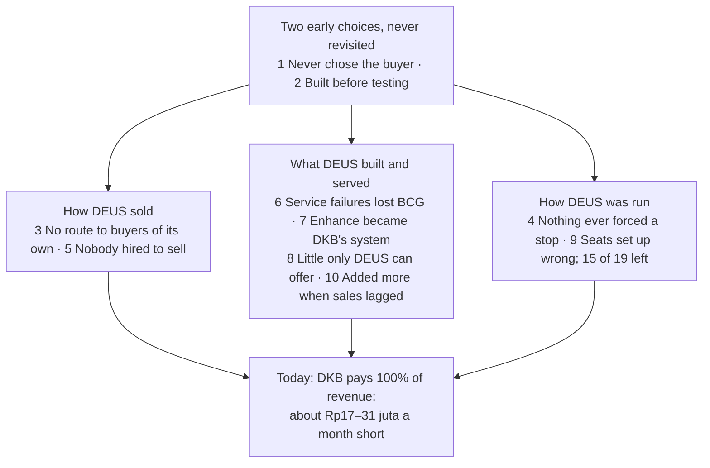

# Step 11: The top 10 reasons DEUS is where it is

As of 2026-10-28. **Revised 2026-10-28** from the reports rerun with the founder's answers of the same day (`inputs/deus-fact-sheet.md`, sections "Corrections to the recap and earlier steps" and "Founder answers"). For the founder and the founder's dad; internal. Asked for by the founder after Step 10: "what were the top 10 or so reasons for my startup being where it's at right now". This report ranks reasons the step reports already found; it adds no new facts. Facts are cited, interpretation is marked, the recommendation has its own section; **ASSUMPTION** = not in the files, **NO DATA** = number missing, **derived** = arithmetic on cited numbers.

**Provisional.** Every account of what happened, and every reason for a loss, is the founder's. No buyer, lost prospect or former team member has been asked why (the Step 6c interviews have not run), and every reason in the founder's answers lies outside DEUS (Step 7, section 4). The bank balance is unknown (Fact sheet, Money).

Sources: `inputs/DEUS_Company_History_Recap.pdf` ("Recap, Phase N"), `inputs/deus-fact-sheet.md` ("Fact sheet"; "Correction N" = its numbered corrections; "Founder answers" = its last section), `inputs/Agate_Next_Chapter_GBA_deck.pdf` ("Agate deck"), the revised `outputs/01-systems-thinking.md` to `outputs/06c-interview-guide.md` and the rerun `outputs/07-sense-check.md` to `outputs/10-DEUS-strategic-analysis.md` ("Step 1" to "Step 10").

---

## The answer

**DEUS is where it is because of two early choices that were never revisited: it never decided who its buyer was, and it built before testing whether anyone would pay.** Nothing ever forced them to be revisited: DEUS never built a route to buyers of its own, and no test, cash figure or funding limit ever said "stop". The other reasons grow out of those: how DEUS sold, what it built and served, and how it ran the company. The result today is one client (DKB) paying 100% of revenue, about Rp17–31 juta a month less than DEUS spends, and a bank balance nobody knows (Fact sheet, Money; Step 8, section 1).

How the list was made: the step reports name about twenty causes. They were merged where they describe the same mechanism and ranked by how much of today's position each explains, so a reason high on the list explains reasons below it (Step 1, "How the loops connect"). Step 7 rates the loop story a lens rather than proven; the same events also fit "an underfunded first-time team learning by doing" (Step 7, C1). Both readings lead to the same fixes.

## What this revision changed

The founder's answers did not remove any reason. They changed three ranks and corrected the facts under five.

| Reason | First pass (rank) | Now (rank) | Why |
|---|---|---|---|
| Never chose the buyer | 1 | 1 | Unchanged. Telkom's buyer is now named as its Assessment Center (Correction 2) |
| Built before testing | 2 | 2 | Unchanged. Discover's recorded revenue now includes SPH; the new games had no purchase cost (Correction 1; Step 7, MC3) |
| No route to buyers of its own | 4, "the dad's network as the channel" | **3** | Widened: Telkom's Assessment Center came through Agate, not through DEUS (Correction 2). Both repeat buyers came through someone else's channel, and Step 1 now names this as the common root of the loops |
| Nothing ever forced a stop | 10, "no numbers" | **4** | The dad funds the gap and will keep doing so, with no written limit (Correction 5). Steps 7 and 8 judge the missing stop rule, not missing cash, as the main problem (Step 7, C18; Step 8, risk 1) |
| Nobody hired to sell | 3 | 5 | Fact added: no success metric was set for any of the four sales hires (Founder answers). It now sits under reason 3 as one of its causes (Step 1, Loop 2 → Loop 3) |
| Service failures lost BCG | 5, "no engineering standard" | 6 | Renamed: BCG left over bugs, delivery and communication, and will not come back (Correction 4) |
| Enhance became DKB's system | 6 | 7 | Fact added: Enhance was refused at one price, not tested on need (Founder answers; Step 7, C10) |
| Little only DEUS can offer | 8, "Agate sells the same games directly" | 8 | Corrected: DEUS is one of five Agate sales partners; whether Agate also sells directly is disputed (Correction 1; Step 7, C8) |
| Seats set up wrong | 9 | 9 | Exit reasons added (Founder answers; Step 6a). "Two decision-makers" removed: the founder has the final say (Correction 5) |
| Added more when sales lagged | 7, "built or bought more" | **10** | The Phase 11 suite and Potentia cost no purchase price, and the suite brought the only validated module (Correction 1; Fact sheet, Validation; Step 7, C2). The cost was focus, not cash |

---

## The ten reasons

### The two early choices (the root)

**1. DEUS never decided who its buyer is.**
- **Fact.** Targets followed whoever was reachable: retail friends of the family (Phase 5), then F&B and finance (Phase 11), and a website naming ten industries (Recap, Phases 5, 11; Step 3). The buyers who paid a large amount (Telkom's Assessment Center, DKB) arrived with a need already in hand; the channels that brought companies without one produced almost nothing (Correction 2; Recap, Phase 3; Step 3).
- **Fact.** The most common reason prospects give for not buying, on the founder's account, is that they already have their own assessment (Fact sheet, "Why deals don't close").
- **Fact.** The two moments of real learning were not turned into the next test: BCG signing for Enhance before it existed, and Telkom's Assessment Center buying two years in a row (Recap, Phases 3, 7; Step 2).
- **Interpretation.** With no chosen buyer, DEUS mostly met companies whose need was already met. Telkom's Assessment Center was the opposite: it was already asking around (Step 1, Loop 3). This is the common root of the loops: with no repeatable buyer, DEUS built to feel ready (reason 10) or built for the one buyer it had (reason 7) (Step 1).

**2. DEUS built before testing whether anyone would pay.**
- **Fact.** Discover started from "an idea we thought was genuinely cool" and went "straight to building": about Rp1 billion to Agate for a medieval game that took almost two hours to play, with no psychometric validation and little market validation (Recap, Phase 1; Fact sheet). DEUS's own personality game still has no validation (Fact sheet, Validation). In eleven phases, no test was set up with a result written down in advance that would have meant "stop" (Step 2).
- **Fact.** Discover's recorded revenue is about Rp452 juta (Boga Rp60 juta, Telkom's Assessment Center's second deal Rp380 juta, SPH about Rp12 juta) plus Telkom's first deal (NO DATA), against about Rp1 billion for the first game plus the extra paid to shorten it (NO DATA) (Step 7, MC3; Fact sheet; derived). This is evidence of the order of events, not a reason to continue or stop (CLAUDE.md, rule 3).
- **Interpretation.** Building felt like progress and was in DEUS's control; selling depended on strangers saying no (ASSUMPTION; Step 1, Loop 5).

### How DEUS sold

**3. DEUS never had a route to buyers of its own.**
- **Fact.** Both repeat buyers came through someone else's channel. DKB came through the dad's network (Recap, Phase 3). Telkom's Assessment Center contacted Agate for a gamified assessment, and Agate brought DEUS in (Correction 2). How BCG first reached DEUS is NO DATA (Step 7, C3).
- **Fact.** The dad's network: "most leads he brought were retail companies and his friends"; "we converted almost none" (Recap, Phase 5). About 100 meetings across all waves produced DKB and almost nothing else; offered Enhance at Rp30 juta a month, the contacts almost all say "no budget" or "hold till later" (Fact sheet, Funnel; Founder answers).
- **Fact.** DEUS's own outreach has closed no deal: F&B 100+ contacts, almost 10 meetings, 0 deals; finance about 100 contacts, most don't reply; Apollo "hundreds" of contacts, 0 meetings; cold outreach to organisations like Telkom gets no response (Fact sheet, Funnel; Founder answers). Telkom could not introduce DEUS to similar groups (Correction 3).
- **Fact.** The Agate route is shared: four other companies are Next Chapter sales partners too, and how Agate allocates leads is unknown (Correction 1; Fact sheet, gap 2).
- **Interpretation.** Each borrowed channel was fast, free and friendly, so it removed the urgency of building DEUS's own way to reach a buyer who needs it (Step 1, Loop 3). Said plainly, with respect: the dad's network gave DEUS its only revenue today, and Agate gave it its largest deal. The problem is that neither is a channel DEUS owns or can measure.

**4. Nothing ever forced a stop.**
- **Fact.** No phase set a pass line in advance (Step 2). Cash in bank, runway and total invested: NO DATA, the founder doesn't know (Fact sheet, Money). No lost deal's reason was recorded in the buyer's words; the reasons on file are the founder's (Fact sheet, Founder notes; Step 6c). The burn may be understated: tools such as Apollo are not in the estimate (Step 7, MC2).
- **Fact.** The dad is the main funder and a shareholder, has said the support will continue, and there is no written limit; the founder has the final say (Correction 5).
- **Interpretation.** Without a pass line, a cash figure or a funding limit, a channel, a product or a hire could fail for a long time before anything made the company choose. Open-ended family money removed the one signal that usually forces that choice (Step 1, Loop 5). The dad's willingness to fund is a fact; it is not evidence that any product works (CLAUDE.md, rule 3). What is missing is a dated consequence agreed in advance, not money (Step 7, C18; Step 8, section 7, risk 1).

**5. Nobody was hired to sell, and no sales seat had a target.**
- **Fact.** Seven people held sales or account seats (Rosi, Bu Vera, Fizka, Bu Retno, Audrey, Wulan, Yessica); none is recorded as an experienced B2B seller, and only Audrey remains (Recap, Phases 1–9; Step 6a). No success metric was set for Bu Vera, Fizka, Bu Retno or Yessica (Founder answers). Selling today is Audrey (F&B outreach) and the founder (Step 1, Loop 2).
- **Interpretation.** When sales were weak, DEUS hired account managers into a seat whose problem was new revenue, and nobody could judge them against a target (Step 6a). That left selling to the founder and to borrowed channels (reason 3) (Step 1, Loop 2 → Loop 3). Step 8 does not answer this with a big sales hire now: there is no working sale yet to scale (Step 8, section 9.4).

### What DEUS built and served

**6. Service and engineering failures lost BCG, the largest buyer by total.**
- **Fact.** The first developer "worked with no guidance" because "we did not know how to develop systems at all"; QA was hired "because there were so many bugs"; messy client data overloaded the data person (Recap, Phases 3, 4, 6, 7).
- **Fact.** BCG paid Rp40 juta a month, about Rp480 juta in total, and left over a lot of bugs, DEUS "weren't able to deliver", and poor communication once Wulan held the account. BCG does not want to come back (Fact sheet, Revenue by client; Correction 4). Wulan's seat combined data and sales (Recap, Phases 7–8; Step 6a).
- **Interpretation.** Each problem got a person or a layer (QA, a data hire, Power BI), not a standard, and the account had no owner who was not also the data cleaner (Step 1, Loop 1; Step 7, C16). Ko Will's rebuild was "much better, even under a clear audit" and DKB is now "quite satisfied" (Recap, Phase 10; Founder answers), so this reason is weaker today. But nobody owns data intake, all engineering sits with Ko Will, and keeping Enhance running without Ko Will would be "very hard" (Step 1; Founder answers).

**7. Enhance became DKB's custom system, and DKB became all the revenue.**
- **Fact.** DKB came with a "very complex" KPI and appraisal setup, and DEUS took it on as its second product (Recap, Phase 3). "Three to four years in, … Enhance was still not fully done because DKB kept adding more and more features" (Recap, Phase 10). DKB still adds features (its own KPI groupings, a year-end summary), pays nothing extra, and has never accepted a written scope with a price per change (Founder answers).
- **Fact.** DKB is 100% of revenue and covers about 53–67% of costs (Fact sheet; Step 8, section 2; derived). New clients are quoted Rp30 juta a month, 2.5–4 times what packaged HR systems list for a company of DKB's size; the dad's contacts say "no budget" (Fact sheet, Pricing; Step 7, MC6; Founder answers).
- **Interpretation.** DKB pays, so it gets the development time; Enhance fits DKB better and the market less (Step 1, Loop 4). Enhance was refused at one price, not tested on need, so "no market" is not proven (Step 7, C10). Whether Ko Will's rebuild works for other groups is NO DATA (Step 1).

**8. DEUS owns little a buyer can't get elsewhere.**
- **Fact.** DEUS is one of five sales partners for Agate's Next Chapter suite (cognitive, neuroscience, simulation) (Correction 1). The founder says Agate sells it only through partners; Agate's own deck shows a price list and "Book Your Live Demo", and Agate launched it with free pilots (Agate deck; Step 4, W8). That conflict is open (Step 7, C8). Partner terms are NO DATA (Fact sheet, gap 2).
- **Fact.** The part DEUS owns, its personality game, has no validation, and lost prospects call it long with small text (Fact sheet, Validation and "Why deals don't close"). Talentlytica and Talentics claim 300+ companies and name Telkom-group clients (Step 4, W3).
- **Fact.** Earlier, when Agate moved to the metaverse, Discover went to Skyfy for almost a year, which could not fix the bugs, and then back to Agate (Recap, Phase 4).
- **Interpretation.** The modules are a point of parity at best. DEUS's one candidate difference is the service around them and the Telkom track record (Step 6b), and the team that delivered that service has mostly left (Step 7, C21). Depending on one outside builder, without terms that protect DEUS, cost time once and now limits the pitch.

### How DEUS was run

**9. Seats were set up wrong, so people came and went: 15 of 19 left.**
- **Fact.** 19 people besides the founder have worked at DEUS; 4 remain (Recap, Reference: people; derived). Step 6a's count of the 15 exits: role design 5, hiring and performance 4, ordinary life or career 4 (Fizka, for example, left because of Fizka's father's health), management 2 (Step 6a, section 1; Founder answers).
- **Fact.** Roles overlapped (Fizka and Bu Vera) or combined two jobs: Fitri left because DEUS wanted one person to do data and sales; Wulan, in that merged seat, left for poor performance (Recap, Phases 4, 6, 7; Founder answers). No role description, target, probation review or onboarding is recorded for any hire (Step 6a).
- **Interpretation.** Step 6a reads it as management first, role design second, hiring third. Step 7 holds that ranking: Step 6a's own count puts role design first, every description is the founder's, and pay (about Rp8–10 juta a month on average) may explain as much (Step 7, C15; Fact sheet). Act on role cards and reviews; hold judgements about named people.

**10. When sales lagged, DEUS added more.**
- **Fact.** After a weak first client, about a year went into digitising the report, and Agate was paid extra to shorten the game (Recap, Phases 4, 6; amount NO DATA). Potentia was acquired, free, while the first two products were hard to sell; DEUS expanded its report, and it was "extremely hard to sell" (Recap, Phase 9; Founder answers).
- **Fact.** Phase 11: DEUS became an Agate sales partner for Next Chapter, at no purchase cost ("made us more confident in selling"), then rebranded (Recap, Phase 11; Correction 1; rebrand cost NO DATA). Three products plus a partner suite for five people.
- **Interpretation.** The belief was "if we build it well enough, it will sell" (Step 1, Loop 5). The most common loss reason, "we already have an assessment", is about need, which no added module fixes (Fact sheet). It ranks last because the corrections cut its cash cost: the suite cost nothing and brought the only validated module, which may be what makes assessment units reachable at all (Fact sheet, Validation; Step 7, C2). "No new builds until a buyer pays" holds; carrying the suite is not a mistake to undo.

---

## What is not on the list

- **The market.** No market DEUS is in is shrinking; growth is not the problem, share is (Step 4).
- **Money.** The dad funds the gap and will keep doing so (Correction 5). Money was not the constraint; the missing stop rule was (reason 4).
- **Bad luck.** Single events were outside DEUS (Agate's move to the metaverse, Telkom's change of MT intake strategy, Fizka's family reasons), but the same patterns repeat across eleven phases (Step 1). Telkom's reason for stopping is the founder's account and is tested in the Telkom interview (Step 7, C6).
- **The founder's outside reasons.** Every reason in the founder's answers clears DEUS (a changed strategy at Telkom, Wulan at BCG, prospects who already have a tool). Until a buyer confirms them they are hypotheses, not causes (Step 7, section 4).
- **Named people.** Judgements about individuals are on hold until someone other than the founder has been heard (Step 7, C15).
- **Time and money already spent.** Neither is a reason to continue or to stop anything (CLAUDE.md, rule 3).

---

## Recommendation: each reason already has a fix in the verdict

No new recommendations here. Every reason maps to a line in the rerun verdict (Step 8, section 8, PIVOT, narrowed) or the step reports.

| # | Reason | The fix already recommended | Where |
|---|---|---|---|
| 1 | Never chose the buyer | One buyer for the one growth bet: the head of a central assessment unit or the owner of a large MT or graduate intake | Step 8, section 8 (the Discover bet) |
| 2 | Built before testing | No new games, modules, features beyond DKB's or rebrand until a buyer pays; fail lines written before each gate | Step 8, section 8 (stops now; decision dates) |
| 3 | No route of its own | Gate 1 by 2026-11-11: Agate's written lead rule or 5 named introducers; no cold email; a weekly funnel log | Step 8, section 8; Step 1, leverage point 3 |
| 4 | Nothing forced a stop | A one-page note signed with the dad by 2026-11-04: the gates, what a fail means, the last month family money covers a growth gap, who stays if DEUS shrinks; bank balance and every recurring cost written down | Step 8, section 8 |
| 5 | Nobody hired to sell | No big sales hire now; after the money bar passes, one experienced seller with a 90-day target in money and a role card | Step 8, section 9.4; Step 6a |
| 6 | Service lost BCG | Thania as DKB's named account owner; Ko Will's run book and a named backup engineer by 2026-11-27; a client data intake rule | Step 8, section 8; Step 1, leverage point 7 |
| 7 | Enhance became DKB's system | Read DKB's contract by 2026-11-11; a 30-day internal time log; a development allowance only if DKB work costs more than about Rp15.5 juta a month; five founder price calls | Step 8, section 8 |
| 8 | Little only DEUS offers | Lead with the service, priced per intake from the costing of one intake; Agate's terms in writing; the six paying groups and honest validity claims before the first meeting | Step 8, section 8; Step 7, C22 |
| 9 | Seats set up wrong | Role cards and 30/90-day reviews; who stays named by 2026-11-04 | Step 6a; Step 8, section 8 |
| 10 | Added more when sales lagged | Stop now: Potentia (zero hours), new builds and hires, Apollo, cold lists, network waves to groups that don't fit | Step 8, section 8 |

---

## Key findings

1. **Two early choices still explain most of the history:** DEUS never decided who its buyer was, and it built before testing whether anyone would pay. The founder's answers did not change them (Steps 1, 2, 3).
2. **DEUS never had a route to buyers of its own.** Both repeat buyers came through someone else's channel (DKB through the dad, Telkom's Assessment Center through Agate), and DEUS's own outreach has closed no deal. This is the biggest move in the ranking, from 4 to 3 (Correction 2; Fact sheet, Funnel; Step 1).
3. **Nothing ever forced a stop.** No pass line, no cash figure and open-ended family money let each pattern run for years. It moves from 10 to 4, and the verdict names it the main risk from here (Correction 5; Step 8, section 7).
4. **The products drifted away from a market.** Enhance into DKB's custom system (100% of revenue), priced where the market says "no budget"; Discover into modules four other partners also sell, beside DEUS's own unvalidated game (Founder answers; Correction 1; Fact sheet, Validation).
5. **Adding products drops to last, and every reason already has a fix in the verdict.** The Phase 11 suite and Potentia cost no purchase price; the cost was focus. The list stays provisional until buyers and former staff have been heard (Correction 1; Steps 6c, 7, 8).

## Data gaps

- Cash in bank, total invested, and every recurring cost beyond the team, the office and the server (NO DATA; Fact sheet, gaps 1 and 3; Step 7, MC2).
- Every buyer's and lost prospect's own reason for buying, staying, leaving or saying no; Telkom's Assessment Center's own reason for stopping (NO DATA; Step 6c; Step 7, C6). BCG will not engage (Correction 4).
- How BCG first reached DEUS (NO DATA; Step 7, C3).
- Agate's partner terms, its lead rule, and whether Agate also sells Next Chapter directly (NO DATA; Fact sheet, gap 2; Step 7, C8).
- The cost of shortening the first game and of the rebrand (NO DATA; Fact sheet).
- Tenure of each departed person; base rates for turnover at small Indonesian startups (NO DATA; Step 7, C15).
- DKB's contract and the hours DKB takes each month; whether Ko Will's rebuild works for other groups (NO DATA; Fact sheet, gap 4; Step 1).

## Questions for the founder

**Answered on 2026-10-28** (Founder answers):
- *What did Agate agree with DEUS about selling the same games?* DEUS is one of five Next Chapter sales partners, with no purchase cost. Still open: the revenue share, the lead rule, and why Agate sells through a price list and demo button of its own.
- *Who decided to acquire Potentia, and what would have had to be true?* Partly: it was free, and DEUS expanded its report. Still open: who decided, and what result was expected.

**Still open:**
1. Looking at the ten, which one would you have disagreed with five years ago, and which would your dad disagree with today?
2. Was there ever a moment when DEUS decided on a target buyer in writing? If so, what made it change?
3. Why was no experienced seller hired, and no target set for the four sales hires: cost, not finding one, or not seeing the need?
4. Why did Agate bring DEUS in for Telkom's Assessment Center rather than another partner, and how did BCG first reach DEUS?
5. Which of the ten fixes in the table could start this week without anyone's permission?
