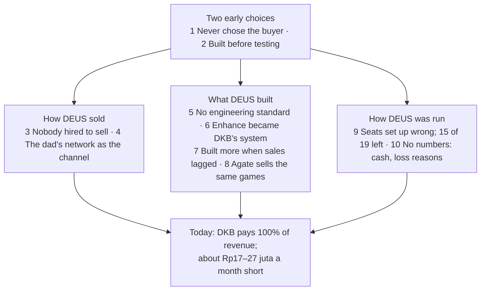

# Step 11: The top 10 reasons DEUS is where it is

As of 2026-10-28. For the founder and the founder's dad; internal. Asked for by the founder after Step 10: "what were the top 10 or so reasons for my startup being where it's at right now". This report ranks reasons the step reports already found; it adds no new facts. Facts are cited, interpretation is marked, the recommendation has its own section; **ASSUMPTION** = not in the files, **NO DATA** = number missing, **derived** = arithmetic on cited numbers.

**Provisional.** Every account of what happened is the founder's. No buyer, lost prospect or former team member has been asked why (the Step 6c interviews have not run), and the bank balance is unknown (Fact sheet).

Sources: `inputs/DEUS_Company_History_Recap.pdf` ("Recap, Phase N"), `inputs/deus-fact-sheet.md` ("Fact sheet"), `inputs/Agate_Next_Chapter_GBA_deck.pdf` ("Agate deck"), `outputs/01-systems-thinking.md` to `outputs/10-DEUS-strategic-analysis.md` ("Step 1" to "Step 10").

---

## The answer

**DEUS is where it is because of two early choices that were never revisited: it never decided who its buyer was, and it built before testing whether anyone would pay.** The other eight reasons grow out of those two: how DEUS sold, what it built, and how it ran the company. The result today is one client (DKB) paying 100% of revenue, about Rp17–27 juta a month less than DEUS spends, and a bank balance nobody knows (Fact sheet).

How the list was made: the step reports name about twenty causes. They were merged where they describe the same mechanism and ranked by how much else depends on them, so a reason high on the list explains reasons below it (Step 1, "How the loops connect"). Step 7 rates the loop story a lens rather than proven; the same events also fit "an underfunded first-time team learning by doing" (Step 7, C1). Both readings lead to the same fixes.

---

## The ten reasons

### The two early choices (the root)

**1. DEUS never decided who its buyer is.**
- **Fact.** Targets followed whoever was reachable: retail friends of the family (Phase 5), then F&B and finance (Phase 11), and a website naming ten industries (Recap, Phases 5, 11; Step 3). Every buyer who paid a large amount (Telkom, DKB, BCG) arrived with a need already in hand; every channel that brought companies without one produced almost nothing (Step 3).
- **Fact.** The two moments of real learning were not turned into the next test: BCG signing for Enhance before it existed, and Telkom buying two years in a row (Recap, Phases 3, 7; Step 2).
- **Interpretation.** This is the common root of the five loops: with no repeatable buyer, DEUS built to feel ready (reason 7) or built for the one buyer it had (reason 6) (Step 1).

**2. DEUS built before testing whether anyone would pay.**
- **Fact.** Discover started from "an idea we thought was genuinely cool" and went "straight to building": about Rp1 billion to Agate for a medieval game that took almost two hours to play, with no psychometric validation and little market validation (Recap, Phase 1; Fact sheet). In eleven phases, no test was set up with a result written down in advance that would have meant "stop" (Step 2).
- **Fact.** Discover's recorded revenue is Rp440 juta plus two unknowns (Telkom's first deal, SPH), against about Rp1 billion for the first game alone, plus the extra to shorten it and the new games, whose costs are NO DATA (Step 7, MC3; Fact sheet; derived).
- **Interpretation.** Building felt like progress and was in DEUS's control; selling depended on strangers saying no (ASSUMPTION; Step 1, Loop 5).

### How DEUS sold

**3. Nobody was hired to sell.**
- **Fact.** Seven people held sales or account seats (Rosi, Bu Vera, Fizka, Bu Retno, Audrey, Wulan, Yessica); none is recorded as an experienced B2B seller, and only Audrey remains (Recap, Phases 1–9; Step 6a). When sales were weak, DEUS hired account managers into a seat whose problem was new revenue (Step 6a).
- **Interpretation.** The seat meant to fix sales was filled again and again with the wrong profile, so selling fell back on the founder and the dad's network (reason 4) (Step 1, Loop 2).

**4. The dad's network was the sales channel.**
- **Fact.** Sales ran "all through my dad's connections"; "most leads he brought were retail companies and his friends"; "we converted almost none" (Recap, Phase 5). About 100 meetings across all waves produced DKB and almost nothing else; the Phase 11 waves brought "nothing; no assessment sales and no Enhance sales" (Fact sheet; Recap, Phases 9, 11).
- **Interpretation.** The network was fast, free and friendly, so it removed the urgency of asking "who buys this, and why?" (Step 1, Loop 3). It also gave DEUS its only revenue today, so the issue is its use as the main channel, not the dad's help.

### What DEUS built

**5. There was no engineering or data standard.**
- **Fact.** The first developer "worked with no guidance" because "we did not know how to develop systems at all"; QA was hired "because there were so many bugs"; messy client data overloaded the data person (Recap, Phases 3, 4, 6, 7). BCG, paying Rp40 juta a month, churned "amid ongoing bugs and slow data cleaning": "a huge blow" (Recap, Phase 8; Fact sheet).
- **Interpretation.** Each problem got a person or a layer (QA, a data hire, Power BI), not a standard (Step 1, Loop 1). Ko Will's rebuild was "much better, even under a clear audit" (Recap, Phase 10), so this reason is weaker today, but nobody owns data intake and all engineering sits with one person (Step 1).

**6. Enhance became DKB's custom system, and DKB became all the revenue.**
- **Fact.** DKB came with a "very complex" KPI and appraisal setup, and DEUS took it on as its second product (Recap, Phase 3). "Three to four years in, … Enhance was still not fully done because DKB kept adding more and more features" (Recap, Phase 10). Apollo outreach for Enhance: zero meetings from hundreds of contacts (Recap, Phase 11). DKB is 100% of revenue and covers 56–67% of the burn (Fact sheet; Step 7, MC2).
- **Interpretation.** DKB pays, so it gets the development time; Enhance fits DKB better and the market less; DEUS's fear of losing DKB grows (Step 1, Loop 4). Whether Ko Will's rebuild is a general product or a cleaner DKB system is NO DATA (Step 1).

**7. When sales were weak, DEUS built or bought more.**
- **Fact.** After a weak first client, about a year went into digitising the report (Recap, Phase 6). Potentia was acquired while the first two products were hard to sell, and was "extremely hard to sell" (Recap, Phase 9). Phase 11 added Agate's new games ("made us more confident in selling"), then a rebrand; their costs are NO DATA (Recap, Phase 11; Fact sheet). Three products for five people.
- **Interpretation.** The belief was "if we build it well enough, it will sell"; no lost buyer is recorded naming the product as the reason (Step 1, Loop 5). Step 7's caution: MT screening normally tests cognitive ability, so the new suite may be what makes the best buyer type reachable. "No new builds until a buyer pays" holds; "the suite was the wrong buy" is not proven (Step 7, C2).

**8. DEUS owns no difference a buyer can't get elsewhere.**
- **Fact.** Agate, which built DEUS's games, sells the same suite directly ("Next Chapter: Game-Based Assessment"), with the same game names, from Rp49,999 per user and free pilots (Agate deck). DEUS's terms with Agate for the new games are NO DATA (Fact sheet). Talentlytica and Talentics claim 300+ companies and name Telkom-group clients (Step 4, W3).
- **Fact.** Earlier, when Agate moved to the metaverse, Discover went to Skyfy for almost a year, which could not fix the bugs, and then back to Agate (Recap, Phase 4).
- **Interpretation.** The games are a point of parity at best; DEUS's only defensible difference is the service around them and its track record (Step 6b). Depending on one outside builder, without terms that protect DEUS, cost time once and now costs the pitch.

### How DEUS was run

**9. Seats were set up wrong, so people came and went: 15 of 19 left.**
- **Fact.** 19 people besides the founder have worked at DEUS; 4 remain (Recap, Reference: people; derived). No role description, target, probation review or onboarding is recorded for any hire (Step 6a). Roles overlapped (Fizka and Bu Vera) or combined two jobs (Wulan, "sales and data"); a psychometrics hire ended up doing data work until overloaded (Recap, Phases 4, 6, 7).
- **Fact.** Two decision-makers: the dad brought the main client, most leads and the order to rebuild Enhance, but his role was never written down (Step 6a; Recap, Phases 3, 5, 10).
- **Interpretation.** Management first (nobody could set or judge the standard), role design second, hiring third (Step 6a). Step 7's caution: every description of a person is the founder's, and pay (about Rp8–10 juta a month on average) may explain as much as management (Step 7, C16; ASSUMPTION). Act on role cards and reviews; hold judgements about named people.

**10. DEUS has been running without its key numbers.**
- **Fact.** Cash in bank, runway and total invested: NO DATA, the founder doesn't know (Fact sheet). No lost deal's reason was ever recorded, and no buyer has been asked why they bought, stayed or left (Fact sheet, Founder notes; Step 6c). The burn may be understated: Apollo, Power BI, hosting and the Potentia site are named in the recap but not in the burn (Step 7, E4).
- **Interpretation.** Without the numbers, nothing forced a stop: a channel, a product or a hire could fail for a long time before anyone could see it. If family money covers the monthly gap, it also hides the cash signal that would otherwise force a decision (ASSUMPTION; Step 1, Loop 5; Step 7, section 4).

---

## What is not on the list

- **The market.** No market DEUS is in is shrinking; growth is not the problem, share is (Step 4).
- **Bad luck.** Single events were unlucky (Agate's move to the metaverse, BCG's churn), but the same patterns repeat across eleven phases (Step 1). The one event the founder calls lucky, Telkom, looks more like the right buyer than luck (Step 3; a hypothesis, Step 7, C6).
- **Named people.** Judgements about individuals are on hold until someone other than the founder has been heard (Step 7, C16).
- **Time and money already spent.** Neither is a reason to continue or to stop anything (CLAUDE.md, rule 3).

---

## Recommendation: each reason already has a fix in the plan

No new recommendations here. Every reason maps to a line in the verdict or the step reports.

| # | Reason | The fix already recommended | Where |
|---|---|---|---|
| 1 | Never chose the buyer | One buyer type per test: groups with their own yearly MT intake (test A); multi-brand groups with a KPI setup like DKB's (test B) | Step 8, section 8 |
| 2 | Built before testing | "Sell, then build": nothing new built, bought or rebranded until a buyer has paid; pass lines written before each test | Step 1, leverage point 1; Step 8 |
| 3 | Nobody hired to sell | The next commercial hire is an experienced seller, with a role card and a 90-day outcome | Step 1, leverage point 5; Step 6a |
| 4 | The dad's network as the channel | Up to 10 introductions from the dad, only to groups that fit the profile | Step 8, section 8 |
| 5 | No engineering standard | Client data intake template; cleaning quoted as paid work; Ko Will's run book and a backup engineer | Step 1, leverage point 6; Step 8 |
| 6 | Enhance became DKB's system | A priced DKB service contract: fixed scope, a price per change request, Ko Will's time capped; read DKB's contract | Step 4; Step 8 |
| 7 | Built more when sales lagged | Stop list now: Potentia, new builds and hiring, Apollo, network waves to groups that don't fit | Step 8, section 8 |
| 8 | No difference DEUS owns | Agate's terms in writing before test A counts; lead with the service, not the games | Step 8; Step 6b |
| 9 | Seats set up wrong | Role cards and 30/90-day reviews; the dad's role written down | Step 6a |
| 10 | No numbers | Bank balance, every recurring cost and a written family funding limit by 2026-11-04; a weekly one-page sheet of cash and the funnel with loss reasons | Step 8; Step 6a |

---

## Key findings

1. **Two early choices explain most of the history:** DEUS never decided who its buyer was, and it built before testing whether anyone would pay. The other eight reasons grow out of them (Steps 1, 2, 3).
2. **Selling was never anyone's job.** Seven sales or account seats, no experienced seller, and a channel (the dad's network) that produced about one deal from about 100 meetings (Step 6a; Fact sheet).
3. **The products drifted away from a market:** Enhance into DKB's custom system (100% of revenue), Discover into games that their own builder now sells directly (Recap, Phase 10; Agate deck).
4. **The company ran without its numbers:** no bank balance, no recorded loss reasons, no role targets. That is why the patterns could run for eleven phases (Fact sheet; Step 6a).
5. **Every reason already has a fix in the verdict, and most cost nothing.** The list is provisional until buyers and former staff have been heard (Steps 6c, 7, 8).

## Data gaps

- Cash in bank, total invested, every recurring cost, and how the monthly gap is funded (NO DATA; Fact sheet; Step 7, E4).
- Every buyer's and lost prospect's own reason for buying, staying, leaving or saying no; BCG's churn reason; why Telkom chose DEUS and why there was no third year (NO DATA; Step 6c).
- The cost of shortening the first game, of the new games, and of the rebrand; DEUS's terms with Agate (NO DATA; Fact sheet).
- Tenure and reasons for leaving of each departed person; base rates for turnover at small Indonesian startups (NO DATA; Step 7, C16).
- Whether DKB still adds features and how much developer time it takes; whether Ko Will's rebuild works for other groups (NO DATA; Step 1).

## Questions for the founder

1. Looking at the ten, which one would you have disagreed with five years ago, and which would your dad disagree with today?
2. Was there ever a moment when DEUS decided on a target buyer in writing? If so, what made it change?
3. Why was no experienced seller hired: cost, not finding one, or not seeing the need?
4. What did Agate agree with DEUS about selling the same games directly, for the first game and for the new suite?
5. Who decided to acquire Potentia, and what would have had to be true for it to pay off?
6. Which of the ten fixes in the table could start this week without anyone's permission?
