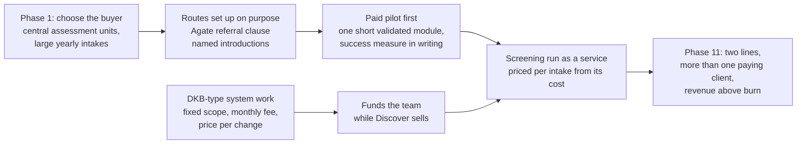

# Step 12: The time-machine rerun

As of 2026-10-28. **Revised 2026-10-28** with the founder's answers of the same day (`inputs/deus-fact-sheet.md`, sections "Corrections to the recap and earlier steps" and "Founder answers") and the revised Steps 1–11. For the founder and the founder's dad; internal. Asked for by the founder: "if I were to do this business from scratch, what would I have done? Simulate one in which it works, as if there were a time machine."

**This is a simulation, not a forecast and not a finding.** Every line under **Then** is what happened, cited. Every line under **Rerun** is a judgement built from what Steps 1–11 found; where the rerun needs something the files can't confirm, it is marked ASSUMPTION. It uses only deal sizes DEUS actually achieved, so no revenue figure is invented; sums of those deal sizes are marked derived. **NO DATA** = number missing.

**Provisional.** The corrections are the founder's account. No buyer, Agate or former team member has been asked (the Step 6c interviews have not run), so the reasons Telkom stopped and BCG left are the founder's, not theirs (Step 7, section 4).

Sources: `inputs/DEUS_Company_History_Recap.pdf` ("Recap, Phase N"), `inputs/deus-fact-sheet.md` ("Fact sheet"; "Correction N" = its numbered corrections; "Founder answers" = its last section), `inputs/Agate_Next_Chapter_GBA_deck.pdf` ("Agate deck"), `inputs/DEUS_Pitch.pdf` ("Pitch deck"), the revised `outputs/01-systems-thinking.md` to `outputs/06c-interview-guide.md` and the rerun `outputs/07-sense-check.md` to `outputs/11-top-10-reasons.md` ("Step 1" to "Step 11").

---

## The answer

**With what DEUS knows now, a rerun would sell one service to one buyer before building anything: game-based screening run as a service for the central assessment units of large Indonesian groups, reached through Agate's referrals and named introductions, and funded early by DKB-type system work sold as fixed-scope contracts.** In the simulation that gets DEUS to revenue above today's burn with more than one paying client, using only deal sizes it really won. Even with the time machine, competitors, Agate's own move into selling assessments, a five-partner split of Agate's leads, and state groups moving screening into the joint recruitment could still sink it.

**The three changes that make the rest work** (each answers reasons 1–3 of Step 11):

1. **Choose the buyer before building:** the head of a central assessment unit, or the owner of a yearly MT or graduate intake, at a large group. Telkom's Assessment Center is the only buyer type that has paid a large amount and come back (Correction 2; Step 3).
2. **Sell first, then build:** nothing is built until a buyer has paid for it or committed money to it (Step 1, leverage point 1; Step 11, reason 2).
3. **A route to buyers that DEUS sets up on purpose:** a written referral agreement with Agate from the first contract, plus named introductions, and an experienced seller as an early hire. In the real history, both repeat buyers came through someone else's channel, by chance (Correction 2; Step 11, reason 3).

## What this revision changed

| Point | First pass | Now | Why |
|---|---|---|---|
| The channel | DEUS hunts the Telkom profile itself, so a Telkom-type buyer turns up earlier | **Agate referrals plus named introductions.** No cold outreach | Telkom's Assessment Center came through Agate, not DEUS's outreach; cold outreach to similar organisations got no response; Telkom could not introduce DEUS to similar groups (Corrections 2–3; Founder answers) |
| The buyer | Group HR at groups with a yearly MT intake | The head of a central assessment unit or of a large intake | The buyer was Telkom's Assessment Center, which tests all Telkom recruits (Correction 2) |
| Agate | DEUS owns the game or Agate can't sell it; Agate sells the same suite directly | The first-game contract adds a referral clause and a lead rule; in Phase 11 DEUS joins the Next Chapter partnership only with written terms | DEUS did not buy the Phase 11 games; it is one of five sales partners (Correction 1). Whether Agate also sells directly is disputed (Step 7, C8) |
| BCG | Stays (ASSUMPTION; its reason NO DATA) | Stays, on a fix to a known cause: a senior engineer and an account owner who is not also the data cleaner (still ASSUMPTION) | BCG left over bugs, delivery and communication once Wulan held the account (Correction 4) |
| Telkom's end | Why it stopped: unknown | A second assessment unit is signed before Telkom's second intake ends, so one buyer's change can't zero Discover | Telkom's MT intake strategy changed (Correction 3, founder's account; Step 7, C6) |
| Enhance timeline | Test whether groups pay Rp35–40 juta a month | Test the need at a price the market lists, not at Rp30–40 juta | At Rp30 juta the dad's contacts say "no budget"; that is 2.5–4 times packaged HR-system lists (Founder answers; Step 7, C10) |
| Family money | In stages tied to milestones | A signed page: gates, fail lines and the last month family money covers a growth gap | The dad will keep funding and the founder decides; what was missing was a dated consequence, not money (Correction 5; Step 7, C18; Step 8, section 8) |
| Burn | Rp52–62 juta a month | Rp52–66 juta, with the Enhance server (about Rp4 juta) | Fact sheet, Money; Step 7, MC2 |

---

## The rerun in one picture

---

## The replay, phase by phase

| Phase | Then (what happened) | Rerun (simulation) |
|---|---|---|
| 1 Founding | "An idea we thought was genuinely cool"; straight to building; about Rp1 billion to Agate for a two-hour medieval game; no validation (Recap, Phase 1) | Months of interviews with heads of assessment units and HR heads at large groups first. Three paid pilots promised before the game is commissioned. One short module, validated from day one. Agate paid in stages, with a **referral clause**: buyers who ask Agate for gamified assessment are passed to DEUS for a fee (ASSUMPTION that Agate would agree; NO DATA) |
| 2 First client | Boga: 600 employees, Rp60 juta, bugs, a long process, "not fully satisfied"; MoM partners "never sold our product" (Recap, Phase 2) | A pilot with a success measure agreed in writing and a debrief at the end. Every answer goes into a log. Partners only with a sales target and a first named deal |
| 3–4 DKB arrives | DKB's complex KPI setup becomes a second product; built "with no guidance", very buggy; Discover spends almost a year at Skyfy when Agate moves to the metaverse (Recap, Phases 3–4) | DKB signed as a custom build: written scope, monthly fee, a price per change request, set at signing. A senior engineer hired before any junior. Client data on a set template; cleaning billed. The Agate contract covers what happens if Agate changes direction (ASSUMPTION) |
| 4–5 Team and sales | Seven sales or account seats, no experienced seller, no success metric for four of them; about 100 network meetings, about one deal; booths and awards convert nothing (Step 6a; Fact sheet; Founder answers; Recap, Phase 5) | An experienced seller early, with a 90-day target in money. The dad opens doors only to groups with an assessment unit or a KPI problem in hand. Stop rule: ten meetings in a segment with no deal, then call each back and ask why |
| 6–7 Telkom | Telkom's Assessment Center asks Agate for a gamified assessment; Agate brings DEUS in; two years in a row (second deal Rp380 juta); "fairly lucky" (Recap, Phase 7; Correction 2; Fact sheet) | The same referral arrives, but through a clause DEUS asked for, and Agate's other gamified-assessment enquiries come the same way (ASSUMPTION). After the first intake: a debrief, a written case study, and a second assessment unit approached through Agate and introductions before the second intake ends |
| 8–11 Later | BCG churns over bugs, delivery and communication; Telkom stops when its MT strategy changes; Potentia acquired free; DEUS becomes one of five Next Chapter partners; rebrand (Recap, Phases 8–11; Corrections 1, 3, 4; Founder answers) | BCG stays (ASSUMPTION). Telkom's change hurts, but Discover has a second unit. No Potentia. The partnership is joined only with a written lead rule and revenue share. Team grows only when a contract pays for the seat |

### Phase 1 in more detail: before building

- **Who to talk to:** heads of assessment units and HR heads at large groups. The questions: when do you test at volume, what do you use now, what does it cost, what goes wrong. The aim is to find the units already looking for gamified assessment, which is what Telkom's Assessment Center turned out to be (Recap, Phase 7; Correction 2). Today the most common "no" is "we already have our own assessment" (Fact sheet, "Why deals don't close"), so the rerun asks what would make a unit add a game, not whether it needs an assessment.
- **The rule before spending:** three units or groups agree to pay for a pilot before the game is commissioned. This is a pass line chosen for the simulation, not data.
- **The build:** one short module that a candidate finishes in one sitting, with Sahid validating it from day one. The original had no validation (Recap, Phase 1), and DEUS's own personality game still has none (Fact sheet, Validation). Today the full suite is 3 hours 20 minutes of play (Pitch deck, slide 7), and lost prospects call the game long with small text (Fact sheet).
- **The contract with Agate:** paid in stages tied to pilots, with two clauses the real one is not known to have: a **referral clause** (Agate passes gamified-assessment enquiries for this game to DEUS, for a fee) and a **change clause** (if Agate moves on, DEUS gets the code or a handover). The real first game was a one-time payment with no per-candidate fee (Fact sheet, Money); its other terms are NO DATA, and whether Agate would have agreed is NO DATA.
- **The money:** most of the Rp1 billion stays in the bank until buyers have paid.

### Phases 3–4 in more detail: the fork when DKB walks in

- **Take DKB's money, not its roadmap.** Signed as a custom build with a written scope, a monthly fee and a price per change request, agreed at signing (Step 1, leverage point 3). In the real history the feature list ran for three to four years (Recap, Phase 10), and DKB has never accepted a priced scope since, because it is used to extras being free (Founder answers). Whether DKB would have signed those terms on day one is ASSUMPTION.
- **BCG signing early is treated as a signal, not luck.** The rerun writes down a guess, "multi-brand groups with complex KPI setups will pay for a custom system", and tests it on need and on price separately: can DEUS find a third such group without the dad's network, and at what price does it say yes? In the real history Enhance was offered at one price, Rp30 juta a month, and the answer was "no budget" (Founder answers; Step 7, C10). If no third group is found, Enhance stays a service line that funds Discover.
- **Quality from the start.** One senior engineer who sets the standard, the role Ko Will ended up playing in Phase 10 ("much better, even under a clear audit"). Client data comes in on a template, and cleaning is billed (Step 1, leverage point 7). Every client has a named account owner who is not also the data cleaner: BCG's stated reasons were bugs, delivery and being left without answers once Wulan, in a merged data-and-sales seat, held the account (Correction 4; Step 7, C16).
- **What that does to the money.** In the rerun BCG stays (ASSUMPTION: the fix answers the founder's account of why it left; BCG will not be interviewed). DKB plus BCG is Rp75 juta a month, more than today's whole burn of Rp52–66 juta (derived; Fact sheet).

### Phases 4–5 in more detail: who sells, and through whom

- **The route is set up, not waited for.** Two channels, both chosen because they are the only ones that ever produced a buyer: **Agate referrals** (Telkom's Assessment Center, the largest Discover deal) and **named introductions** to people who own an assessment budget (DKB came through the dad; Recap, Phase 3). No cold lists: DEUS's own outreach has closed no deal in any wave (Fact sheet, Funnel; Step 11, reason 3).
- **Agate's referrals are logged and paid for.** Each enquiry Agate passes is recorded with its outcome, and the fee is paid only on a signed deal. This turns a lucky referral into a channel DEUS can measure (Step 1, Loop 3).
- **The first commercial hire has sold to HR or assessment buyers at large groups before**, starts with a 90-day target in money, and has a role card. In the real history no success metric was set for four sales hires (Founder answers; Step 6a).
- **The dad's role is written down:** funder, shareholder and senior door-opener, opening doors only to groups that fit, with the founder deciding (Correction 5; Step 6a). His network did not work as a lead source: about 100 meetings, about one deal (Fact sheet, Funnel).
- **The stop rule** (ten meetings in a segment with no deal) would have ended the retail wave in Phase 5 instead of running it on to Phase 11 (Recap, Phases 5, 9, 11).
- **No booths or awards as a sales channel** (zero conversions, Recap, Phase 5).

### Phases 6–7 in more detail: the Telkom moment

- **Not luck, a referral DEUS asked for.** The real Telkom Assessment Center asked Agate for a gamified assessment, and Agate brought DEUS in (Correction 2). In the rerun the same thing happens under a clause, so Agate's other enquiries reach DEUS too, and DEUS asks Agate each quarter who has been asking (ASSUMPTION: how many such enquiries Agate got is NO DATA).
- **After the first intake:** a debrief interview, a written case study, and a question to the unit's head: who else runs an assessment like yours? Telkom could not introduce DEUS to similar groups (Correction 3), so the rerun does not count on it.
- **Before the second intake ends, a second unit.** Approached through Agate and named introductions. Telkom stopped when its MT strategy changed (Correction 3, founder's account): a programme buyer lasts as long as its programme (Step 3), so the rerun never lets one unit be all of Discover.
- **Price the service, not the modules.** Telkom's Assessment Center paid Rp380,000 per candidate for a run intake across 30+ provinces with results in one day (Fact sheet). Step 7 reads that as a fee for running the intake, not pricing power (Step 7, C5), which is what the rerun sells.
- **Product work follows what these buyers ask for.** The year spent digitising the report (Recap, Phase 6) happens only if buyers name the report as their reason.

### Phases 8–11 in more detail: what doesn't happen

- **No Potentia:** a different buyer. It was free to acquire (Founder answers), so the cost was focus: one deal of about Rp12 juta and a product that was "extremely hard to sell" (Fact sheet; Recap, Phase 9).
- **The Next Chapter partnership, joined on written terms.** In the real history DEUS became one of five Agate sales partners at no purchase cost (Correction 1). That brought the only validated module, cognitive, which MT screening usually needs (Fact sheet, Validation; Step 7, C2). The rerun joins too, but first gets in writing the revenue share, the price, and a lead rule saying who gets open-search enquiries. Agate's own deck shows a price list and "Book Your Live Demo" (Agate deck), so the rerun assumes Agate may sell directly and plans for it (Step 7, C8).
- **No rebrand across ten industries:** the website names one use case and shows only paying clients' logos (Step 3, the "40+ brands" gap; the logos are brands inside about six paying groups, Founder answers).
- **The team grows only when a contract pays for the seat**, with a role card and a target. That avoids most of the 15 departures out of 19 hires, which Step 6a counts as role design 5, hiring and performance 4, ordinary life or career 4, management 2 (Recap, Reference: people; Step 6a).
- **A weekly one-page sheet:** cash in the bank, the funnel per channel (Agate referrals counted separately), and the reason for every "no" in the buyer's words (Step 6a).

---

## Where the rerun ends up (Phase 11)

**One company, one buyer:** large Indonesian groups, with two lines.
- **Screening run as a service for assessment units and large intakes:** seasonal, large deals, from at least two units. Telkom's size was Rp380 juta per intake (Fact sheet).
- **Custom performance systems** for two groups, as DKB and BCG were, at Rp35–40 juta a month (Fact sheet).

**The simulation's maths, using only real deal sizes** (all derived; Fact sheet):

| | Per year |
|---|---|
| Today's burn (Rp52–66 juta a month, server included) | Rp624–792 juta |
| DKB alone | Rp420 juta |
| DKB plus one Telkom-size intake | Rp800 juta: at the top of today's burn |
| DKB, BCG and two Telkom-size intakes | About Rp1.66 billion |

These are revenue figures, not profit. Delivery cost and Agate's share of any Next Chapter modules are NO DATA, and Step 7 holds any "one deal closes the gap" claim until one deal's margin is known (Step 7, C14). On DKB plus one intake alone the rerun only just matches today's burn; it works because it has more than one buyer on each line.

**What "works" means here:** more than one paying client on each line, revenue above burn, a route DEUS can measure, and a known reason why each buyer buys. Not a unicorn.

### The other timeline: Enhance first

The evidence still cannot say which product to back: Enhance has about twice Discover's recorded revenue (about Rp900 juta against about Rp452 juta plus Telkom's first deal, NO DATA), and Discover has the only buyer that came through a repeatable-looking route (Step 7, MC3; Correction 2). A rerun built on Enhance would treat DKB and BCG as the first two of a product for multi-brand groups, keep BCG by fixing service, and look for a third group at a price packaged HR systems make credible, not at Rp30 juta (Step 7, C10, MC6). It needs one thing the files can't show: that groups outside the family's circle have the same need (Apollo: zero meetings from hundreds of contacts; the dad's contacts: "no budget" at one price; Fact sheet, Funnel). And it has no Agate: the only outside referral route DEUS has ever had is for Discover. The main simulation keeps Enhance as a funded service and tests the need early.

---

## What could still have sunk it, even with the time machine

- **Agate's referrals may not stay DEUS's.** In Phase 7 Agate was referring work on a game it built for DEUS; since its June 2026 launch it has its own product, a price list and five partners (Step 7, C8; Step 4, W8; Correction 1). A referral clause written for the first game might not cover that.
- **Competitors already serve this buyer.** Talentlytica and Talentics claim 300+ companies and name Telkom-group clients (Step 4, W3).
- **State groups are moving early screening into the joint recruitment:** 107 state companies and 1.4 million+ registrants in 2025 (Step 4, W7; Step 6b). The rerun would need private groups with their own assessment units too (Step 6b, S2).
- **The pool may be small.** How many groups run their own central assessment unit or large intake is unknown (Step 6b; Founder answers).
- **Programme buyers end with their programme.** Telkom stopped when its MT strategy changed (Correction 3). Why it bought, why it stopped and why Agate picked DEUS are still the founder's account or unknown (Step 7, C6; Step 11, question 4).
- **Agate might not have agreed** to a referral or change clause (NO DATA).
- **Hindsight.** The rerun already knows what Telkom's Assessment Center looks like and that it came through Agate. At founding the founder would have had to find that out by asking, which is exactly the habit the rerun adds. Step 7 also notes the plainer reading of the history: an underfunded first-time team learning by doing (Step 7, C1).

---

## Recommendation: what carries over to today

The time machine can't bring back the Rp1 billion, the years or BCG, which does not want to come back (Correction 4). Most of the rerun's moves are still available, and they are what the rerun verdict already asks for (Step 8, section 8):

| Rerun move | Still available today as |
|---|---|
| Choose the buyer first | The Discover bet's one buyer: the head of a central assessment unit or the owner of a large intake (Step 8, section 8) |
| A route set up on purpose: Agate referrals | **Gate 1 by 2026-11-11:** Agate's written lead rule, saying who gets open-search enquiries and whether DEUS gets some (Step 8, section 8; Step 5, M4) |
| A route set up on purpose: named introductions | At least 5 named people who can introduce DEUS to a programme owner, by the same gate; no cold email (Step 8, section 8) |
| Sell first, then build | No new games, modules, features beyond DKB's or rebrand until a buyer pays (Step 8, stops now) |
| Money as the pass line | A paid pilot or signed order by 2026-12-28, or 2027-01-26 if Agate has passed DEUS a qualified lead by 2026-11-27 (Step 8, the decision dates) |
| Family money tied to dated consequences | One page signed by the founder and the dad by 2026-11-04: the gates, what a fail means, the last month family money covers a growth gap (Step 8, "What sets the clock") |
| Price the service, not the modules | One price per intake from Bu Sovie's costing of one intake, never from Telkom's Rp380,000 (Step 8; Step 7, C5) |
| DKB as a fixed-scope contract | Read DKB's contract and log 30 days of DKB work first; a development allowance only if the log shows it is heavy (Step 8, "Keep and secure") |
| An account owner who is not the developer | Thania as DKB's named account owner; Ko Will's run book and a backup engineer by 2026-11-27 (Step 8) |
| Test Enhance's need at a credible price | Five calls to the dad's "no budget" contacts, no price quoted, scored on 2026-11-27 (Step 8, the Enhance price check) |
| Ask buyers why | The Telkom Assessment Center and DKB interviews; Agate as an interviewee (Step 6c) |
| A real seller | One experienced seller only after the money bar passes (Step 8, section 9.4) |
| The weekly sheet | A weekly one-page log of cash and the funnel, read by the founder and the dad (Step 6a; Step 8) |

What was already spent is not a reason for or against any of it (CLAUDE.md, rule 3).

---

## Key findings

1. **The rerun differs in three choices, not in luck:** a buyer chosen first, money before building, and a route to buyers set up on purpose, with Agate's referrals written into the first contract (Steps 1, 3, 11; Correction 2).
2. **The pieces existed in the real history:** BCG and DKB paid before Enhance was finished, and Telkom's Assessment Center came through Agate already looking. The rerun turns those signals into the plan instead of exceptions (Recap, Phases 3, 7; Correction 2; Step 2).
3. **On real deal sizes, the bar is low but not one deal:** DKB plus one Telkom-size intake a year (Rp800 juta) only just reaches today's burn of Rp624–792 juta, before delivery costs and Agate's share, which are unknown. The rerun works because each line has more than one buyer (derived; Step 7, C14).
4. **The time machine does not remove the outside risks:** Agate's own product and five partners, incumbents serving the same buyer, programme changes like Telkom's, and state groups moving screening into the joint recruitment (Step 7, C8; Steps 4, 6b; Correction 3).
5. **Most of the rerun is still available today** and is already in the verdict: the one buyer, Agate's written lead rule and five introducers by 2026-11-11, the money bar, the signed page with the dad, the DKB contract and the Enhance price calls (Step 8).

## Data gaps

- Why Agate brought DEUS rather than another party to Telkom's Assessment Center; Telkom's own reason for buying and for stopping; Telkom's first deal value (NO DATA; Step 6c; Step 7, C6; Fact sheet, gap 5).
- Agate's terms: the first game's ownership and change terms, the Next Chapter revenue share, the lead rule, and whether Agate also sells directly (NO DATA; Fact sheet, gap 2; Step 7, C8).
- How many gamified-assessment enquiries Agate receives a year (NO DATA).
- Delivery cost of one 1,000-candidate intake and of DKB's monthly service (NO DATA; Step 7, C14).
- How many Indonesian groups run their own central assessment unit or large intake (NO DATA; Step 6b).
- How BCG first reached DEUS; BCG's own account of leaving (NO DATA; BCG will not engage; Step 7, C3; Correction 4).

## Questions for the founder

**Answered on 2026-10-28** (Founder answers):
- *When BCG signed for Enhance before it existed, what did it mean?* Partly: BCG had the need and left over service, not lack of need (Correction 4). Still open: what you thought it meant at the time.
- *Would Agate have accepted a contract that stopped it selling the same games to your buyers?* Partly: DEUS is one of five Next Chapter partners, and on your account Agate sells only through partners (Correction 1). Still open: the written terms and the lead rule.

**Still open:**
1. In Phase 1, who were the first ten people you could have asked "would you pay for this?", and why weren't they asked?
2. Did anyone at DEUS ever ask Agate to pass on enquiries like Telkom's, and how many has Agate passed since Phase 7?
3. Why did Agate bring DEUS, and not someone else, to Telkom's Assessment Center?
4. If you'd had to choose one product in Phase 3, which would you have picked, and would you pick the same one now?
5. Which rerun move feels hardest to make today, and what would make it easier?
